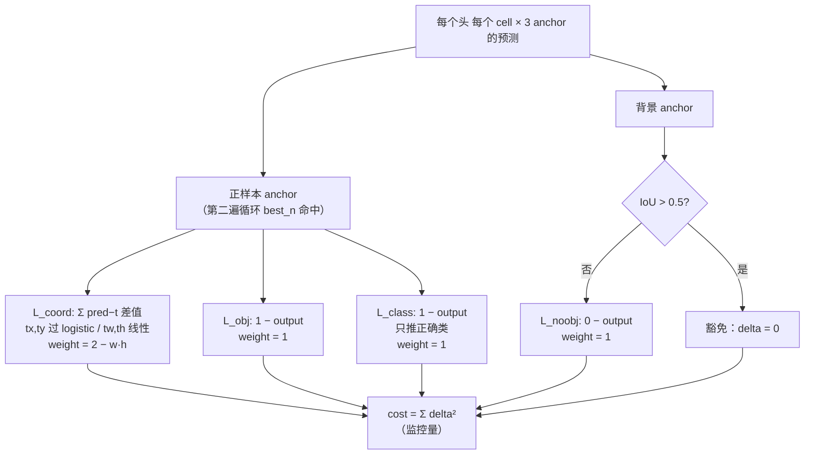
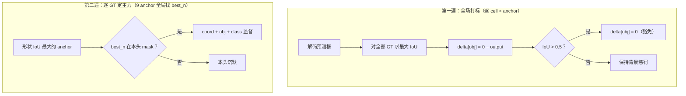

# YOLOv3 损失函数

YOLOv3 的损失在快照代码里**仍是 sum-squared error 的 delta 形式**，全部在 <SrcLink file="v3:src/yolo_layer.c" :line="132" /> 的 `forward_yolo_layer()` 中计算；`cost = Σ delta²`（<SrcLink file="v3:src/yolo_layer.c" :line="238" />）。

> ⚠️ **论文与代码的著名分歧**：论文写 *"During training we use binary cross-entropy loss for the class predictions"*，但快照里没有任何 BCE 项——只有形如 `delta = (target − output)` 的差值。巧的是，**对 logistic 输出而言，BCE 对 logits 的梯度恰好就是 `output − target`**，所以这份 delta 在"梯度语义"上与 BCE 一致，只是 `cost` 的数值口径仍是 SSE。

$$L_{total} = L_{coord} + L_{obj} + L_{noobj} + L_{class} \qquad \text{（权重不再走 cfg，硬编码进代码）}$$

**与 v2 的 4 点关键差异**：

| 项 | v2 | v3 |
|----|----|----|
| 四项 scale 权重 | cfg 里 coord=1/obj=5/noobj=1/cls=1 | **全删，硬编码；坐标权重动态化** |
| 坐标权重 | 统一 1 | **scale = 2 − truth.w × truth.h（小框加权）** |
| objectness 目标 | `rescore=1` 时用实时 IoU | **固定 1，rescore 参数消失** |
| 类别梯度 | softmax 交叉熵式，命中即推 | **logistic，objectness-gated 只推正确类** |

## 全景图



## 1. 坐标回归 L2 (`loss-coord-l2`)

> **v2 读者路标**：v2 的坐标 delta 乘了 logistic 梯度 σ′（[v2 losses §1](/versions/v2/losses#_1-坐标回归-l2-loss-coord-l2)）；v3 **不乘 σ′**，而且权重从常数 1 变成按 GT 面积动态变化的 `2 − w·h`。

**公式**：

$$L_{coord} = \sum_{best} \big(2 - w_{gt} \cdot h_{gt}\big) \Big[ (y_{tx}-t_x)^2 + (y_{ty}-t_y)^2 + (y_{tw}-t_w)^2 + (y_{th}-t_h)^2 \Big]$$

**白话**：网络输出的 tx/ty 已过 sigmoid（值域 0~1），tw/th 是相对 anchor 的对数缩放（线性）。目标值与 v2 完全同构：`tx = truth.x×lw − i`、`tw = log(truth.w×net.w / anchor_w)`。

**要点**：

- **动态权重 `2 − truth.w × truth.h`**：GT 面积占比越小，权重越接近 2（大框最低 1.19）——把 v2 靠 √w√h / log 实现的"大小目标均衡"再加一层显式加权（<SrcLink file="v3:src/yolo_layer.c" :line="190" />、<SrcLink file="v3:src/yolo_layer.c" :line="219" />）
- **delta 不乘 σ′**：<SrcLink file="v3:src/yolo_layer.c" :line="103" :end="106" /> 是 `scale × (t − y)`，而 y 是激活后的值——相比严格 MSE 推导少了 `σ′` 因子（v2 有），详见[反向传播 §4](/versions/v3/loss-gradient)
- 目标计算 <SrcLink file="v3:src/yolo_layer.c" :line="98" :end="101" />：无 v2 的 `DOABS` hack，直接用 `truth.w × net.w / anchor_w`

**源码对应**：

<SrcSnippet file="v3:src/yolo_layer.c" :start="93" :end="108" hl="96-101,103-106" />

::: details 逐行注释（L93–L108）
- **L95**：解码当前预测框（tx/ty 已在 forward 开头过 logistic，这里 `x[...]` 拿到的是激活后的值）。
- **L96**：`iou = box_iou(pred, truth)`——只返回给调用方算日志（avg_iou/recall），不进坐标梯度。
- **L98-99**：中心目标 = GT 相对格子左上角的偏移（0~1 之间）。
- **L100-101**：宽高目标 = GT 像素宽高 ÷ anchor 宽高再取 log——"这个框是 anchor 的几倍大"。
- **L103-106**：delta = `scale × (目标 − 预测)`。`scale` 由调用方传入 `(2 − truth.w×truth.h)`；注意没有乘 logistic 梯度（v2 有）——梯度直接对激活前的 logits 生效，是 darknet 的实用主义简化。
:::

## 2. Objectness L2 (`loss-object-l2`)

> **v2 读者路标**：v2 的 objectness 目标默认 1、`rescore=1` 时覆盖为实时 IoU；v3 快照 **rescore 参数彻底消失**，目标固定为 1。

**公式**：

$$L_{obj} = \big(1 - y_{obj}\big)^2 \quad \text{（仅正样本 anchor）}$$

**白话**：正样本的 objectness 被推向 1。v2 让 confidence 兼职表达定位质量（目标=IoU），v3 放弃了这个设计——定位质量交给坐标项 + 动态权重，objectness 回归纯粹的"有没有"。

**源码对应**（第二遍循环，正样本写 obj delta）：

<SrcSnippet file="v3:src/yolo_layer.c" :start="218" :end="224" hl="219,221-223" />

::: details 逐行注释（L218–L224）
- **L219**：`delta_yolo_box(..., (2-truth.w*truth.h), ...)`——坐标监督 + 动态权重一次完成，返回的 IoU 用于 recall 统计。
- **L221**：定位 objectness 槽位。
- **L223**：`delta = 1 − output`——目标固定 1，无 rescore、无 scale 系数、无 σ′。对 logistic 而言这恰好是 BCE 对 logits 的正确梯度形（`output − target` 的反号）。
:::

## 3. No-Object L2 + ignore_thresh 豁免 (`loss-noobject-l2`)

> **v2 读者路标**：v2 对所有非 best_n anchor 写 `0 − output`（无 0.5），另有 IoU 阈值豁免；v3 把"先全场罚、再豁免"拆成独立的第一遍循环，豁免阈值从 `thresh` 改名 `ignore_thresh`。

**公式**：

$$L_{noobj} = \big(y_{obj} - 0\big)^2 \quad \text{（背景 anchor，IoU} \le 0.5 \text{）}$$

**白话**：第一遍循环把每个 anchor 都"有罪推定"为背景推向 0；但如果它的预测框和某个 GT 的 IoU 超过 `ignore_thresh=0.5`，delta 清零——**预测得好但没被选为主力的框不受惩罚**，避免自相矛盾（同一个框既被 noobj 罚又被 best_n 奖）。

**源码对应**（第一遍循环核心 6 行）：

<SrcSnippet file="v3:src/yolo_layer.c" :start="176" :end="183" hl="178-181" />

::: details 逐行注释（L176–L183）
- **L178**：`delta = 0 − output`——默认背景惩罚。注意没有系数 0.5（v2 的 noobject_scale=1 同样无 0.5，v1 才是 0.5）。
- **L179-181**：`best_iou` 是该预测框对**全部 GT** 的最大 IoU（L167-175 算出）。超过 `ignore_thresh=.5` 就把 delta 清零——这就是著名的 ignore 机制。
- **L182-183**：`truth_thresh` 分支想给高 IoU 的 anchor 额外监督，但 cfg 里 `truth_thresh=1` 而 IoU 恒 ≤ 1，**这段在默认配置下是死代码**。
:::

## 4. Class 损失（logistic 多标签）(`loss-class-logistic`)

> **v2 读者路标**：v2 的类 delta 是 `one-hot − softmax`（互斥）；v3 改独立 logistic，且**只推正确类**——其余 79 类保持 0。

**公式**：

$$\delta_{class} = 1 - y_{c^*} \quad \text{（仅正确类 } c^*\text{，且仅当 objectness 已激活）}$$

**白话**：多标签语义下，"是人"和"是女人"都要独立推向 1，其他类不该被推向 0（它们只是"未知"）。所以 delta 只写正确类的 `1 − output`，背景 anchor 对全部类沉默（objectness-gated 守卫，见 [concepts §5](/versions/v3/concepts#_5-objectness-gated-类别-delta-concept-objectness-gated-delta)）。

**源码对应**：

<SrcSnippet file="v3:src/yolo_layer.c" :start="111" :end="123" hl="114-118" />

::: details 逐行注释（L111–L123）
- **L114**：`if (delta[index])` 守卫——objectness 槽位的 delta 非零才继续（正样本才进这里）。
- **L115**：只对正确类写 `1 − output`。对 logistic 来说这正是 BCE 梯度的化简形：`dL/dz = output − target`（BCE），这里写的是其反号（delta 表示"下降方向"）。
- **L116**：`avg_cat` 统计正确类平均输出（日志）。
- **L119-122**：守卫不成立时的兜底（推全部 80 维 one-hot delta）——本快照两个调用点都在 obj delta 写入之后，**实际永远走 L115**。
:::

## 5. 目标分配（两遍循环）

v3 的 GT 分配比 v2 多一道"全场预扫描"：



- 第一遍 <SrcLink file="v3:src/yolo_layer.c" :line="159" :end="192" />；第二遍 <SrcLink file="v3:src/yolo_layer.c" :line="195" :end="236" />
- **没有 warmup**：v2 的 `seen < 12800` anchor 形状预训练分支（<SrcLink file="v2:src/region_layer.c" :line="243" />）在 v3 里不存在——9 个 anchor 分三头后，形状匹配已足够稳定
- GT 仍由"形状最匹配的头"独占（`mask_n >= 0` 才监督）——一个 GT 只训一个 anchor 的机制延续自 v2

## 6. cost 与"真实 loss"的关系

<SrcLink file="v3:src/yolo_layer.c" :line="238" />：

```c
*(l.cost) = pow(mag_array(l.delta, l.outputs * l.batch), 2);
```

- `cost = Σ delta²` 只是**训练日志量**：delta 里已经混入动态权重、豁免置零，且缺 σ′ 因子，它不是严格意义的标量 loss
- 真正反传的是 `l.delta` 本身（`backward_yolo_layer` 直接 axpy 回 <SrcLink file="v3:src/yolo_layer.c" :line="242" :end="245" />）
- 推理时 `if(!net.train) return`（<SrcLink file="v3:src/yolo_layer.c" :line="149" />）——整套分配逻辑只活在训练里

## 权重平衡总表

| 项 | v1 | v2 | v3 |
|----|----|----|----|
| Coord | 5（√ 空间） | 1（log 空间） | **2 − w·h（log 空间，动态）** |
| Object | 1（rescore=IoU） | 1（rescore=IoU） | **1（目标固定 1，rescore 移除）** |
| No-Object | 0.5 | 1 | 1（+ignore_thresh=.5 豁免） |
| Class | 1（裸线性 L2） | 1（softmax 交叉熵式） | 1（logistic，只推正确类） |

**一眼看懂的设计转向**：v1 用权重手工平衡 → v2 调 noobj 到 1 + rescore → v3 砍掉一切可调权重，把均衡逻辑**写死**（动态坐标权重 + ignore 豁免 + gated 类别）。超参越少，社区复现越稳。

## 与其他页的链接

- [概览](/versions/v3/index)
- [论文精读](/versions/v3/paper)
- [理论 Concept](/versions/v3/concepts)
- [架构与层](/versions/v3/layers)
- [训练技巧](/versions/v3/tricks)
- [反向传播推导](/versions/v3/loss-gradient)
- [源码走读](/versions/v3/code-walkthrough) — yolo_layer.c 逐段解析
- [痛点追踪](/versions/v3/painpoints)
