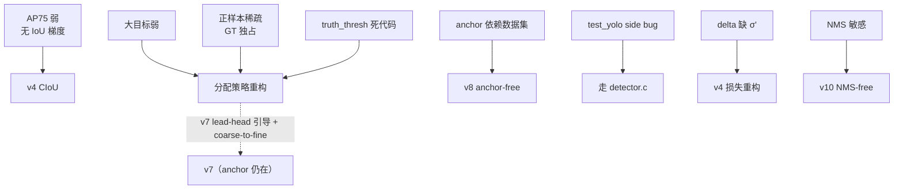

# YOLOv3 痛点追踪

YOLOv3 用三尺度头 + 残差骨干大幅提升了 AP50 和小目标召回，但也引入/暴露了 8 个痛点。这一页追踪每个痛点的：表现、根因、跨版本修复路径。**带"快照"标记的是代码级事实**，均可在本仓快照中复核。

## 8 个痛点全景

| 痛点 | 严重度 | 后续解法 | 修复版本 |
|------|--------|---------|---------|
| AP75 弱：坐标损失仍无 IoU 直接梯度 | High | CIoU loss | v4 |
| 大目标召回弱（论文自认） | Medium | 更强骨干 + 分配策略重构 | v4+ |
| GT 单 anchor 独占，正样本极度稀疏 | High | 动态分配（OTA/SimOTA） | v4/v5/v7 |
| anchor 先验依赖数据集 | Medium | anchor-free | v8 / v10 |
| test_yolo 用未初始化的 `l.side`（快照 bug） | Medium（代码） | 推理走 detector.c | 社区后续 commit |
| 坐标 delta 缺 σ′（快照） | Medium（代码） | 损失重构 + 激活后移 | v4 |
| truth_thresh=1 监督分支是死代码（快照） | Low（代码） | 删除/启用阈值 | 社区后续 commit |
| NMS 阈值敏感（遗留自 v1） | Medium | NMS-free | v10 |

> **v4 路标**：表中 AP75、GT 独占、坐标 delta 三行在 v4 都有答案——CIoU loss、multi-positive 多正样本、scale_x_y 消网格敏感（见 [v4 痛点追踪](/versions/v4/painpoints)）。
>
> **v5 路标**："GT 单 anchor 独占"在 v5 被多正样本分配彻底打破——wh 比例 + 邻居偏移，一个 GT 可产生最多 15 个正样本（见 [v5 痛点追踪](/versions/v5/painpoints)）。

> **v6 路标**：多正样本思想在 v6 演进为 TAL——不再按 IoU 阈值一刀切，而是用"分类分数 × IoU"对齐度量选 top-13，并据此生成分类软标签（见 [v6 痛点追踪](/versions/v6/painpoints)）。

> **v8 路标**：多正样本这条线走到 v8 的 TAL——"分类分数 × CIoU"对齐度量取 top-10，归一化度量写成分类软标签；"AP75 弱"由 CIoU + DFL 分布回归继续推（见 [v8 痛点追踪](/versions/v8/painpoints)）。

---

## 1. AP75 弱：坐标损失仍无 IoU 直接梯度 (`pain-no-iou-gradient`)

**表现**：论文自己承认 *"YOLOv3 is a good detector, it is not the strongest"*——AP50 与 SSD 持平，但 AP75 落后 RetinaNet 约 3-4 点；框"大致对"但边缘不准。

**根因**：
- 坐标损失仍是 L2 家族：`delta_yolo_box`（<SrcLink file="v3:src/yolo_layer.c" :line="93" />）算的是 `(target − output)`，IoU 只用于**选 anchor**（<SrcLink file="v3:src/yolo_layer.c" :line="203" :end="214" />）和**日志统计**（<SrcLink file="v3:src/yolo_layer.c" :line="234" />）
- IoU 本身**从不直接微分**流入坐标——v1/v2/v3 三代一贯的结构性问题

**跨版本修复**：

| 版本 | 尝试 | 是否解决 |
|------|------|---------|
| v3 | 动态权重 2−w·h | ⚠️ 只帮小目标，不帮定位精度 |
| v4 | CIoU loss（重叠+中心距+宽高比直接进损失） | ✅ 解决 |
| v5+ | GIoU/DIoU/CIoU 家族 | ✅ 标配 |

**教训**：v3 的 `2−w·h` 是在 L2 框架内打补丁；真正的答案是让 IoU 可微。

---

## 2. 大目标召回弱 (`pain-large-object-weak`)

**表现**：AP<sub>L</sub> 落后 SSD/RetinaNet；论文甚至调侃 *"Don't try to detect large objects"* 式的反直觉现象。

**根因**：
- 13×13 头只有 3 个大 anchor（116,90 / 156,198 / 373,326，<SrcLink file="v3:cfg/yolov3.cfg" :line="609" />），大 GT 的形状匹配命中有限
- GT 独占分配（见 §3）：一个大目标只训 1 个 anchor，而小目标在 52×52 头有海量候选
- anchor 是相对全图归一化的：对超大框，9 个先验都"不够大"时误差只能靠 exp 撑

**跨版本修复**：

| 版本 | 尝试 | 是否解决 |
|------|------|---------|
| v4 | 更大分辨率 + CIoU | ⚠️ 缓解 |
| v5/v7 | 更多 anchor / P2 支路 | ⚠️ 缓解 |
| 分配策略重构（v4 OTA） | 跨 anchor 动态分配 | ✅ 大幅缓解 |

---

## 3. GT 单 anchor 独占，正样本极度稀疏 (`pain-sparse-positives`)

**表现**：收敛慢、对小数据集容易欠拟合；每个头 507 个候选通常只有个位数正样本。

**根因**：
- 第二遍循环给每个 GT 只找 **1 个** best_n（9 anchor 全局），且 mask 不命中就整头沉默（<SrcLink file="v3:src/yolo_layer.c" :line="216" :end="217" />）
- `2 − w·h` 权重 + ignore 豁免都只是"单正样本框架"下的补偿

**跨版本修复**：

| 版本 | 尝试 | 是否解决 |
|------|------|---------|
| v4 | 静态多正样本 + OTA 动态分配 | ✅ |
| v7 | SimOTA（按成本动态扩正样本） | ✅ |

**快照佐证**：论文 "Things That Don't Work" 里试过**双 IoU 阈值分配**并报告不稳定——作者已经意识到单独占太苛刻，但没找到稳定方案。

---

## 4. Anchor 先验依赖数据集 (`pain-anchor-dataset-bias`)

**表现**：换数据集就要重跑 K-means 重填 `anchors`（COCO 聚出的 9 组对自建数据不一定合适），否则 mAP 掉点。

**根因**：
- 9 组 anchor 硬编码在 cfg（<SrcLink file="v3:cfg/yolov3.cfg" :line="609" />）
- 形状匹配完全由 anchor 决定（v2 bias_match 思想的延续，<SrcLink file="v3:src/yolo_layer.c" :line="203" :end="214" />），先验不准则分配全错

**跨版本修复**：

| 版本 | 尝试 | 是否解决 |
|------|------|---------|
| v3 | 9 anchor 三尺度分担 | ⚠️ 缓解 |
| v8 / v10 | anchor-free（中心点/角点回归） | ✅ 解决 |

---

## 5. 快照 bug：test_yolo 用未初始化的 `l.side` (`pain-test-yolo-side-bug`)

**表现（代码级）**：<SrcLink file="v3:examples/yolo.c" :line="265" /> 的 `test_yolo()`：

```c
layer l = net->layers[net->n-1];                      // 最后一层是 yolo 层
...
if (nms) do_nms_sort(dets, l.side*l.side*l.n, l.classes, nms);   // L295
draw_detections(im, dets, l.side*l.side*l.n, thresh, ...);       // L297
```

`make_yolo_layer`（<SrcLink file="v3:src/yolo_layer.c" :line="13" />）**从不赋值 `l.side`**（整个文件无 side 字样），calloc 出来是 0——`0×0×3=0`：

- `do_nms_sort` 收到 num=0 → **NMS 空转**
- `draw_detections` 收到 num=0 → **一张框都不画**

**根因**：`examples/yolo.c` 是 v1 时代 `darknet yolo` 命令的入口，v2/v3 里已半废弃——真正的推理走 `darknet detector test`（`examples/detector.c` 的 `test_detector`），那里用 `get_network_boxes` 返回的 `nboxes`。这与 v2 快照同位置的 detection_layer 强转 bug 同源（见 [v2 痛点 §5](/versions/v2/painpoints#_5-快照-bug-test-yolo-残留-detection-layer-强转-pain-test-yolo-cast-bug)）。

**教训**：读 v2/v3 源码别拿 `examples/yolo.c` 的 test_yolo 当"官方推理路径"——它是祖传死代码。

---

## 6. 快照事实：坐标 delta 缺 σ′，损失是 BCE/MSE 混合体 (`pain-mixed-gradient-semantics`)

**表现（代码级）**：
- forward 开头把 tx/ty/obj/class **原地**过 sigmoid（<SrcLink file="v3:src/yolo_layer.c" :line="141" :end="143" />）
- delta 直接 `scale × (target − 激活后值)`（<SrcLink file="v3:src/yolo_layer.c" :line="103" :end="106" />），backward 一次 axpy（<SrcLink file="v3:src/yolo_layer.c" :line="242" :end="245" />）
- 数学后果：obj/class 的 `t − p` 恰好是 **BCE 对 logits 的严格梯度**（σ′ 被 1/p 消掉，见[推导 §4](/versions/v3/loss-gradient#_4-obj-项-bce-梯度的-巧合严格)）；但坐标 tx/ty 少乘 σ′——不是 MSE 的无偏梯度

**根因**：v2 的做法是 delta 显式乘 `logistic_gradient`；v3 把激活前置后"忘了"补链式因子（或有意简化），并顺手把坐标权重的语义从 cfg（`coord_scale`）搬进代码（`2−w·h`）。

**跨版本修复**：

| 版本 | 尝试 | 是否解决 |
|------|------|---------|
| v4 | CIoU + BCE 组合，激活/损失彻底重构 | ✅ |
| v5 | BCE objectness + BCE class + CIoU box | ✅ |

**教训**：论文说 BCE、代码是"delta 混合体"——复现时以代码为准，别照论文抄公式。

---

## 7. 快照事实：truth_thresh=1 监督分支是死代码 (`pain-truth-thresh-dead`)

**表现（代码级）**：第一遍循环里的高 IoU 监督分支（<SrcLink file="v3:src/yolo_layer.c" :line="182" :end="191" />）条件是 `best_iou > l.truth_thresh`，cfg 里 `truth_thresh = 1`（<SrcLink file="v3:cfg/yolov3.cfg" :line="614" />）——而 IoU 恒 ≤ 1，分支**永不触发**。

**根因**：设计意图应该是"给高 IoU 的 anchor 额外奖励"（多正样本的雏形），但默认阈值配成了不可能值，等于代码在仓库里睡大觉。

**跨版本修复**：v4 的静态多正样本/OTA 才把"多 anchor 共训一个 GT"真正做对。**教训**：把这段死代码读成"v3 有两个监督分支"是二手资料的常见错误。

---

## 8. NMS 阈值敏感（遗留自 v1） (`pain-nms-sensitive`)

**表现**：密集场景（人群/车流）里相邻目标被误删；`nms=.4~.5` 的选择直接影响 mAP 1-2 点。

**根因**：
- `do_nms_sort`（<SrcLink file="v3:src/box.c" />）仍是贪心按类抑制——v1 逻辑原样沿用
- v3 的多尺度头让同一目标可能在相邻头都出框，对 NMS 的依赖反而更重

**跨版本修复**：Soft-NMS（v4 前后社区）、NMS-free（v10）。这是整个 anchor 时代共享的痛点。

---

## 痛点谱系图



---

## 延伸阅读

- [论文精读](/versions/v3/paper) — 论文自认短板的原文语境
- [损失函数](/versions/v3/losses) / [反向传播推导](/versions/v3/loss-gradient) — §1/§6 的详细数学
- [源码走读](/versions/v3/code-walkthrough) — 逐段复核所有快照事实
- [v2 痛点追踪](/versions/v2/painpoints) — 上游痛点全景
- [v7 痛点追踪](/versions/v7/painpoints) — v7 用 lead-head 引导 + coarse-to-fine 双头分配继续回应"正样本稀疏"
