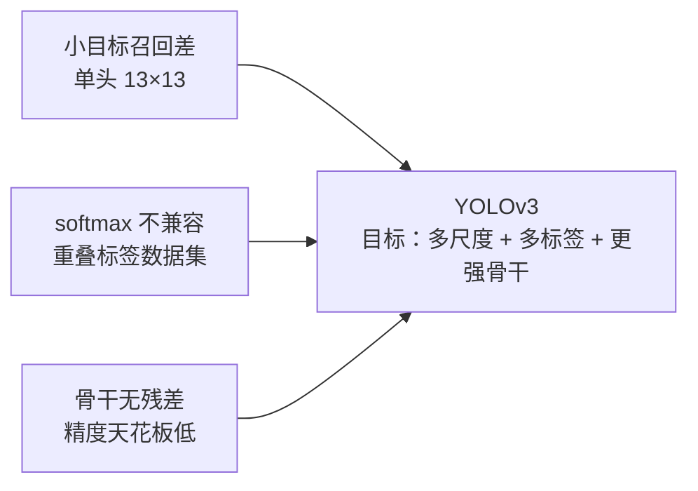
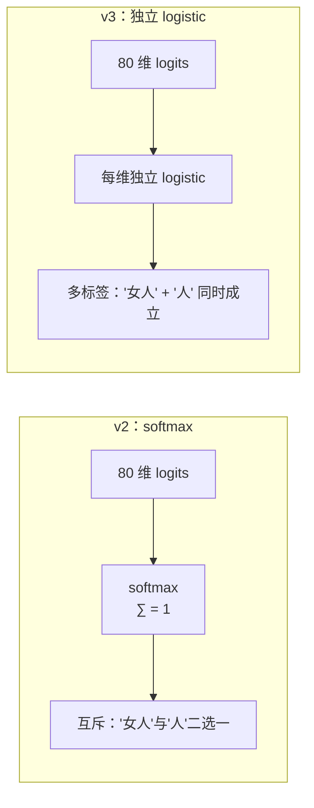
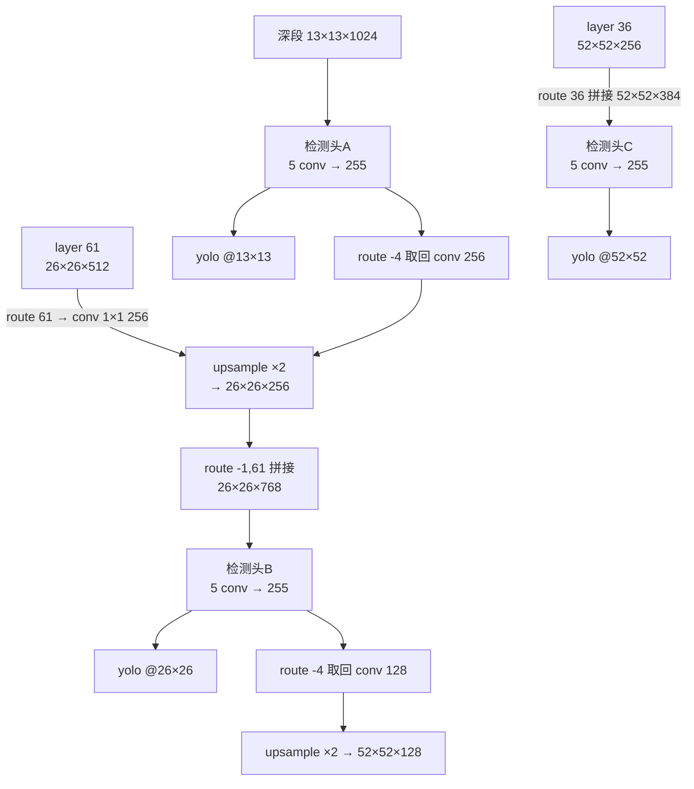
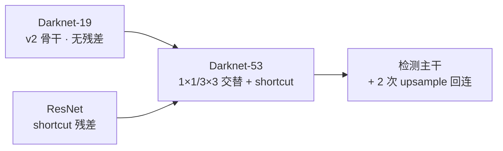

# YOLOv3 论文精读

**YOLOv3: An Incremental Improvement**

*Joseph Redmon, Ali Farhadi · arXiv 2018 · [arXiv:1804.02767](https://arxiv.org/abs/1804.02767)*

::: tip TL;DR：只想带走三件事
1. **三尺度头（FPN）是最大增量**：13/26/52 三个 yolo 头并联 + upsample 回连浅层，小目标召回显著改善。
2. **类头从 softmax 换成独立 logistic**：为 Open Images 式多标签数据集铺路；论文写 BCE loss，但快照代码仍是 SSE（[losses 页详解](/versions/v3/losses)）。
3. **Darknet-53 = Darknet-19 + 残差**：top-1 77.2% 追平 ResNet-101，速度快 1.5 倍；论文坦承 AP75 仍落后 RetinaNet，标题就叫"增量改进"。
:::

> **关于论文风格**：YOLOv3 论文只有 8 页正文，语气随意（开头一句 "We present some updates to YOLO!"），是系列里最"不正式"的一篇，但工程改动最多。

---

## 1. 为什么要"增量"？（Motivation）

2017-2018 年检测器格局：SSD 用多尺度特征图打得不错、RetinaNet 靠 focal loss 把 one-stage 推到 SOTA。v2 只有一个 13×13 检测头，**小目标召回是硬伤**。

论文的回应非常克制——三项主要改动：

| # | 改进 | 论文章节 |
|---|------|---------|
| 1 | 三尺度预测（FPN 风格回连） | Predictions Across Scales |
| 2 | 类别头 softmax → 独立 logistic | Class Prediction |
| 3 | Darknet-53 残差骨干 | Feature Extractor |

---

## 2. Bounding Box Prediction：anchor 机制延续

v2 的 anchor + offset 方案整体保留：每个 yolo 头的每个格子预测 3 个框，网络输出 4 个偏移量，解码公式与 v2 同构（快照 `get_yolo_box`，<SrcLink file="v3:src/yolo_layer.c" :line="83" :end="91" />）：

$$b_x = \sigma(t_x) + c_x \qquad b_y = \sigma(t_y) + c_y$$

$$b_w = p_w \cdot e^{t_w} \qquad b_h = p_h \cdot e^{t_h}$$

其中 \( (c_x, c_y) \) 是格子的左上角坐标，\( (p_w, p_h) \) 是 anchor 先验宽高。

**与 v2 的两处不同**（快照事实，论文未细说）：

1. **9 个 anchor 三组共享**：K-means 聚 9 类，按大小均分给三个头（mask 6,7,8 / 3,4,5 / 0,1,2，<SrcLink file="v3:cfg/yolov3.cfg" :line="608" :end="609" />）。论文原话：*"We picked 9 clusters and 3 scales and then split up the clusters evenly across the scales."*
2. **激活分工变了**：快照里 tx/ty 过 [logistic](/glossary#logistic-激活)，objectness 和 80 类也全过 logistic，而 tw/th 保持线性（<SrcLink file="v3:src/yolo_layer.c" :line="141" :end="143" />）——这与 v2 的 region 层一致，但 v2 的 wh 是 sigmoid 后 exp，v3 快照直接线性 exp。

**objectness 用 logistic 独立打分**：论文原文 *"YOLOv3 predicts an objectness score for each bounding box using logistic regression"*——每个 anchor 独立判断"框里有没有东西"，不再是 v1 的"每格共享一个置信度"。

---

## 3. Class Prediction：softmax 的退场

这是 v3 在**输出语义层面**最大的一次改动。

**动机**：数据集标签开始重叠（Open Images 里 "Woman" 和 "Person" 都是 GT）。softmax 强制类别互斥，会压制多标签学习。论文原文：*"This formulation helps when we get to more complex domains like the Open Images Dataset."*

**论文与快照的一个著名分歧**：论文写 *"During training we use binary cross-entropy loss for the class predictions"*，但快照 `delta_yolo_class`（<SrcLink file="v3:src/yolo_layer.c" :line="111" :end="123" />）实际算的仍是 **SSE 形式的 delta**（`delta = 1 − output`），没有任何 BCE 项。这套代码是"官方实现与论文不完全一致"的典型例子，[losses 页](/versions/v3/losses)逐行拆解。

**objectness-gated 类别 delta**：快照里 `delta_yolo_class` 开头有 `if (delta[index])` 分支——**只有该 anchor 的 objectness delta 非零（即这个框被判定有目标）时，才推送类别梯度**，且只推正确类的 `1 − output`，其余类不动；objectness 为零的 anchor 对全部 80 类保持沉默。这是 v3 对 v2 类别梯度的一大精简。

---

## 4. Predictions Across Scales：FPN 的检测器化

三个尺度并行出框：

| 头 | 层号 | 特征图 | anchor mask | 负责的框 |
|----|------|--------|-------------|---------|
| A | layer 94 | 13×13 | 6,7,8 | 大目标 |
| B | layer 105 | 26×26 | 3,4,5 | 中目标 |
| C | layer 116 | 52×52 | 0,1,2 | 小目标 |

**回连方式**（cfg 事实）：

- 每次上采样后 **concat**（不是相加）浅层特征：26×26 头拼 256+512=768 通道，52×52 头拼 128+256=384 通道
- 三个头各自输出 255 = 3×(4+1+80)，共 9 个 anchor 全集
- 论文自己也点明这是 SSD/特征金字塔思路的变体

**为什么三头能救小目标**：v2 的小目标要"活过" 5 次下采样才能被 13×13 看到；v3 的 52×52 头只离输入 3 次下采样（416/8），细粒度特征保留完整。

源码定位：cfg 回连 <SrcLink file="v3:cfg/yolov3.cfg" :line="618" :end="633" />（第一处）与 <SrcLink file="v3:cfg/yolov3.cfg" :line="705" :end="720" />（第二处）。

---

## 5. Feature Extractor：Darknet-53

- **结构**：stem 1 conv + 5 段。每段 = 1 个 stride-2 卷积 + N 个残块（1/2/8/8/4），残块 = 1×1 降维 + 3×3 升维 + shortcut（两输入相加）。全网 52 conv + 23 shortcut，检测完整网络 107 层（[architecture 页逐层盘点](/versions/v3/architecture)）
- **分类成绩**（ImageNet，Titan X，256×256）：top-1 **77.2%**、top-5 93.8%、**78 FPS**——ResNet-101 是 77.1%、53 FPS，ResNet-152 是 77.6%、32 FPS
- 论文原话：*"Our network uses successive 3×3 and 1×1 convolutional layers but now has shortcut connections"*，并自嘲起名：*"so we call it.... wait for it..... Darknet-53!"*
- **性价比**：论文结论是 Darknet-53 "与 ResNet-101 精度相同、快 1.5 倍"，换来检测头在高分辨率输入下仍能维持实时

---

## 6. Training：多尺度 + 增强全套

论文对训练细节着墨很少（"we use a darknet neural network framework"），真实超参都在快照 cfg 里：

| 超参 | 值 | cfg 行 |
|------|-----|--------|
| momentum / decay | 0.9 / 0.0005 | <SrcLink file="v3:cfg/yolov3.cfg" :line="11" :end="12" /> |
| burn_in | 1000（前 1000 iter 线性升温） | <SrcLink file="v3:cfg/yolov3.cfg" :line="19" /> |
| learning_rate | 0.001 | <SrcLink file="v3:cfg/yolov3.cfg" :line="18" /> |
| max_batches | 500200 | <SrcLink file="v3:cfg/yolov3.cfg" :line="20" /> |
| steps / scales | 400000,450000 / ×0.1 | <SrcLink file="v3:cfg/yolov3.cfg" :line="22" :end="23" /> |
| 色彩增强 | hue=0.1 / saturation=1.5 / exposure=1.5 | <SrcLink file="v3:cfg/yolov3.cfg" :line="14" :end="16" /> |
| 多尺度训练 | random=1（每 10 batch 重摇输入尺寸） | <SrcLink file="v3:cfg/yolov3.cfg" :line="615" /> |

**与 v2 的训练差异**：jitter 从 0.2 加大到 **0.3**；`random=1` 让多尺度训练内置（每批随机 320-608），不再依赖脚本改 cfg；色彩增强三件套在数据路径真实生效（v1 快照未调用）。细节见 [tricks 页](/versions/v3/tricks)。

---

## 7. Things That Don't Work：论文自己列的失败实验

YOLOv3 论文有一整节自曝失败案例，非常珍贵：

1. **线性激活直接回归 box 偏移**：试过用线性激活把 \(x, y\) 偏移直接作为格子宽高的倍数预测（绕过 sigmoid），**mAP 下降**——sigmoid 约束偏移到格子邻域的方案胜出。
2. **Focal loss**：为解决前景/背景失衡试了 focal loss，结果 **mAP 降了约 2 点**。论文原文 *"We're still not sure why this is the case"*——作者猜测 YOLOv3 的 anchor 分配机制本身已经缓解了失衡。
3. **双 IoU 阈值分配（dual IoU thresholds）**：试过用两个 IoU 阈值做正负样本分配，**训练不稳定**。

> 这三条几乎预言了后来社区的全部探索方向：v4 放弃 focal loss（改用 CIOU + BCE）、标签分配策略成为 v4/v5/v7 的主战场。

---

## 8. 自我评价："not the strongest"

论文在结果部分罕见地自曝短板：

- **AP50 很强，IoU 阈值一高就掉**：论文原话 *"YOLOv3 is a good detector, it is not the strongest"*——定位"够用"，但框的回归精度（AP75）落后 RetinaNet 约 3-4 点
- **大目标反而弱**：论文提到 *"Don't try to detect large objects"* 式的调侃——APL 不如 SSD/RetinaNet，作者归因于 anchor 先验与多尺度分配的匹配方式
- **小目标进步显著**：APS 相比 v2/SSD 明显提升，归功于 52×52 头

| 指标段 | 表现 | 原因 |
|--------|------|------|
| AP50 | 强（与 SSD 持平，快 3 倍） | 语义判断容易，多尺度头足够 |
| AP75 | 弱 | SSE loss 对高 IoU 梯度弱 |
| APS | 强 | 52×52 头细粒度特征 |
| APL | 弱 | 大 anchor 数量少（3 个） |

---

## 9. 指标记录

**检测（COCO test-dev，Titan X）**：

| 模型 | AP | AP50 | 延迟 |
|------|-----|----------------|------|
| YOLOv3-320 | 28.2 | 51.5 | 22 ms |
| YOLOv3-416 | 31.0 | 55.3 | 29 ms |
| YOLOv3-608 | **33.0** | **57.9** | 51 ms |

**分类（ImageNet，Titan X）**：Darknet-53 top-1 77.2 / top-5 93.8 / 78 FPS。

**历史位置**：one-stage 检测器第一次在 COCO 上同时做到"实时 + AP50 50+"；此后社区改进（v4/v5）都建立在三尺度头 + anchor 回归这套 v3 框架之上。

---

## 延伸阅读

- [理论 Concept](/versions/v3/concepts)
- [Architecture 逐层图解](/versions/v3/architecture)
- [损失函数（论文 BCE vs 代码 SSE 之谜）](/versions/v3/losses)
- [痛点追踪](/versions/v3/painpoints)
