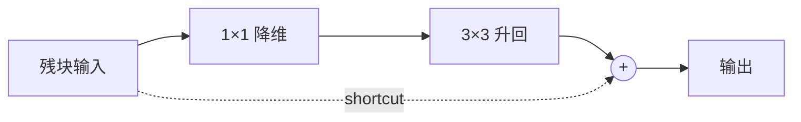
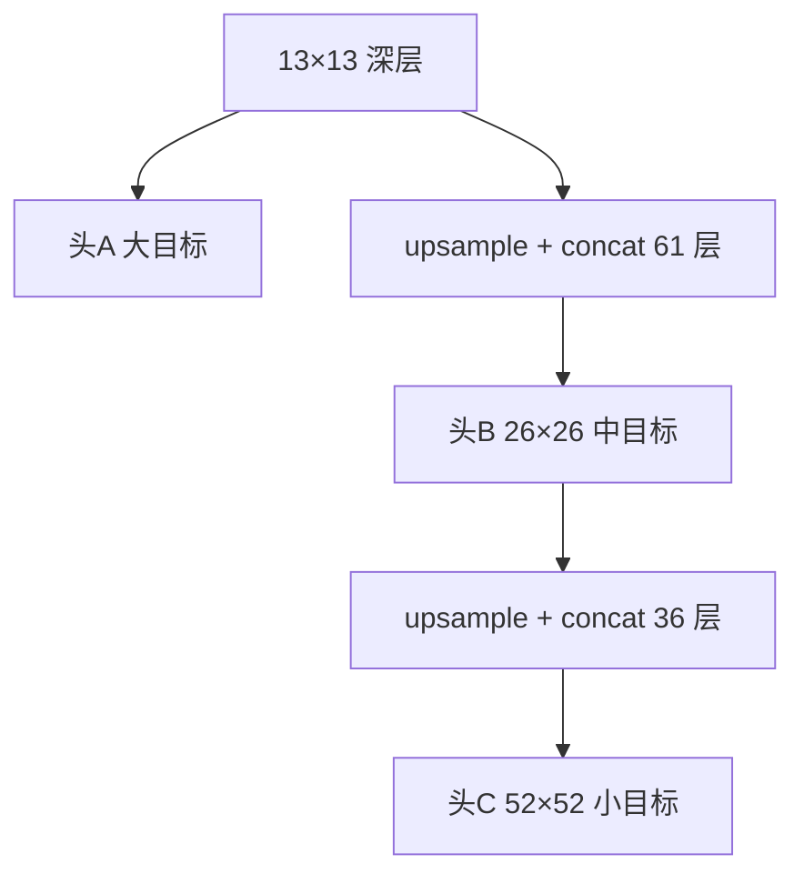
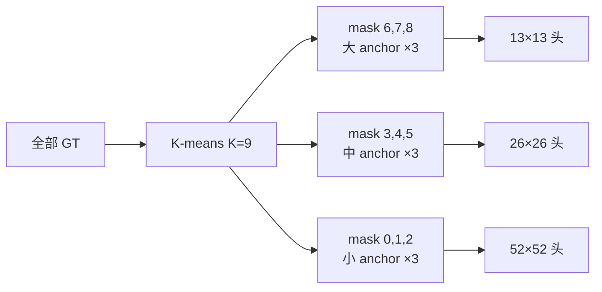
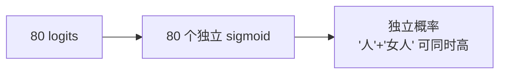
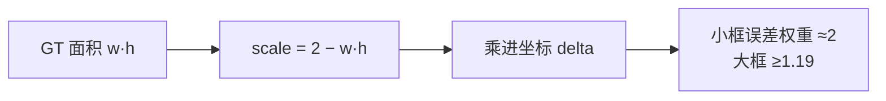
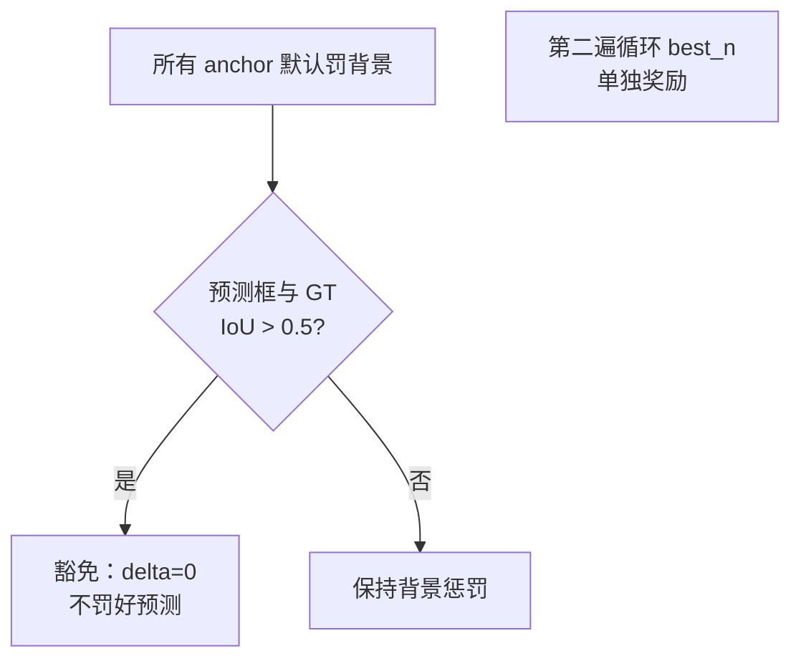
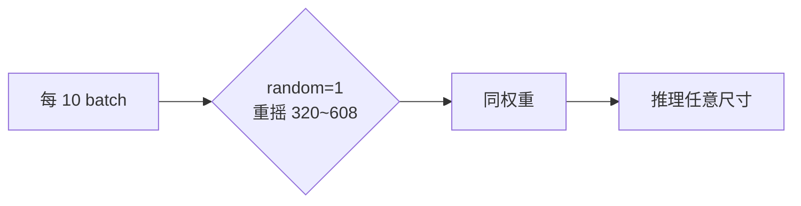
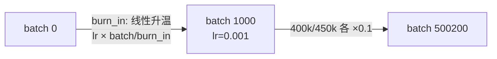
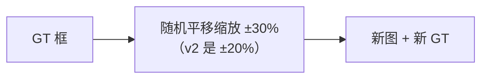
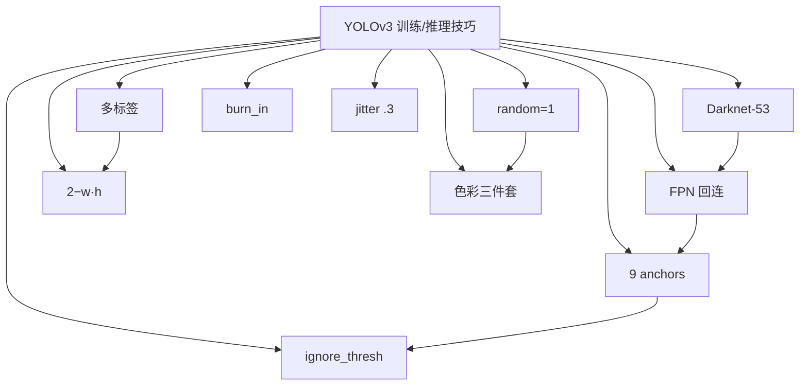

# YOLOv3 训练与推理技巧

YOLOv3 的关键 knob 一半在 `cfg/yolov3.cfg`、一半**写死进源码**（这是 v3 的明显哲学变化）。每个 trick 都配：**原理图、白话、源码、演进**。

---

## 全部 10 个 Trick 速查

| # | Trick | 类别 | 位置 | 与 v2 对比 |
|---|-------|------|------|-----------|
| 1 | Darknet-53 残差骨干 | 结构 | `yolov3.cfg` 层 4+ | 新增 shortcut |
| 2 | FPN 三头回连 | 结构 | route+upsample | 替代 reorg |
| 3 | 9 anchors 三组 mask | 先验 | `anchors`+`mask` | 5→9 个 |
| 4 | 多标签 logistic 类头 | 分类 | yolo_layer.c | softmax 删除 |
| 5 | 动态坐标权重 2−w·h | 损失 | yolo_layer.c | 统一权重→动态 |
| 6 | ignore_thresh 豁免 | 损失 | `ignore_thresh=.5` | thresh→ignore_thresh |
| 7 | 多尺度训练内置 | 增强 | `random=1` | 0→1 |
| 8 | 色彩增强三件套 | 增强 | hue/sat/exposure | 从死参数变生效 |
| 9 | burn_in + steps 调度 | LR | `burn_in=1000` | 延续+明确 |
| 10 | jitter 加大 | 增强 | `jitter=.3` | .2→.3 |

> **v2 读者路标**：v2 的 9 个 trick 里有 4 个在 v3 **消失**——12800 anchor warmup、rescore、四项 scale 权重、softmax 类头。v3 的思路是"能写死就写死"，把超参空间砍到最小（详见本页末尾"移除的 knob"）。

---

## 1. Darknet-53 残差骨干 (`trick-darknet53`)

### 原理图

### 白话

> 107 层敢训，靠的是 23 个 shortcut 给梯度开"高速公路"。v2 的 Dense 变体串联堆叠到深处梯度衰减明显；v3 每段塞残块，越深越好训。**骨干加深是三尺度头的前提**——没有更强的特征提取，多出两个头也提不出更好的特征。

### 源码

第一个 shortcut <SrcLink file="v3:cfg/yolov3.cfg" :line="59" />；残块展开见 [Architecture §2](/versions/v3/architecture#_2-逐层明细表-按快照-cfg-顺序-共-107-层)。

### 演进

残差成为 v4-v8 骨干标配；CSPDarknet（v4/v5）本质是残差 + 跨阶段部分连接的再优化。

---

## 2. FPN 三头回连 (`trick-fpn`)

### 原理图

### 白话

> v2 的 reorg 是"把浅层细节搬下来"；v3 反过来"把深层语义送上去"。52×52 头只离输入 3 次下采样，小目标特征完整。**小目标 AP 的主要功臣**。

### 源码

<SrcLink file="v3:cfg/yolov3.cfg" :line="618" :end="633" />（第一处）与 <SrcLink file="v3:cfg/yolov3.cfg" :line="705" :end="720" />（第二处）：

<SrcSnippet file="v3:cfg/yolov3.cfg" :start="618" :end="633" hl="618-619,632-633" />

### 演进

v4 加 PANet 式自底向上再聚合（PAN）；v5/v7/v8 全部保留三头。

---

## 3. 9 Anchors 三组 mask (`trick-anchors-9`)

### 原理图

### 白话

> anchor 从 5 个扩到 9 个、三头各认领 3 个。匹配时 9 个 anchor **全局**找形状最像的（<SrcLink file="v3:src/yolo_layer.c" :line="203" :end="214" />），GT 自然按尺度分流到对应的头。

### 源码

<SrcLink file="v3:cfg/yolov3.cfg" :line="607" :end="615" />：

<SrcSnippet file="v3:cfg/yolov3.cfg" :start="607" :end="615" hl="608-609,613" />

### 演进

9 anchors 三头配置成为事实标准，v5/v7 原样沿用；anchor-free 路线（FCOS/CenterNet）从 v8 前后开始分叉。

---

## 4. 多标签 logistic 类头 (`trick-multi-label`)

### 原理图

### 白话

> Open Images 式重叠标签让 softmax 互斥失效。v3 每类独立 sigmoid，训练时只推正确类（objectness-gated）。

### 源码

激活 <SrcLink file="v3:src/yolo_layer.c" :line="143" />；梯度 <SrcLink file="v3:src/yolo_layer.c" :line="111" :end="123" />：

<SrcSnippet file="v3:src/yolo_layer.c" :start="111" :end="123" hl="114-118" />

### 演进

多标签 sigmoid 头成为 v4-v8 标配；softmax 只在 hier/YOLO9000 场景还魂。

---

## 5. 动态坐标权重 2−w·h (`trick-dynamic-scale`)

### 原理图

### 白话

> 小框在图里占比小，一个像素的偏差相对更致命。v3 把 GT 面积反比权重**硬编码**进坐标 delta（v2 是统一 1），小目标的定位学习被隐性加强。

### 源码

<SrcLink file="v3:src/yolo_layer.c" :line="190" /> 与 <SrcLink file="v3:src/yolo_layer.c" :line="219" />：

<SrcSnippet file="v3:src/yolo_layer.c" :start="218" :end="219" />

### 演进

这个 `(2 − w·h)` 因子被后来所有 darknet 系实现沿用；IoU 系 loss（v4 CIoU）出现后才被取代。

---

## 6. ignore_thresh 豁免 (`trick-ignore-thresh`)

### 原理图

### 白话

> "先有罪推定、再豁免"。防止"框得好但没被选为主力"的预测被背景惩罚误伤——这是 v3 训练稳定的关键之一。注意 `truth_thresh=1` 的姊妹分支因 IoU 恒 ≤1 是死代码。

### 源码

<SrcLink file="v3:src/yolo_layer.c" :line="178" :end="181" />：

<SrcSnippet file="v3:src/yolo_layer.c" :start="176" :end="183" hl="178-181" />

### 演进

ignore_thresh 沿用至今（v4-v8 全部保留）；它同时是社区最爱调的 knob 之一（调大→召回高，调小→精度高）。

---

## 7. 多尺度训练内置 (`trick-random`)

### 原理图

### 白话

> v2 的 `random=0` 要靠脚本改 cfg 重启；v3 的 `random=1` 内置生效，每 10 个 batch 换一次输入尺寸。配合三尺度头，每个头在各种输入下都被锻炼。

### 源码

<SrcLink file="v3:cfg/yolov3.cfg" :line="615" />；消费在 `src/detector.c` 的 `train_detector`（每 10 batch resize 网络）。

### 演进

v4+ 全保留；后来 v5 加了 min/max 批次锁尺度等细化。

---

## 8. 色彩增强三件套 (`trick-color-aug`)

### 原理图

### 白话

> v1 的 saturation/exposure 是死参数、v2 只有 hue；v3 的三件套全部在数据路径真实生效（`random_distort_image`）。光照色温鲁棒性白拿。

### 源码

<SrcLink file="v3:cfg/yolov3.cfg" :line="14" :end="16" />：

<SrcSnippet file="v3:cfg/yolov3.cfg" :start="14" :end="16" />

### 演进

mosaic（v4）之前，这套 jitter+翻转+色彩 就是 darknet 增强全家桶。

---

## 9. burn_in + steps LR 调度 (`trick-lr-schedule`)

### 原理图

### 白话

> 前 1000 iter 线性升温避免初始大梯度炸权重；40 万/45 万步各降 10 倍。`burn_in` 这个名字从此成为 darknet 系标配。

### 源码

<SrcLink file="v3:cfg/yolov3.cfg" :line="18" :end="23" />：

<SrcSnippet file="v3:cfg/yolov3.cfg" :start="18" :end="23" hl="18-19,22-23" />

### 演进

burn_in + steps 被 v4/v5 原样继承；cosine 调度是后来的补充。

---

## 10. jitter 加大到 0.3 (`trick-jitter-30`)

### 原理图

### 白话

> 裁剪幅度加大 50%，同一张图能出更多"目标大小/位置各异"的变体——配合多尺度训练，等价于免费扩充数据集。

### 源码

三个 yolo 段各写一次：<SrcLink file="v3:cfg/yolov3.cfg" :line="612" />（其余两段同）。消费在 `src/data.c` 的 `load_data_detection`。

### 演进

v4 用 mosaic（4 图拼接）彻底超越 jitter，但 jitter 仍保留。

---

## 移除的 knob（v2 有、v3 删）

| 移除项 | v2 位置 | v3 替代 |
|--------|---------|---------|
| 12800 anchor warmup | region_layer.c | **删除**——9 anchor 三头匹配已稳，无需占位预训练 |
| rescore | `rescore=1` | **删除**——objectness 目标固定 1，定位质量交给坐标项 |
| 四项 scale 权重 | coord/obj/noobj/class_scale | **删除**——硬编码（坐标项改动态 2−w·h） |
| softmax | `softmax=1` | **删除**——多标签 logistic |
| maxpool / reorg | 结构层 | **删除**——stride-2 conv 下采样 + upsample 上采样 |

**设计哲学的转向**：v2 时代"一切可调"（8 个 loss/分配 knob），v3 时代"能写死就写死"。超参越少，社区复现差异越小——这也是 v3 权重在不同环境下表现一致的原因。

---

## 10 个 Trick 的谱系图

---

## 延伸阅读

- [论文精读](/versions/v3/paper)
- [Architecture 逐层图解](/versions/v3/architecture)
- [理论 Concept](/versions/v3/concepts)
- [损失函数](/versions/v3/losses)
- [反向传播推导](/versions/v3/loss-gradient)
- [源码走读](/versions/v3/code-walkthrough)
- [痛点追踪](/versions/v3/painpoints)
