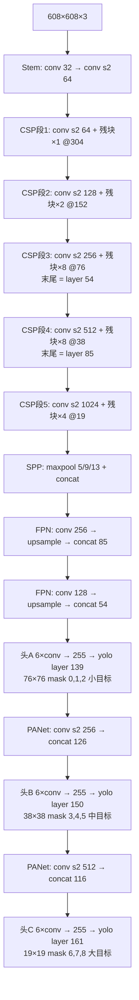
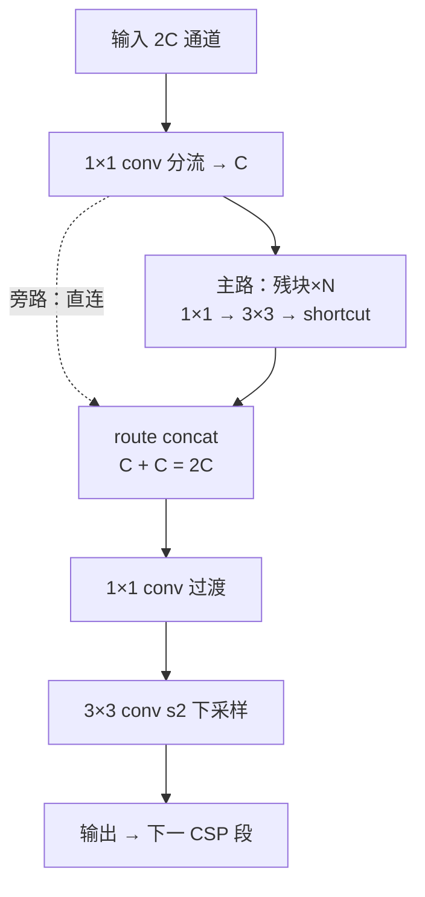
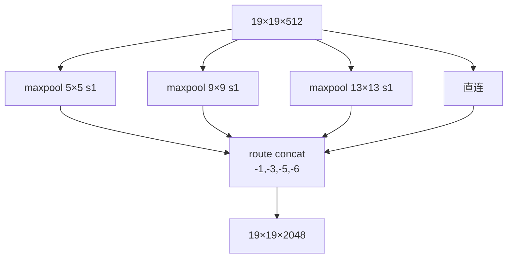
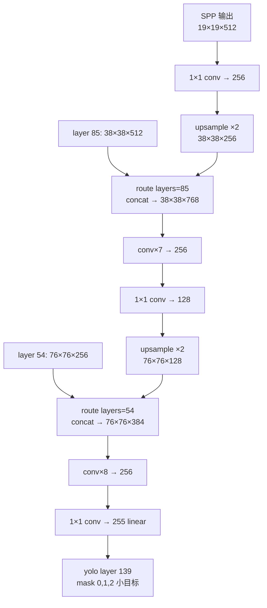
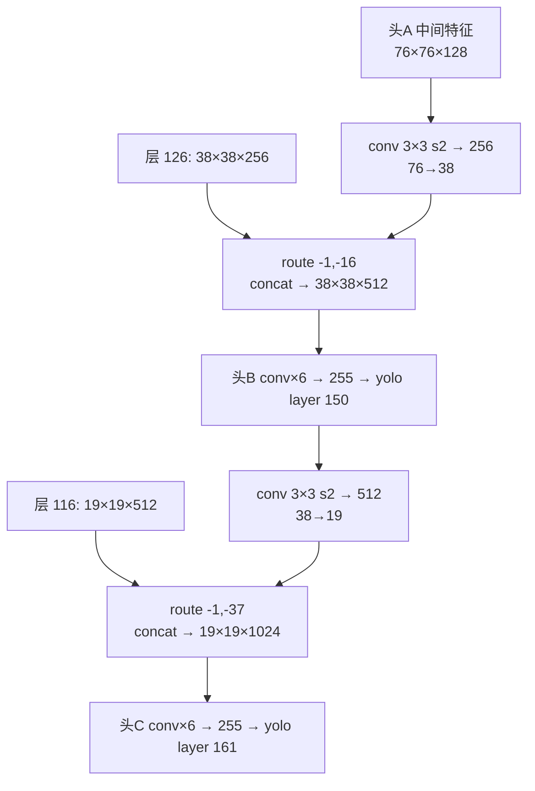
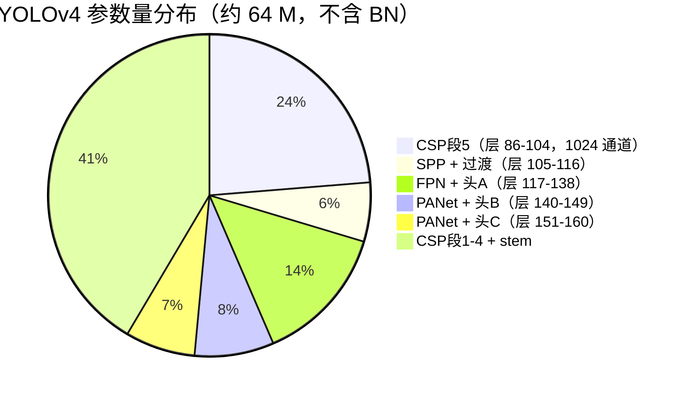

# YOLOv4 架构逐层图解

这一页把 YOLOv4（commit `4131ae1`）的 cfg 逐层展开：输入/输出 tensor shape、层号、源码对应位置、一句白话解释。

> 所有代码来自 `source/yolov4/snapshot/`，cfg 见 `cfg/yolov4.cfg`。
> **口径说明**：共 **162 层**（0-indexed 编号 0–161）。构成 = 110 conv + 23 shortcut + 21 route + 3 maxpool + 2 upsample + 3 yolo。本文以快照 cfg 事实为准。

::: tip TL;DR：只想带走三件事
1. **162 层 = CSPDarknet53 骨干（0–104）+ SPP（105–116）+ PANet 双向 neck（117–161）**：骨干 5 段 CSP，步进 5 次下采样到 19×19。
2. **三个 yolo 头在 layer 139 / 150 / 161**，输出都是 255 = 3×(4+1+80)，anchors 由 mask 0,1,2 / 3,4,5 / 6,7,8 切分——**顺序与 v3 相反**（76×76 小目标头在最前）。
3. **CSP 分流 + SPP + PANet 三件套**：CSP 每段劈两半（主路残块 + 旁路直连），SPP 三尺度 maxpool 扩感受野，PANet 上采样 + 下采样双向聚合。
:::

---

## 1. 一眼看清：输入 → 输出的完整流程



**一句话总结**：5 次空间减半把 608×608 压到 19×19（骨干 0–104），SPP 三尺度 maxpool 扩感受野（105–116），FPN 两次上采样回连浅层（117–139），PANet 两次下采样送回深层（140–161）——三个头各管一档尺度，顺序与 v3 相反。

---

## 2. 逐层明细表（按快照 cfg 顺序，共 162 层）

> **v3 读者路标**：v3 的残块是"1×1 降维 + 3×3 升维 + shortcut"串联；v4 每段开头加了一个 **route -2 分流**（CSP），主路走残块、旁路直连，最后 **route -1,-N concat** 回来。骨干激活从 leaky 换成 **mish**，neck/head 保留 leaky。表格按段分组，`#` 列是 darknet 的 0-indexed 层号。

骨干 conv 全部 `batch_normalize=1` + **mish**；neck/head conv 全部 `batch_normalize=1` + **leaky**（除每头末层 1×1 255 是 linear）。

### 2.1 骨干：stem + CSP段1-2（层 0–23）

| # | 类型 | kernel / stride | 输出通道 | 特征图 | cfg 行 |
|---|------|-----------------|---------|--------|--------|
| 0 | conv | 3×3 / 1 | 32 | 608×608 | <SrcLink file="v4:cfg/yolov4.cfg" :line="30" /> |
| 1 | conv | 3×3 / **2** | 64 | 304×304 | <SrcLink file="v4:cfg/yolov4.cfg" :line="40" /> |
| 2 | conv | 1×1 / 1 | 64 | 304×304 | <SrcLink file="v4:cfg/yolov4.cfg" :line="48" /> |
| 3 | **route** | layers=-2 | 64 | 304×304 | <SrcLink file="v4:cfg/yolov4.cfg" :line="56" /> |
| 4-7 | conv×3 + **shortcut** | 1×1+3×3 残块 | 64 | 304×304 | <SrcLink file="v4:cfg/yolov4.cfg" :line="59" /> 起 |
| 8 | conv | 1×1 / 1 | 64 | 304×304 | <SrcLink file="v4:cfg/yolov4.cfg" :line="83" /> |
| 9 | **route** | layers=-1,-7 | 64 | 304×304 | <SrcLink file="v4:cfg/yolov4.cfg" :line="87" /> |
| 10 | conv | 1×1 / 1 | 64 | 304×304 | <SrcLink file="v4:cfg/yolov4.cfg" :line="90" /> |
| 11 | conv | 3×3 / **2** | 128 | 152×152 | <SrcLink file="v4:cfg/yolov4.cfg" :line="98" /> |
| 12 | conv | 1×1 / 1 | 64 | 152×152 | <SrcLink file="v4:cfg/yolov4.cfg" :line="106" /> |
| 13 | **route** | layers=-2 | 64 | 152×152 | <SrcLink file="v4:cfg/yolov4.cfg" :line="116" /> |
| 14-21 | conv×6 + shortcut×2 | 残块×2 | 64 | 152×152 | <SrcLink file="v4:cfg/yolov4.cfg" :line="119" /> 起 |
| 22 | **route** | layers=-1,-10 | 64 | 152×152 | <SrcLink file="v4:cfg/yolov4.cfg" :line="175" /> |
| 23 | conv | 1×1 / 1 | 128 | 152×152 | <SrcLink file="v4:cfg/yolov4.cfg" :line="178" /> |

### 2.2 骨干：CSP段3（层 24–54，8 残块）→ 回连锚点 54

| # | 类型 | 说明 | 特征图 | cfg 行 |
|---|------|------|--------|--------|
| 24 | conv | 3×3 / **2** → 256ch | 76×76 | <SrcLink file="v4:cfg/yolov4.cfg" :line="186" /> |
| 25 | conv | 1×1 → 128ch（分流） | 76×76 | <SrcLink file="v4:cfg/yolov4.cfg" :line="196" /> |
| 26 | **route** | layers=-2（CSP 分流） | 128 | <SrcLink file="v4:cfg/yolov4.cfg" :line="204" /> |
| 27-52 | 残块×8 | 1×1 128 + 3×3 128 + shortcut | 76×76×128 | <SrcLink file="v4:cfg/yolov4.cfg" :line="207" /> 起 |
| 53 | **route** | layers=-1,-28（concat） | 256 | <SrcLink file="v4:cfg/yolov4.cfg" :line="384" /> |
| 54 | conv | 1×1 → 256ch（过渡） | 76×76×**256** | <SrcLink file="v4:cfg/yolov4.cfg" :line="387" /> |

**layer 54** = CSP段3 末（76×76×256），后续被 `route 54` 回连给 76×76 小目标头。

### 2.3 骨干：CSP段4（层 55–85，8 残块）→ 回连锚点 85

| # | 类型 | 说明 | 特征图 | cfg 行 |
|---|------|------|--------|--------|
| 55 | conv | 3×3 / **2** → 512ch | 38×38 | <SrcLink file="v4:cfg/yolov4.cfg" :line="395" /> |
| 56 | conv | 1×1 → 256ch（分流） | 38×38 | <SrcLink file="v4:cfg/yolov4.cfg" :line="405" /> |
| 57 | **route** | layers=-2（CSP 分流） | 256 | <SrcLink file="v4:cfg/yolov4.cfg" :line="413" /> |
| 58-83 | 残块×8 | 1×1 256 + 3×3 256 + shortcut | 38×38×256 | <SrcLink file="v4:cfg/yolov4.cfg" :line="416" /> 起 |
| 84 | **route** | layers=-1,-28（concat） | 512 | <SrcLink file="v4:cfg/yolov4.cfg" :line="598" /> |
| 85 | conv | 1×1 → 512ch（过渡） | 38×38×**512** | <SrcLink file="v4:cfg/yolov4.cfg" :line="601" /> |

**layer 85** = CSP段4 末（38×38×512），后续被 `route 85` 回连给 38×38 中目标头。

### 2.4 骨干：CSP段5（层 86–104，4 残块）

| # | 类型 | 说明 | 特征图 | cfg 行 |
|---|------|------|--------|--------|
| 86 | conv | 3×3 / **2** → 1024ch | 19×19 | <SrcLink file="v4:cfg/yolov4.cfg" :line="609" /> |
| 87 | conv | 1×1 → 512ch（分流） | 19×19 | <SrcLink file="v4:cfg/yolov4.cfg" :line="619" /> |
| 88 | **route** | layers=-2（CSP 分流） | 512 | <SrcLink file="v4:cfg/yolov4.cfg" :line="627" /> |
| 89-102 | 残块×4 | 1×1 512 + 3×3 512 + shortcut | 19×19×512 | <SrcLink file="v4:cfg/yolov4.cfg" :line="630" /> 起 |
| 103 | **route** | layers=-1,-16（concat） | 1024 | <SrcLink file="v4:cfg/yolov4.cfg" :line="726" /> |
| 104 | conv | 1×1 → 1024ch（过渡） | 19×19×1024 | <SrcLink file="v4:cfg/yolov4.cfg" :line="729" /> |

### 2.5 SPP 段（层 105–116）

| # | 类型 | 说明 | 特征图 | cfg 行 |
|---|------|------|--------|--------|
| 105-107 | conv×3 | 1×1 512 / 3×3 1024 / 1×1 512 | 19×19×512 | <SrcLink file="v4:cfg/yolov4.cfg" :line="737" /> 起 |
| 108 | **maxpool** | **5×5 s1** same padding | 19×19×512 | <SrcLink file="v4:cfg/yolov4.cfg" :line="763" /> |
| 109 | route | layers=-2 | 19×19×512 | <SrcLink file="v4:cfg/yolov4.cfg" :line="767" /> |
| 110 | **maxpool** | **9×9 s1** same padding | 19×19×512 | <SrcLink file="v4:cfg/yolov4.cfg" :line="772" /> |
| 111 | route | layers=-4 | 19×19×512 | <SrcLink file="v4:cfg/yolov4.cfg" :line="776" /> |
| 112 | **maxpool** | **13×13 s1** same padding | 19×19×512 | <SrcLink file="v4:cfg/yolov4.cfg" :line="779" /> |
| 113 | **route** | layers=-1,-3,-5,-6（**concat 4 份**） | 19×19×**2048** | <SrcLink file="v4:cfg/yolov4.cfg" :line="783" /> |
| 114-116 | conv×3 | 1×1 512 / 3×3 1024 / 1×1 512 | 19×19×512 | <SrcLink file="v4:cfg/yolov4.cfg" :line="790" /> 起 |

### 2.6 FPN 上采样 + 头A（层 117–139）

| # | 类型 | 说明 | 特征图 | cfg 行 |
|---|------|------|--------|--------|
| 117 | conv | 1×1 → 256 | 19×19×256 | <SrcLink file="v4:cfg/yolov4.cfg" :line="810" /> |
| 118 | **upsample** | 最近邻 ×2 | 38×38×256 | <SrcLink file="v4:cfg/yolov4.cfg" :line="818" /> |
| 119 | **route** | layers=85（回连 CSP4 末） | 38×38×**768** | <SrcLink file="v4:cfg/yolov4.cfg" :line="821" /> |
| 120-126 | conv×7 | 1×1/3×3 交替 → 256 | 38×38×256 | <SrcLink file="v4:cfg/yolov4.cfg" :line="824" /> 起 |
| 127 | conv | 1×1 → 128 | 38×38×128 | <SrcLink file="v4:cfg/yolov4.cfg" :line="875" /> |
| 128 | **upsample** | 最近邻 ×2 | 76×76×128 | <SrcLink file="v4:cfg/yolov4.cfg" :line="883" /> |
| 129 | **route** | layers=54（回连 CSP3 末） | 76×76×**384** | <SrcLink file="v4:cfg/yolov4.cfg" :line="886" /> |
| 130-137 | conv×8 | 1×1/3×3 交替 → 128/256 | 76×76×256 | <SrcLink file="v4:cfg/yolov4.cfg" :line="889" /> 起 |
| 138 | conv | **1×1 → 255**（linear） | 76×76×255 | <SrcLink file="v4:cfg/yolov4.cfg" :line="950" /> |
| 139 | **yolo** | mask 0,1,2（小 anchor） | 76×76×255 | <SrcLink file="v4:cfg/yolov4.cfg" :line="958" /> |

### 2.7 PANet 下采样 + 头B（层 140–150）

| # | 类型 | 说明 | 特征图 | cfg 行 |
|---|------|------|--------|--------|
| 140 | route | layers=-4 → 取回层 136 | 76×76×128 | <SrcLink file="v4:cfg/yolov4.cfg" :line="975" /> |
| 141 | conv | **3×3 / 2** → 256（下采样） | 38×38×256 | <SrcLink file="v4:cfg/yolov4.cfg" :line="978" /> |
| 142 | **route** | layers=-1, -16（concat 层 126） | 38×38×**512** | <SrcLink file="v4:cfg/yolov4.cfg" :line="986" /> |
| 143-148 | conv×6 | 1×1/3×3 交替 → 256/512 | 38×38×512 | <SrcLink file="v4:cfg/yolov4.cfg" :line="989" /> 起 |
| 149 | conv | **1×1 → 255**（linear） | 38×38×255 | <SrcLink file="v4:cfg/yolov4.cfg" :line="1037" /> |
| 150 | **yolo** | mask 3,4,5（中 anchor） | 38×38×255 | <SrcLink file="v4:cfg/yolov4.cfg" :line="1045" /> |

### 2.8 PANet 下采样 + 头C（层 151–161）

| # | 类型 | 说明 | 特征图 | cfg 行 |
|---|------|------|--------|--------|
| 151 | route | layers=-4 → 取回层 147 | 38×38×256 | <SrcLink file="v4:cfg/yolov4.cfg" :line="1062" /> |
| 152 | conv | **3×3 / 2** → 512（下采样） | 19×19×512 | <SrcLink file="v4:cfg/yolov4.cfg" :line="1065" /> |
| 153 | **route** | layers=-1, -37（concat 层 116） | 19×19×**1024** | <SrcLink file="v4:cfg/yolov4.cfg" :line="1073" /> |
| 154-159 | conv×6 | 1×1/3×3 交替 → 512/1024 | 19×19×1024 | <SrcLink file="v4:cfg/yolov4.cfg" :line="1076" /> 起 |
| 160 | conv | **1×1 → 255**（linear） | 19×19×255 | <SrcLink file="v4:cfg/yolov4.cfg" :line="1124" /> |
| 161 | **yolo** | mask 6,7,8（大 anchor） | 19×19×255 | <SrcLink file="v4:cfg/yolov4.cfg" :line="1132" /> |

**空间下采样共 5 次**：层 1/11/24/55/86（5 个 stride-2 conv，与 v3 相同——没有 maxpool 做下采样，SPP 的 3 个 maxpool 是 stride=1 的感受野扩展），608 / 2⁵ = **19**。

---

## 3. 四个阶段的「原理图 + 白话 + 代码」

### 3.1 骨干：CSP 分流残差（层 0–104）

**原理图**（CSP 段结构）：



**白话**：
- 每段的通道 64→128→256→512→1024，段入口一个 stride-2 卷积减半分辨率，段内 CSP 分流 + 残块堆栈。
- CSP = **1×1 分流（通道减半）→ 主路残块×N → route concat 回旁路 → 1×1 过渡**，v4 最大的结构升级；计算量降 20%，梯度有直通路径。
- 层 54 / 85 两个"半路特征"被 FPN 回连——它们是浅层细节供体。

**对应代码**（CSP段3 的 s2 入口 + 分流，<SrcLink file="v4:cfg/yolov4.cfg" :line="186" :end="207" />）：

<SrcSnippet file="v4:cfg/yolov4.cfg" :start="186" :end="207" hl="186-190,204-206" />

---

### 3.2 SPP：三尺度感受野扩展（层 105–116）

**原理图**：



**白话**：
- 三个 maxpool 用不同核（5/9/13）但 stride=1 + same padding，特征图尺寸不变（19×19），只扩感受野。
- route concat 把 4 份拼起来（原始 + 5×5 + 9×9 + 13×13），通道从 512 → 2048。
- 后续 3 个 conv 降维回 512，控制参数量。

**对应代码**（<SrcLink file="v4:cfg/yolov4.cfg" :line="763" :end="790" />）：

<SrcSnippet file="v4:cfg/yolov4.cfg" :start="763" :end="790" hl="763-766,772-775,779-782,786-789" />

---

### 3.3 FPN 上采样 + 头A：76×76 小目标（层 117–139）

**原理图**：



**白话**：
- FPN 两次上采样：19→38→76，每次 concat 回连骨干的半路特征（层 85 / 54）。
- 头 A 的 76×76 格子配最小的 3 个 anchor（12,16 / 19,36 / 40,28），专抓小目标。
- 255 = 3 anchors × (4 坐标 + 1 objectness + 80 类)。

**对应代码**（<SrcLink file="v4:cfg/yolov4.cfg" :line="818" :end="886" />）：

<SrcSnippet file="v4:cfg/yolov4.cfg" :start="818" :end="830" hl="818-819,826-827" />

> ⚠️ route 的 `layers=85` 是**绝对层号**（0-indexed），即 CSP段4 末尾。

---

### 3.4 PANet 下采样 + 头B/C：38×38 / 19×19（层 140–161）

**原理图**：



**白话**：
- PANet 在 FPN 之后加了两路**下采样**：头 A 的 76×76 特征 conv s2 压到 38×38，concat 回头 B 的输入；头 B 的 38×38 特征 conv s2 压到 19×19，concat 回头 C 的输入。
- 这是 v3 没有的——v3 只有 FPN（自顶向下），v4 加了 PANet（自底向上），**浅层位置信息回传深层**。

**对应代码**（<SrcLink file="v4:cfg/yolov4.cfg" :line="978" :end="986" />）：

<SrcSnippet file="v4:cfg/yolov4.cfg" :start="978" :end="990" hl="978-982,986-989" />

---

## 4. 255 维输出的可视化切分（每个头相同）

```text
76×76 × 3 anchors × 85
                    └ 80 类概率（独立 logistic）
              └────── 每 anchor：tx, ty, tw, th + objectness
```

| 逻辑段 | 含义 | 激活 | 训练目标 |
|-------|------|------|---------|
| tx, ty | 相对格子的偏移 | sigmoid + scale_x_y | `truth.x×76 − i`（经 scale 调整） |
| tw, th | 相对 anchor 的对数缩放 | 线性 | `log(truth.w×net.w / anchor_w)` |
| objectness | P(Object)，每 anchor 独立 | sigmoid | 背景推 0（IoU>0.7 豁免）；正样本推 1 |
| 80 类 | 类别概率 | **独立 logistic**（多标签） | 正样本只推正确类 |

**推理解码**在 `get_yolo_detections()`（<SrcLink file="v4:src/yolo_layer.c" :line="316" />），坐标解码用 <SrcLink file="v4:src/yolo_layer.c" :line="119" /> 的 `get_yolo_box`，letterbox 还原在 <SrcLink file="v4:src/yolo_layer.c" :line="246" />。

---

## 5. 参数量分布

按每层 `in×out×k×k` 累加（不含 BN 的 γ/β），全网约 **64.1M**——比 v3 的 61.8M 略增：



**关键结论**：参数高度集中在骨干（CSP段1-4 + 段5 占 65%）。CSP 分流让主路只看一半通道，省下的参数被 SPP 和 PANet 的额外 conv 吃掉——总量与 v3 持平，但结构更高效。

---

## 6. 与 v3 的架构对比

| 特性 | v3 | v4 |
|------|-----|-----|
| 层数 | 107（75 conv + 23 shortcut + 4 route + 2 upsample + 3 yolo） | **162（110 conv + 23 shortcut + 21 route + 3 maxpool + 2 upsample + 3 yolo）** |
| 骨干结构 | Darknet-53（残块串联） | **CSPDarknet53（CSP 分流 + 残块）** |
| 骨干激活 | leaky | **Mish** |
| Neck | FPN（单向，上采样 2 次） | **SPP + PANet（SPP 扩感受野 + 双向聚合）** |
| 检测头顺序 | 13(大) → 26(中) → 52(小) | **76(小) → 38(中) → 19(大)** |
| 输入尺寸 | 416（论文）/ 608（评测） | **608（标配）** |
| 网格尺寸 | 13/26/52 | **19/38/76** |
| 坐标 loss | SSE | **CIoU** |
| 正样本分配 | 单 GT 单 anchor | **Multi-positive（iou_thresh=0.213）** |
| 参数量 | ~62M | **~64M** |

---

## 延伸阅读

- [理论 Concept](/versions/v4/concepts)
- [架构与层速查](/versions/v4/layers)
- [损失函数（CIoU 全套）](/versions/v4/losses)
- [源码走读](/versions/v4/code-walkthrough)
