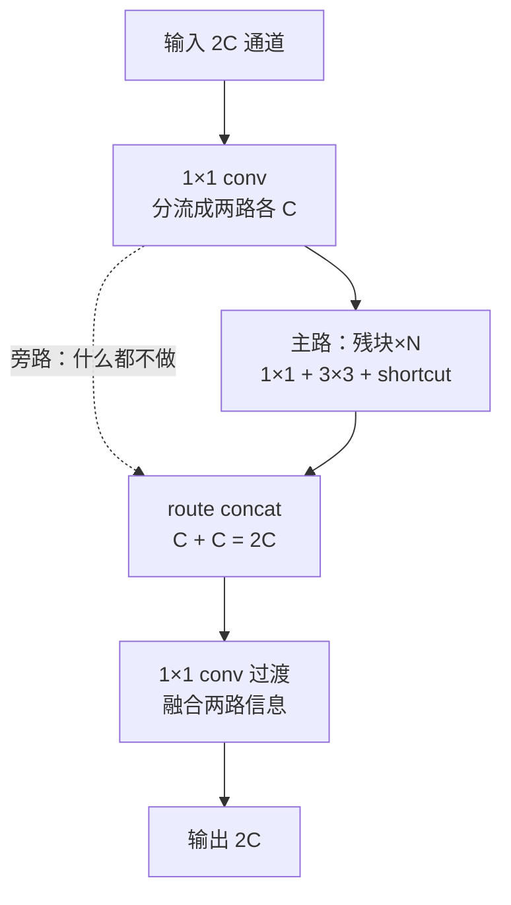
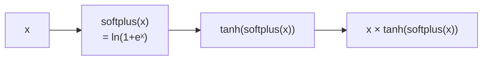
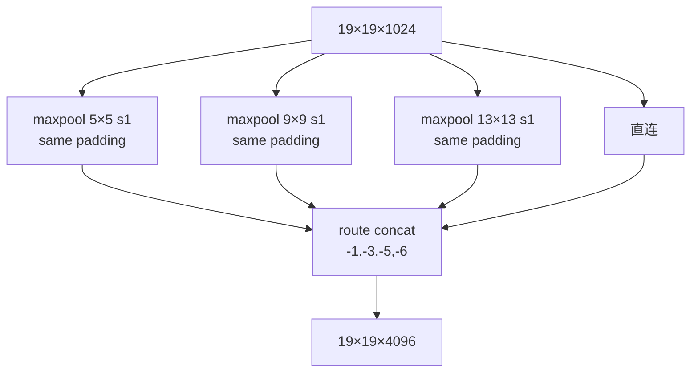
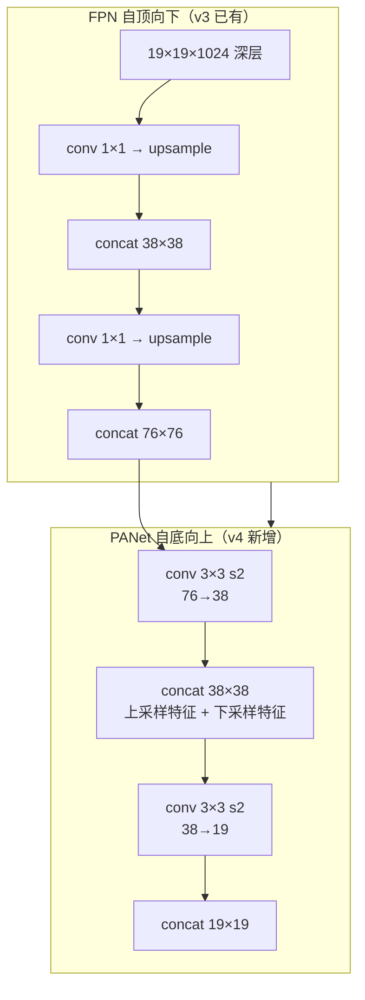
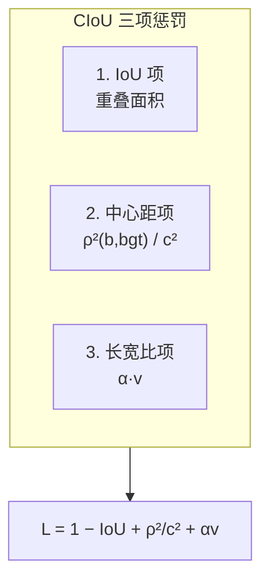
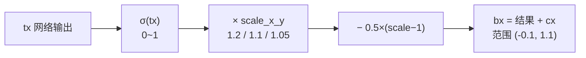
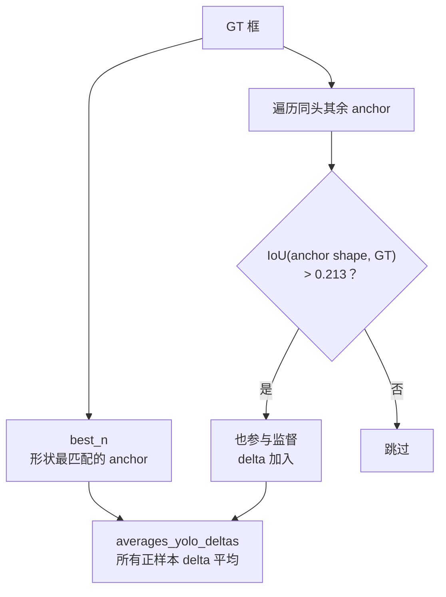
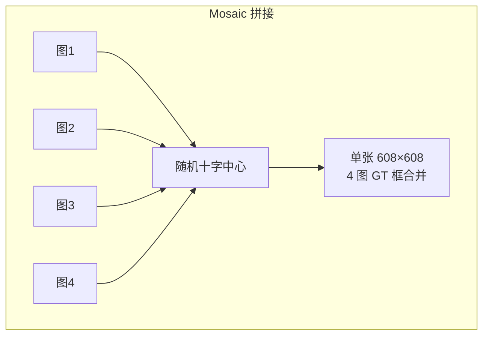
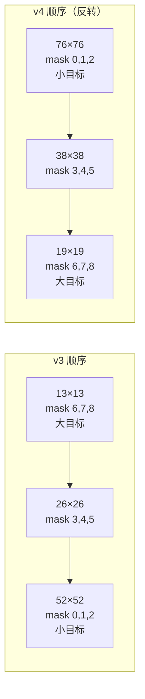

# YOLOv4 理论 Concept

YOLOv4 相比 v3 引入/演进了 10 个核心概念。每个都配**原理图 + 白话 + 源码对应**。源码统一指向 v4 快照（commit `4131ae1`）。

---

## 1. CSP 结构 (`concept-csp-cross-stage-partial`)

> **v3 读者路标**：v3 的 Darknet-53 是"残块串联"（1×1 降维 → 3×3 升维 → shortcut）；v4 在每段开头加了一个 **1×1 conv 分流**，把特征劈成两半——主路走残块、旁路直连，最后 concat 回来再过 1×1 过渡。

### 原理图



### 白话

> v3 的残块里，梯度要走完整个残块堆栈才能回传；v4 的 CSP 把特征劈成两半，一半走"重加工"（残块），一半"原样保留"（旁路），最后拼接——**梯度有一条更短的高速公路**，训练更稳，计算量还降了 20%。

### 为什么计算量降了

- 主路残块只看一半通道（C 而不是 2C），卷积计算量直接减半
- 旁路完全不计算，只在最后 concat
- 代价是多了一个 1×1 过渡 conv（融合两路），但远小于省下的计算

### 源码对应

第一个 CSP 段（层 0-35 的骨干段1）的分流在 <SrcLink file="v4:cfg/yolov4.cfg" :line="56" />（`[route] layers = -2`，取回层 54 的输出），concat 在 <SrcLink file="v4:cfg/yolov4.cfg" :line="95" />（`layers = -1,-7`，拼主路 + 旁路），过渡 conv 在 <SrcLink file="v4:cfg/yolov4.cfg" :line="98" />。

<SrcSnippet file="v4:cfg/yolov4.cfg" :start="56" :end="68" hl="56-58,67-68" />

::: details 逐行注释（L56–L68）
- **L56-58**：`[route] layers = -2` —— 取回倒数第 2 层（层 54，CSP 分流前的输入）作为旁路的起点。
- **L59-66**：主路的第一个 conv（1×1，通道减半）。
- **L67-68**：主路的第二个 conv（3×3）——残块开始。
- 后续 8 个残块堆栈后，在 L95 的 route 把主路和旁路 concat。
:::

---

## 2. Mish 激活 (`concept-mish-activation`)

> **v3 读者路标**：v3 全网络用 leaky（`max(0.1x, x)`）；v4 的**骨干**换成 Mish，neck/head 保留 leaky。

### 原理图



$$Mish(x) = x \cdot \tanh(\ln(1 + e^x))$$

### 白话

> Mish 是"更平滑的 ReLU"：负值不是一刀切置零（ReLU）或压缩成 0.1x（leaky），而是平滑过渡到接近 0 的小负值。这让梯度在负区间也能流动，训练更稳定。

### 对比三种激活

| 激活 | 公式 | x=-1 时的值 | 特点 |
|------|------|------------|------|
| ReLU | max(0, x) | 0 | 硬边界，负区间梯度=0 |
| leaky | max(0.1x, x) | -0.1 | 负区间保留 10% 梯度 |
| Mish | x·tanh(softplus(x)) | ≈-0.30 | 平滑非单调，负区间梯度连续 |

### 源码对应

激活函数注册在 <SrcLink file="v4:src/activations.c" :line="50" />（`strcmp(s, "mish") == 0`），前向实现在 <SrcLink file="v4:src/activations.c" :line="143" :end="151" />，梯度在 <SrcLink file="v4:src/activations.c" :line="344" :end="360" />。

**softplus 阈值 20 防溢出**（L145）：x>20 时 softplus(x)≈x，避免 exp(20+) 数值爆炸。

cfg 里骨干 72 个 mish、neck/head 35 个 leaky，分界在 SPP 前后（层 105 附近）。

---

## 3. SPP 空间金字塔池化 (`concept-spp`)

> **v3 读者路标**：v3 没有 SPP；v4 在骨干末尾（19×19 特征图）加了三个并行的 maxpool，扩感受野。

### 原理图



### 白话

> SPP 的核心思想是**"同一位置用不同大小的窗口看"**：5×5 看局部、9×9 看中距离、13×13 看全局。三个 maxpool 都用 stride=1 + same padding，特征图尺寸不变（19×19），但通道从 1024 涨到 4096（拼 4 份）。

### 为什么放在 19×19

- 19×19 是最深层的特征图（下采样 5 次后的结果），每个点负责原图 32×32 的区域
- 在这里扩感受野，等于让最深层的语义特征"看得更大"
- 代价极小：maxpool 无参数，只多了一次 concat

### 源码对应

三个 maxpool 在 <SrcLink file="v4:cfg/yolov4.cfg" :line="772" />（5×5）、<SrcLink file="v4:cfg/yolov4.cfg" :line="779" />（9×9）、<SrcLink file="v4:cfg/yolov4.cfg" :line="786" />（13×13），concat 在 <SrcLink file="v4:cfg/yolov4.cfg" :line="790" />（`layers=-1,-3,-5,-6`）。

---

## 4. PANet 双向聚合 (`concept-panet-bidirectional`)

> **v3 读者路标**：v3 的 neck 是 FPN（自顶向下，上采样 2 次回连浅层）；v4 在此之上加了一路**自底向上**的下采样，把浅层的位置信息送回深层。

### 原理图



### 白话

> v3 的 FPN 只把深层语义往浅层搬（"大目标的经验告诉小目标长什么样"）；v4 的 PANet 加了反向通路，把浅层细节往深层搬（"小目标的精确位置告诉大目标在哪"）——**双向奔赴**。

### 源码对应

第一处下采样在 <SrcLink file="v4:cfg/yolov4.cfg" :line="1107" :end="1122" />（conv 3×3 s2 把 76×76 压到 38×38，route concat 回 38×38 头）；第二处下采样在 <SrcLink file="v4:cfg/yolov4.cfg" :line="1252" :end="1267" />（38→19）。

上采样路径（FPN 部分）在 <SrcLink file="v4:cfg/yolov4.cfg" :line="826" />（upsample）和 <SrcLink file="v4:cfg/yolov4.cfg" :line="891" />（第二次 upsample）。

---

## 5. CIoU loss (`concept-ciou-loss`)

> **v3 读者路标**：v3 的坐标回归用 SSE（`delta = scale × (target − output)`，scale=2−w·h）；v4 换成 CIoU，直接对 IoU 求梯度，同时惩罚中心距和长宽比。

### 原理图



$$\mathcal{L}_{CIoU} = 1 - IoU + \frac{\rho^2(b, b^{gt})}{c^2} + \alpha v$$

其中 $v = \frac{4}{\pi^2}(\arctan\frac{w^{gt}}{h^{gt}} - \arctan\frac{w}{h})^2$，$\alpha = \frac{v}{(1-IoU)+v}$。

### 白话

> SSE 只看坐标偏移量的数值大小，**不管两个框实际重不重叠**；CIoU 直接优化 IoU（检测的评价指标），还额外惩罚"中心偏了"和"长宽比不对"——训练目标和评测指标对齐了。

### 与 v3 SSE 的对比

| | v3 SSE | v4 CIoU |
|---|--------|---------|
| 优化目标 | 坐标偏移量的 L2 | IoU + 中心距 + 长宽比 |
| 尺度敏感 | 需要 (2−w·h) 权重补偿 | **天然尺度不变**（IoU 是归一化指标） |
| 梯度 | 手推 delta = scale×(target−output) | 手推 dIoU/dx, dIoU/dy, dIoU/dw, dIoU/dh |
| 代码位置 | yolo_layer.c delta_yolo_box | box.c dx_box_iou |

### 源码对应

cfg 开关 <SrcLink file="v4:cfg/yolov4.cfg" :line="978" />（`iou_loss=ciou`），调用点在 <SrcLink file="v4:src/yolo_layer.c" :line="187" />（`dx_box_iou(pred, truth, iou_loss)`），梯度实现在 <SrcLink file="v4:src/box.c" :line="258" :end="476" />。

**注意**：v3 的 `(2−truth.w·truth.h)` 小框权重在 CIoU 分支被 **bypass**（L428/L470 传入但 CIoU 路径不使用，只用于 MSE 旧路），因为 IoU 本身是归一化指标，天然尺度不变。

---

## 6. scale_x_y 消网格敏感 (`concept-scale-xy`)

> **v3 读者路标**：v3 的 bx = σ(tx) + cx，σ(tx) ∈ (0,1)，每个格子只能预测自己格子内的中心点；v4 加了个 scale 把范围扩到 (-0.1, 1.1)。

### 原理图



$$b_x = s \cdot \sigma(t_x) - 0.5(s-1) + c_x$$

### 白话

> v3 的 σ(tx) 严格在 (0,1)，意味着格子 (i,j) 的中心点预测**永远不可能超出自己的格子**——边缘目标（中心恰好在格子边界）就漏了。v4 把 σ(tx) 先放大 s 倍再平移，允许中心点稍微"越界"到相邻格子，消除网格硬边界。

### 三个头的 scale 不同

| 头 | 网格 | scale_x_y | 扩展后范围 |
|----|------|-----------|-----------|
| 76×76（小目标） | 76×76 | **1.2** | (-0.1, 1.1) |
| 38×38（中目标） | 38×38 | **1.1** | (-0.05, 1.05) |
| 19×19（大目标） | 19×19 | **1.05** | (-0.025, 1.025) |

小目标头给最大的扩展——小目标更容易卡在网格边界。

### 源码对应

cfg 配置 <SrcLink file="v4:cfg/yolov4.cfg" :line="974" />（`scale_x_y = 1.2`），前向应用在 <SrcLink file="v4:src/yolo_layer.c" :line="337" />（`scal_add_cpu(2*l.w*l.h, l.scale_x_y, -0.5*(l.scale_x_y-1), ...)`）。

---

## 7. Multi-positive 多正样本分配 (`concept-multi-positive`)

> **v3 读者路标**：v3 每个 GT 只被一个 anchor 监督（best_n 独占）；v4 允许**同一头内**其他形状相似的 anchor 也参与监督。

### 原理图



### 白话

> v3 的"单 GT 单 anchor"太苛刻：一个 GT 可能同时和两个 anchor 形状都匹配，但只选了最好的那个，另一个被浪费了。v4 的 multi-positive 让所有"足够像"的 anchor 都参与监督，**一个 GT 可能训练 2-3 个 anchor**，样本利用率翻倍。

### 源码对应

cfg 阈值 <SrcLink file="v4:cfg/yolov4.cfg" :line="975" />（`iou_thresh=0.213`），第三遍循环在 <SrcLink file="v4:src/yolo_layer.c" :line="501" :end="545" />，delta 平均在 <SrcLink file="v4:src/yolo_layer.c" :line="556" />。

<SrcSnippet file="v4:src/yolo_layer.c" :start="501" :end="520" hl="504-517" />

::: details 逐行注释（L501–L520）
- **L504**：`mask_n >= 0 && n != best_n && l.iou_thresh < 1.0f` —— 只处理"在本头 mask 内、但不是 best_n"的 anchor。
- **L508**：用 GT 的纯形状（truth_shift，只保留 w/h，中心对齐到 anchor）与当前 anchor 求 IoU。
- **L511**：`iou > l.iou_thresh`（0.213）—— 形状足够像就参与监督。
- **L517**：调 `delta_yolo_box` 写 delta（与 best_n 相同的逻辑）。
- **L556**（后续）：所有正样本的 delta 经 `averages_yolo_deltas` 平均，防止多个 anchor 的梯度叠加导致训练不稳。
:::

---

## 8. Mosaic 四图拼接增强 (`concept-mosaic`)

> **v3 读者路标**：v3 的增强是单图操作（jitter + hue/sat/exposure）；v4 的 Mosaic 把 4 张图拼成一张，上下文多样性翻 4 倍。

### 原理图



### 白话

> 把 4 张训练图按随机位置拼成一个"十字"，一次训练看到 4 倍场景：小目标可能出现在 4 张图的任意位置，背景多样性直接翻 4 倍。BN 层一次统计 4 张图的分布，相当于隐式增大 batch。

### 与 CutMix / MixUp 的区别

| 增强 | 操作 | v4 是否采用 |
|------|------|------------|
| MixUp | 两图加权混合（像素级） | 否 |
| CutMix | 两图裁剪拼接（矩形区域） | 代码有，但与 detector 不兼容（L955 报错） |
| Mosaic | 四图十字拼接 | **是**（cfg `mosaic=1`） |

### 源码对应

cfg 开关 <SrcLink file="v4:cfg/yolov4.cfg" :line="26" />（`mosaic=1`），实现在 `src/data.c` 的 `load_data_detection`（`use_mixup=3` 路径，L967+）。

**注意**：`letter_box` 与 Mosaic 不兼容（L959 报错）——Mosaic 需要自己处理 resize。

---

## 9. 三头反序 + 18 anchors (`concept-three-heads-reversed`)

> **v3 读者路标**：v3 的三头顺序是 13(大) → 26(中) → 52(小)，anchors 9 个；v4 反转成 76(小) → 38(中) → 19(大)，anchors 加到 18 个。

### 原理图



### 白话

> v4 输入加大到 608（v3 是 416），网格尺寸翻倍（608/8=76, 608/16=38, 608/32=19）。顺序反转是为了让**小目标头先出现**——浅层特征更新鲜，小目标优先享受。anchors 从 9 加到 18（每头仍 3 个，但 K-means 聚 18 类选 9 个）。

### 18 anchors 的实际值

```
12, 16,  19, 36,  40, 28,    ← mask 0,1,2（76×76 头，小目标）
36, 75,  76, 55,  72, 146,   ← mask 3,4,5（38×38 头，中目标）
142,110, 192,243, 459,401    ← mask 6,7,8（19×19 头，大目标）
```

最小的 anchor 是 12×16（约 1/50 图宽），最大的是 459×401（覆盖 3/4 图）。

### 源码对应

anchors 声明在 <SrcLink file="v4:cfg/yolov4.cfg" :line="968" />（18 个数 = 9 个框的 w,h 交替），三个头的 mask 分别在 <SrcLink file="v4:cfg/yolov4.cfg" :line="967" />（0,1,2）、<SrcLink file="v4:cfg/yolov4.cfg" :line="1054" />（3,4,5）、<SrcLink file="v4:cfg/yolov4.cfg" :line="1141" />（6,7,8）。

---

## 10. 训练 trick 集大成 (`concept-training-tricks`)

> **v3 读者路标**：v3 的 trick 只有多尺度训练 + 色彩增强；v4 把 2018-2020 年社区验证过的 trick 全搬进来，论文逐项消融。

### 已启用 trick 清单

| Trick | cfg 参数 | 作用 | 论文消融 ΔAP |
|-------|---------|------|-------------|
| Mosaic | `mosaic=1` | 四图拼接 | +0.7 |
| CIoU loss | `iou_loss=ciou` | 坐标回归换 IoU 系 | +0.5 |
| Multi-positive | `iou_thresh=0.213` | 单 GT 多 anchor | +1.5 |
| scale_x_y | `scale_x_y=1.2/1.1/1.05` | 消网格敏感 | +0.3 |
| DropBlock | （代码实现） | 连续区域 dropout | +0.4 |
| Label Smoothing | `label_smooth_eps=0` | 标签平滑 | 未启用（eps=0） |
| 多尺度训练 | `random=1` | 每 10 batch 换分辨率 | +0.5 |
| 色彩增强 | `hue=.1 sat=1.5 exp=1.5` | HSV 扰动 | +0.3 |

### 代码就绪但未启用

| Trick | 状态 | 原因 |
|-------|------|------|
| SAT（自对抗训练） | `detector.c` L1717 有代码 | cfg 无 `adversarial_lr` → 默认 0 |
| DIoU-NMS | `box.c` diounms_sort 就绪 | cfg `nms_kind=greedynms` 用 greedy |
| CutMix | `data.c` 有代码 | 与 detector 不兼容（L955 报错） |

### 白话

> v4 论文的本质是一次**系统化的 trick 消融实验**：把 2018-2020 年社区提出的所有"可能有用"的技巧逐项测试，留下真正有效的。这种"工程驱动"的方法论本身比任何单个 trick 都重要——它告诉后来者"哪些路走过了、哪些坑踩过了"。

### 源码对应

训练配置在 <SrcLink file="v4:cfg/yolov4.cfg" :line="14" :end="26" />（色彩增强 + Mosaic），SAT 代码在 `src/detector.c` L1717，DIoU-NMS 在 `src/box.c` diounms_sort。

---

## 延伸阅读

- [Architecture 逐层图解](/versions/v4/architecture)
- [损失函数（CIoU 全公式推导）](/versions/v4/losses)
- [训练技巧（Mosaic/DropBlock/SAT 详解）](/versions/v4/tricks)
- [痛点追踪](/versions/v4/painpoints)
