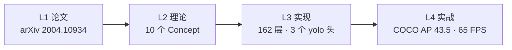
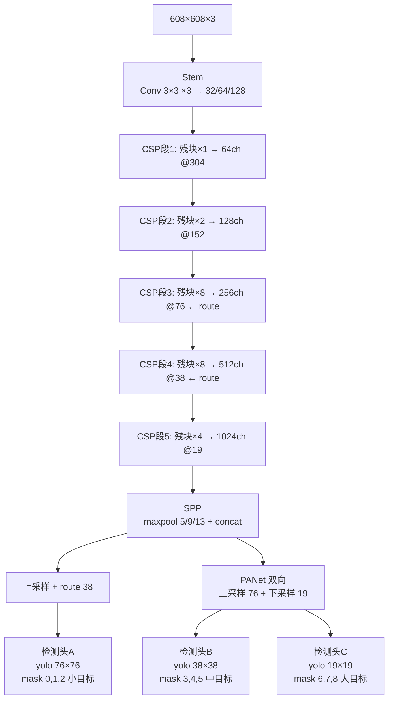

# YOLOv4 (2020-04)

**YOLOv4: Optimal Speed and Accuracy of Object Detection**

- 📄 论文：[arXiv:2004.10934](https://arxiv.org/abs/2004.10934) · arXiv 2020
- 🏛️ 作者：Alexey Bochkovskiy, Chien-Yao Wang, Hong-Yuan Mark Liao
- 💻 源码：[AlexeyAB/darknet](https://github.com/AlexeyAB/darknet) commit `4131ae1`
- 🎯 里程碑：**"Bag of Freebies + Bag of Specials 集大成"**——CSPDarknet53 骨干、SPP、PANet、CIoU loss、Mosaic 增强全部上场，COCO AP 43.5 / AP50 65.7，V100 65 FPS

## 3 分钟电梯演讲

1. **v3 的骨干+neck 都不够强**：v4 把 Darknet-53 改成 [CSP 结构](/glossary#csp-跨阶段部分连接)（梯度分流，计算量降 20%）、激活换 [Mish](/glossary#mish-激活)、加 [SPP](/glossary#spp-空间金字塔池化) 扩感受野、neck 用 [PANet](/glossary#panet-路径聚合网络) 双向聚合——一套组合拳。
2. **训练 trick 大丰收**：[Mosaic](/glossary#mosaic-增强) 四图拼接、[CIoU loss](/glossary#ciou-loss)、[scale_x_y](/glossary#scale-x-y) 消网格敏感、[multi-positive](/glossary#multi-positive-多正样本) 多正样本分配、SAM/CBN/CmBN 等一堆论文验证过的 trick 全被搬进来。
3. **结果**：COCO AP 从 v3 的 33.0 → **43.5**（608 输入），AP50 从 57.9 → **65.7**，V100 上仍保持 **65 FPS**——第一次"又快又准"。

> 已读过 [v3](/versions/v3/index)？本页下方有 v3→v4 逐项差异表；术语不熟先查[术语表](/glossary)。

## 四层闭环视图

## 核心贡献

1. **CSPDarknet53 骨干**：Darknet-53 每段改成 [CSP 结构](/glossary#csp-跨阶段部分连接)（1×1 conv 分流 + 残块堆栈 + route concat + 1×1 conv 过渡），计算量降 20%、精度反升；激活从 leaky 换成 [Mish](/glossary#mish-激活)
2. **SPP + PANet neck**：[SPP](/glossary#spp-空间金字塔池化) 三个 maxpool（5×5/9×9/13×13 same padding）扩感受野；[PANet](/glossary#panet-路径聚合网络) 在 FPN 上采样基础上加一路下采样，浅层位置信息回传深层
3. **CIoU loss**：[CIoU](/glossary#ciou-loss) 替代 SSE 做坐标回归——考虑重叠面积 + 中心距 + 长宽比，框回归精度大幅提升
4. **训练 trick 大礼包**：[Mosaic](/glossary#mosaic-增强) 四图拼接、[scale_x_y](/glossary#scale-x-y) 消网格敏感、[multi-positive](/glossary#multi-positive-多正样本) 多正样本分配、DropBlock 正则化、Class Label Smoothing——论文把每项都做了消融实验
5. **三头顺序反转**：v3 是 13/26/52（大/中/小），v4 改成 76/38/19（小/中/大）——输入加大到 608，网格尺寸翻倍

## 推理效果一览

<DiagramPipeline caption="图：v4 推理流水线——输入 608×608，CSPDarknet53 主干 → SPP 扩感受野 → PANet 双向聚合（上采样 + 下采样）→ 三个 yolo 头（76/38/19 格）各输出 255 通道 → CIoU 解码 + greedy-NMS" />

## 关键指标

**检测（COCO test-dev）**

| 模型 | 输入 | AP | AP50 | AP75 | FPS（V100） |
|------|------|-----|----------------|----------------|-------------|
| YOLOv4-416 | 416×416 | 41.2 | 62.8 | 44.3 | 96 |
| YOLOv4-512 | 512×512 | 43.0 | 64.9 | 45.6 | 83 |
| YOLOv4-608 | 608×608 | **43.5** | **65.7** | **47.3** | **65** |

- 对比 v3（同口径 YOLOv3-608）：AP 33.0 → **43.5**（+10.5）、AP50 57.9 → **65.7**（+7.8）——历史最大单代涨幅
- 对比 EfficientDet-D7（SOTA）：AP 52.2 vs 43.5 仍落后，但 EfficientDet 只有 6.5 FPS——v4 **快 10 倍**
- 论文原话：*"YOLOv4 is superior to the fastest and most accurate detectors in terms of both speed and accuracy"*

**骨干分类（ImageNet）**

| 骨干 | top-1 | top-5 | 输入 |
|------|-------|-------|------|
| CSPDarknet53 | **77.9** | 94.3 | 256×256 |
| Darknet-53（v3） | 77.2 | 93.8 | 256×256 |
| CSPResNeXt50 | 77.8 | 94.2 | 256×256 |

## 网络架构

- **162 层**（cfg 逐层盘点）：110 conv + 23 shortcut + 21 route + 3 maxpool + 2 upsample + 3 yolo（**逐层明细见 [Architecture 逐层图解](/versions/v4/architecture)**）
- **CSPDarknet53** = stem 3 conv + 5 段 CSP（残块 1/2/8/8/4）= 骨干 conv + 23 shortcut；**比 v3 多 3 个 CSP 过渡 conv**
- **SPP**（层 105-116）：3 个 maxpool（5×5/9×9/13×13 same padding）+ route concat → 感受野扩大
- **PANet**：上采样（conv 1×1 + upsample）回连浅层 + 下采样（conv 3×3 s2）再送回深层——双向聚合
- **输出 255 = 3 anchors × (4 坐标 + 1 objectness + 80 类)**，三个头各自 255 通道
- 参数量约 **64.1M**（conv 权重，BN 参数不计入）——比 v3 的 61.8M 略增

## 核心 Concept 一览

| Concept | 一句话 | 对应代码位置 |
|---------|--------|-------------|
| CSP 结构 | 1×1 分流 + 残块 + concat + 过渡 | <SrcLink file="v4:cfg/yolov4.cfg" :line="56" :end="68" /> |
| Mish 激活 | x·tanh(softplus(x))，平滑非单调 | <SrcLink file="v4:src/activations.c" :line="142" /> |
| SPP | 3 个 maxpool 不同核 → concat | <SrcLink file="v4:cfg/yolov4.cfg" :line="947" :end="966" /> |
| PANet | FPN 上采样 + 下采样双向 | <SrcLink file="v4:cfg/yolov4.cfg" :line="1107" :end="1122" /> |
| CIoU loss | IoU + 中心距 + 长宽比惩罚 | <SrcLink file="v4:src/box.c" :line="258" :end="476" /> |
| scale_x_y | 消网格敏感：y = s·σ(tx) − 0.5(s−1) | <SrcLink file="v4:src/yolo_layer.c" :line="336" :end="337" /> |
| Multi-positive | 同头多 anchor IoU>0.213 也监督 | <SrcLink file="v4:src/yolo_layer.c" :line="501" :end="545" /> |
| Mosaic 增强 | 4 图拼十字，context 丰富 | <SrcLink file="v4:cfg/yolov4.cfg" :line="15" /> |
| 三头反序 | 76/38/19（小/中/大） | <SrcLink file="v4:cfg/yolov4.cfg" :line="970" /> |
| anchors 18 个 | K-means 聚 18 类，每头 3 个 | <SrcLink file="v4:cfg/yolov4.cfg" :line="968" :end="969" /> |

## v3 → v4 关键差异

| 维度 | YOLOv3 | YOLOv4 |
|------|--------|--------|
| 骨干 | Darknet-53（107 层） | **CSPDarknet53（骨干 105 层，CSP 分流）** |
| 激活 | leaky（全网络） | **Mish（骨干）+ leaky（neck/head）** |
| SPP | 无 | **3 个 maxpool（5/9/13）concat** |
| Neck | FPN（单向，上采样 2 次） | **PANet（双向，上采样 + 下采样）** |
| 坐标 loss | SSE（delta = scale × (target − output)） | **CIoU（IoU + 中心距 + 长宽比）** |
| 网格敏感 | 无 | **scale_x_y（y = s·σ(tx) − 0.5(s−1)）** |
| 正样本分配 | 单 GT 单 anchor（best_n 独占） | **Multi-positive（同头 IoU>0.213 多 anchor）** |
| 输入尺寸 | 416（论文）/ 608（评测） | **608（标配）** |
| 网格尺寸 | 13/26/52 | **19/38/76** |
| 检测头顺序 | 13（大）→ 26（中）→ 52（小） | **76（小）→ 38（中）→ 19（大）** |
| anchors | 9 个（K-means） | **18 个（K-means）** |
| 数据增强 | jitter + hue/sat/exposure + random | **+ Mosaic 四图拼接** |
| NMS | 硬编码 0.5 greedy | **cfg nms_kind=greedynms（DIoU-NMS 代码就绪）** |
| 参数量 | ~62M | **~64M** |
| COCO AP（608） | 33.0 | **43.5** |
| COCO AP50（608） | 57.9 | **65.7** |
| FPS | 20（Titan X，608） | **65（V100，608）** |

## 暴露的痛点

| 痛点 | 严重度 | 后续版本的解法 |
|------|--------|---------------|
| AP75 仍落后 EfficientDet | Medium | v5/v7 改进 anchor-free + 更强 loss |
| anchor 仍是手工超参（18 个） | Medium | v5 自动学习 anchor；anchor-free 兴起 |
| Mosaic 训练初期不稳定 | Low | v5 加 warmup 关闭 Mosaic |
| 代码复杂度高（trick 堆叠） | Medium | v5 工程化重构（PyTorch 化） |

## 后续演进速览

- **v5（2020）**：三尺度 anchor + 官方仓库，训练 pipeline 工程化
- **v6（2020）**：E-ELAN 轻量 + SimOTA，主打边缘效率
- **v7（2022）**：P2 小目标 + 双头训练，学术线回归
- **v8（2023）**：Ultralytics 官方化重构（anchor-free + TAL + DFL）
- **v9（2024）**：GELAN + 双头可编程梯度
- **v10-v13（2024-2025）**：NMS-free / 官方线 AGPL / 学术线 HyperACE

> **v10-v13 已上线本站**：NMS-free / AGPL / HyperACE 等新一轮演进，详见 [v10 概览](/versions/v10/index) 起。

## 深入阅读

- [论文精读](/versions/v4/paper)
- [Architecture 逐层图解](/versions/v4/architecture)
- [理论 Concept](/versions/v4/concepts)
- [架构与层速查](/versions/v4/layers)
- [损失函数（CIoU 全套）](/versions/v4/losses)
- [反向传播推导（CIoU 手推梯度）](/versions/v4/loss-gradient)
- [训练技巧（Mosaic/SAT/DropBlock）](/versions/v4/tricks)
- [源码走读](/versions/v4/code-walkthrough)
- [痛点追踪](/versions/v4/painpoints)
