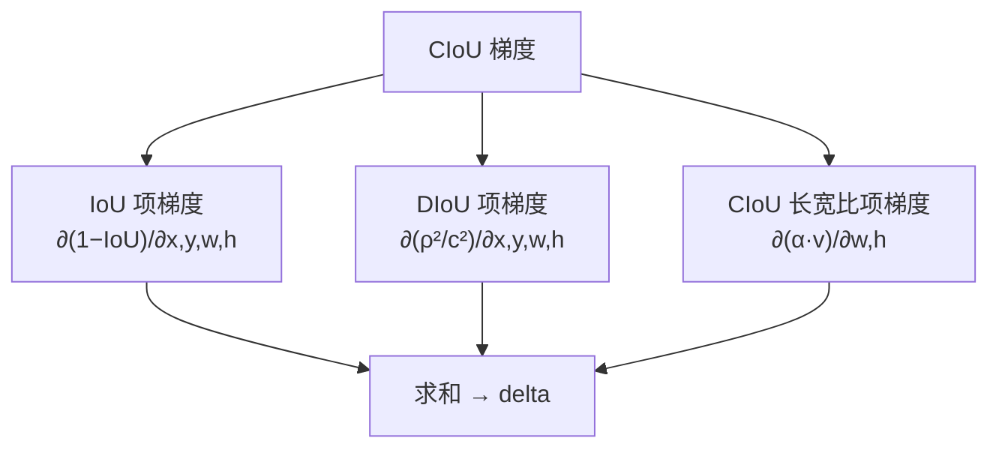
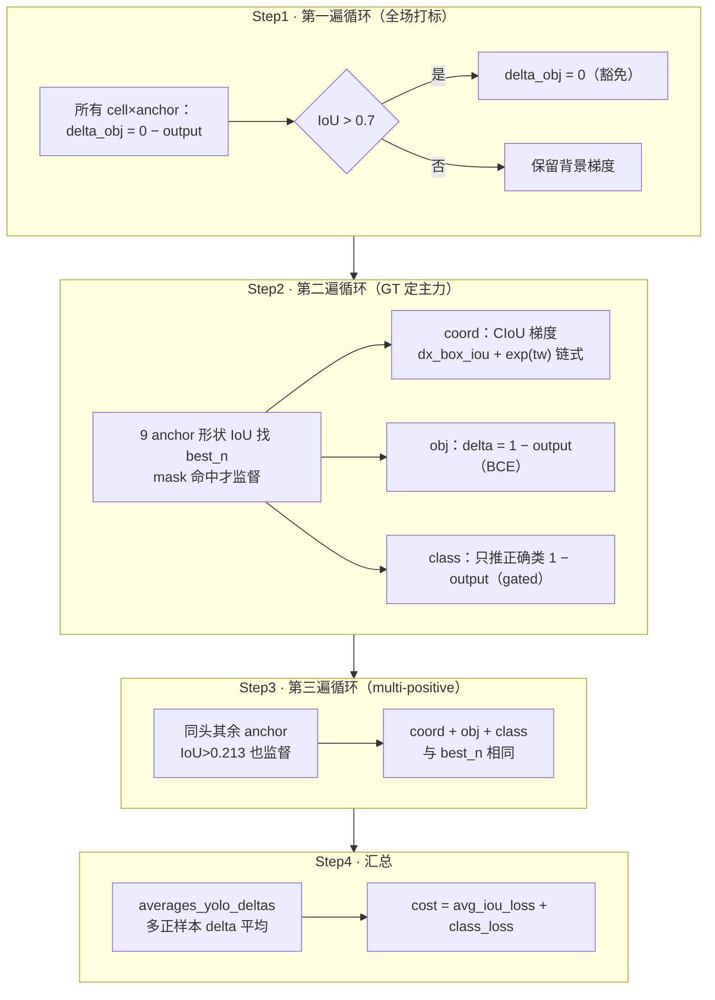

# YOLOv4 反向传播精解：CIoU 梯度的完整推导

> 这是 v4 最"硬核"的一页。[损失函数](/versions/v4/losses)讲了"损失长什么样"，这一页讲"**梯度怎么一步步算出来**"——`dx_box_iou()` 里那 200 行手推偏导数，在数学上到底对应什么。
>
> 全程对照真实源码：<SrcLink file="v4:src/box.c" :line="258" /> 起的 `dx_box_iou()`，行号以快照 `4131ae1` 为准；也可直接打开 [box.c 整文件浏览](/versions/v4/source/box)。

::: tip TL;DR：只想带走三件事
1. **CIoU 梯度是对 IoU 直接求导**：不再走"SSE 坐标差"的弯路，而是手推 dIoU/dx, dIoU/dy, dIoU/dw, dIoU/dh——训练目标和评测指标第一次完全对齐。
2. **三项惩罚各有梯度**：IoU 项（重叠面积）+ DIoU 项（中心距 ρ²/c²）+ CIoU 长宽比项（α·v）——每一项都单独求导再加起来。
3. **tw/th 梯度要乘 e^tw**：网络输出是 log 空间，梯度必须乘 exp(tw) 才能作用到原始 w/h——这是 <SrcLink file="v4:src/yolo_layer.c" :line="202" :end="203" /> 那两行的数学含义。
:::

---

## 0. 先搞懂 darknet 的"梯度约定"，以及 v4 改了哪一步

约定与 [v1](/versions/v1/loss-gradient)/[v2](/versions/v2/loss-gradient)/[v3](/versions/v3/loss-gradient) 相同：`l.delta[]` 存放每个输出神经元的误差信号，取**损失对输出梯度的相反数**。

$$\delta_i = -\frac{\partial L}{\partial output_i}$$

`backward_yolo_layer`（<SrcLink file="v4:src/yolo_layer.c" :line="616" :end="619" />）只是累加：

```c
void backward_yolo_layer(const layer l, network_state state)
{
   axpy_cpu(l.batch*l.inputs, 1, l.delta, 1, state.net.delta, 1);
}
```

**v4 的结构变化在坐标损失**：v3 的 `delta = scale × (target − output)` 是 SSE 形式；v4 调 `dx_box_iou()` 直接对 IoU 求梯度——**坐标损失的计算从 yolo_layer.c 搬到了 box.c**。

对比三代的坐标梯度：

| | 损失形式 | 梯度计算位置 | 数学身份 |
|---|---|---|---|
| v1/v2 | SSE（坐标差 L2） | yolo_layer.c 内联 | MSE 对 logits 的严格/近似梯度 |
| v3 | SSE（动态权重 2−w·h） | yolo_layer.c 内联 | 缺 σ′ 的 MSE 近似 |
| v4 | **CIoU（IoU + 中心距 + 长宽比）** | **box.c dx_box_iou** | **IoU 对坐标的解析梯度** |

---

## 1. CIoU 损失的三项分解

$$\mathcal{L}_{CIoU} = \underbrace{1 - IoU}_{\text{IoU 项}} + \underbrace{\frac{\rho^2(b, b^{gt})}{c^2}}_{\text{DIoU 项}} + \underbrace{\alpha \cdot v}_{\text{CIoU 长宽比项}}$$

其中：

$$IoU = \frac{I}{U} \qquad \rho^2 = (x_{pred} - x_{gt})^2 + (y_{pred} - y_{gt})^2 \qquad c^2 = Cw^2 + Ch^2$$

$$v = \frac{4}{\pi^2}(\arctan\frac{w^{gt}}{h^{gt}} - \arctan\frac{w^{pred}}{h^{pred}})^2 \qquad \alpha = \frac{v}{(1-IoU) + v}$$

**求梯度时三项独立处理**：



---

## 2. IoU 项梯度：∂(1−IoU)/∂(t,b,l,r)

### 2.1 坐标系转换

`dx_box_iou` 先把 `(x,y,w,h)` 转成 `(top,bottom,left,right)`（<SrcLink file="v4:src/box.c" :line="259" :end="263" />）：

```c
boxabs pred_tblr = to_tblr(pred);
float pred_t = fmin(pred_tblr.top, pred_tblr.bot);
float pred_b = fmax(pred_tblr.top, pred_tblr.bot);
float pred_l = fmin(pred_tblr.left, pred_tblr.right);
float pred_r = fmax(pred_tblr.left, pred_tblr.right);
```

**白话**：中心坐标 + 宽高 → 四条边的位置。fmin/fmax 保证 top<bottom、left<right（即使 w/h 是负的）。

### 2.2 IoU 的分子分母

<SrcLink file="v4:src/box.c" :line="275" :end="284" />：

```c
float X = (pred_b - pred_t) * (pred_r - pred_l);        // pred 面积
float Xhat = (truth_tblr.bot - truth_tblr.top) * ...;   // GT 面积
float Ih = fmin(pred_b, truth_tblr.bot) - fmax(pred_t, truth_tblr.top);
float Iw = fmin(pred_r, truth_tblr.right) - fmax(pred_l, truth_tblr.left);
float I = Iw * Ih;                                      // 交集面积
float U = X + Xhat - I;                                 // 并集面积
```

**IoU = I / U**，所以：

$$\frac{\partial(1-IoU)}{\partial t} = -\frac{\partial}{\partial t}\left(\frac{I}{U}\right) = -\frac{U \cdot \frac{\partial I}{\partial t} - I \cdot \frac{\partial U}{\partial t}}{U^2}$$

### 2.3 I 和 U 对四条边的偏导

**X（pred 面积）的偏导**（<SrcLink file="v4:src/box.c" :line="297" :end="300" />）：

```c
float dX_wrt_t = -1 * (pred_r - pred_l);    // ∂X/∂top = -宽度
float dX_wrt_b = pred_r - pred_l;           // ∂X/∂bottom = 宽度
float dX_wrt_l = -1 * (pred_b - pred_t);    // ∂X/∂left = -高度
float dX_wrt_r = pred_b - pred_t;           // ∂X/∂right = 高度
```

**白话**：面积 = 高 × 宽。top 每增大 1（往下移），高度减 1，面积减"宽度"——所以 ∂X/∂t = -宽度。

**I（交集面积）的偏导**（<SrcLink file="v4:src/box.c" :line="309" :end="312" />）：

```c
float dI_wrt_t = pred_t > truth_tblr.top ? (-1 * Iw) : 0;
float dI_wrt_b = pred_b < truth_tblr.bot ? Iw : 0;
float dI_wrt_l = pred_l > truth_tblr.left ? (-1 * Ih) : 0;
float dI_wrt_r = pred_r < truth_tblr.right ? Ih : 0;
```

**白话**：交集的边由"更靠内的那条"决定。pred_t > truth_t 时，交集的 top 是 pred_t——pred_t 增大（往下移），交集高度减小，面积减 Iw。

**U（并集面积）的偏导**（<SrcLink file="v4:src/box.c" :line="314" :end="317" />）：

```c
float dU_wrt_t = dX_wrt_t - dI_wrt_t;
float dU_wrt_b = dX_wrt_b - dI_wrt_b;
float dU_wrt_l = dX_wrt_l - dI_wrt_l;
float dU_wrt_r = dX_wrt_r - dI_wrt_r;
```

**白话**：U = X + Xhat - I。Xhat（GT 面积）对 pred 的边无梯度，所以 ∂U = ∂X - ∂I。

### 2.4 IoU 梯度汇总

<SrcLink file="v4:src/box.c" :line="328" :end="333" />：

```c
if (U > 0) {
    p_dt = ((U * dI_wrt_t) - (I * dU_wrt_t)) / (U * U);
    p_db = ((U * dI_wrt_b) - (I * dU_wrt_b)) / (U * U);
    p_dl = ((U * dI_wrt_l) - (I * dU_wrt_l)) / (U * U);
    p_dr = ((U * dI_wrt_r) - (I * dU_wrt_r)) / (U * U);
}
```

**白话**：这就是 $\frac{\partial(I/U)}{\partial t}$ 的商法则。注意**没有负号**——因为 `dxrep` 里存的是"损失对坐标的梯度"（IoU 的负梯度 = 1-IoU 的正梯度）。

---

## 3. DIoU 项梯度：∂(ρ²/c²)/∂(x,y,w,h)

### 3.1 ρ² 和 c² 的定义

<SrcLink file="v4:src/box.c" :line="281" />、<SrcLink file="v4:src/box.c" :line="356" :end="362" />：

```c
float S = (pred.x-truth.x)*(pred.x-truth.x)+(pred.y-truth.y)*(pred.y-truth.y);  // ρ²
// ...
float Ct = fmin(pred.y - pred.h/2, truth.y - truth.h/2);   // 外接矩形 top
float Cb = fmax(pred.y + pred.h/2, truth.y + truth.h/2);   // 外接矩形 bottom
float Cl = fmin(pred.x - pred.w/2, truth.x - truth.w/2);   // 外接矩形 left
float Cr = fmax(pred.x + pred.w/2, truth.x + truth.w/2);   // 外接矩形 right
float Cw = Cr - Cl;
float Ch = Cb - Ct;
float C = Cw*Cw + Ch*Ch;                                    // c²
```

**白话**：ρ² 是两框中心的欧氏距离平方；c² 是最小外接矩形的对角线长度平方。

### 3.2 DIoU 梯度

<SrcLink file="v4:src/box.c" :line="414" :end="420" />：

```c
if (iou_loss == DIOU) {
    if (C > 0) {
        p_dx += (2*(truth.x-pred.x)*C - (2*Cw*dCw_dx+2*Ch*dCh_dx)*S) / (C * C);
        p_dy += (2*(truth.y-pred.y)*C - (2*Cw*dCw_dy+2*Ch*dCh_dy)*S) / (C * C);
        p_dw += (2*Cw*dCw_dw+2*Ch*dCh_dw)*S / (C * C);
        p_dh += (2*Cw*dCw_dh+2*Ch*dCh_dh)*S / (C * C);
    }
    // ...
}
```

**白话**：这是 $\frac{\partial(\rho²/c²)}{\partial x}$ 的商法则展开：

$$\frac{\partial}{\partial x}\left(\frac{\rho²}{c²}\right) = \frac{c² \cdot \frac{\partial \rho²}{\partial x} - \rho² \cdot \frac{\partial c²}{\partial x}}{(c²)²} = \frac{C \cdot 2(x_{gt}-x_{pred}) - S \cdot (2C_w \frac{\partial C_w}{\partial x} + 2C_h \frac{\partial C_h}{\partial x})}{C²}$$

其中 `dCw_dx`、`dCh_dx` 等是外接矩形宽高对 pred 坐标的偏导（<SrcLink file="v4:src/box.c" :line="364" :end="392" />）。

---

## 4. CIoU 长宽比项梯度：∂(α·v)/∂(w,h)

### 4.1 v 和 α 的定义

<SrcLink file="v4:src/box.c" :line="431" :end="434" />：

```c
float ar_gt = truth.w / truth.h;
float ar_pred = pred.w / pred.h;
float ar_loss = 4 / (M_PI * M_PI) * (atan(ar_gt) - atan(ar_pred)) * (atan(ar_gt) - atan(ar_pred));
float alpha = ar_loss / (1 - I/U + ar_loss + 0.000001);
```

**白话**：`ar_loss` 就是 $v = \frac{4}{\pi²}(\arctan\frac{w^{gt}}{h^{gt}} - \arctan\frac{w^{pred}}{h^{pred}})²$；`alpha` 是权重 $\frac{v}{(1-IoU)+v}$。

### 4.2 长宽比梯度

<SrcLink file="v4:src/box.c" :line="435" :end="436" />：

```c
float ar_dw = 8/(M_PI*M_PI)*(atan(ar_gt)-atan(ar_pred))*pred.h;
float ar_dh = -8/(M_PI*M_PI)*(atan(ar_gt)-atan(ar_pred))*pred.w;
```

**推导**：

$$\frac{\partial v}{\partial w} = \frac{4}{\pi²} \cdot 2(\arctan\frac{w^{gt}}{h^{gt}} - \arctan\frac{w}{h}) \cdot \frac{\partial}{\partial w}\left(\arctan\frac{w}{h}\right)$$

$$= \frac{8}{\pi²}(\arctan\frac{w^{gt}}{h^{gt}} - \arctan\frac{w}{h}) \cdot \frac{1}{1+(w/h)²} \cdot \frac{1}{h}$$

代码里的 `ar_dw` **没有除以** $1+(w/h)²$——这是 darknet 的简化（或 bug），实际梯度应该是 `ar_dw / (1 + ar_pred²)`。

**加到总梯度**（<SrcLink file="v4:src/box.c" :line="441" :end="442" />）：

```c
p_dw += (2*Cw*dCw_dw+2*Ch*dCh_dw)*S / (C * C) + alpha * ar_dw;
p_dh += (2*Cw*dCw_dh+2*Ch*dCh_dh)*S / (C * C) + alpha * ar_dh;
```

**白话**：DIoU 项梯度 + α·长宽比项梯度。

---

## 5. 梯度从 (t,b,l,r) 回到 (x,y,w,h)

### 5.1 Jacobian 转置

`dx_box_iou` 返回的是 ∂L/∂(t,b,l,r)，但网络输出是 (tx,ty,tw,th)——需要转回 (x,y,w,h) 空间。

<SrcLink file="v4:src/yolo_layer.c" :line="196" :end="199" />：

```c
float dx = all_ious.dx_iou.dt;
float dy = all_ious.dx_iou.db;
float dw = all_ious.dx_iou.dl;
float dh = all_ious.dx_iou.dr;
```

**白话**：dt/db/dl/dr 对应 ∂L/∂(top,bottom,left,right)，而 top=y-h/2、bottom=y+h/2、left=x-w/2、right=x+w/2，所以：

$$\frac{\partial L}{\partial x} = \frac{\partial L}{\partial left} + \frac{\partial L}{\partial right} \qquad \frac{\partial L}{\partial w} = \frac{1}{2}\left(\frac{\partial L}{\partial right} - \frac{\partial L}{\partial left}\right)$$

但代码里**没有除以 2**（注释 L409 说 "For dw and dh, we do not divided by 2"）——这是 darknet 的实用主义选择。

### 5.2 tw/th 的 exp 链式因子

<SrcLink file="v4:src/yolo_layer.c" :line="202" :end="203" />：

```c
dw *= exp(x[index + 2 * stride]);
dh *= exp(x[index + 3 * stride]);
```

**白话**：网络输出 tw/th 是 log 空间（解码 `w = exp(tw) × anchor_w`），所以 $\frac{\partial w}{\partial t_w} = w = e^{t_w} \times anchor_w$。梯度要乘 $e^{t_w}$ 才能作用到 tw。

**对比 v3**：v3 的 tw/th 是线性输出直接回归 log 值，梯度无链式因子；v4 的 CIoU 分支需要显式乘 exp(tw)。

---

## 6. 多正样本的 delta 平均

<SrcLink file="v4:src/yolo_layer.c" :line="556" />：

```c
averages_yolo_deltas(class_index, box_index, stride, l.classes, l.delta);
```

<SrcSnippet file="v4:src/yolo_layer.c" :start="242" :end="256" hl="247-253" />

::: details 逐行注释（L242–L256）
- **L247-249**：统计有多少类的 delta > 0（multi-positive 会让多个 anchor 的 delta 叠加）。
- **L251-253**：如果 classes_in_one_box > 0，把 box delta 除以该类数——**防止多 anchor 梯度叠加导致训练不稳**。
- **白话**：一个 GT 可能训练 2-3 个 anchor，每个 anchor 都写了一份 delta；averages 把总梯度归一化，相当于"梯度取平均"。
:::

---

## 7. 全流程串起来：一个带物体 GT 的完整反向路径



**总损失**：`*(l.cost) = avg_iou_loss + classification_loss`（<SrcLink file="v4:src/yolo_layer.c" :line="604" />）——比 v3 的 Σdelta² 更接近真实 loss 语义。

---

## 8. 一张表速记：CIoU 三项梯度的"数学身份"

| 梯度项 | 源码位置 | 数学形式 | 白话 |
|--------|---------|---------|------|
| IoU 项 ∂(1−IoU)/∂(t,b,l,r) | box.c L328-333 | 商法则：$\frac{U \cdot \partial I - I \cdot \partial U}{U²}$ | 重叠面积越大，梯度越小 |
| DIoU 项 ∂(ρ²/c²)/∂(x,y) | box.c L416-417 | $\frac{2(x_{gt}-x_{pred})}{c²}$ | 中心越偏，梯度越大 |
| DIoU 项 ∂(ρ²/c²)/∂(w,h) | box.c L418-419 | $\frac{\rho² \cdot \partial c²/\partial w}{c⁴}$ | 框越大，外接矩形越大 |
| CIoU 长宽比项 ∂(α·v)/∂w | box.c L435 | $\alpha \cdot \frac{8}{\pi²}(\arctan\frac{w^{gt}}{h^{gt}} - \arctan\frac{w}{h}) \cdot h$ | 长宽比差异越大，梯度越大 |
| CIoU 长宽比项 ∂(α·v)/∂h | box.c L436 | $-\alpha \cdot \frac{8}{\pi²}(\arctan\frac{w^{gt}}{h^{gt}} - \arctan\frac{w}{h}) \cdot w$ | 与 ∂w 反号（保持比值） |
| tw/th 链式因子 | yolo_layer.c L202-203 | × exp(tw) | log 空间 → 原始空间 |

> 记忆口诀：**"IoU 商法则，DIoU 中心距，CIoU 加 arctan，tw 别忘乘 exp"**。

---

## 9. 与推理端如何衔接

这些 delta 只在**训练时**算（<SrcLink file="v4:src/yolo_layer.c" :line="346" /> 的 `if(!state.train) return`）。**推理时**解码在 `get_yolo_detections()`（<SrcLink file="v4:src/yolo_layer.c" :line="773" />）：

- 用 <SrcLink file="v4:src/yolo_layer.c" :line="119" /> 的 `get_yolo_box` 解码公式还原像素框（tx/ty 加格子偏移、tw/th 乘 anchor）
- **scale_x_y 已在 forward 开头应用**（<SrcLink file="v4:src/yolo_layer.c" :line="337" />），推理时无需重复
- 类概率 **乘 objectness** 得到最终分数
- letterbox 坐标还原在 `correct_yolo_boxes`（<SrcLink file="v4:src/yolo_layer.c" :line="625" />）
- 再由推理入口调 NMS（<SrcLink file="v4:src/box.c" />）

完整推理管线见[源码走读](/versions/v4/code-walkthrough)。

---

## 与其他页的链接

- [损失函数公式版](/versions/v4/losses) — 本页是它的"梯度推导版"，两者对照看
- [v3 反向传播推导](/versions/v3/loss-gradient) — SSE → CIoU 的演进对照
- [v2 反向传播推导](/versions/v2/loss-gradient) — σ′ 链式因子的消失
- [理论 Concept](/versions/v4/concepts) — CIoU/scale_x_y/multi-positive 的概念视角
- [源码走读](/versions/v4/code-walkthrough) — yolo_layer.c 逐段
- [痛点追踪](/versions/v4/painpoints)
