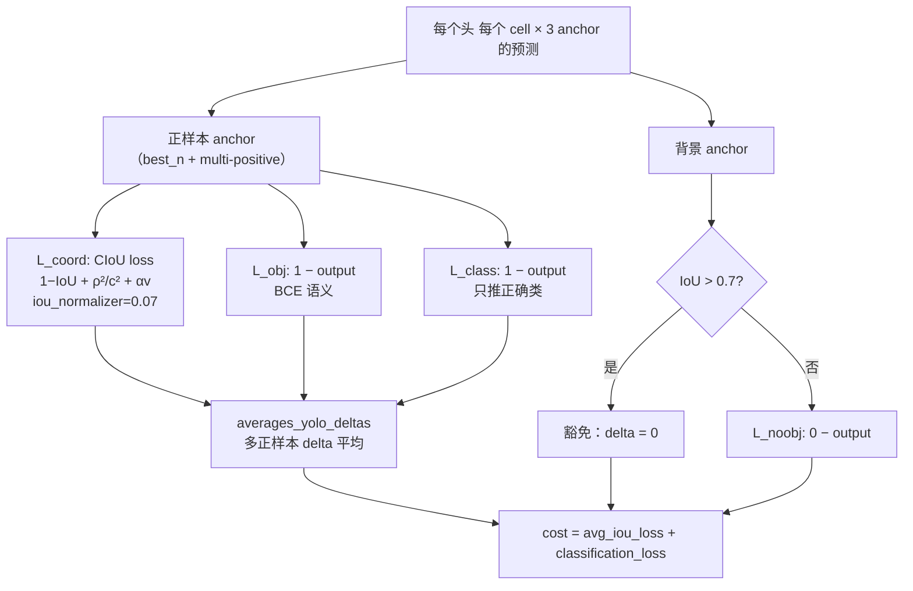
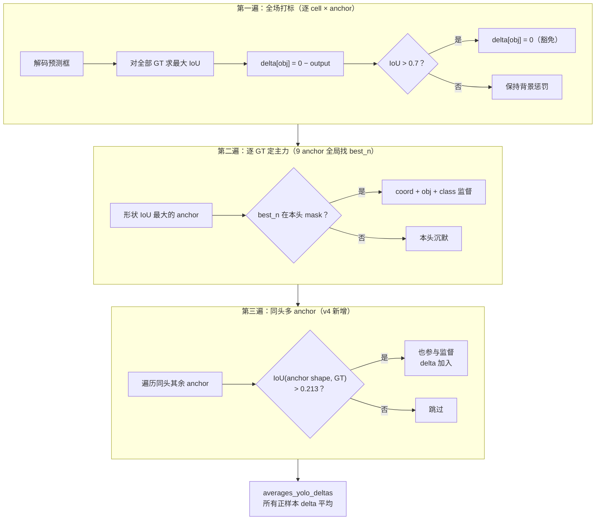

# YOLOv4 损失函数

YOLOv4 的损失是一次**范式转移**：坐标回归从 SSE 换成 **CIoU**（Complete IoU），全部在 <SrcLink file="v4:src/yolo_layer.c" :line="327" /> 的 `forward_yolo_layer()` 中计算；`cost = avg_iou_loss + classification_loss`（<SrcLink file="v4:src/yolo_layer.c" :line="604" />）。

> **v3 读者路标**：v3 的坐标损失是 `scale × (target − output)` 的 SSE 形式（缺 σ′）；v4 直接对 **IoU 求梯度**——`dx_box_iou` 手推 dIoU/dx, dIoU/dy, dIoU/dw, dIoU/dh，同时惩罚重叠面积、中心距、长宽比。

$$\mathcal{L}_{CIoU} = 1 - IoU + \frac{\rho^2(b, b^{gt})}{c^2} + \alpha v$$

**与 v3 的 5 点关键差异**：

| 项 | v3 | v4 |
|----|----|----|
| 坐标 loss | SSE（scale × (target − output)） | **CIoU（IoU + 中心距 + 长宽比）** |
| 小框权重 | 2 − truth.w·truth.h | **CIoU 分支被 bypass**（IoU 天然尺度不变） |
| GT 分配 | 单 GT 单 anchor（best_n 独占） | **Multi-positive（同头 IoU>0.213 多 anchor）** |
| ignore_thresh | 0.5 | **0.7** |
| 坐标网格敏感 | 无处理 | **scale_x_y（y = s·σ(tx) − 0.5(s−1)）** |

## 全景图



## 1. 坐标回归：CIoU loss (`loss-coord-ciou`)

> **v3 读者路标**：v3 的坐标 delta 是 `scale × (target − output)`（SSE 形式）；v4 调 `dx_box_iou` 直接对 IoU 求梯度，同时惩罚中心距和长宽比。

**公式**（CIoU 三项）：

$$\mathcal{L}_{CIoU} = \underbrace{1 - IoU}_{\text{重叠面积}} + \underbrace{\frac{\rho^2(b, b^{gt})}{c^2}}_{\text{中心距}} + \underbrace{\alpha \cdot \frac{4}{\pi^2}(\arctan\frac{w^{gt}}{h^{gt}} - \arctan\frac{w}{h})^2}_{\text{长宽比}}$$

其中：
- $IoU$：预测框与 GT 的交并比
- $\rho^2(b, b^{gt})$：两框中心的欧氏距离平方
- $c^2$：最小外接矩形对角线长度平方
- $v$：长宽比一致性惩罚
- $\alpha = \frac{v}{(1-IoU)+v}$：权重系数

**白话**：SSE 只看坐标偏移量的数值大小，不管两个框实际重不重叠；CIoU 直接优化 IoU（检测的评价指标），还额外惩罚"中心偏了"和"长宽比不对"——**训练目标和评测指标对齐了**。

**要点**：

- **iou_normalizer=0.07**：CIoU 项的归一化系数（<SrcLink file="v4:cfg/yolov4.cfg" :line="977" />），防止 IoU 梯度过大淹没其他项
- **小框权重被 bypass**：v3 的 `(2−truth.w·truth.h)` 传入 `delta_yolo_box`（<SrcLink file="v4:src/yolo_layer.c" :line="428" />、<SrcLink file="v4:src/yolo_layer.c" :line="470" />），但 CIoU 分支**不使用**（只在 MSE 旧路径用，<SrcLink file="v4:src/yolo_layer.c" :line="178" :end="181" />）——IoU 是归一化指标，天然尺度不变
- **梯度全手推**：`dx_box_iou` 在 <SrcLink file="v4:src/box.c" :line="258" :end="476" />，对 dx/dy/dw/dh 分别推导出 IoU 的解析梯度

**源码对应**（delta_yolo_box 的 CIoU 分支）：

<SrcSnippet file="v4:src/yolo_layer.c" :start="183" :end="236" hl="187,196-203,206-209,233-236" />

::: details 逐行注释（L183–L236）
- **L187**：`dx_box_iou(pred, truth, iou_loss)` —— 调用 box.c 的 CIoU 梯度计算，返回 dIoU/d(t,b,l,r)。
- **L196-199**：Jacobian 转置——`dx = dt, dy = db, dw = dl, dh = dr`（t/b/l/r 对应 x/y/w/h 的梯度映射）。
- **L202-203**：`dw *= exp(x[...])`、`dh *= exp(x[...])` —— tw/th 是 log 空间，梯度要乘 e^tw 才能作用到原始 w/h。
- **L206-209**：`dx *= iou_normalizer` —— 乘归一化系数 0.07，防止 CIoU 梯度过大。
- **L212-215**：`fix_nan_inf` —— 防御性截断，防止梯度爆炸。
- **L217-222**：`max_delta != FLT_MAX` 时 clip —— cfg 默认 `max_delta=FLT_MAX`（无截断）。
- **L225-236**：`accumulate` 标志决定是否先清零再累加——multi-positive 的多个 anchor 会累加 delta。
:::

**dx_box_iou 的 CIoU 分支**（<SrcLink file="v4:src/box.c" :line="430" :end="450" />）：

```c
if (iou_loss == CIOU) {
    float ar_gt = truth.w / truth.h;
    float ar_pred = pred.w / pred.h;
    float ar_loss = 4 / (M_PI * M_PI) * (atan(ar_gt) - atan(ar_pred)) * (atan(ar_gt) - atan(ar_pred));
    float alpha = ar_loss / (1 - I/U + ar_loss + 0.000001);
    float ar_dw = 8/(M_PI*M_PI)*(atan(ar_gt)-atan(ar_pred))*pred.h;
    float ar_dh = -8/(M_PI*M_PI)*(atan(ar_gt)-atan(ar_pred))*pred.w;
    // ... DIoU 项 + CIoU 长宽比项 ...
}
```

详尽的梯度推导见 [loss-gradient 页](/versions/v4/loss-gradient)。

## 2. Objectness L2（BCE 语义）(`loss-object`)

> **v3 读者路标**：与 v3 相同——`delta = 1 − output`，BCE 对 logits 的严格梯度。

**公式**：

$$L_{obj} = \big(1 - y_{obj}\big)^2 \quad \text{（仅正样本 anchor）}$$

**源码对应**（第二遍循环 best_n + 第三遍循环 multi-positive）：

<SrcSnippet file="v4:src/yolo_layer.c" :start="468" :end="472" hl="470-471" />

::: details 逐行注释（L468–L472）
- **L470**：`delta_yolo_box(..., (2-truth.w*truth.h), ...)` —— 坐标监督（CIoU 分支），小框权重传入但 CIoU 不使用。
- **L471**：objectness delta = `1 − output` —— 与 v3 相同的 BCE 语义。
- **L472**：类别 delta（走 gated 分支，与 v3 相同）。
:::

## 3. No-Object L2 + ignore_thresh 豁免 (`loss-noobject`)

> **v3 读者路标**：ignore_thresh 从 0.5 调到 **0.7**——更宽松的豁免，更多"预测得好但没被选中"的框不受罚。

**公式**：

$$L_{noobj} = \big(y_{obj} - 0\big)^2 \quad \text{（背景 anchor，IoU} \le 0.7 \text{）}$$

**白话**：第一遍循环把每个 anchor 都"有罪推定"为背景推向 0；但如果它的预测框和某个 GT 的 IoU 超过 `ignore_thresh=0.7`（v3 是 0.5），delta 清零——**v4 的豁免更宽松**，配合 multi-positive 多正样本，训练更稳定。

**源码对应**（第一遍循环）：

<SrcSnippet file="v4:src/yolo_layer.c" :start="404" :end="410" hl="404-409" />

::: details 逐行注释（L404–L410）
- **L404**：`best_iou > l.ignore_thresh` —— IoU>0.7 时豁免。
- **L405-407**：delta 清零——预测得好但没被选为主力的框不受罚。
- **L409**：`else` 分支保持默认的 `0 − output` 背景惩罚。
:::

## 4. Class 损失（logistic 多标签）(`loss-class`)

> **v3 读者路标**：与 v3 相同——objectness-gated，只推正确类。

**公式**：

$$\delta_{class} = 1 - y_{c^*} \quad \text{（仅正确类 } c^*\text{，且仅当 objectness 已激活）}$$

**源码对应**：

<SrcSnippet file="v4:src/yolo_layer.c" :start="97" :end="109" hl="100-104" />

::: details 逐行注释（L97–L109）
- **L100**：`if (delta[index])` 守卫——objectness 槽位的 delta 非零才继续（正样本才进这里）。
- **L101**：只对正确类写 `1 − output`（BCE 对 logits 的严格梯度）。
- **L102**：`avg_cat` 统计正确类平均输出（日志）。
- **L105-108**：守卫不成立时的兜底（推全部 80 维 one-hot delta）——实际永远走 L101。
:::

## 5. 目标分配：三遍循环（v4 新增 multi-positive）

v4 的 GT 分配比 v3 多一遍循环：



- 第一遍 <SrcLink file="v4:src/yolo_layer.c" :line="369" :end="410" />
- 第二遍 <SrcLink file="v4:src/yolo_layer.c" :line="447" :end="490" />
- 第三遍 <SrcLink file="v4:src/yolo_layer.c" :line="501" :end="545" />
- delta 平均 <SrcLink file="v4:src/yolo_layer.c" :line="556" />

**Multi-positive 源码**（<SrcLink file="v4:src/yolo_layer.c" :line="501" :end="545" />）：

<SrcSnippet file="v4:src/yolo_layer.c" :start="501" :end="520" hl="504-517" />

::: details 逐行注释（L501–L520）
- **L504**：`mask_n >= 0 && n != best_n && l.iou_thresh < 1.0f` —— 只处理"在本头 mask 内、但不是 best_n"的 anchor。
- **L508**：用 GT 的纯形状（truth_shift，只保留 w/h，中心对齐到 anchor）与当前 anchor 求 IoU。
- **L511**：`iou > l.iou_thresh`（0.213）—— 形状足够像就参与监督。
- **L517**：调 `delta_yolo_box` 写 delta（与 best_n 相同的逻辑）。
- **L556**（后续）：所有正样本的 delta 经 `averages_yolo_deltas` 平均，防止多个 anchor 的梯度叠加导致训练不稳。
:::

## 6. cost 计算

<SrcLink file="v4:src/yolo_layer.c" :line="604" />：

```c
*(l.cost) = avg_iou_loss + classification_loss;
```

- **v3 的 cost 是 Σdelta²**（只作日志监控）
- **v4 的 cost 是 avg_iou_loss + classification_loss**——更接近真实 loss 的语义
- 真正反传的仍是 `l.delta` 本身（`backward_yolo_layer` 直接 axpy，<SrcLink file="v4:src/yolo_layer.c" :line="616" :end="619" />）

## 权重平衡总表

| 项 | v1 | v2 | v3 | v4 |
|----|----|----|----|----|
| Coord | 5（√ 空间） | 1（log 空间） | 2−w·h（log 空间，动态） | **CIoU（iou_normalizer=0.07）** |
| Object | 1（rescore=IoU） | 1（rescore=IoU） | 1（目标固定 1） | 1（同 v3） |
| No-Object | 0.5 | 1 | 1（+ignore=.5） | 1（+ignore=.7） |
| Class | 1（裸线性 L2） | 1（softmax 交叉熵式） | 1（logistic，只推正确类） | 1（同 v3） |
| 正样本分配 | 单 GT 单 box | 单 GT 单 anchor | 单 GT 单 anchor | **Multi-positive（iou_thresh=0.213）** |

**一眼看懂的设计转向**：v1-v3 在 L2 框架内打补丁（权重、√空间、log 空间、动态权重）；v4 直接换 CIoU，**训练目标和评测指标对齐**。Multi-positive 把"单 GT 单 anchor"的苛刻分配放开，样本利用率翻倍。

## 与其他页的链接

- [概览](/versions/v4/index)
- [论文精读](/versions/v4/paper)
- [理论 Concept](/versions/v4/concepts)
- [架构与层](/versions/v4/layers)
- [训练技巧](/versions/v4/tricks)
- [反向传播推导（CIoU 手推梯度）](/versions/v4/loss-gradient)
- [源码走读](/versions/v4/code-walkthrough)
- [痛点追踪](/versions/v4/painpoints)
