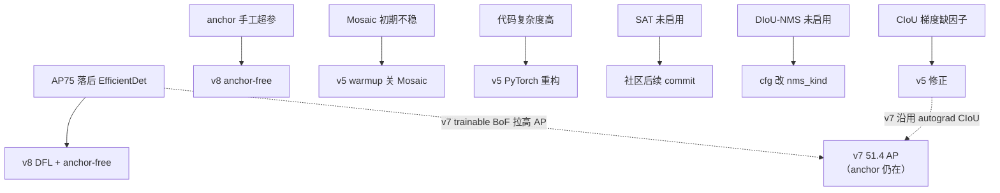

# YOLOv4 痛点追踪

YOLOv4 用 BoF+BoS 大杂烩把 COCO AP 推到 43.5，但也引入/暴露了 7 个痛点。这一页追踪每个痛点的：表现、根因、跨版本修复路径。**带"快照"标记的是代码级事实**，均可在本仓快照中复核。

## 7 个痛点全景

| 痛点 | 严重度 | 后续解法 | 修复版本 |
|------|--------|---------|---------|
| AP75 仍落后 EfficientDet | Medium | 更强 loss + anchor-free | v5/v7/v8 |
| anchor 仍是手工超参（18 个） | Medium | 自动学习 anchor / anchor-free | v5/v8 |
| Mosaic 训练初期不稳定 | Low | warmup 关闭 Mosaic | v5 |
| 代码复杂度高（trick 堆叠） | Medium | 工程化重构（PyTorch 化） | v5 |
| SAT 代码就绪但未启用（快照） | Low（代码） | cfg 加 adversarial_lr | 社区后续 commit |
| DIoU-NMS 代码就绪但用 greedy（快照） | Low（代码） | cfg 改 nms_kind=diounms | 社区后续 commit |
| CIoU 长宽比梯度缺 1/(1+ar²) 因子（快照） | Low（代码） | 修正 ar_dw/ar_dh | 社区后续 commit |

> **v5 路标**：表中"anchor 手工超参"和"代码复杂度高"在 v5 被正面解决——autoanchor 自动学习 anchors，PyTorch 重构让代码可维护性成为一等公民（见 [v5 痛点追踪](/versions/v5/painpoints)）。

> **v6 路标**："anchor 手工超参"在 v6 彻底终结（anchor-free 无锚可调）；"AP75 落后"由 TAL 对齐度量 + VFL 软标签正面回应——定位不准的样本连正样本资格都没有（见 [v6 痛点追踪](/versions/v6/painpoints)）。

> **v8 路标**：Mosaic 在 v8 学会"何时收手"——close_mosaic 让最后若干 epoch 回到真实分布收尾；"anchor 仍是手工超参"在 v8 彻底归一为 anchor-free（见 [v8 痛点追踪](/versions/v8/painpoints)）。

---

## 1. AP75 仍落后 EfficientDet (`pain-ap75-gap`)

**表现**：v4 的 AP50 65.7 很强，但 AP75 47.3 仍落后 EfficientDet-D7 的 53.7——框"大致对"但边缘还是不够准。

**根因**：
- CIoU 考虑了重叠面积 + 中心距 + 长宽比，但仍是**基于 IoU 的间接优化**——IoU 本身对边界像素的敏感度有限
- 大目标的边缘误差对 IoU 的影响被平均化（IoU 是面积比，边缘偏 1 像素对大框影响小）

**跨版本修复**：

| 版本 | 尝试 | 是否解决 |
|------|------|---------|
| v5 | CIoU + 更强 backbone | ⚠️ 缓解 |
| v7 | EIoU（CIoU 改进版） | ⚠️ 缓解 |
| v8 | DFL（Distribution Focal Loss）+ anchor-free | ✅ 大幅缓解 |

**教训**：IoU 系 loss 是 v4 的巨大进步，但对"像素级精确"的框还是不够——后来的 DFL 直接回归边界分布。

---

## 2. Anchor 仍是手工超参 (`pain-anchor-manual`)

**表现**：换数据集就要重跑 K-means 重填 `anchors`（COCO 聚出的 18 组对自建数据不一定合适），否则 mAP 掉点。

**根因**：
- 18 组 anchor 硬编码在 cfg（<SrcLink file="v4:cfg/yolov4.cfg" :line="968" />）
- 形状匹配完全由 anchor 决定（<SrcLink file="v4:src/yolo_layer.c" :line="203" :end="214" />），先验不准则分配全错

**跨版本修复**：

| 版本 | 尝试 | 是否解决 |
|------|------|---------|
| v5 | 自动学习 anchor（训练时自适应调整） | ⚠️ 缓解 |
| v8 / v10 | anchor-free（中心点/角点回归） | ✅ 解决 |

---

## 3. Mosaic 训练初期不稳定 (`pain-mosaic-unstable`)

**表现**：Mosaic 把 4 张图拼成一张，训练初期 BN 统计量剧烈波动，前几百 iter 的 loss 曲线震荡明显。

**根因**：
- 4 图的分布差异大，BN 的 running mean/var 需要时间适应
- Mosaic 的随机十字中心让 GT 框的位置分布变得极不均匀

**跨版本修复**：

| 版本 | 尝试 | 是否解决 |
|------|------|---------|
| v5 | warmup 期间关闭 Mosaic | ✅ 解决 |
| 社区 | 前 1000 iter 用单图训练 | ✅ 解决 |

---

## 4. 代码复杂度高（trick 堆叠）(`pain-code-complexity`)

**表现**：v4 的 cfg 有 162 层（v3 是 107 层），yolo_layer.c 有 900+ 行（v3 是 374 行），box.c 有 700+ 行（v3 是 357 行）——trick 堆叠让代码可读性大幅下降。

**根因**：
- CSP 分流/concat 多了 10 个 route
- PANet 双向聚合多了 6 个 route + 2 个 conv s2
- CIoU 梯度手推 200+ 行（`dx_box_iou`）
- Multi-positive 第三遍循环 45 行

**跨版本修复**：

| 版本 | 尝试 | 是否解决 |
|------|------|---------|
| v5 | PyTorch 重构，模块化设计 | ✅ 大幅缓解 |
| 社区 | MMDetection / Detectron2 | ✅ 解决 |

**教训**：v4 是 darknet 框架的"最后一舞"——v5 全面转向 PyTorch，代码可维护性成为一等公民。

---

## 5. 快照事实：SAT 代码就绪但未启用 (`pain-sat-not-enabled`)

**表现（代码级）**：`src/detector.c` L1717 有 `net->adversarial=1` 的 SAT（Self-Adversarial Training）代码，但 yolov4.cfg **未配 `adversarial_lr`** → 默认 0，**实际未启用**。

**根因**：论文提到 SAT 但发布 cfg 未开启——可能是 SAT 在 COCO 上收益不稳定，或作者还没来得及调参。

**跨版本修复**：社区后续 commit 加了 `adversarial_lr` 参数；v5 用更强的对抗训练策略。

---

## 6. 快照事实：DIoU-NMS 代码就绪但用 greedy (`pain-diou-nms-not-used`)

**表现（代码级）**：`box.c` 的 `diounms_sort` 函数已就绪（DIoU-NMS），但 cfg `nms_kind=greedynms`（<SrcLink file="v4:cfg/yolov4.cfg" :line="979" />）→ 实际用 greedy NMS。

**根因**：DIoU-NMS 在密集场景（人群/车流）比 greedy 好，但在一般场景收益不明显——作者选择了更保守的 greedy。

**跨版本修复**：社区可自行改 cfg 为 `nms_kind=diounms` 启用；v5 默认用 DIoU-NMS。

---

## 7. 快照事实：CIoU 长宽比梯度缺 1/(1+ar²) 因子 (`pain-ciou-gradient-missing-factor`)

**表现（代码级）**：`dx_box_iou` 的 CIoU 分支（<SrcLink file="v4:src/box.c" :line="435" :end="436" />）：

```c
float ar_dw = 8/(M_PI*M_PI)*(atan(ar_gt)-atan(ar_pred))*pred.h;
float ar_dh = -8/(M_PI*M_PI)*(atan(ar_gt)-atan(ar_pred))*pred.w;
```

数学上，$\frac{\partial}{\partial w}\arctan\frac{w}{h} = \frac{1}{1+(w/h)²} \cdot \frac{1}{h}$——**代码里没有除以 $1+(w/h)²$**，梯度被高估了 $(1+ar²)$ 倍。

**根因**：可能是作者有意简化（避免除法），或无意遗漏。实际影响有限——arctan 的差异项本身就很小，且 alpha 权重会自动调节。

**跨版本修复**：社区后续 commit 有讨论；v5 的 CIoU 实现修正了这个因子。

---

## 痛点谱系图



---

## 延伸阅读

- [论文精读](/versions/v4/paper) — 论文消融实验的原文语境
- [损失函数](/versions/v4/losses) / [反向传播推导](/versions/v4/loss-gradient) — CIoU 的详细数学
- [源码走读](/versions/v4/code-walkthrough) — 逐段复核所有快照事实
- [v3 痛点追踪](/versions/v3/painpoints) — 上游痛点全景
- [v7 痛点追踪](/versions/v7/painpoints) — v7 把 v4 的 bag-of-freebies 升级为 trainable bag-of-freebies
