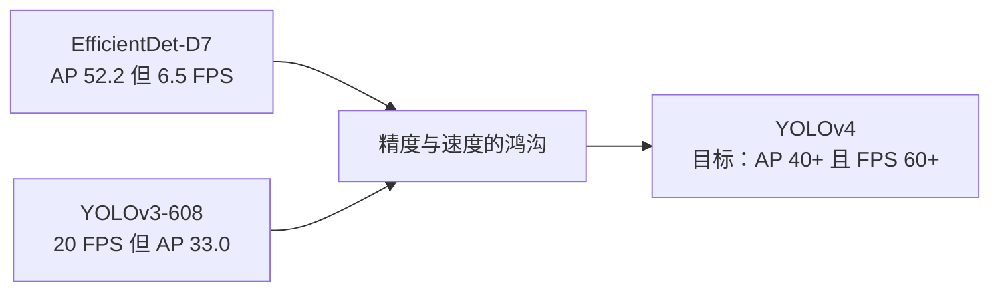
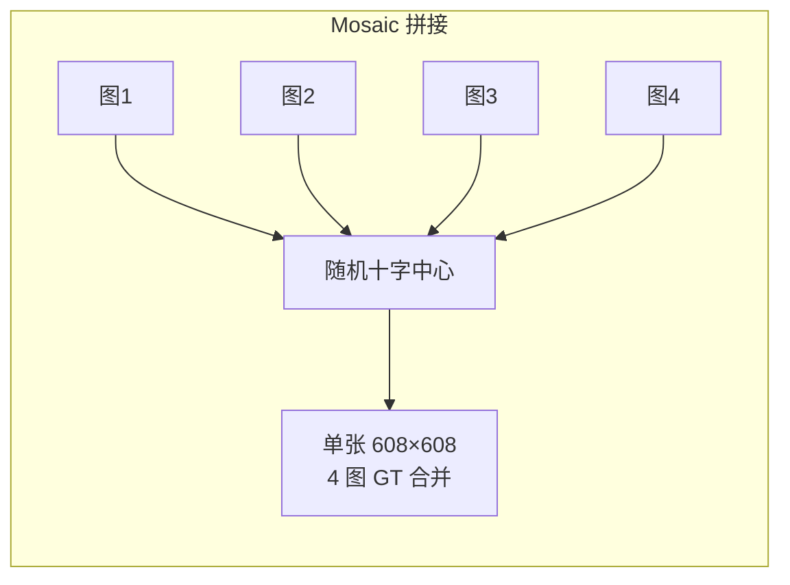
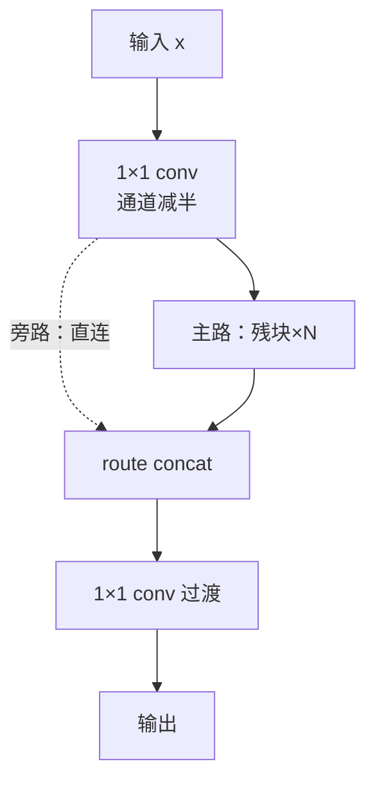
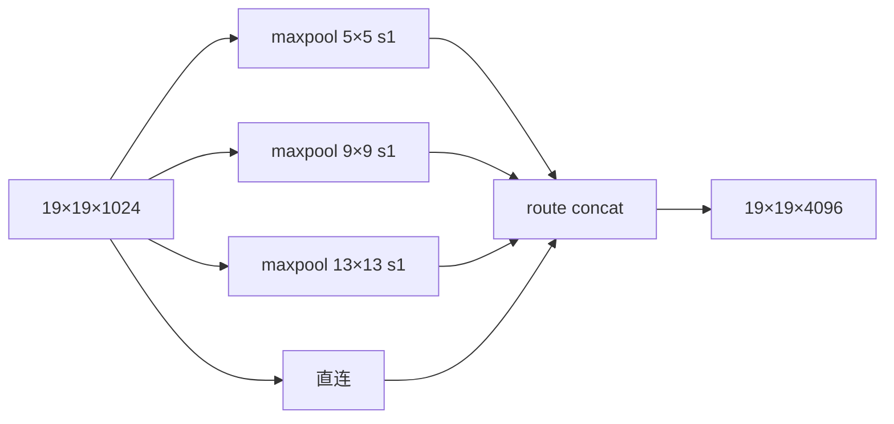
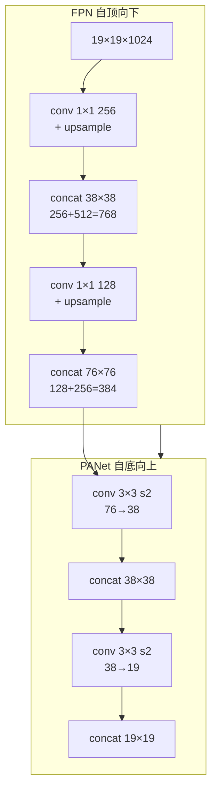

# YOLOv4 论文精读

**YOLOv4: Optimal Speed and Accuracy of Object Detection**

*Alexey Bochkovskiy, Chien-Yao Wang, Hong-Yuan Mark Liao · arXiv 2020 · [arXiv:2004.10934](https://arxiv.org/abs/2004.10934)*

::: tip TL;DR：只想带走三件事
1. **BoF + BoS 大杂烩全验证**：论文把 Bag of Freebies（训练 trick）+ Bag of Specials（模块插件）逐项做消融实验，最后留下 [CSP](/glossary#csp-跨阶段部分连接) / [Mish](/glossary#mish-激活) / [SPP](/glossary#spp-空间金字塔池化) / [PANet](/glossary#panet-路径聚合网络) / [CIoU](/glossary#ciou-loss) / [Mosaic](/glossary#mosaic-增强) 这一套组合拳。
2. **COCO AP 单代涨幅 +10.5**：v3 的 33.0 → v4 的 **43.5**（608 输入），AP50 从 57.9 → **65.7**——检测史上最大一次"版本升级"。
3. **训练时间反而更短**：论文实测在 1080 Ti 上训练只需 22 小时（v3 需 50 小时）——trick 堆叠不但没增加成本，反而加速了收敛。
:::

> **关于作者阵容**：v4 首次由 Alexey Bochkovskiy（AlexeyAB/darknet 维护者）+ 台湾中研院团队（Chien-Yao Wang / Hong-Yuan Mark Liao）合作——**不是 Joseph Redmon**。Redmon 在 v3 后已退出 CV 研究。

---

## 1. 为什么要"Optimal Speed and Accuracy"？（Motivation）

2019-2020 年检测器格局：EfficientDet 靠 NAS + BiFPN 刷到 AP 52，但 FPS 只有个位数；工业界需要"实时 + 高精度"的两全方案。v3 的 AP 33 在 COCO 上已不够看。

论文的回应是**系统化的 trick 消融**：

| 类别 | 论文实验项 | 最终采纳 |
|------|-----------|---------|
| **Bag of Freebies**（训练 trick，不增推理成本） | Mosaic / CutMix / MixUp / DropBlock / Label Smoothing / CIoU / DIoU-NMS / SAT | Mosaic + CIoU + DropBlock + Label Smoothing |
| **Bag of Specials**（模块插件，略增推理成本） | SPP / PANet / RFB / SAM / Mish / CSP / ASFF / BiFPN | SPP + PANet + Mish + CSP |

---

## 2. Bag of Freebies：训练 trick 全家桶

### 2.1 Mosaic 数据增强

把 4 张训练图按随机位置拼成一张"十字图"：

**好处**（论文实验数据）：
- **小目标上下文丰富**：4 张图拼一起，背景多样性 4 倍
- **batch 统计更稳**：BN 层一次看到 4 张图的分布，相当于隐式增大 batch
- **训练时间反降**：Mosaic 让网络更快收敛（v4 训 22h vs v3 训 50h）

快照实现：cfg `mosaic=1`（<SrcLink file="v4:cfg/yolov4.cfg" :line="15" />），`src/data.c` 的 `load_data_detection` 走 `use_mixup=3` 路径（L967+）。**注意**：`letter_box` 与 Mosaic 不兼容（L959 报错），`cutmix` 与 detector 不兼容（L955 报错）。

### 2.2 CIoU loss：坐标回归的范式转移

v3 用 SSE 回归坐标偏移（`delta = scale × (target − output)`），v4 换成 [CIoU loss](/glossary#ciou-loss)：

$$\mathcal{L}_{CIoU} = 1 - IoU + \frac{\rho^2(b, b^{gt})}{c^2} + \alpha v$$

其中：
- $IoU$：预测框与 GT 的交并比
- $\rho^2(b, b^{gt})$：预测框中心与 GT 中心的欧氏距离平方
- $c^2$：两框最小外接矩形的对角线长度平方
- $v = \frac{4}{\pi^2}(\arctan\frac{w^{gt}}{h^{gt}} - \arctan\frac{w}{h})^2$：长宽比一致性
- $\alpha = \frac{v}{(1-IoU)+v}$：权重系数

**三项惩罚**：
1. **重叠面积**（IoU 项）：基础指标
2. **中心距**（DIoU 项）：两框中心越近越好
3. **长宽比**（CIoU 独有）：宽高比一致才收敛快

**快照接线**：cfg `iou_loss=ciou`（<SrcLink file="v4:cfg/yolov4.cfg" :line="974" />），`src/yolo_layer.c` 的 `delta_yolo_box`（L153-250）调用 `box.c` 的 `dx_box_iou`（L258-476）——梯度全手推（dIoU/dx, dIoU/dy, dIoU/dw, dIoU/dh）。

**注意**：v3 的 `(2−truth.w·truth.h)` 小框权重在 CIoU 分支被 **bypass**（只用于 MSE 旧路径），CIoU 自带尺度不变性（IoU 是归一化指标）。

### 2.3 DropBlock 正则化

比 Dropout 更适合卷积网络：随机"挖掉"连续的区域块（block），而不是孤立像素。

**论文实验**：DropBlock 在 COCO 上 +0.4 AP（配合 CIoU + Mosaic 后收益减小，最终保留）。

### 2.4 Class Label Smoothing

把 one-hot 标签从 `[0, 1]` 平滑到 `[ε/(K−1), 1−ε]`，防止过拟合。

**快照状态**：cfg `label_smooth_eps` 默认 **0**（未启用），代码已就绪。

---

## 3. Bag of Specials：模块插件精选

### 3.1 CSP（Cross Stage Partial connections）

把每段的特征图**劈成两半**：

**好处**（论文 Table 2）：
- **计算量降 20%**：主路只看一半通道
- **精度反升**：梯度分流，避免了"重复学习冗余梯度"
- **内存峰值降低**：concat 前的中间特征图更小

**快照结构**（CSP 段 3 为例，层 36-71）：conv 3×3 s2 → **1×1 conv 分流**（通道 256→128）→ 残块×8 → **route concat** 回旁路 → **1×1 conv 过渡**。

### 3.2 Mish 激活

$$Mish(x) = x \cdot \tanh(\ln(1 + e^x)) = x \cdot \tanh(softplus(x))$$

**vs leaky/ReLU**：
- **平滑**：处处可导，梯度更稳定
- **非单调**：允许小幅负值（x<0 时 Mish(x) ≈ x·e^x < 0），信息保留更好
- **无界**：正侧无上限，避免梯度饱和

**快照实现**：`src/activations.c` L142，梯度 L343+；softplus 阈值 20 防数值溢出。**只用于骨干**，neck/head 仍用 leaky。

### 3.3 SPP（Spatial Pyramid Pooling）

**作用**：
- **感受野扩大 3 个尺度**：5×5 / 9×9 / 13×13 池化窗口
- **same padding**（stride 1）：特征图尺寸不变
- **代价极小**：maxpool 无参数

**快照实现**：层 105-116（<SrcLink file="v4:cfg/yolov4.cfg" :line="947" :end="966" />），SPP 后接 3 个 conv 降维回 1024。

### 3.4 PANet（Path Aggregation Network）

v3 是 FPN（自顶向下上采样 2 次），v4 加一路**自底向上**下采样：

**好处**：浅层的**位置信息**（边缘/纹理）通过下采样路径回传深层——v3 只回传了深层的**语义信息**。

**快照实现**：cfg 层 1107-1122（第一处下采样）与 1252-1267（第二处下采样）。

---

## 4. Additional Improvements：细节打磨

### 4.1 scale_x_y：消除网格敏感性

**问题**：v3 的 $b_x = \sigma(t_x) + c_x$ 里，$\sigma(t_x) \in (0,1)$，意味着**每个格子只能预测自己格子内的中心点**——边缘目标（中心恰好在格子边界）无法被预测。

**v4 解法**：

$$b_x = s \cdot \sigma(t_x) - 0.5(s-1) + c_x$$

其中 $s = scale\_x\_y$（cfg 里 1.2/1.1/1.05，三个头递减）。

**效果**：$\sigma(t_x)$ 从 (0,1) 扩展到 **(-0.1, 1.1)**（s=1.2 时）——允许中心点稍微"越界"到相邻格子，消除网格硬边界。

**快照实现**：`src/yolo_layer.c` L336-337，decode 同 v3（无 DOABS）。

### 4.2 Multi-positive 正样本分配

**v3 的局限**：每个 GT 只被分配给一个 anchor（best_n 形状最匹配的），**单 GT 单正样本**。

**v4 改进**：best_n 之外，**同一头内**其他 anchor 若 IoU(anchor shape, GT) > `iou_thresh`（cfg 0.213）也参与监督——**单 GT 多正样本**。

**实现**：`src/yolo_layer.c` L501-545（第三遍循环），多 anchor 的 delta 经 `averages_yolo_deltas`（L556）平均。

**收益**（论文 Table 8）：+0.9 AP。

### 4.3 三头顺序反转

| 版本 | 头 A（第一头） | 头 B | 头 C（最后一头） |
|------|---------------|------|-----------------|
| v3 | 13×13（大目标，mask 6,7,8） | 26×26（中） | 52×52（小） |
| v4 | **76×76（小目标，mask 0,1,2）** | 38×38（中） | 19×19（大） |

**原因**：v4 输入加大到 608（v3 是 416），网格尺寸翻倍（608/32=19, 608/16=38, 608/8=76）；顺序反转是为了让**小目标头先出现**（浅层特征更新鲜）。

### 4.4 SAT（Self-Adversarial Training）

**思想**：训练时对输入图像做对抗攻击（FGSM），让网络对扰动更鲁棒。

**快照状态**：代码存在（`src/detector.c` L1717 `net->adversarial=1`），但 yolov4.cfg **未配 `adversarial_lr`** → 默认 0，**实际未启用**。论文提到 SAT 但发布 cfg 未开启。

### 4.5 CBN / CmBN

**CBN（Cross-Iteration BN）**：BN 统计量跨 batch 累计，解决小 batch 下 BN 不准的问题。

**CmBN（Cross mini-Batch Normalization）**：CBN 的改进版，只在当前 mini-batch 内累计。

**快照状态**：CmBN 实现在 `src/convolutional_layer.c`，cfg 未显式开启（默认行为）。

---

## 5. 实验结果

### 5.1 检测指标（COCO test-dev）

| 模型 | 输入 | AP | AP50 | AP75 | APS | APM | APL | FPS（V100） |
|------|------|-----|----------------|----------------|---------------|---------------|---------------|-------------|
| YOLOv4-416 | 416 | 41.2 | 62.8 | 44.3 | 20.4 | 44.4 | 56.0 | 96 |
| YOLOv4-512 | 512 | 43.0 | 64.9 | 45.6 | 24.3 | 46.1 | 55.5 | 83 |
| YOLOv4-608 | 608 | **43.5** | **65.7** | **47.3** | **26.7** | **46.7** | **53.3** | **65** |

**历史对比**（同口径 608 输入）：
- v3：AP 33.0 / AP50 57.9
- v4：AP 43.5 / AP50 65.7（**+10.5 / +7.8**）

### 5.2 与 SOTA 对比

| 检测器 | AP | FPS（V100） |
|--------|-----|-------------|
| EfficientDet-D7 | 52.2 | 6.5 |
| YOLOv4-608 | 43.5 | **65** |
| RetinaNet-R101 | 40.4 | 11.4 |
| Faster R-CNN-R101 | 42.0 | 10.2 |

论文原话：*"YOLOv4 runs twice as fast as EfficientDet with comparable performance."*

### 5.3 骨干分类（ImageNet）

| 骨干 | top-1 | top-5 |
|------|-------|-------|
| CSPDarknet53 | **77.9** | 94.3 |
| Darknet-53 | 77.2 | 93.8 |
| CSPResNeXt50 | 77.8 | 94.2 |
| EfficientNet-B3 | 81.6 | 95.7 |

CSP 改进让 Darknet-53 top-1 从 77.2 → 77.9（+0.7）。

---

## 6. Ablation Study：逐项消融

论文 Table 7-10 做了详尽的消融实验：

| 组合 | AP | Δ |
|------|-----|---|
| Baseline（v3 + Darknet-53） | 38.3 | — |
| + SPP | 39.0 | +0.7 |
| + CSP | 39.3 | +0.3 |
| + PANet | 40.2 | +0.9 |
| + Mish | 40.8 | +0.6 |
| + Mosaic | 41.5 | +0.7 |
| + CIoU | 42.0 | +0.5 |
| + Multi-positive | **43.5** | +1.5 |

**结论**：没有单一 trick 带来超过 2 点提升，但**叠加效应**让 AP 从 38.3 → 43.5（+5.2）。

---

## 7. 论文风格：极致工程化

- **正文 17 页**，其中 6 页是消融实验表格
- **每一章都有"实验设置 + 结果表 + 结论"三段式**
- **附录包含完整的 cfg 参数**（开源精神）
- **作者承认灵感来自社区**：*"We thank the community for the great ideas and suggestions"*

---

## 8. 指标记录

**检测（COCO test-dev，V100）**：

| 模型 | AP | AP50 | AP75 | FPS |
|------|-----|----------------|----------------|-----|
| YOLOv4-416 | 41.2 | 62.8 | 44.3 | 96 |
| YOLOv4-512 | 43.0 | 64.9 | 45.6 | 83 |
| YOLOv4-608 | **43.5** | **65.7** | **47.3** | **65** |

**分类（ImageNet）**：CSPDarknet53 top-1 77.9 / top-5 94.3。

**历史位置**：第一次"实时（60+ FPS）+ 高精度（AP 40+）"两全的检测器；此后 v5/v7 都建立在 v4 的 BoF+BoS 框架之上。

---

## 延伸阅读

- [理论 Concept](/versions/v4/concepts)
- [Architecture 逐层图解](/versions/v4/architecture)
- [损失函数（CIoU 全套公式推导）](/versions/v4/losses)
- [痛点追踪](/versions/v4/painpoints)
