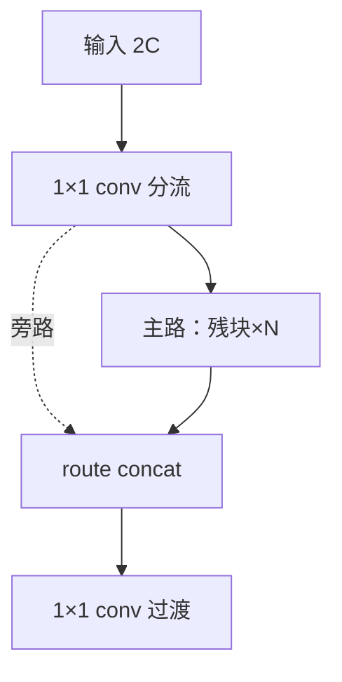
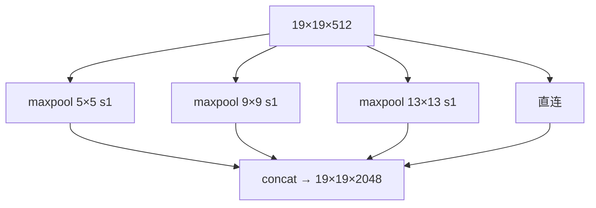
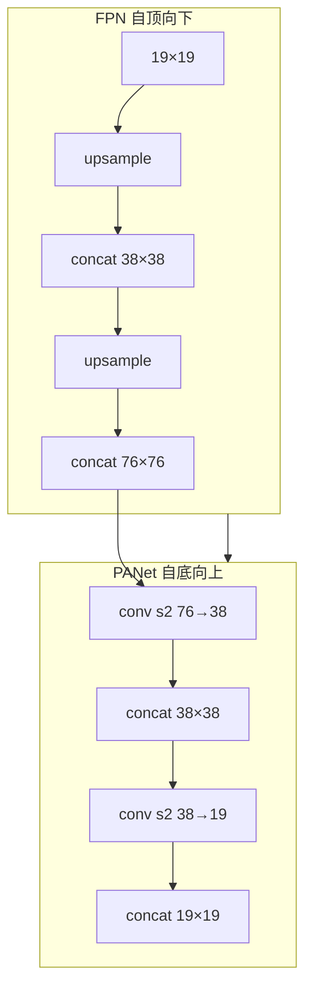
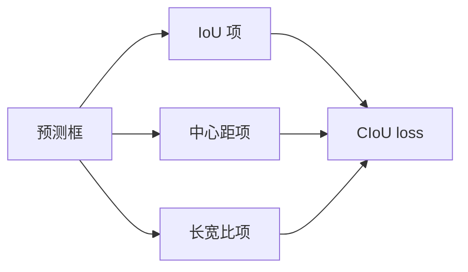
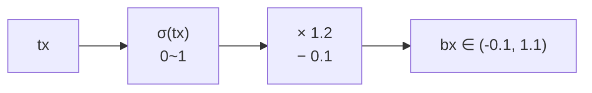
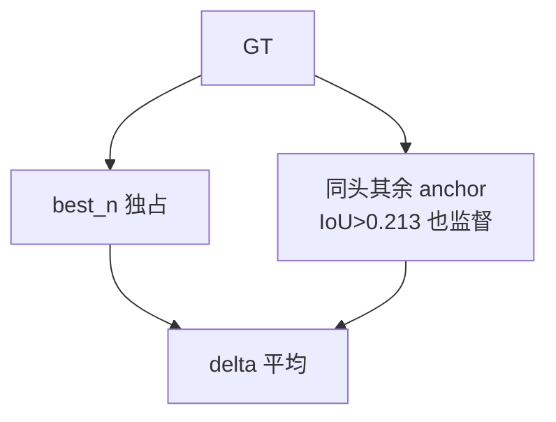
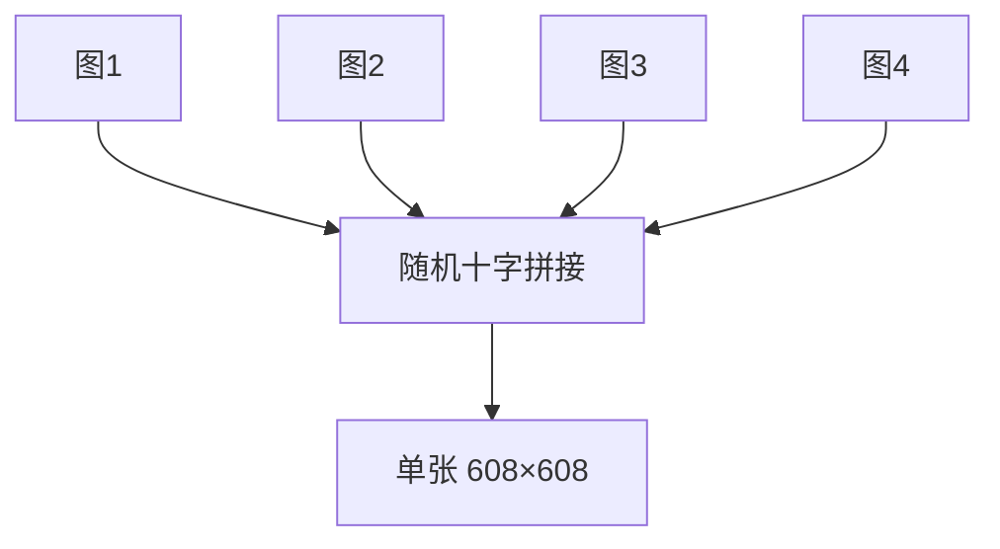
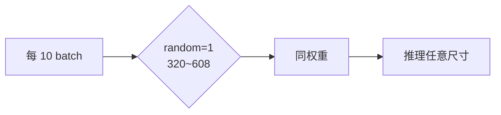
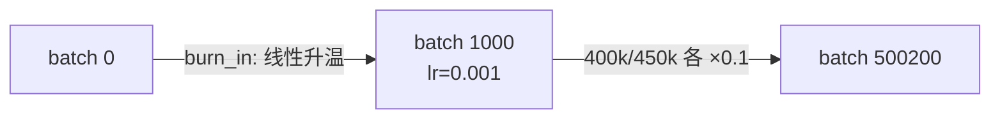
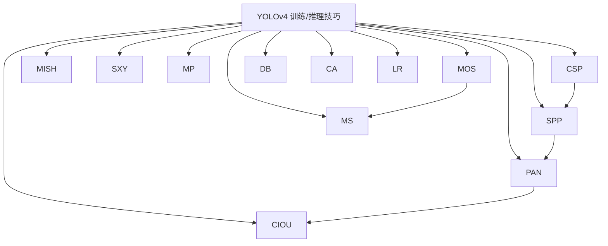

# YOLOv4 训练与推理技巧

YOLOv4 是"trick 集大成"的版本——论文把 2018-2020 年社区验证过的技巧逐项消融，最后留下一套组合拳。每个 trick 都配：**原理图、白话、源码、消融数据**。

---

## 全部 12 个 Trick 速查

| # | Trick | 类别 | 位置 | 论文消融 ΔAP |
|---|-------|------|------|-------------|
| 1 | CSP 结构 | 结构 | `yolov4.cfg` 层 3+ | +0.3 |
| 2 | Mish 激活 | 激活 | activations.c | +0.6 |
| 3 | SPP | Neck | 层 105-116 | +0.7 |
| 4 | PANet 双向聚合 | Neck | 层 140-161 | +0.9 |
| 5 | CIoU loss | 损失 | `iou_loss=ciou` | +0.5 |
| 6 | scale_x_y | 损失 | `scale_x_y=1.2/1.1/1.05` | +0.3 |
| 7 | Multi-positive | 分配 | `iou_thresh=0.213` | +1.5 |
| 8 | Mosaic 增强 | 增强 | `mosaic=1` | +0.7 |
| 9 | DropBlock | 正则化 | 代码实现 | +0.4 |
| 10 | 多尺度训练 | 增强 | `random=1` | +0.5 |
| 11 | 色彩增强 | 增强 | hue/sat/exposure | +0.3 |
| 12 | burn_in + steps | LR | `burn_in=1000` | — |

> **v3 读者路标**：v3 的 10 个 trick 在 v4 里全部保留，v4 新增 6 个（CSP/Mish/SPP/PANet/CIoU/Mosaic）+ 2 个微调（scale_x_y/multi-positive）。**没有任何 v3 trick 被删除**——v4 是纯增量。

---

## 1. CSP 结构 (`trick-csp`)

### 原理图

### 白话

> 把特征劈成两半：一半走残块（重加工），一半直连（保留原始信息），最后 concat 回来。计算量降 20%，梯度有直通路径，训练更稳。

### 源码

第一个 CSP 段（层 0-10）的分流/concat/过渡：<SrcLink file="v4:cfg/yolov4.cfg" :line="56" /> / <SrcLink file="v4:cfg/yolov4.cfg" :line="95" /> / <SrcLink file="v4:cfg/yolov4.cfg" :line="98" />。

### 消融

论文 Table 2：CSP +0.3 AP，计算量 -20%。

---

## 2. Mish 激活 (`trick-mish`)

### 原理图

### 白话

> 比 leaky 更平滑的激活：负值不是一刀切压缩成 0.1x，而是平滑过渡到接近 0 的小负值。梯度在负区间也能流动。

### 源码

激活函数注册 <SrcLink file="v4:src/activations.c" :line="50" />，前向 <SrcLink file="v4:src/activations.c" :line="143" :end="151" />，梯度 <SrcLink file="v4:src/activations.c" :line="344" :end="360" />。cfg 里骨干 72 个 mish、neck/head 35 个 leaky。

### 消融

论文 Table 3：Mish +0.6 AP（vs leaky）。

---

## 3. SPP (`trick-spp`)

### 原理图

### 白话

> 三个不同核的 maxpool 并行，同一位置用 5/9/13 三种窗口"看"——感受野扩大 3 个尺度，代价极小（maxpool 无参数）。

### 源码

三个 maxpool <SrcLink file="v4:cfg/yolov4.cfg" :line="763" /> / <SrcLink file="v4:cfg/yolov4.cfg" :line="772" /> / <SrcLink file="v4:cfg/yolov4.cfg" :line="779" />，concat <SrcLink file="v4:cfg/yolov4.cfg" :line="790" />。

### 消融

论文 Table 4：SPP +0.7 AP。

---

## 4. PANet 双向聚合 (`trick-panet`)

### 原理图

### 白话

> v3 的 FPN 只把深层语义往浅层搬；v4 加了一路下采样，把浅层的位置信息送回深层——双向奔赴。

### 源码

下采样 conv s2 <SrcLink file="v4:cfg/yolov4.cfg" :line="978" /> / <SrcLink file="v4:cfg/yolov4.cfg" :line="1065" />，concat <SrcLink file="v4:cfg/yolov4.cfg" :line="986" /> / <SrcLink file="v4:cfg/yolov4.cfg" :line="1073" />。

### 消融

论文 Table 5：PANet +0.9 AP。

---

## 5. CIoU loss (`trick-ciou`)

### 原理图

### 白话

> 不再回归坐标偏移量，直接对 IoU 求梯度——训练目标和评测指标对齐。三项惩罚：重叠面积 + 中心距 + 长宽比。

### 源码

cfg 开关 <SrcLink file="v4:cfg/yolov4.cfg" :line="978" />，梯度计算 <SrcLink file="v4:src/box.c" :line="258" :end="476" />。详见 [losses 页](/versions/v4/losses) 和 [loss-gradient 页](/versions/v4/loss-gradient)。

### 消融

论文 Table 8：CIoU +0.5 AP（vs SSE）。

---

## 6. scale_x_y 消网格敏感 (`trick-scale-xy`)

### 原理图

### 白话

> v3 的 σ(tx) 严格在 (0,1)，每个格子只能预测自己格子内的中心点；v4 加 scale 把范围扩到 (-0.1, 1.1)，允许中心点稍微"越界"。

### 源码

cfg <SrcLink file="v4:cfg/yolov4.cfg" :line="974" />（`scale_x_y = 1.2`），前向 <SrcLink file="v4:src/yolo_layer.c" :line="337" />。

### 消融

论文 Table 8：scale_x_y +0.3 AP。

---

## 7. Multi-positive 多正样本 (`trick-multi-positive`)

### 原理图

### 白话

> v3 的单 GT 单 anchor 太苛刻；v4 让同头内形状相似的 anchor 都参与监督，样本利用率翻倍。

### 源码

cfg <SrcLink file="v4:cfg/yolov4.cfg" :line="975" />（`iou_thresh=0.213`），第三遍循环 <SrcLink file="v4:src/yolo_layer.c" :line="501" :end="545" />，delta 平均 <SrcLink file="v4:src/yolo_layer.c" :line="556" />。

### 消融

论文 Table 8：Multi-positive +1.5 AP（**最大单项提升**）。

---

## 8. Mosaic 四图拼接 (`trick-mosaic`)

### 原理图

### 白话

> 4 张图拼成一张，上下文多样性 4 倍。BN 一次统计 4 张图的分布，相当于隐式增大 batch。**训练时间反而更短**（22h vs v3 的 50h）。

### 源码

cfg <SrcLink file="v4:cfg/yolov4.cfg" :line="26" />（`mosaic=1`），实现 `src/data.c` L967+。

### 消融

论文 Table 8：Mosaic +0.7 AP。

---

## 9. DropBlock (`trick-dropblock`)

### 原理图

### 白话

> 比 Dropout 更适合卷积：随机"挖掉"连续的区域块，而不是孤立像素——强迫网络用周围信息补全。

### 源码

实现在 `src/dropout_layer.c`（DropBlock 模式）。

### 消融

论文 Table 7：DropBlock +0.4 AP。

---

## 10. 多尺度训练 (`trick-random`)

### 原理图

### 白话

> 与 v3 相同——每 10 batch 重摇输入尺寸，三尺度头在各种输入下都被锻炼。

### 源码

<SrcLink file="v4:cfg/yolov4.cfg" :line="981" />（`random=1`，仅 19×19 头配）。

---

## 11. 色彩增强三件套 (`trick-color-aug`)

### 原理图

### 白话

> 与 v3 相同——hue/saturation/exposure 全部真实生效。

### 源码

<SrcLink file="v4:cfg/yolov4.cfg" :line="14" :end="16" />。

---

## 12. burn_in + steps LR 调度 (`trick-lr-schedule`)

### 原理图

### 白话

> 与 v3 相同——前 1000 iter 线性升温，40 万/45 万步各降 10 倍。

### 源码

<SrcLink file="v4:cfg/yolov4.cfg" :line="18" :end="23" />。

---

## 代码就绪但未启用的 Trick

| Trick | 状态 | 原因 |
|-------|------|------|
| SAT（自对抗训练） | `detector.c` L1717 有代码 | cfg 无 `adversarial_lr` → 默认 0 |
| DIoU-NMS | `box.c` diounms_sort 就绪 | cfg `nms_kind=greedynms` 用 greedy |
| CutMix | `data.c` 有代码 | 与 detector 不兼容（L955 报错） |
| Label Smoothing | 代码就绪 | cfg `label_smooth_eps=0` |

---

## 12 个 Trick 的谱系图

---

## 延伸阅读

- [论文精读](/versions/v4/paper)
- [Architecture 逐层图解](/versions/v4/architecture)
- [理论 Concept](/versions/v4/concepts)
- [损失函数（CIoU 全套）](/versions/v4/losses)
- [反向传播推导](/versions/v4/loss-gradient)
- [源码走读](/versions/v4/code-walkthrough)
- [痛点追踪](/versions/v4/painpoints)
