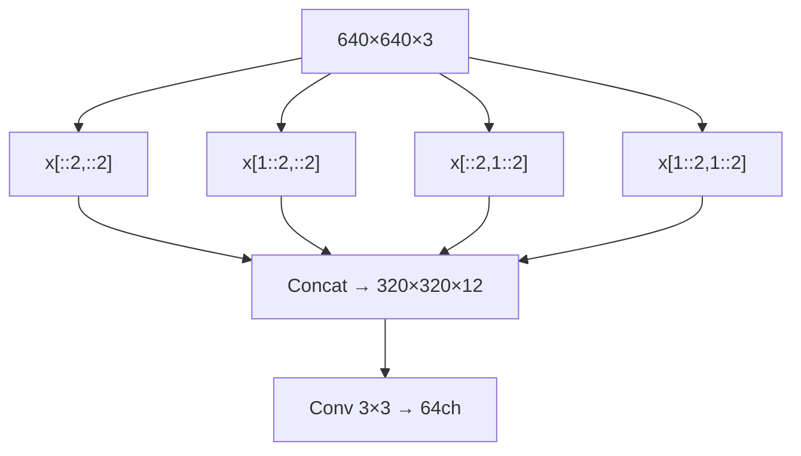
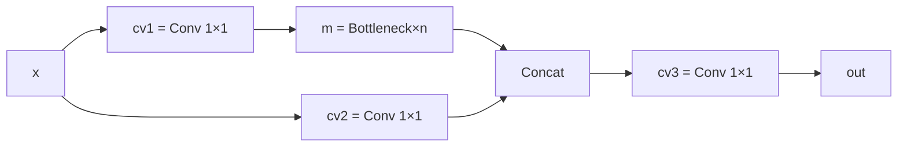

# YOLOv5 逐层图解

::: tip 只想带走三件事
1. v5 的"层"不是 cfg 里的层，而是 **yaml 驱动的 PyTorch 模块**；
2. 骨干 = Focus + Conv + C3 ×3 + SPP + C3，neck = 双向 PANet，头 = Detect ×3；
3. yolov5s 参数量约 **7.2M**，其中 C3 占大头（~5M）。
:::

## 1. 一眼看清：输入 → 输出的完整流程

```mermaid
flowchart LR
    IMG["640×640×3"] --> F["Focus<br/>4切片 → 12ch → Conv → 64ch @320"]
    F --> B1["Conv 3×3 s2 → 128ch @160"]
    B1 --> C31["C3 ×1 → 128ch @160"]
    C31 --> B2["Conv 3×3 s2 → 256ch @80"]
    B2 --> C32["C3 ×3 → 256ch @80"]
    C32 --> B3["Conv 3×3 s2 → 512ch @40"]
    B3 --> C33["C3 ×3 → 512ch @40"]
    C33 --> B4["Conv 3×3 s2 → 1024ch @20"]
    B4 --> SPP["SPP<br/>MaxPool 5/9/13 concat"]
    SPP --> C34["C3 ×1 → 1024ch @20"]

    C34 --> N1["Conv 1×1 → 512ch + Upsample ×2"]
    N1 --> CC1["Concat [C33] → 1024ch @40"]
    CC1 --> N2["C3 ×1 → 512ch @40"]
    N2 --> N3["Conv 1×1 → 256ch + Upsample ×2"]
    N3 --> CC2["Concat [C32] → 512ch @80"]
    CC2 --> N4["C3 ×1 → 256ch @80"]
    N4 --> D1["Detect P3/8<br/>3 anchors"]
    N4 --> N5["Conv 3×3 s2 → 256ch @40"]
    N5 --> CC3["Concat [N2] → 512ch @40"]
    CC3 --> N6["C3 ×1 → 512ch @40"]
    N6 --> D2["Detect P4/16<br/>3 anchors"]
    N6 --> N7["Conv 3×3 s2 → 512ch @20"]
    N7 --> CC4["Concat [C34] → 1024ch @20"]
    CC4 --> N8["C3 ×1 → 1024ch @20"]
    N8 --> D3["Detect P5/32<br/>3 anchors"]
```



## 2. 逐层明细表（yaml 驱动，共 24 层）

| 层号 | from | n | 模块 | 参数 | 说明 |
|------|------|---|------|------|------|
| 0 | -1 | 1 | Focus | [64, 3] | 4路切片 + conv |
| 1 | -1 | 1 | Conv | [128, 3, 2] | 下采样 160 |
| 2 | -1 | 3 | C3 | [128] | 骨干 C3 ×1 |
| 3 | -1 | 1 | Conv | [256, 3, 2] | 下采样 80 |
| 4 | -1 | 9 | C3 | [256] | 骨干 C3 ×3 |
| 5 | -1 | 1 | Conv | [512, 3, 2] | 下采样 40 |
| 6 | -1 | 9 | C3 | [512] | 骨干 C3 ×3 |
| 7 | -1 | 1 | Conv | [1024, 3, 2] | 下采样 20 |
| 8 | -1 | 1 | SPP | [1024, [5,9,13]] | SPP 感受野扩展 |
| 9 | -1 | 3 | C3 | [1024, False] | 骨干末段 C3 |
| 10 | -1 | 1 | Conv | [512, 1, 1] | 1×1 降维 |
| 11 | -1 | 1 | nn.Upsample | [None, 2, 'nearest'] | 上采样 |
| 12 | [-1, 6] | 1 | Concat | [1] | concat C33 输出 |
| 13 | -1 | 3 | C3 | [512, False] | neck C3 |
| 14 | -1 | 1 | Conv | [256, 1, 1] | 1×1 降维 |
| 15 | -1 | 1 | nn.Upsample | [None, 2, 'nearest'] | 上采样 |
| 16 | [-1, 4] | 1 | Concat | [1] | concat C32 输出 |
| 17 | -1 | 3 | C3 | [256, False] | neck C3（P3/8 小目标头前） |
| 18 | -1 | 1 | Conv | [256, 3, 2] | 下采样 |
| 19 | [-1, 14] | 1 | Concat | [1] | concat N2 输出 |
| 20 | -1 | 3 | C3 | [512, False] | neck C3（P4/16 中目标头前） |
| 21 | -1 | 1 | Conv | [512, 3, 2] | 下采样 |
| 22 | [-1, 10] | 1 | Concat | [1] | concat C34 输出 |
| 23 | -1 | 3 | C3 | [1024, False] | neck C3（P5/32 大目标头前） |
| 24 | [17, 20, 23] | 1 | Detect | [nc, anchors] | 检测头 ×3 |

> 注：`n` 在 `parse_model` 中会被 `depth_multiple` 缩放：$n = \max(\text{round}(n \times 0.33), 1)$，所以 yolov5s 的 C3 实际重复次数为 1（`round(3 × 0.33)=1`）。

## 3. 三个阶段的「原理图 + 白话 + 代码」

### 3.1 Focus 切片



<SrcSnippet file="v5:models/common.py" :line="163" :end="172" />

### 3.2 C3 模块



<SrcSnippet file="v5:models/common.py" :line="126" :end="138" />

### 3.3 Detect 解码

```python
y = x[i].sigmoid()
y[..., 0:2] = (y[..., 0:2] * 2. - 0.5 + self.grid[i]) * self.stride[i]  # xy
y[..., 2:4] = (y[..., 2:4] * 2) ** 2 * self.anchor_grid[i]  # wh
```

<SrcSnippet file="v5:models/yolo.py" :line="49" :end="56" />

## 4. 255 维输出的可视化切分（每个头相同）

每头输出 85 维 = 4 坐标 + 1 objectness + 80 类别。3 个 anchor 共享同一组 85 维：

| 维度 | 含义 | 激活 |
|------|------|------|
| 0-3 | x, y, w, h | sigmoid（xy）/ 原始（wh） |
| 4 | objectness | sigmoid |
| 5-84 | 80 类 logits | BCEWithLogitsLoss |

## 5. 参数量分布（yolov5s）

| 模块 | 参数量 | 占比 |
|------|--------|------|
| Focus | ~5K | 0.1% |
| 骨干 Conv | ~200K | 2.8% |
| 骨干 C3 | ~3.5M | 48.6% |
| SPP | ~100K | 1.4% |
| Neck C3 | ~2.8M | 38.9% |
| Detect 1×1 | ~590K | 8.2% |
| **合计** | **~7.2M** | 100% |

- 参数量大头在 **C3 模块**（Bottleneck 内的 3×3 conv）
- 通过 `width_multiple` 缩放通道数，参数量与 $width^2$ 成正比

## 6. 与 v4 的架构对比

| 维度 | v4 | v5 |
|------|----|----|
| 配置 | cfg（自定义文本，162 层） | yaml（24 层，模块抽象） |
| Stem | Conv 3×3 ×3 | **Focus**（切片 + conv） |
| CSP 模块 | BottleneckCSP（4 conv） | **C3**（3 conv，少 BN/Act） |
| 激活 | Mish + Leaky | **SiLU**（全网络） |
| Neck | PANet（手写 route） | PANet（yaml Concat） |
| Detect | 手写 C，162 层固定 | **PyTorch 模块，Detect ×3** |
| 参数量 | ~64M（CSPDarknet53） | **~7.2M**（yolov5s） |
| 推理 | darknet 二进制 | **detect.py / torch.hub** |

## 延伸阅读

- [理论 Concept](/versions/v5/concepts)
- [架构与层速查](/versions/v5/layers)
- [源码走读](/versions/v5/code-walkthrough)
