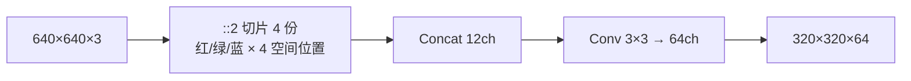
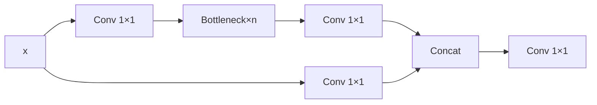

# YOLOv5 理论 Concept

::: tip 只想带走三件事
1. **Focus 是 v5 的招牌 stem**：用切片替代 stride-2 conv，不丢像素；
2. **C3 比 v4 的 BottleneckCSP 更瘦**：砍掉一次 BN/激活，参数量降了；
3. **Anchor 分配策略彻底重写**：从 v3/v4 的"best_n 独占"变成"wh 比例 + 邻居偏移"，正样本数量爆炸。
:::

## 1. Focus (`concept-focus`)

切片交错重组通道：640×640×3 → 320×320×12 → Conv → 320×320×64。



- 空间信息完全保留，只是重新排列通道；没有 stride=2 卷积的信息压缩
- 等价于一个 stride=2 的 conv，但 FLOPs 更低、信息利用率更高
- v6.0 后为了部署友好，用 6×6 Conv s2 替代 Focus（本快照仍为 Focus）

> v4 读者路标：v4 的 stem 是连续 3 个 Conv 3×3，没有 Focus 切片。

## 2. C3 — CSP Bottleneck with 3 conv (`concept-c3`)



- 与 v4 BottleneckCSP 相比，**少了一次 BN/激活**：v4 在 concat 后先做 `bn + act` 再 `Conv 1×1`；v5 直接 `concat → Conv 1×1`
- shortcut 可选（`shortcut=True/False`），neck 中通常关闭（shortcut=False），避免梯度短路

## 3. SPP 空间金字塔池化 (`concept-spp`)

与 v4 完全一致：1×1 降维 → 3 个 MaxPool（5/9/13 same padding）→ concat → 1×1 升维。

<SrcSnippet file="v5:models/common.py" :line="149" :end="160" />

## 4. PANet 双向聚合 (`concept-panet`)

- **上采样**：P5 → P4 → P3（FPN 路径），conv 1×1 + nearest upsample
- **下采样**：P3 → P4 → P5（PANet 路径），conv 3×3 s2 + concat
- v5 的 concat 通过 yaml 里的 `[[-1, 6], 1, Concat, [1]]` 表达，模块内部就是 `torch.cat`

## 5. Detect 头与网格解码 (`concept-detect`)

训练时输出 shape：`[nl, bs, na, ny, nx, no]`

推理时解码（yolo.py L53-55）：

$$
\begin{aligned}
xy &= (\sigma(output_{xy}) \times 2 - 0.5 + grid) \times stride \\
wh &= (\sigma(output_{wh}) \times 2)^2 \times anchor
\end{aligned}
$$

- `×2 − 0.5` 使 sigmoid 输出范围从 [0,1] 扩展到 [-0.5, 1.5]，**消除网格敏感性**（与 v4 scale_x_y 同构）
- wh 不直接乘 anchor，而是 `(2·sigmoid)² × anchor`，保证 wh 为正且不会剧烈膨胀

## 6. 损失函数总览 (`concept-loss-overview`)

| 项 | 公式 | 代码 |
|----|------|------|
| 坐标 | CIoU loss | `bbox_iou(..., CIoU=True)` |
| Objectness | BCEWithLogitsLoss | `BCEobj` |
| Classification | BCEWithLogitsLoss | `BCEcls` |
| Label Smoothing | cp=1−0.5ε, cn=0.5ε | `smooth_BCE` |

- 没有 focal loss 默认启用（`fl_gamma: 0.0`），但代码已备好

## 7. Objectness = IoU ratio (`concept-iou-ratio`)

```python
tobj[b, a, gj, gi] = (1.0 - self.gr) + self.gr * iou.detach().clamp(0)
```

- `self.gr = model.gr = 1.0`（默认），所以 objectness target 就是 `iou.detach()`
- 好处：objectness 直接预测与 GT 的 IoU，而不是二值 0/1，**更精细**
- `.detach()` 切断梯度，objectness 只受 box 回归影响单向

## 8. Anchor 多正样本分配 (`concept-anchor-assignment`)

两步筛选：

1. **形状匹配**：$r = \max(\frac{wh}{anchor}, \frac{anchor}{wh})$，取 $\max(r)$ < `anchor_t`(4.0) 的 anchor
2. **邻居偏移**：中心点落在网格内时，若 gxy % 1 < 0.5，额外向 4 个邻居偏移，产生最多 **5 个正样本位置**

与 v3/v4 的区别：
- v3：全局 best_n 独占一个 anchor
- v4：best_n + 同头 IoU>0.213 的 anchor 也参与，但**仍只分配到 1 个 grid**
- v5：所有满足 wh 比例的 anchor + 邻居偏移，一个 GT 可产生 **最多 15 个正样本**（3 头 × 3 anchor × 邻居）

## 9. Autoanchor (`concept-autoanchor`)

BPR（Best Possible Recall）< 0.98 时触发：

1. k-means 初始化 9 个 anchors（按训练集 wh）
2. 遗传算法（GA）进化 1000 代，mutation + fitness
3. 如果新的 BPR 更高，替换进 model.anchors

- 彻底**自动化**：用户不需要手动调 anchor
- `anchor_t=4.0` 即 k-means 的 wh ratio 阈值

## 10. 训练 trick 速览 (`concept-training-tricks`)

| Trick | 代码 | 说明 |
|-------|------|------|
| EMA | `ModelEMA` | 参数滑动平均，eval 用 ema 模型 |
| AMP | `torch.cuda.amp` | 混合精度训练 |
| OneCycle LR | `one_cycle()` | 前 3 epoch warmup，后 cosine 退火 |
| 多尺度 | `opt.multi_scale` | 每 batch 随机 resize 320-1280 |
| 图像权重 | `opt.image_weights` | 按 mAP 加权采样难例 |

## 延伸阅读

- [损失函数详解](/versions/v5/losses)
- [反向传播推导](/versions/v5/loss-gradient)
- [训练技巧详解](/versions/v5/tricks)
- [v4 理论 Concept（对比）](/versions/v4/concepts)
