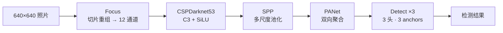
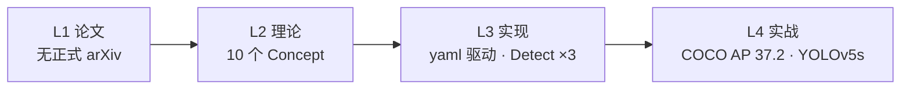
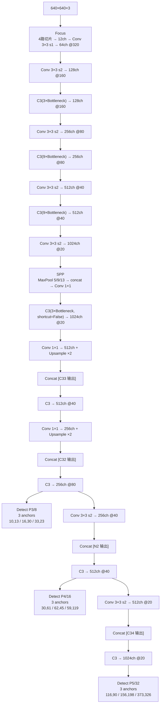

# YOLOv5 (2021-04)

> **TL;DR**
> - 一句话：darknet C 切到 PyTorch，配置改成 yaml，一键训练/导出
> - 解决：v4 复现门槛高
> - 代价：精度不追 SOTA，主打易用
>
> **前置阅读**：[YOLOv4](/versions/v4/index) → [PyTorch](/glossary#pytorch) → [yaml 配置](/glossary#yaml-配置) → [EMA](/glossary#ema-指数移动平均) → [AMP](/glossary#amp-自动混合精度)

**Ultralytics YOLOv5（无正式论文，v5.0 release tag）**

- 📄 论文：无正式 arXiv 论文，文档与指标在 [ultralytics/yolov5 README](https://github.com/ultralytics/yolov5)
- 🏛️ 作者：Glenn Jocher（Ultralytics）
- 💻 源码：[ultralytics/yolov5](https://github.com/ultralytics/yolov5) tag `v5.0`（commit `f5b8f7d`，2021-04-11）
- 🎯 里程碑：**工程化重构**——从 darknet C 切到 PyTorch，配置改成 yaml，训练加 autoanchor、HSV、random_perspective、EMA、混合精度，推理与导出全部 TorchScript/ONNX/CoreML 化

## 3 分钟电梯演讲

1. **v4 的所有 trick 都被搬进了 PyTorch**：CSP、Mish→SiLU、SPP、PANet、CIoU、Mosaic——但更干净、可 pip 安装、支持 onnx/torchscript 导出。
2. **anchor 不再手工调**：[autoanchor](/glossary#autoanchor)（k-means + 遗传算法进化）自动按当前数据集重算 anchors，BPR < 0.98 就触发。
3. **训练-推理完全 Python 化**：`train.py`/`detect.py`/`test.py` 三件套 + `hubconf.py` PyTorch Hub 一行调用，第一次"装完即用"。

> 已读过 [v4](/versions/v4/index)？本页下方有 v4→v5 逐项差异表；术语不熟先查[术语表](/glossary)。

## 四层闭环视图

## 核心贡献

1. **PyTorch 化 + yaml 配置**：告别 darknet cfg，网络结构写在 `models/yolov5s.yaml`，由 `parse_model` 解析为 `nn.Sequential`——支持 `depth_multiple`/`width_multiple` 一键缩放（s/m/l/x 四档）
2. **Focus 替代 stem 卷积**：4 路切片 → concat 12 通道 → 1 个 conv，无信息损失下采样（640→320）<SrcLink file="v5:models/common.py" :line="163" :end="172" />
3. **C3 模块（CSP Bottleneck with 3 conv）**：v4 CSP 结构的 PyTorch 重写，比 v4 BottleneckCSP 少一次 BN/激活<SrcLink file="v5:models/common.py" :line="126" :end="138" />
4. **SiLU（Swish）激活**：x·sigmoid(x)，全程替换 v4 的 Mish/LeakyReLU<SrcLink file="v5:models/common.py" :line="39" />
5. **Autoanchor**：k-means + 遗传算法进化，按当前数据集 wh 分布自动调 anchors<SrcLink file="v5:utils/autoanchor.py" :line="23" :end="59" />
6. **多正样本 anchor 匹配**：wh 比例 < anchor_t(4.0) 即入选，每个 GT 可命中多 anchor × 多网格偏移，远超 v3/v4 的"独占 best_n"<SrcLink file="v5:utils/loss.py" :line="163" :end="214" />

## 推理效果一览

<DiagramPipeline caption="图：v5 推理流水线——输入 640×640，Focus 切片 → CSPDarknet53 骨干（3 个 C3 段）→ SPP → PANet 双向聚合 → 三个 Detect 头（P3/P4/P5）→ NMS（torchvision.ops.nms）" />

## 关键指标

**检测（COCO val2017，YOLOv5 v5.0，640×640）**

| 模型 | 参数量 | FLOPs | APval | AP50val | 速度（V100 bs=1） |
|------|--------|-------|------------------|-------------------------------|--------------------|
| YOLOv5s | 7.2M | 16.5G | 37.4 | 56.8 | 6.4 ms |
| YOLOv5m | 21.2M | 49.0G | 45.4 | 64.1 | 8.2 ms |
| YOLOv5l | 46.5M | 109.1G | 49.0 | 67.3 | 10.1 ms |
| YOLOv5x | 86.7M | 205.7G | 50.7 | 68.9 | 12.1 ms |

- 对比 v4-608（CSPDarknet53，AP 43.5 / AP50 65.7）：YOLOv5s 参数仅 7.2M 就达到 AP 37.4，**推理快 10 倍以上**
- 首次实现"实时 SOTA 全家桶"——s/m/l/x 同一架构、一键切换
- 模型缩放公式：`depth_multiple` 控深度（bottleneck 重复次数）、`width_multiple` 控宽度（通道数）

## 网络架构

- 整体结构由 yaml 驱动：<SrcLink file="v5:models/yolov5s.yaml" :line="13" :end="48" />；`depth_multiple`/`width_multiple` 控规模
- 三个头 stride 8/16/32，**对应 v4 的 76/38/19 改成 80/40/20**（640 输入 ÷ stride）
- 每个头输出 85 通道 = 4 坐标 + 1 objectness + 80 类，共 3 anchors → 255
- 与 v4 反序不同，v5 头是 P3（小目标）→ P4（中目标）→ P5（大目标）顺序——但 Detect 内部按 stride 从小到大

## 核心 Concept 一览

| Concept | 一句话 | 对应代码位置 |
|---------|--------|-------------|
| Focus | 4 路切片 → concat → conv，无损下采样 | <SrcLink file="v5:models/common.py" :line="163" :end="172" /> |
| C3（CSP Bottleneck with 3 conv） | 3 个 conv + shortcut 拼接 | <SrcLink file="v5:models/common.py" :line="126" :end="138" /> |
| SPP | 3 个 MaxPool（5/9/13 same）+ concat | <SrcLink file="v5:models/common.py" :line="149" :end="160" /> |
| SiLU 激活 | x·sigmoid(x)，v5 全程启用 | <SrcLink file="v5:models/common.py" :line="39" /> |
| Detect 头 | 推理时 y = sigmoid·scale + grid·stride | <SrcLink file="v5:models/yolo.py" :line="49" :end="56" /> |
| Anchor 多正样本 | wh 比例 < 4.0 即入选，含邻居偏移 | <SrcLink file="v5:utils/loss.py" :line="185" :end="197" /> |
| Objectness = IoU ratio | tobj = (1-gr) + gr·iou.detach() | <SrcLink file="v5:utils/loss.py" :line="136" /> |
| Autoanchor | k-means + GA 进化，BPR<0.98 触发 | <SrcLink file="v5:utils/autoanchor.py" :line="43" :end="58" /> |
| Model scaling | depth_multiple / width_multiple | <SrcLink file="v5:models/yolov5s.yaml" :line="3" :end="4" /> |
| Letterbox | 640 自适应填充 + stride 对齐 | <SrcLink file="v5:utils/datasets.py" :line="818" /> |

## v4 → v5 关键差异

| 维度 | YOLOv4（AlexeyAB/darknet） | YOLOv5（ultralytics） |
|------|---------------------------|-----------------------|
| 实现语言 | C（darknet） | **Python（PyTorch）** |
| 配置文件 | cfg（自定义文本） | **yaml（标准格式）** |
| 骨干 | CSPDarknet53（C 手写） | **CSPDarknet53（PyTorch 模块，yaml 驱动）** |
| Stem | Conv 3×3 ×3 | **Focus（4 路切片 + conv）** |
| 激活 | Mish（骨干）+ leaky（neck） | **SiLU（全网络）** |
| CSP 模块 | BottleneckCSP（4 conv） | **C3（3 conv，少一次 BN/激活）** |
| 网格尺寸 | 76/38/19（608 输入） | **80/40/20（640 输入）** |
| Anchors | 18 个（cfg 手工写死） | **9 个（默认）+ autoanchor 自动学** |
| Anchor 分配 | best_n 独占 + multi-positive IoU>0.213 | **wh 比例 < 4.0 + 邻居偏移** |
| Objectness target | 1.0（固定） | **(1−gr) + gr·iou.detach()（IoU ratio）** |
| NMS | 手写 greedy / DIoU-NMS | **torchvision.ops.nms（C 实现）** |
| 推理入口 | darknet detector test | **detect.py / PyTorch Hub** |
| 训练入口 | darknet detector train | **train.py + EMA + AMP** |
| Mosaic | cfg mosaic=1 | **hyp.scratch.yaml mosaic=1.0** |
| 多尺度 | cfg random=0 | **opt.multi_scale + hyp['scale']** |
| 权重文件 | .weights（二进制） | **.pt（PyTorch）** |

## 暴露的痛点

| 痛点 | 严重度 | 后续版本的解法 |
|------|--------|---------------|
| 无正式论文，指标未同行评审 | High | v7 起社区回归论文+代码双轨 |
| Focus 在部署端不友好（难以量化/剪枝） | Medium | v6.0 用 6×6 Conv 替代 Focus |
| anchor 仍存在（非 anchor-free） | Medium | v8 切换 anchor-free |
| CIoU 的长宽比项梯度仍缺 1/(1+ar²) 因子 | Low | 沿用 v4，未修复 |
| 模型 yaml 硬编码三头结构，难改 P2 | Medium | v8 解耦 head |

## 后续演进速览

- **v6（2020）**：E-ELAN 轻量 + SimOTA，主打边缘效率
- **v7（2022）**：三尺度 anchor + P2 小目标 + 双头训练
- **v8（2023）**：Ultralytics 官方化重构（anchor-free + C2f + TAL + DFL）
- **v9（2024）**：学术重构双头（GELAN + 可编程梯度）
- **v10-v13（2024-2025）**：学术线与官方线分叉——NMS-free / AGPL / HyperACE

> **v10-v13 已上线本站**：NMS-free / AGPL / HyperACE 等新一轮演进，详见 [v10 概览](/versions/v10/index) 起。

## 深入阅读

- [论文精读（无正式论文，读 README + 代码）](/versions/v5/paper)
- [Architecture 逐层图解](/versions/v5/architecture)
- [理论 Concept](/versions/v5/concepts)
- [架构与层速查](/versions/v5/layers)
- [损失函数（CIoU + BCE + IoU ratio）](/versions/v5/losses)
- [反向传播推导（PyTorch 自动求导 vs darknet 手写）](/versions/v5/loss-gradient)
- [训练技巧（Autoanchor + HSV + random_perspective + EMA + AMP）](/versions/v5/tricks)
- [源码走读](/versions/v5/code-walkthrough)
- [痛点追踪](/versions/v5/painpoints)
