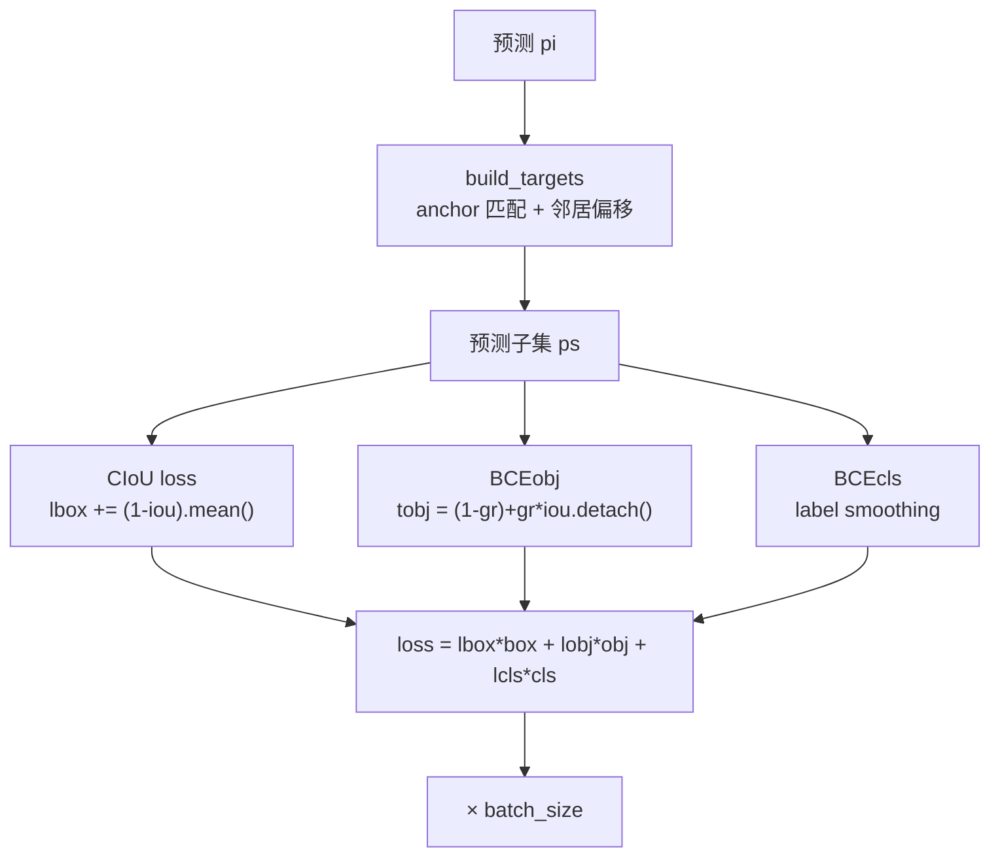

# YOLOv5 损失函数

::: tip 只想带走三件事
1. **box loss = CIoU**，坐标回归直接以 IoU 为优化目标；
2. **obj loss = BCEWithLogitsLoss**，target 不是 1.0 而是 `iou.detach()`（IoU ratio）；
3. **anchor 分配 = wh 比例 + 邻居偏移**，一个 GT 可产生最多 15 个正样本。
:::

## 全景图



## 1. 坐标回归：CIoU loss (`loss-box-ciou`)

```python
pxy = ps[:, :2].sigmoid() * 2. - 0.5
pwh = (ps[:, 2:4].sigmoid() * 2) ** 2 * anchors[i]
pbox = torch.cat((pxy, pwh), 1)
iou = bbox_iou(pbox.T, tbox[i], x1y1x2y2=False, CIoU=True)
lbox += (1.0 - iou).mean()
```

- 与 v4 的 CIoU 完全一致，但**实现是 PyTorch 的自动求导**（`bbox_iou` 返回可导 tensor）
- 没有 v4 的手写 `delta_yolo_box` 梯度推导，因为 PyTorch 的 `autograd` 自动处理
- 坐标编码：xy 用 `sigmoid*2-0.5`（消网格敏感），wh 用 `(sigmoid*2)²×anchor`（保证正数且平滑）

## 2. Objectness BCE（IoU ratio）(`loss-object`)

```python
tobj[b, a, gj, gi] = (1.0 - self.gr) + self.gr * iou.detach().clamp(0)
obji = self.BCEobj(pi[..., 4], tobj)
lobj += obji * self.balance[i]
```

- `self.gr = model.gr = 1.0`（默认），所以 `tobj = iou.detach()`
- `.detach()` 切断梯度：objectness 只被 BCE 优化，box 回归的梯度不反向传播到 objectness
- `balance = [4.0, 1.0, 0.4]`：P3 头（小目标）权重最高，P5 头（大目标）权重最低

> v4 读者路标：v4 的 objectness target 是固定 1.0，v5 改为 IoU ratio。

## 3. Class BCE（label smoothing）(`loss-class`)

```python
self.cp, self.cn = smooth_BCE(eps=h.get('label_smoothing', 0.0))
t = torch.full_like(ps[:, 5:], self.cn, device=device)
t[range(n), tcls[i]] = self.cp
lcls += self.BCEcls(ps[:, 5:], t)
```

- `smooth_BCE(eps=0.1)` → cp=0.95, cn=0.05
- 默认 `label_smoothing=0.0`（不启用），但代码已备好
- `self.nc > 1` 才计算 cls loss（单类数据集跳过）

## 4. Focal Loss（可选，默认关闭）

```python
g = h['fl_gamma']  # 0.0
if g > 0:
    BCEcls, BCEobj = FocalLoss(BCEcls, g), FocalLoss(BCEobj, g)
```

- 默认 `fl_gamma=0.0`，即不启用
- 代码已封装 `FocalLoss` 和 `QFocalLoss`，用户只需改 hyp

## 5. 目标分配：build_targets (`loss-target-assignment`)

```python
# 1. 形状匹配
r = t[:, :, 4:6] / anchors[:, None]  # wh ratio
j = torch.max(r, 1. / r).max(2)[0] < self.hyp['anchor_t']  # < 4.0
t = t[j]  # 过滤

# 2. 邻居偏移
gxy = t[:, 2:4]
gxi = gain[[2, 3]] - gxy
j, k = ((gxy % 1. < g) & (gxy > 1.)).T
l, m = ((gxi % 1. < g) & (gxi > 1.)).T
j = torch.stack((torch.ones_like(j), j, k, l, m))
t = t.repeat((5, 1, 1))[j]
offsets = (torch.zeros_like(gxy)[None] + off[:, None])[j]
```

- **形状匹配**：wh 比例 < 4.0 即入选（比 v4 的 IoU>0.213 更宽松）
- **邻居偏移**：中心点落在网格内时，向 4 个方向偏移，产生最多 5 个正样本位置
- 与 v3/v4 的"best_n 独占"完全不同，**正样本数量大幅增加**

## 6. 权重平衡总表

| 损失项 | 权重（hyp） | 缩放后 | 说明 |
|--------|-------------|--------|------|
| lbox | 0.05 | ×3/nl | 坐标回归 |
| lcls | 0.5 | ×nc/80 ×3/nl | 分类 |
| lobj | 1.0 | ×(imgsz/640)² ×3/nl | objectness |
| balance | [4.0, 1.0, 0.4] | 固定 | 各头 obj 权重 |

## 与其他页的链接

- [反向传播推导](/versions/v5/loss-gradient)
- [训练技巧](/versions/v5/tricks)
- [理论 Concept](/versions/v5/concepts)
- [v4 损失函数（对比）](/versions/v4/losses)
