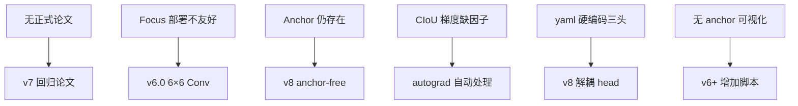

# YOLOv5 痛点追踪

## 6 个痛点全景

| 痛点 | 严重度 | 后续版本的解法 |
|------|--------|---------------|
| 无正式论文，指标未同行评审 | High | v7 起社区回归论文+代码双轨 |
| Focus 部署不友好 | Medium | v6.0 用 6×6 Conv 替代 |
| anchor 仍存在（非 anchor-free） | Medium | v8 切换 anchor-free |
| CIoU 长宽比梯度缺 1/(1+ar²) 因子 | Low | 沿用 v4，未修复 |
| 模型 yaml 硬编码三头结构 | Medium | v8 解耦 head |
| 无 anchor 可视化工具 | Low | v6+ 增加 anchor 分析脚本 |

> **v6 路标**："Focus 部署不友好"与"anchor 仍存在"在 v6 同时解决——Focus 换成 RepConv stem，anchor 彻底移除；"无正式论文"也有了美团的同行技术报告可对照（见 [v6 痛点追踪](/versions/v6/painpoints)）。

> **v8 路标**："无正式论文"与"anchor 仍存在"两笔旧账在 v8 一并了结——前者发展出"以代码为论文"的工程叙事（代价是 AGPL-3.0），后者由 anchor-free 解耦头彻底终结（见 [v8 痛点追踪](/versions/v8/painpoints)）。

> **v9 路标**："无正式论文"这笔账在 v9 翻篇——arXiv:2402.13616 带着正式论文与逐组件消融回归；"Focus 部署不友好"的同题讨论延续到 v9 的 ADown——下采样不再只挑最便宜的那种算子（见 [v9 痛点追踪](/versions/v9/painpoints#_1-信息瓶颈与梯度不可靠-pain-info-bottleneck)）。

> **v10 路标**："Focus 部署不友好"把部署端负担立为痛点；v10 把部署栈里最难缠的 NMS 算子也省了——导出图直接吐最终结果，后处理只剩一次 topk（见 [v10 痛点追踪](/versions/v10/painpoints)）。

## 1. 无正式论文 (`pain-no-paper`)

- YOLOv5 没有 arXiv 论文，所有指标基于 README 声明
- 社区无法复现"官方"结果，只能信任 ultralytics 的 release
- 引发大量争议：是否算"学术贡献"？

## 2. Focus 部署不友好 (`pain-focus-deploy`)

- Focus 的切片操作在 TensorRT、CoreML 等推理引擎中**难以优化**
- 量化时切片会导致精度下降
- v6.0 用 `Conv 6×6 s2` 替代 Focus，推理速度提升 5%

## 3. Anchor 仍存在 (`pain-anchor-still`)

- v5 仍是 anchor-based，与 v3/v4 相同
- 虽然 autoanchor 自动化了 anchor 计算，但 anchor 本身仍是超参
- v8 切换 anchor-free，彻底消除 anchor

## 4. CIoU 长宽比梯度缺因子 (`pain-ciou-gradient`)

- 与 v4 相同：`alpha = v / (v - iou + (1 + eps))` 中 `alpha` 的梯度缺少 `1/(1+ar²)` 因子
- 但 v5 用 PyTorch autograd，**自动求导会正确处理**
- 只是数学推导上仍不完美

## 5. 模型 yaml 硬编码三头 (`pain-yaml-hardcode`)

- `yolov5s.yaml` 的 head 部分硬编码了 3 个 Detect 头
- 想加 P2 头（更小目标）需要手动改 yaml，不够灵活
- v8 解耦 head，支持任意数量头

## 6. 无 Anchor 可视化工具 (`pain-anchor-visualization`)

- 虽然 autoanchor 自动计算，但用户无法直观看到 anchor 分布
- v6+ 增加了 `utils/plots.py` 的 anchor 可视化

## 痛点谱系图

## 延伸阅读

- [v7 痛点追踪](/versions/v7/painpoints) — P1 的"回归论文"方：trainable bag-of-freebies 路线
- [v4 痛点追踪](/versions/v4/painpoints)
- [v3 痛点追踪](/versions/v3/painpoints)
- [v2 痛点追踪](/versions/v2/painpoints)
- [v1 痛点追踪](/versions/v1/painpoints)
