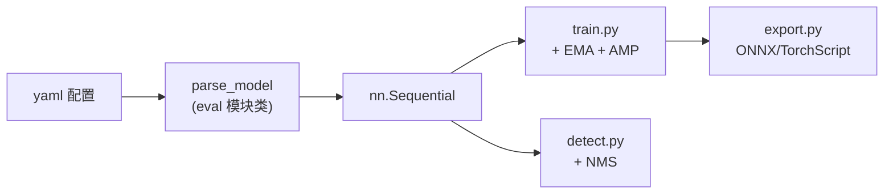

# YOLOv5：无正式论文的工程化手册

YOLOv5 没有发布 arXiv 论文，其所有技术细节、指标、教程全部以 **README + issue + 代码** 形式存在于 [ultralytics/yolov5](https://github.com/ultralytics/yolov5)。因此本页不精读论文，而是精读 **"工程化手册"**——即 README 的设计哲学与代码隐含的设计决策。

## 1. 为什么要从 darknet 切到 PyTorch？

- **训练可复现性**：darknet 的 C 实现对改动极其敏感（如 v4 的 CIoU 梯度因子问题），PyTorch 自动求导消除了手写梯度风险
- **生态对接**：PyTorch Hub、ONNX、CoreML、TensorRT 导出链直接打通
- **配置即代码**：yaml 文件可被 Python `yaml.load` 解析，`eval(m)` 直接实例化模块——配置与代码不再割裂
- **pip install 即安装**：`pip install yolov5` 后一行 `torch.hub.load('ultralytics/yolov5', 'yolov5s')` 即可推理

## 2. "训练-推理"统一框架

- **yaml 是唯一真相源**：网络拓扑、锚点、类别数、深度/宽度缩放系数全部在 yaml
- **模块白名单**：`parse_model` 内 `eval(m)` 只能实例化预先定义好的模块类（Conv, C3, SPP, Detect 等），防止任意代码注入
- **训练-推理共享同一个 `nn.Module`**：推理时 `model.eval()` + `torch.no_grad()`，与训练共用同一套参数和解析逻辑

## 3. 模型缩放（s/m/l/x）的统一公式

| 模型 | depth_multiple | width_multiple | 参数量 | 说明 |
|------|----------------|----------------|--------|------|
| YOLOv5n | 0.33 | 0.25 | 1.9M | Nano（v6 新增，v5 未含） |
| YOLOv5s | 0.33 | 0.50 | 7.2M | Small（默认推荐） |
| YOLOv5m | 0.67 | 0.75 | 21.2M | Medium |
| YOLOv5l | 1.0 | 1.0 | 46.5M | Large |
| YOLOv5x | 1.33 | 1.25 | 86.7M | Extra large |

- `depth_multiple` 作用于 `C3` 的重复次数：$n = \max(\text{round}(n_0 \times d), 1)$
- `width_multiple` 作用于通道数：$c = \text{make_divisible}(c_0 \times w, 8)$
- 所有缩放仅改 yaml 里的两个数字，模块代码完全不变

## 4. 指标声明与验证方式

Ultralytics 的指标全部基于 **COCO val2017**（而非 test-dev），使用 `pycocotools`，且**不公布推理时间硬件环境细节**（仅标 "V100"）。

| 模型 | APval | AP50val | 速度（V100） |
|------|------------------|-------------------------------|-------------|
| YOLOv5s | 37.4 | 56.8 | 6.4 ms |
| YOLOv5m | 45.4 | 64.1 | 8.2 ms |
| YOLOv5l | 49.0 | 67.3 | 10.1 ms |
| YOLOv5x | 50.7 | 68.9 | 12.1 ms |

- 注意：v5 指标 **AP 口径与 v4 不同**（v4 是 test-dev，v5 是 val）
- YOLOv5l 的 AP 49.0 已超越 YOLOv4-608 的 43.5（但输入不同、数据集不同，非严格对比）

## 5. 工程化哲学：代码即文档

- 没有论文 Figure，但有 `tutorial.ipynb` 交互教程
- 没有附录推导，但有 `utils/loss.py` 的 50 行 compute_loss
- 消融实验不在论文里，而在 `utils/general.py` 的 issue 链接和 commit message 里
- 这是 YOLOv5 最大的特色，也是最大的争议

## 延伸阅读

- [Architecture 逐层图解](/versions/v5/architecture)
- [源码走读](/versions/v5/code-walkthrough)
- [v4 论文精读（有正式论文的对比）](/versions/v4/paper)
