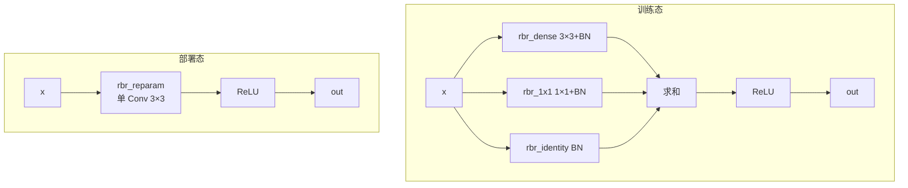
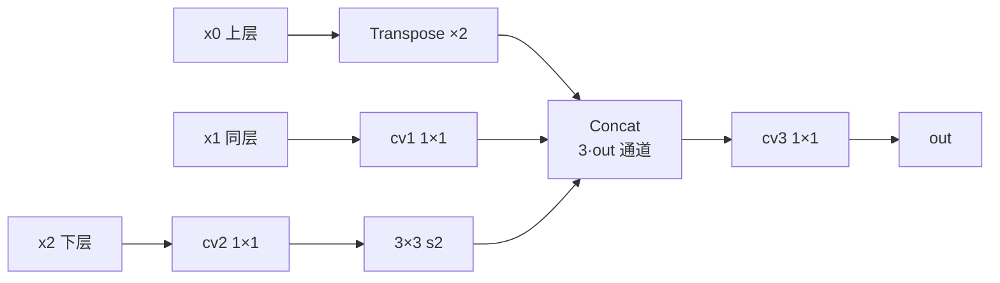

# YOLOv6 逐层图解

::: tip 只想带走三件事
1. v6 的"层"不是 yaml 层表，而是 **Python 类直接组装**：`build_network` 按配置 dict 实例化 EfficientRep → RepBiFPANNeck → EffiDeHead；
2. 骨干 = stem + ERBlock_2~5（`fuse_P2=True` 时**四路输出**），neck = RepBiFPANNeck（**四输入** BiFusion），头 = EffiDeHead ×3（strides 8/16/32）；
3. yolov6s 缩放后骨干通道 `[32,64,128,256,512]`，推理输出 `(bs, 8400, 85)` = 4 box + 1 占位 + 80 类。
:::

> 本页所有通道数均为 `configs/yolov6s.py` 经 `width_multiple=0.50` / `depth_multiple=0.33` 缩放后的**真实值**（`make_divisible(x, 8)`），输入按 640×640 推演。配置原文见 <SrcLink file="v6:configs/yolov6s.py" :line="2" :end="39" />。

## 1. 一眼看清：输入 → 输出的完整流程

```mermaid
flowchart LR
    IMG["640×640×3"] --> STEM["stem RepVGGBlock<br/>3×3 s2 → 32ch @320"]
    STEM --> E2["ERBlock_2<br/>s2 → 64ch + RepBlock×2<br/>P2 @160"]
    E2 --> E3["ERBlock_3<br/>s2 → 128ch + RepBlock×4<br/>P3 @80"]
    E3 --> E4["ERBlock_4<br/>s2 → 256ch + RepBlock×6<br/>P4 @40"]
    E4 --> E5["ERBlock_5<br/>s2 → 512ch + RepBlock×2 + CSPSPPF<br/>P5 @20"]

    E5 --> R0["reduce_layer0 1×1<br/>512 → 128 @20"]
    R0 --> BF0["Bifusion0<br/>上采样128 + cv1(256→128) + ↓cv2(128→128)<br/>concat 384 → 128 @40"]
    E4 --> BF0
    E3 --> BF0
    BF0 --> P4R["Rep_p4 ×4 → 128 @40"]
    P4R --> R1["reduce_layer1 1×1<br/>128 → 64 @40"]
    R1 --> BF1["Bifusion1<br/>上采样64 + cv1(128→64) + ↓cv2(64→64)<br/>concat 192 → 64 @80"]
    E3 --> BF1
    E2 --> BF1
    BF1 --> P3R["Rep_p3 ×4 → 64 @80 = P3"]

    P3R --> DS2["downsample2 3×3 s2 → 64 @40"]
    DS2 --> NC1["cat 64+64 → Rep_n3 ×4 → 128 @40 = P4"]
    P4R -. concat .-> NC1
    NC1 --> DS1["downsample1 3×3 s2 → 128 @20"]
    DS1 --> NC2["cat 128+128 → Rep_n4 ×4 → 256 @20 = P5"]
    R0 -. concat .-> NC2

    P3R --> H3["EffiDeHead P3/8<br/>80×80 位置"]
    NC1 --> H4["EffiDeHead P4/16<br/>40×40 位置"]
    NC2 --> H5["EffiDeHead P5/32<br/>20×20 位置"]
```



## 2. 逐模块明细表（build_network 组装，缩放后真实值）

| 部件 | 模块 | 位置 | 输入 → 输出 | 重复 n（缩放后） | 说明 |
|------|------|------|-------------|------------------|------|
| 骨干 | RepVGGBlock（stem） | efficientrep.py | 3 → 32 @320 | 1 | 3×3 s2 |
| 骨干 | ERBlock_2 | 骨干 | 32 → 64 @160 | down 1 + RepBlock n=2 | **fuse_P2 输出 x3** |
| 骨干 | ERBlock_3 | 骨干 | 64 → 128 @80 | down 1 + RepBlock n=4 | 输出 x2 |
| 骨干 | ERBlock_4 | 骨干 | 128 → 256 @40 | down 1 + RepBlock n=6 | 输出 x1 |
| 骨干 | ERBlock_5 | 骨干 | 256 → 512 @20 | down 1 + RepBlock n=2 + SimCSPSPPF | 输出 x0 |
| 颈 | reduce_layer0 | reppan.py | 512@20 → 128@20 | 1 | ConvBNReLU 1×1 |
| 颈 | Bifusion0 | reppan.py | [128@20, 256@40, 128@80] → 128@40 | 1 | BiFusion 三路 |
| 颈 | Rep_p4 | reppan.py | 128@40 → 128@40 | n=4 | RepBlock |
| 颈 | reduce_layer1 | reppan.py | 128@40 → 64@40 | 1 | ConvBNReLU 1×1 |
| 颈 | Bifusion1 | reppan.py | [64@40, 128@80, 64@160] → 64@80 | 1 | BiFusion 三路（第三路是 P2） |
| 颈 | Rep_p3 | reppan.py | 64@80 → 64@80 | n=4 | 输出 **P3** |
| 颈 | downsample2 + cat | reppan.py | 64@80→64@40，cat(64+64)=128@40 | 1 | PAN 下行 |
| 颈 | Rep_n3 | reppan.py | 128@40 → 128@40 | n=4 | 输出 **P4** |
| 颈 | downsample1 + cat | reppan.py | 128@40→128@20，cat(128+128)=256@20 | 1 | PAN 下行 |
| 颈 | Rep_n4 | reppan.py | 256@20 → 256@20 | n=4 | 输出 **P5** |
| 头 | EffiDeHead 层0 | effidehead.py | 64@80 → cls 80 + reg 4 | 每层 5 子层 | stride 8 |
| 头 | EffiDeHead 层1 | effidehead.py | 128@40 → cls 80 + reg 4 | 每层 5 子层 | stride 16 |
| 头 | EffiDeHead 层2 | effidehead.py | 256@20 → cls 80 + reg 4 | 每层 5 子层 | stride 32 |

> 重复次数缩放：neck 配置 `num_repeats=[12,12,12,12]` 经 `max(round(12×0.33),1)=4`；backbone `[1,6,12,18,6] → [1,2,4,6,2]`（`n=1` 不缩放），公式见 <SrcLink file="v6:yolov6/models/yolo.py" :line="66" :end="67" />。

## 3. 三个阶段的「原理图 + 白话 + 代码」

### 3.1 RepVGGBlock：三分支训练 → 单 3×3 部署



**白话**：训练时三条路各学各的（3×3 学空间、1×1 学跨通道、identity 保恒等），`switch_to_deploy()` 用 BN 折算公式把三条路的等效 kernel/bias 相加，塞进一个带 bias 的 3×3 conv——函数不变，算子从 3 个变 1 个。

<SrcLink file="v6:yolov6/layers/common.py" :line="245" :end="319" />

### 3.2 BiFusion：三路一次融合



**白话**：v5 的 neck 融合是"上采样 + 双路 concat"；BiFusion 在同一节点上把上层语义（转置卷积上采样）、同层特征（1×1 对齐）、下层细节（1×1 + 3×3 s2 降采样）**三路**拼一起再 1×1 收拢，一次融合吃掉双向路径的信息差。

<SrcLink file="v6:yolov6/layers/common.py" :line="695" :end="718" />

### 3.3 EffiDeHead 推理解码：anchor-free + dist2bbox

```python
if self.use_dfl:  # reg_max=16 时
    reg_output = reg_output.reshape([-1, 4, self.reg_max + 1, l]).permute(0, 2, 1, 3)
    reg_output = self.proj_conv(F.softmax(reg_output, dim=1))  # 期望解码 ltrb

anchor_points, stride_tensor = generate_anchors(x, self.stride, ...,
                                                is_eval=True, mode='af')
pred_bboxes = dist2bbox(reg_dist_list, anchor_points, box_format='xywh')
pred_bboxes *= stride_tensor
```

**白话**：每个网格中心是"锚点"（anchor-free），网络预测中心到框四边的距离 ltrb，`dist2bbox` 拼回 xywh 再乘 stride 回到原图坐标；DFL 打开时先把 17 格分布 softmax 求期望压成 4 个距离值。

<SrcLink file="v6:yolov6/models/effidehead.py" :line="108" :end="139" />

## 4. 张量形状推演（yolov6s，输入 640×640，bs 省略）

| # | 操作 | 输出形状 | 说明 |
|---|------|----------|------|
| 0 | stem RepVGGBlock 3×3 s2 | 32×320×320 | 3 → 32 |
| 1 | ERBlock_2 down 3×3 s2 | 64×160×160 | |
| 2 | ERBlock_2 RepBlock ×2 | 64×160×160 | = x3（P2） |
| 3 | ERBlock_3 down 3×3 s2 | 128×80×80 | |
| 4 | ERBlock_3 RepBlock ×4 | 128×80×80 | = x2（P3） |
| 5 | ERBlock_4 down 3×3 s2 | 256×40×40 | |
| 6 | ERBlock_4 RepBlock ×6 | 256×40×40 | = x1（P4） |
| 7 | ERBlock_5 down 3×3 s2 | 512×20×20 | |
| 8 | ERBlock_5 RepBlock ×2 + SimCSPSPPF | 512×20×20 | = x0（P5） |
| 9 | reduce_layer0 1×1 | 128×20×20 | fpn_out0 |
| 10 | Bifusion0 | 128×40×40 | 上采样(128@20) + cv1(x1→128@40) + ↓cv2(x2→128@40)，concat 384→128 |
| 11 | Rep_p4 ×4 | 128×40×40 | f_out0 |
| 12 | reduce_layer1 1×1 | 64×40×40 | fpn_out1 |
| 13 | Bifusion1 | 64×80×80 | 上采样(64@40) + cv1(x2→64@80) + ↓cv2(x3→64@80)，concat 192→64 |
| 14 | Rep_p3 ×4 | 64×80×80 | **P3 输出** |
| 15 | downsample2 3×3 s2 | 64×40×40 | |
| 16 | cat(down_feat1, fpn_out1) | 128×40×40 | 64+64 |
| 17 | Rep_n3 ×4 | 128×40×40 | **P4 输出** |
| 18 | downsample1 3×3 s2 | 128×20×20 | |
| 19 | cat(down_feat0, fpn_out0) | 256×20×20 | 128+128 |
| 20 | Rep_n4 ×4 | 256×20×20 | **P5 输出** |
| 21 | 头层0：stem/cls_conv/reg_conv | 64×80×80 | chx[0]=6 → 64 |
| 22 | 头层0：cls_pred / reg_pred | 80×80×80 / 4×80×80 | 80 类；use_dfl=False 时 reg=4 |
| 23 | 头层1：cls_pred / reg_pred | 80×40×40 / 4×40×40 | chx[1]=8 → 128 |
| 24 | 头层2：cls_pred / reg_pred | 80×20×20 / 4×20×20 | chx[2]=10 → 256 |

- 头部输入通道取自合并通道表：`chx = [6, 8, 10]` → `[64, 128, 256]`（<SrcLink file="v6:yolov6/models/effidehead.py" :line="142" :end="144" />）
- 训练输出：`(feats, cls_score_list, reg_distri_list)`，其中 `cls_score_list` 为 `(bs, 8400, 80)`，`reg_distri_list` 为 `(bs, 8400, 4)`（DFL 开启时 `(bs, 8400, 68)`，4×17 分布）
- 推理输出：`(bs, 8400, 85)`，位置数 $8400 = 80^2 + 40^2 + 20^2$

## 5. 85 维输出的切分（每个位置相同）

| 维度 | 含义 | 来源 |
|------|------|------|
| 0-3 | x, y, w, h（原图坐标） | `dist2bbox` × stride |
| 4 | objectness 占位 | **恒为 1**（v6 无 objectness 分支，仅兼容格式） |
| 5-84 | 80 类 sigmoid 分数 | cls_pred → sigmoid |

## 6. 结构规模

- 论文口径（YOLOv6 技术报告）：YOLOv6-S 约 **17.2M 参数 / 44.1 GFLOPs**（640×640）
- 参数大头在骨干 ERBlock_4（RepBlock ×6，256ch）与颈部 RepBlock；部署融合后仅剩 3×3 conv，推理访存大幅下降
- 参数量与 $width\_multiple^2$ 成正比，重复次数与 $depth\_multiple$ 成正比

## 7. 与 v5 的架构对比

| 维度 | v5 | v6 |
|------|----|----|
| 配置 | yaml 层表（24 层） | **Python dict**，类直接组装 |
| Stem | Focus 4 路切片 | **RepVGGBlock 3×3 s2** |
| 阶段块 | C3（Bottleneck） | **RepBlock / BottleRep**（可融合） |
| Neck | PANet（nearest upsample + concat） | **RepBiFPANNeck**（Transpose + BiFusion 三路） |
| 尺度 | P3/P4/P5 | P2 融入（fuse_P2），检测仍 P3/P4/P5 |
| 检测头 | 1×1 conv ×3（255 维） | **解耦双分支** stem/cls_conv/reg_conv |
| 预测 | anchor-based（3×3 anchors） | **anchor-free**（dist2bbox） |
| 标签分配 | wh 比例 + 邻居偏移 | **TAL**（topk=13）+ ATSS warmup |
| 损失 | CIoU + BCEcls + BCEobj | **GIoU + VFL + 可选 DFL**，无 objectness |
| 部署 | conv 不变 | **switch_to_deploy 重参数化** |

## 延伸阅读

- [理论 Concept](/versions/v6/concepts)
- [架构与层速查](/versions/v6/layers)
- [损失函数详解](/versions/v6/losses)
- [v5 逐层图解（对比）](/versions/v5/architecture)
