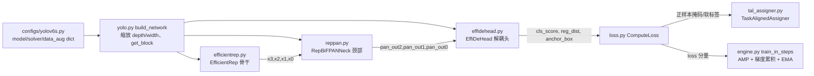

# YOLOv6 源码走读

本页沿 YOLOv6（美团，2022-06）的主调用链走读源码：**`configs/yolov6s.py` → `yolo.py` 的 `build_network` → `efficientrep.py`（骨干）→ `reppan.py`（颈部）→ `effidehead.py`（解耦头）→ `loss.py` / `tal_assigner.py`（损失与标签分配）**。所有行号均以站内快照 `source/yolov6/snapshot/` 为准，可点击 SrcLink 跳转核对。

## 文件清单

| 文件 | 行数 | 功能 |
| --- | --- | --- |
| `configs/yolov6s.py` | 65 | Python dict 配置：model / solver / data_aug 三段 |
| `yolov6/models/yolo.py` | 138 | `build_network`：按配置组装 backbone + neck + head |
| `yolov6/models/efficientrep.py` | 582 | EfficientRep 骨干（RepVGGBlock 堆叠） |
| `yolov6/models/reppan.py` | 1226 | RepBiFPANNeck / RepPANNeck 颈部 |
| `yolov6/models/effidehead.py` | 293 | EffiDeHead 解耦 anchor-free 检测头 |
| `yolov6/models/losses/loss.py` | 278 | ComputeLoss：VFL + GIoU + DFL 聚合 |
| `yolov6/assigners/tal_assigner.py` | 173 | TaskAlignedAssigner 标签分配 |
| `yolov6/layers/common.py` | 986 | RepVGGBlock / QARepVGGBlock / BepC3 / BiFusion 等基础块 |
| `yolov6/data/data_augment.py` | 208 | mosaic / mixup / random_affine / HSV 增强 |
| `yolov6/data/datasets.py` | 726 | 数据集与增强调度 |
| `yolov6/core/engine.py` | 594 | 训练主循环（AMP / EMA / warmup / 梯度累积） |
| `yolov6/solver/build.py` | 46 | SGD 优化器与 Cosine 学习率 |
| `yolov6/utils/ema.py` | 59 | ModelEMA 指数滑动平均 |

## 调用链总览

## 1. `configs/yolov6s.py` — 配置即入口

### 模型段：缩放系数与三段式结构（L2-39）

配置是一个 Python dict（而非 v5 的 yaml），`model` 段按 backbone / neck / head 三段声明：

- L5-6 给出 `depth_multiple=0.33`、`width_multiple=0.50`，是 YOLOv6-S 的缩放依据：
  <SrcLink file="v6:configs/yolov6s.py" :line="2" :end="6" />
- L7-13 骨干声明：`EfficientRep`、`num_repeats=[1,6,12,18,6]`、`out_channels=[64,128,256,512,1024]`、`fuse_P2=True`、`cspsppf=True`：
  <SrcLink file="v6:configs/yolov6s.py" :line="7" :end="13" />
- L14-18 颈部声明 `RepBiFPANNeck`（width 与 backbone 对齐）：
  <SrcLink file="v6:configs/yolov6s.py" :line="14" :end="18" />
- L19-38 头声明 `EffiDeHead`：`anchors_init` 仅供 `--fuse_ab` 辅助分支使用（L25-27），`strides=[8,16,32]`（L29）、`atss_warmup_epoch=0`（L30，全程 TAL）、`iou_type='giou'`（L31）、`use_dfl=False` + `reg_max=0`（L32-33，注释明说蒸馏续训才开）、`distill_weight`（L34-37）：
  <SrcLink file="v6:configs/yolov6s.py" :line="19" :end="38" />

### 求解器段与数据增强段（L41-65）

- L41-51 solver：SGD + Cosine、`lr0=0.01`、`lrf=0.01`、`momentum=0.937`、`weight_decay=0.0005`、`warmup_epochs=3.0`、`warmup_momentum=0.8`、`warmup_bias_lr=0.1`：
  <SrcLink file="v6:configs/yolov6s.py" :line="41" :end="51" />
- L53-65 data_aug：HSV（hsv_h=0.015 / hsv_s=0.7 / hsv_v=0.4）、`translate=0.1`、`scale=0.5`、`fliplr=0.5`、`mosaic=1.0`，注意 **`mixup=0.0`（默认关闭）**：
  <SrcLink file="v6:configs/yolov6s.py" :line="53" :end="65" />

## 2. `yolov6/models/yolo.py` — `build_network` 组装网络

### 缩放与块选择（L55-71）

- `build_network` 入口先按 `depth_multiple` / `width_multiple` 计算 `num_repeat` 与 `channels_list`：
  <SrcLink file="v6:yolov6/models/yolo.py" :line="55" :end="67" />
- `block = get_block(config.training_mode)` 决定 RepVGG 系块的训练/部署形态；随后 `eval` 出 `BACKBONE` / `NECK` 类：
  <SrcLink file="v6:yolov6/models/yolo.py" :line="69" :end="71" />
- `get_block` 的取值表（repvgg / qarepvgg / qarepvggv2 / hyper_search→LinearAddBlock / repopt→RealVGGBlock 等）见 <SrcLink file="v6:yolov6/layers/common.py" :line="721" :end="737" />。

### 骨干/颈部实例化与头的三分支（L73-133）

- L73-97 CSP 系（`stage_block_type` 默认 `BepC3`）与 L98-112 非 CSP 两条实例化路径：
  <SrcLink file="v6:yolov6/models/yolo.py" :line="73" :end="112" />
- 头按训练模式三分支：`distill_ns` 蒸馏头（L114-120）、`fuse_ab` 双分支头（L122-126）、默认 `EffiDeHead`（L128-131），最终 `return backbone, neck, head`：
  <SrcLink file="v6:yolov6/models/yolo.py" :line="114" :end="133" />

## 3. `yolov6/models/efficientrep.py` — EfficientRep 骨干

### 整体结构（L7-118）

- stem 是 3×3 stride-2 卷积（替代 v5 的 Focus 切片）：
  <SrcLink file="v6:yolov6/models/efficientrep.py" :line="28" :end="33" />
- ERBlock_2~5 由 RepVGGBlock + 下采样堆叠，重复数由 `num_repeats` 缩放：
  <SrcLink file="v6:yolov6/models/efficientrep.py" :line="35" :end="102" />
- 末端 `channel_merge_layer` 按块类型选 SPPF/SimSPPF，`cspsppf=True` 时换 CSPSPPF/SimCSPSPPF：
  <SrcLink file="v6:yolov6/models/efficientrep.py" :line="80" :end="82" />
- forward 输出 `fuse_P2` 控制的多尺度特征元组：
  <SrcLink file="v6:yolov6/models/efficientrep.py" :line="104" :end="118" />

### 底层块在哪里（`yolov6/layers/common.py`）

骨干/颈部复用的原子块集中于 common.py：

- **RepVGGBlock**：训练三分支（L240-242）→ forward 三路求和过激活（L244-254）→ `get_equivalent_kernel_bias`（L256-260）→ `_fuse_bn_tensor`（L277-299）→ `switch_to_deploy` 折叠单 3×3（L301-318）：
  <SrcLink file="v6:yolov6/layers/common.py" :line="196" :end="318" />
- **BottleRep**：可学习 `alpha` 加权残差（L590-608）；**BepC3** 内部用 `RepBlock(..., block=BottleRep)`（L634-650）：
  <SrcLink file="v6:yolov6/layers/common.py" :line="590" :end="650" />
- **BiFusion**：三分支特征融合（L695-718），是颈部的基本单元：
  <SrcLink file="v6:yolov6/layers/common.py" :line="695" :end="718" />

## 4. `yolov6/models/reppan.py` — RepBiFPANNeck 颈部

### 自顶向下 / 自底向上双向通路（L132-237）

- init 依次构建 `reduce_layer0 → Bifusion0 → Rep_p4 → reduce_layer1 → Bifusion1 → Rep_p3`（自顶向下）与 `downsample2 → Rep_n3 → downsample1 → Rep_n4`（自底向上）：
  <SrcLink file="v6:yolov6/models/reppan.py" :line="138" :end="212" />
- forward 解包骨干输出 `(x3, x2, x1, x0)`，BiFusion 逐级融合（如 `f_concat_layer0 = self.Bifusion0([fpn_out0, x1, x2])`），最终输出 `outputs = [pan_out2, pan_out1, pan_out0]` 三个尺度：
  <SrcLink file="v6:yolov6/models/reppan.py" :line="215" :end="237" />

## 5. `yolov6/models/effidehead.py` — EffiDeHead 解耦头

### Detect 初始化（L16-69）

- 每尺度一组 `cls_convs` / `reg_convs` / `cls_pred` / `reg_pred`，`no = num_classes + 5`，`reg_pred` 输出宽度为 `reg_max * 4`：
  <SrcLink file="v6:yolov6/models/effidehead.py" :line="16" :end="47" />
- `initialize_biases` 用 `−log((1−p)/p)` 初始化分类 bias、reg bias 置 1.0：
  <SrcLink file="v6:yolov6/models/effidehead.py" :line="49" :end="65" />
- `proj_conv` 权重初始化为 linspace 投影向量（DFL 积分还原用）：
  <SrcLink file="v6:yolov6/models/effidehead.py" :line="67" :end="69" />

### 训练 forward 与推理 forward（L71-139）

- 训练分支输出 `(cls_score, reg_dist, anchor_box)` 三元组喂给损失：
  <SrcLink file="v6:yolov6/models/effidehead.py" :line="71" :end="92" />
- 推理分支：`use_dfl` 时 `proj_conv` softmax+matmul 积分还原（L108-110），export 专用分支（L114-122），`dist2bbox(..., box_format='xywh') * stride_tensor` 得最终框（L131-132）：
  <SrcLink file="v6:yolov6/models/effidehead.py" :line="93" :end="139" />

## 6. `yolov6/models/losses/loss.py` — ComputeLoss

### 初始化：损失权重与双分配器（L14-50）

- `loss_weight = {'class': 1.0, 'iou': 2.5, 'dfl': 0.5}`：
  <SrcLink file="v6:yolov6/models/losses/loss.py" :line="26" :end="29" />
- `warmup_assigner = ATSSAssigner(9)` 与 `formal_assigner = TaskAlignedAssigner(topk=13, alpha=1.0, beta=6.0)` 并存：
  <SrcLink file="v6:yolov6/models/losses/loss.py" :line="41" :end="42" />
- `use_dfl` / `reg_max` / `proj` 决定 DFL 通路是否构建，随后实例化 VarifocalLoss 与 BboxLoss：
  <SrcLink file="v6:yolov6/models/losses/loss.py" :line="44" :end="50" />

### `__call__` 主流程（L52-182）

- anchor 缓存（L63-69）→ ATSS warmup / TAL 分支（L85-103，受 `atss_warmup_epoch` 控制，配置为 0 时全程 TAL）：
  <SrcLink file="v6:yolov6/models/losses/loss.py" :line="85" :end="103" />
- OOM 时回退 CPU 计算（L105-152），每 10 step `torch.cuda.empty_cache()`（L154-155）：
  <SrcLink file="v6:yolov6/models/losses/loss.py" :line="154" :end="155" />
- 分类损失走 VFL（L160-169）、框损失走 BboxLoss（L172-173）、按 `loss_weight` 加权求和（L175-177）：
  <SrcLink file="v6:yolov6/models/losses/loss.py" :line="160" :end="177" />

### VFL 与 BboxLoss（L201-278）

- VarifocalLoss：`weight = alpha * pred_score.pow(gamma) * (1 - label) + gt_score * label`（α=0.75, γ=2.0）：
  <SrcLink file="v6:yolov6/models/losses/loss.py" :line="201" :end="211" />
- BboxLoss：IoU 项按 `target_scores` 加权（L234-241）；DFL 项仅 `if self.use_dfl` 才计算（L244-257），否则 `pred_dist.sum() * 0.` 占位（L259）：
  <SrcLink file="v6:yolov6/models/losses/loss.py" :line="234" :end="259" />
- `_df_loss` 是标准 DFL（预测分布与最近两整数目标的交叉熵加权）：
  <SrcLink file="v6:yolov6/models/losses/loss.py" :line="267" :end="278" />

## 7. `yolov6/assigners/tal_assigner.py` — TaskAlignedAssigner

### forward 主流程（L6-95）

- 超参 `topk=13, alpha=1.0, beta=6.0`；`forward` 带 `@torch.no_grad`：
  <SrcLink file="v6:yolov6/assigners/tal_assigner.py" :line="6" :end="21" />
- `n_max_boxes > 100` 时按 batch 逐样本循环规避显存峰值（L55-58）；软标签经 `norm_align_metric` 归一（L76-81），冲突用 `select_highest_overlaps` 仲裁（L69-70）：
  <SrcLink file="v6:yolov6/assigners/tal_assigner.py" :line="55" :end="81" />

### 正样本掩码与对齐度量（L97-173）

- `get_pos_mask`：`mask_pos = mask_topk * mask_in_gts * mask_gt` 三级过滤：
  <SrcLink file="v6:yolov6/assigners/tal_assigner.py" :line="97" :end="115" />
- `get_box_metrics`：核心公式 `align_metric = bbox_scores.pow(self.alpha) * overlaps.pow(self.beta)`：
  <SrcLink file="v6:yolov6/assigners/tal_assigner.py" :line="117" :end="133" />
- `select_topk_candidates` 按对齐度量选 topk（L135-150），`get_targets` 汇总回归目标与软标签（L152-173）。

## 阅读路线建议

1. **先看配置**：`configs/yolov6s.py` 通读一遍，建立"三段 dict"的整体印象，特别留意 `use_dfl=False`、`atss_warmup_epoch=0`、`mixup=0.0` 三个默认值。
2. **再看组装**：`yolo.py` 的 `build_network`，理解 depth/width 缩放与 `get_block` 如何决定块形态。
3. **按数据流读结构**：`efficientrep.py` → `reppan.py` → `effidehead.py`，对照"调用链总览"的 mermaid 图走一遍张量形状。
4. **读损失闭环**：`loss.py` 的 `__call__` 从头到尾追一遍，再跳进 `tal_assigner.py` 看正样本怎么来。
5. **按需补基础块**：`common.py` 里 RepVGGBlock 的 `switch_to_deploy` 是理解"训练态≠部署态"的钥匙（另见 /versions/v6/tricks 与 /versions/v6/painpoints）。
6. **最后看工程层**：`core/engine.py`（训练主循环）、`solver/build.py`（优化器/LR）、`utils/ema.py`（EMA）、`data/`（增强）。

## 延伸阅读

- [YOLOv6 网络结构](/versions/v6/architecture) — 本页结构章节的概念版
- [YOLOv6 核心概念](/versions/v6/concepts) — 重参数化、anchor-free、TAL 等概念铺垫
- [YOLOv6 损失函数](/versions/v6/losses) — VFL / GIoU / DFL 的公式推导
- [YOLOv6 训练技巧](/versions/v6/tricks) — 18 个 trick 的动机与实现
- [YOLOv6 痛点追踪](/versions/v6/painpoints) — 源码设计背后的代价与路标
- [YOLOv5 源码走读](/versions/v5/code-walkthrough) — 上一版的调用链对照
