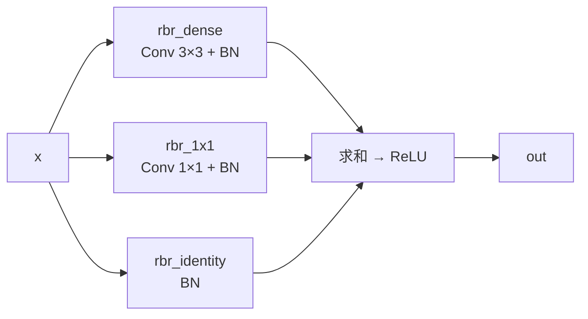
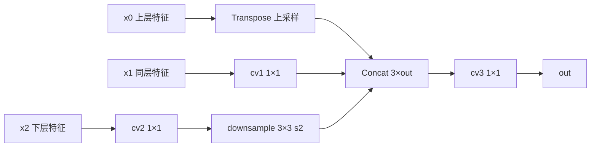

# YOLOv6 理论 Concept

::: tip 只想带走三件事
1. **结构重参数化是 v6 的灵魂**：RepVGGBlock 训练时三分支（3×3 + 1×1 + identity），部署时融合成单个 3×3 conv，精度与速度兼得；
2. **标签分配与损失全面重写**：anchor-free + TAL 任务对齐分配（cls$^\alpha$ × IoU$^\beta$）+ VarifocalLoss + GIoU/DFL，彻底告别 anchor；
3. **全链路硬件友好设计**：EfficientRep 骨干、RepBiFPANNeck、EffiDecoupled Head 都按"多分支可融合 / 少碎片算子"设计，GPU 与推理芯片通吃。
:::

## 1. RepVGG 结构重参数化 (`concept-reparam`)

**定义**：训练期用多分支拓扑提升容量，部署期把多分支在数学上等价地合并成单个 3×3 卷积——训练与部署的结构不同，但函数完全一致。

**动机**：多分支（残差、1×1 旁路）训练效果好但推理慢（多次内存读写、算子碎片化）；单 3×3 conv 推理快但训练效果差。重参数化"鱼与熊掌兼得"。

**实现**：训练态 `RepVGGBlock` 有三条分支：

- `switch_to_deploy()` 把三分支折算成一对 $(K_{3\times3}, b)$：1×1 kernel 零填充成 3×3，identity 折算成中心为 1 的 3×3 单位核再按 BN 的 $\gamma/\sigma$ 缩放，三者相加后只留一个 `rbr_reparam` conv

<SrcLink file="v6:yolov6/layers/common.py" :line="197" :end="319" />

**与上版差异**：v5 的 Conv/C3 结构训练与部署一致；v6 引入 RepVGG（ICCV 2021）思路后，"部署前融合"成为全网络的基本动作。

> v5 读者路标：v5 靠 Bottleneck 残差堆深度，v6 靠"可融合的多分支"堆容量，推理时分支全部消失。

## 2. EfficientRep 骨干 (`concept-efficientrep`)

**定义**：以 RepVGGBlock 为基本单元的硬件友好骨干：stem（Conv 3×3 s2）+ ERBlock_2 ~ ERBlock_5 四个阶段。

**实现**（yolov6s 为例）：每个 ERBlock = 下采样 RepVGGBlock（s2）+ RepBlock（n 个 RepVGGBlock）；ERBlock_5 末尾再接 CSPSPPF 做感受野扩展：

<SrcLink file="v6:yolov6/models/efficientrep.py" :line="7" :end="118" />

- 通道由 `channels_list` 决定（yolov6s 缩放后 `[32, 64, 128, 256, 512]`）
- `cspsppf=True` 时 ERBlock_5 末尾用 `SimCSPSPPF`（CSP 结构的 SPPF），否则用 `SimSPPF`
- 基础块可替换：`block=ConvBNSiLU` 时 SPPF 系同步换成 SiLU 版（`SPPF`/`CSPSPPF`）

**与上版差异**：v5 骨干是 Focus + C3；v6 用 RepVGGBlock/RepBlock 替换 C3，并把 SPP 移到 P5 阶段末尾（SimSPPF/CSPSPPF）。

## 3. RepBlock 与 BottleRep (`concept-repblock`)

**定义**：RepBlock 是"同一通道上连续 n 个 rep-style 块"的阶段容器；BottleRep 是带可学习 $\alpha$ 加权残差的两块瓶颈。

- `RepBlock(block=BottleRep)` 时重复次数自动**减半**（`n = n // 2`），因为每个 BottleRep 含两个 rep 块
- BottleRep 的残差是 $outputs + \alpha \cdot x$，$\alpha$ 为可学习标量（`weight=True`）；通道不一致时无 shortcut

<SrcLink file="v6:yolov6/layers/common.py" :line="569" :end="608" />

**与上版差异**：v5 的 Bottleneck 是 1×1+3×3 conv 对；BottleRep 用两个 RepVGGBlock + 加权残差，部署时全部融进 3×3。

## 4. RepBiFPANNeck 与 BiFusion (`concept-bifusion`)

**定义**：RepBiFPANNeck = 双向（FPN 上采样 + PAN 下采样）路径 + BiFusion 三路融合节点，路径上的聚合块是 RepBlock。

BiFusion 把**上层语义、同层特征、下层细节**一次性融合：

<SrcLink file="v6:yolov6/layers/common.py" :line="695" :end="718" />

- 上采样用 **转置卷积**（`Transpose`，ConvTranspose2d）而不是 nearest upsample，硬件上是一次卷积算子
- 下采样是 3×3 s2 ConvBNReLU，先 1×1 对齐通道再降采样
- yolov6s 的 RepBiFPANNeck 接收骨干**四路输出** `(x3, x2, x1, x0)`（P2~P5），输出 `[P3, P4, P5]` 三路给检测头

<SrcLink file="v6:yolov6/models/reppan.py" :line="132" :end="237" />

**与上版差异**：v5 neck 是 conv 1×1 + nearest upsample + concat 的 PANet；v6 用 BiFusion 三路融合替代双路 concat，上采样换转置卷积，聚合块换 RepBlock。

## 5. fuse_P2 四尺度输出 (`concept-fuse-p2`)

**定义**：`fuse_P2=True` 时骨干在 ERBlock_2（P2，1/8 分辨率）就引出一路输出，neck 用 BiFusion 把它融进 P3 分支，形成 P2→P5 四尺度特征流。

<SrcLink file="v6:yolov6/models/efficientrep.py" :line="104" :end="118" />

- 小目标检测受益：P2 分辨率高（640 输入下 80×80），细节不再只靠 P3（80×80，1/8）——注意 fuse_P2 后 BiFusion1 的第三路输入就是 P2（`x3`）
- 但**检测头仍是 3 输出**（strides 8/16/32）：P2 只作为融合信息源，不单独出检测层（四头 P6 需用 EfficientRep6 + RepBiFPANNeck6）
- 配置项在 `configs/yolov6s.py` 的 backbone 里，默认开启

**与上版差异**：v5 三尺度固定（P3/P4/P5），无 P2 通路。

## 6. EffiDecoupled Head (`concept-effidehead`)

**定义**：Efficient Decoupled Head——解耦分类与回归两个子网络，且每个检测层的通道数与上游特征对齐（hybrid channels，不用统一宽度）。

每层 5 个子层：`stem 1×1 → cls_conv 3×3 → cls_pred 1×1` 与 `stem → reg_conv 3×3 → reg_pred 1×1`：

<SrcLink file="v6:yolov6/models/effidehead.py" :line="10" :end="47" />

- `cls_pred` 输出 $num\_classes \times num\_anchors$（yolov6s：80×1=80），`reg_pred` 输出 $4 \times (reg\_max + num\_anchors)$
- 分类分支初始化为低先验（`prior_prob=1e-2`，bias $= -\log\frac{1-p}{p}$），回归分支 bias 置 1
- 三个检测层共享结构但参数独立（strides 8/16/32；四层时 8/16/32/64）

**与上版差异**：v5 Detect 是 3 个独立 1×1 conv（输出 255 = 3×85）；v6 每层是"两套 conv 干路"，且 cls/reg 分离，预测头更宽、更贴近特征图语义。

## 7. anchor-free 与 dist2bbox (`concept-anchor-free`)

**定义**：不预设 anchor 框，直接预测每个网格中心到框四边的距离（ltrb），再用 `dist2bbox` 还原成 xywh/xyxy。

$$
\begin{aligned}
b_x &= stride \cdot (t_x^{dist} + a_x), \quad b_w = stride \cdot (t_{right}^{dist} + t_{left}^{dist}) \\
\text{其中 } a_x &= \text{网格中心坐标（含 0.5 偏移）}
\end{aligned}
$$

- 训练态 `generate_anchors` 生成 `anchor_points`（网格中心）与 `stride_tensor`；推理态 `mode='af'` 直接返回网格中心点
- `dist2bbox(..., box_format='xywh')` 把 ltrb 距离转成中心式框，再乘 stride 映射回原图

<SrcLink file="v6:yolov6/models/effidehead.py" :line="128" :end="139" />

**与上版差异**：v5 是 anchor-based（9 个 anchor + wh 比例分配）；v6 每个位置只出 1 个预测（`num_anchors=1`），anchor 概念只剩"网格中心点"。

## 8. DFL 分布式焦点回归 (`concept-dfl`)

**定义**：把回归值离散成 $reg\_max+1$ 个格点上的分布，用 softmax 期望解出连续距离，即 Distribution Focal Loss 思路。

$$
\hat{d} = \sum_{i=0}^{reg\_max} \text{softmax}(p_i) \cdot i
$$

- 推理时 `proj_conv` 是**固定权重** `linspace(0, reg_max, reg_max+1)` 的 1×1 conv（`requires_grad=False`），等价于上述期望
- **注意 yolov6s 的默认配置**：`use_dfl=False, reg_max=0`——蒸馏续训（distill）才打开 `use_dfl=True, reg_max=16`，此时 `reg_pred` 输出 $4 \times 17 = 68$ 维
- `bbox2dist` 生成回归目标时 clip 到 $reg\_max - 0.01$，防止越界

<SrcLink file="v6:yolov6/models/effidehead.py" :line="29" :end="69" />

**与上版差异**：v5 直接回归 wh 原始值；v6 蒸馏态回归 ltrb 的离散分布，配合蒸馏标签更稳。

## 9. TAL 任务对齐标签分配 (`concept-tal`)

**定义**：Task-Aligned Assigner，按"分类得分与 IoU 的加权几何平均"给每个 GT 挑 topk 个正样本，使分类与定位任务对齐。

$$
align\_metric = s^{\alpha} \times IoU^{\beta}, \quad \alpha = 1.0,\ \beta = 6.0,\ topk = 13
$$

筛选三步：`align_metric × mask_in_gts × mask_topk → mask_pos`：

<SrcLink file="v6:yolov6/assigners/tal_assigner.py" :line="97" :end="133" />

- `mask_in_gts`：只有中心落在 GT 框内的候选点参与
- `select_topk_candidates`：每 GT 取 align_metric 最高的 13 个位置，one-hot 去重后并入正样本
- 正样本的 cls 目标是 `align_metric` 归一化后的软标签（不是纯 1），IoU 越高、分类越准，监督越强

**与上版差异**：v5 是"wh 比例 + 邻居偏移"的启发式多正样本；v6 用连续的对齐指标选 topk，数量固定、与预测质量挂钩。

## 10. ATSS warmup (`concept-atss-warmup`)

**定义**：训练最开始 `atss_warmup_epoch` 个 epoch 用 ATSSAssigner（`topk=9`）做粗分配，之后切到 TAL。

<SrcLink file="v6:yolov6/models/losses/loss.py" :line="40" :end="49" />

- ATSS 按"anchor 中心距离 + 统计阈值"选正样本，不依赖预测分数，适合网络还没训出判别力的冷启动阶段
- yolov6s 配置 `atss_warmup_epoch=0`，即**默认直接上 TAL**（热启或蒸馏续训时预测已可用）；设 >0 时前 N epoch 走 `warmup_assigner`，之后走 `formal_assigner`

**与上版差异**：v5 全程一套分配规则；v6 引入"冷启动切换"机制，规则本身也随训练阶段变化。

## 11. VarifocalLoss (`concept-varifocalloss`)

**定义**：对正样本按 IoU 加权（回归目标是软 IoU），对负样本按预测分数做 focal 降权的分类损失。

$$
VFL = \big[\alpha \cdot s^{\gamma} \cdot (1 - q) + q \big] \cdot \text{BCE}(s, q), \quad \alpha = 0.75,\ \gamma = 2.0
$$

其中 $q$ 为正样本的 IoU 软标签、$s$ 为预测分数：

<SrcLink file="v6:yolov6/models/losses/loss.py" :line="201" :end="211" />

- 正样本权重 $q$：IoU 越高的位置贡献越大（对齐"分类分数 = 定位质量"的目标）
- 负样本权重 $\alpha s^\gamma$：预测分数越高罚得越狠（hard negative focus）
- 最终 `loss_cls` 按 `target_scores_sum` 归一化，总损失 $L = 1.0 \cdot L_{cls} + 2.5 \cdot L_{iou} + 0.5 \cdot L_{dfl}$

**与上版差异**：v5 用 BCE + label smoothing，objectness 单独一项；v6 **没有 objectness 分支**，VFL 一并承担"是否有目标"与"分类"两个职责。

## 12. GIoU 框回归 (`concept-giou`)

**定义**：`iou_type='giou'` 时框回归损失用 GIoU：

$$
GIoU = IoU - \frac{|C \setminus (B \cup B^{gt})|}{|C|}
$$

- `BboxLoss` 里 IoU 损失按 TAL 的 `target_scores` 加权（定位越准的正样本权重越大）
- `use_dfl=True` 时额外叠加 DFL 损失（`bbox2dist` 生成 ltrb 目标）；`use_dfl=False` 时 `loss_dfl = 0`（用 `pred_dist.sum() * 0.` 占位保持图连通）

<SrcLink file="v6:yolov6/models/losses/loss.py" :line="214" :end="263" />

**与上版差异**：v5 是 CIoU + objectness=IoU ratio；v6 是 GIoU + 无 objectness + 可选 DFL。

## 13. 模型缩放公式 (`concept-scaling`)

两个缩放系数都写在配置 dict 里（yolov6s：`depth_multiple=0.33, width_multiple=0.50`）：

$$
\begin{aligned}
n_i &= \max(\mathrm{round}(n_i \times depth\_mul),\ 1) \quad (n_i > 1 \text{ 时缩放}) \\
c_i &= \mathrm{make\_divisible}(c_i \times width\_mul,\ 8) = \lceil c_i \cdot width\_mul / 8 \rceil \times 8
\end{aligned}
$$

<SrcLink file="v6:yolov6/models/yolo.py" :line="50" :end="67" />

- depth 公式有个细节：$n = 1$ 的块**不缩放**（`if i > 1 else i`），保证浅层不被压成 0
- `make_divisible` 向上取整到 8 的倍数，对推理芯片的向量对齐友好
- yolov6s 实际重复次数：backbone `[1, 2, 4, 6, 2]`，neck `[4, 4, 4, 4]`；通道表 `[32, 64, 128, 256, 512, 128, 64, 64, 128, 128, 256]`

**与上版差异**：v5 的 depth/width 缩放在 `parse_model` 里吃 yaml；v6 在 `build_network` 里吃 Python dict，公式基本同构（v5 的 n 缩放没有 `i>1` 例外）。

## 14. Python dict 配置系统 (`concept-config`)

**定义**：v6 弃用 yaml，用 mmcv 风格的 **Python dict** 写配置（`configs/yolov6s.py`），加载后是 `addict.Dict`，支持 `.attr` 访问与 `config.model.backbone.get('fuse_P2')` 式取值。

<SrcLink file="v6:configs/yolov6s.py" :line="2" :end="39" />

- 配置分三段：`model`（backbone/neck/head）、`solver`（SGD + Cosine，lr0=0.01, lrf=0.01, warmup 3 epoch）、`data_aug`（mosaic=1.0, mixup=0.0）
- 还有一个**隐藏配置项** `training_mode`：`tools/train.py` 里若配置未写则补 `'repvgg'`，它决定 `get_block` 返回哪种基本块
- head 段同时携带蒸馏开关（`use_dfl`/`reg_max`/`distill_weight`）和 fuse_ab 用的 `anchors_init`

**与上版差异**：v5 用 yaml + `parse_model` 按层表搭网络；v6 用 Python 类显式组装（`build_network`），配置只给通道、重复次数等标量。

## 15. Rep 家族扩展：QARepVGGBlock / RepOptimizer / DBB (`concept-rep-family`)

v6 的 `training_mode` 把"基本块"做成了可插拔设计（`get_block`）：

| training_mode | 基本块 | 思路 |
|---------------|--------|------|
| `repvgg`（默认） | RepVGGBlock | 经典三分支重参数化 |
| `qarepvgg` | QARepVGGBlock | BN 后置，量化友好（arXiv 2212.01593） |
| `qarepvggv2` | QARepVGGBlockV2 | 再加 avg 分支 |
| `repopt` | RealVGGBlock | RepOptimizer：SGD 噪声引导 + 纯 conv 训练 |
| `hyper_search` | LinearAddBlock | 超参搜索出的线性加权分支 |
| `conv_relu` / `conv_silu` | ConvBNReLU / ConvBNSiLU | 纯 conv 基线 |

<SrcLink file="v6:yolov6/layers/common.py" :line="721" :end="737" />

- **QARepVGGBlock**：把 BN 放在分支求和之后（`rbr_dense`/`rbr_1x1` 不带 BN），折算更简单，INT8 量化精度更高
- **RepOptimizer**（`repopt` 模式）：训练时不用多分支，靠结构重参数化理论指导的梯度噪声让纯 3×3 网络获得多分支的优化收益，训练显存更省
- **DBB**（Diverse Branch Block，DiverseBranchBlock 思路）：用不同尺度/空洞的多分支再融合，v6 源码中以 `LinearAddBlock`/`QARepVGGBlockV2` 的 avg 分支体现同类思想

**与上版差异**：v5 没有"训练块可插拔"的概念；v6 把它变成一行配置切换（`training_mode`），实验对比几乎零成本。

## 延伸阅读

- [损失函数详解](/versions/v6/losses)
- [反向传播推导](/versions/v6/loss-gradient)
- [v5 理论 Concept（对比）](/versions/v5/concepts)
- [术语表](/glossary)
