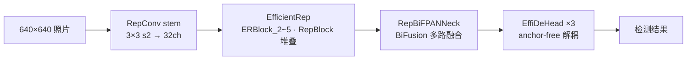
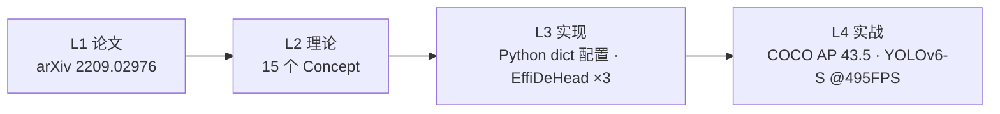
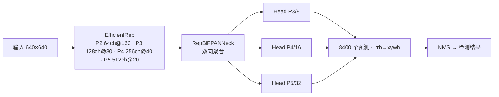
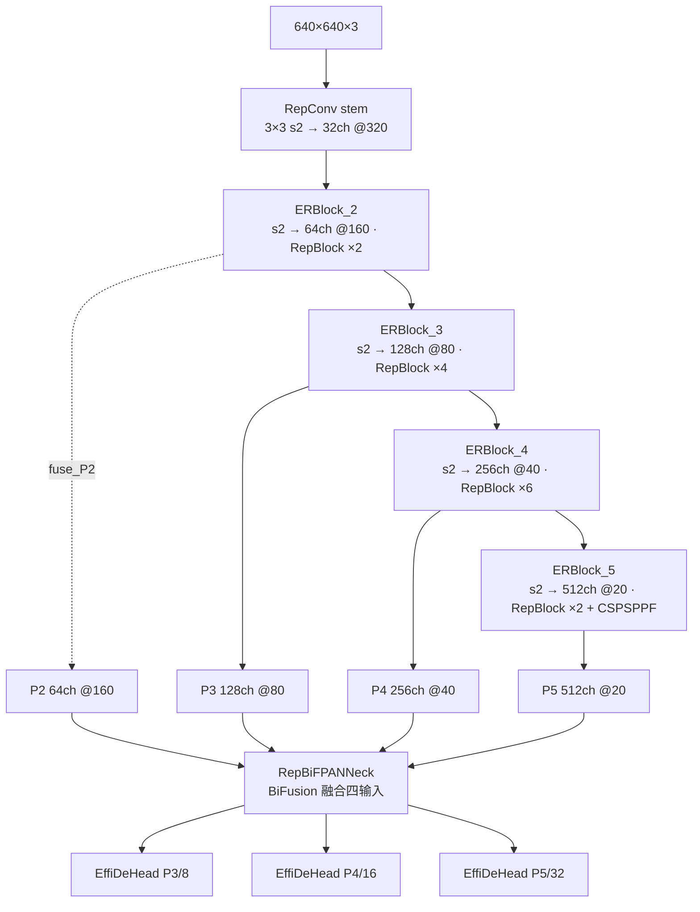

# YOLOv6 (2022-06)

> **TL;DR**
> - 一句话：RepVGG 式重参数化骨干/Neck + 彻底 anchor-free + TAL + DFL
> - 解决：部署慢（训练多分支、推理单卷积）
> - 代价：配方与 v5 差异大，训练代码库独立
>
> **前置阅读**：[YOLOv5](/versions/v5/index) → [RepVGG 重参数化](/glossary#repggg-重参数化) → [anchor-free](/glossary#anchor-free) → [TAL](/glossary#tal-task-alignment-learning) → [DFL](/glossary#dfl-distribution-focal-loss)

**美团 YOLOv6（工业部署导向的重参数化检测器）**

- 📄 论文：[YOLOv6: A Single-Stage Object Detection Framework for Industrial Applications](https://arxiv.org/abs/2209.02976)（技术报告，2022-09；GitHub 2022-06 首发）
- 🏛️ 作者：Chuyi Li 等 18 人（美团）
- 💻 源码：[meituan/YOLOv6](https://github.com/meituan/YOLOv6)（快照取自 main 分支）
- 🎯 里程碑：**为部署而生的重参数化时代**——RepVGG 式骨干/Neck 训练多分支、推理单卷积，彻底 anchor-free，Python dict 配置 + TensorRT/NCNN/OpenVINO 全家桶

## 3 分钟电梯演讲

1. **训练堆容量、推理不花钱**：RepVGGBlock 训练态 3×3 + 1×1 + identity 三分支求和，`switch_to_deploy()` 一键融合成单个 3×3 卷积——EfficientRep 骨干与 Rep-PAN Neck 全线复用。
2. **彻底 anchor-free + 任务对齐分配**：EffiDeHead 解耦 cls/reg 双分支、直接回归 ltrb 距离；TAL 按 $s^\alpha \cdot \text{IoU}^\beta$ 选 top-13 正样本，分类用 VarifocalLoss、回归用 GIoU（DFL 留给蒸馏续训）。
3. **工业落地优先**：配置是 Python dict，部署覆盖 TensorRT/ONNX/NCNN/OpenVINO；量化 S 用 RepOptimizer + 通道蒸馏做到 43.3 AP @ 869 FPS（T4）。

> 已读过 [v5](/versions/v5/index)？本页下方有 v5→v6 逐项差异表；术语不熟先查[术语表](/glossary)。

## 四层闭环视图

## 核心贡献

1. **RepVGG 结构重参数化**：训练态三分支求和，`switch_to_deploy()` 用 BN 融合公式合并为单卷积<SrcLink file="v6:yolov6/layers/common.py" :line="197" :end="319" />
2. **EfficientRep 骨干**：stem + ERBlock_2~5 全用 Rep 块与 s2 卷积下采样（v5 的 Focus 因部署不友好被弃用），`fuse_P2=True` 时输出 4 尺度特征，尾部 CSPSPPF 扩感受野<SrcLink file="v6:yolov6/models/efficientrep.py" :line="7" :end="118" />
3. **RepBiFPANNeck**：PAN 拓扑上叠加 BiFusion 三路融合，四输入（P2~P5）进、三尺度出<SrcLink file="v6:yolov6/models/reppan.py" :line="132" :end="237" />
4. **EffiDeHead 高效解耦头**：cls/reg 分离、无 objectness 分支、anchor-free ltrb 回归 + DFL proj_conv 解码<SrcLink file="v6:yolov6/models/effidehead.py" :line="10" :end="139" />
5. **TAL 任务对齐标签分配**：对齐度量 $s^\alpha \cdot \text{IoU}^\beta$ 选 top-13 正样本并生成软标签<SrcLink file="v6:yolov6/assigners/tal_assigner.py" :line="117" :end="150" />
6. **VFL + GIoU + DFL 损失组合**：VarifocalLoss 非对称加权分类，GIoU 权重 2.5，DFL 权重 0.5（蒸馏场景）<SrcLink file="v6:yolov6/models/losses/loss.py" :line="14" :end="52" />

## 推理效果一览

::: figure 图：v6 推理流水线——EfficientRep 四尺度输出，RepBiFPANNeck 三路 BiFusion 融合出 3 个尺度，EffiDeHead 逐位置回归 ltrb + 分类，T4 上 TensorRT fp16 部署

:::

## 关键指标

**检测（COCO，技术报告摘要口径，T4 + TensorRT fp16；吞吐 bs=32，量化模型 TensorRT 8）**

| 模型 | APval | 吞吐 | 备注 |
|------|------------------|------|------|
| YOLOv6-N | 35.9 | 1234 FPS | |
| YOLOv6-S | 43.5 | 495 FPS | 同速档超过 YOLOv5-S / YOLOX-S / PPYOLOE-S |
| YOLOv6-S INT8（QAT） | 43.3 | 869 FPS | RepOptimizer + 通道蒸馏 |
| YOLOv6-M | 49.5 | — | 同速档精度领先 |
| YOLOv6-L | 52.3 | — | 同速档精度领先 |

- M/L 用 CSPStackRep 替代 RepBlock（单路结构参数量指数增长，大模型不可行）
- 后续 v3.0 报告（arXiv:2301.05586）：N 37.5 AP @ 1187 FPS / S 45.0 @ 484 FPS，M/L 50.0/52.8（Ultralytics 文档汇总口径 226/116 FPS）

## 网络架构

- 结构由 Python dict 配置驱动：<SrcLink file="v6:configs/yolov6s.py" :line="2" :end="39" />；`depth_multiple=0.33` / `width_multiple=0.50` 控规模
- `fuse_P2=True` 使骨干输出 P2~P5 四层特征，与 RepBiFPANNeck 的四输入严格对应
- 三个头 stride 8/16/32，无 anchors（anchor-free），每位置输出 4 ltrb + 80 cls（导出时补恒 1 objectness 占位凑 85 维）

## 核心 Concept 一览

| Concept | 一句话 | 对应代码位置 |
|---------|--------|-------------|
| RepVGGBlock | 训练三分支 → 部署单卷积 | <SrcLink file="v6:yolov6/layers/common.py" :line="197" :end="319" /> |
| RepBlock / BottleRep | 重复块 + alpha 加权残差 | <SrcLink file="v6:yolov6/layers/common.py" :line="569" :end="610" /> |
| SimSPPF / CSPSPPF | 简化 SPPF，减少激活次数 | <SrcLink file="v6:yolov6/layers/common.py" :line="115" :end="124" /> |
| BiFusion | Neck 三路特征融合 | <SrcLink file="v6:yolov6/layers/common.py" :line="695" :end="719" /> |
| EfficientRep | Rep 骨干，fuse_P2 四尺度输出 | <SrcLink file="v6:yolov6/models/efficientrep.py" :line="7" :end="118" /> |
| EffiDeHead | 解耦 + anchor-free ltrb 回归 | <SrcLink file="v6:yolov6/models/effidehead.py" :line="10" :end="139" /> |
| TaskAlignedAssigner | s^α·IoU^β top-13 软标签分配 | <SrcLink file="v6:yolov6/assigners/tal_assigner.py" :line="117" :end="150" /> |
| VarifocalLoss | 非对称加权分类损失 | <SrcLink file="v6:yolov6/models/losses/loss.py" :line="201" :end="211" /> |
| GIoU + DFL | 回归双损失，权重 2.5 / 0.5 | <SrcLink file="v6:yolov6/models/losses/loss.py" :line="214" :end="278" /> |
| depth/width 缩放 | 0.33 / 0.50 一键 s/m/l/x | <SrcLink file="v6:yolov6/models/yolo.py" :line="66" :end="67" /> |

## v5 → v6 关键差异

| 维度 | YOLOv5（ultralytics） | YOLOv6（美团） |
|------|----------------------|----------------|
| 出品方 | Ultralytics | 美团 |
| 配置文件 | yaml（models/yolov5s.yaml） | **Python dict（configs/yolov6s.py）** |
| 骨干 | CSPDarknet53（C3） | **EfficientRep（RepVGG 重参数化）** |
| Stem | Focus 4 路切片 | **RepConv 3×3 s2** |
| Neck | PANet（C3） | **Rep-PAN（RepBlock/BiFusion）** |
| Anchor | 9 anchors + autoanchor | **anchor-free，无锚点** |
| 检测头 | 耦合 Detect（obj+cls+xywh） | **解耦 EffiDeHead（cls+ltrb，无 obj 分支）** |
| 标签分配 | wh 比例 <4.0 多正样本 + 邻居偏移 | **TAL top-13 任务对齐（ATSS 可选预热）** |
| 分类损失 | BCE（objectness = IoU ratio） | **VarifocalLoss（无 objectness）** |
| 回归损失 | CIoU | **GIoU 权重 2.5 + DFL 0.5（蒸馏场景）** |
| 重参数化 | 无 | **RepVGG 全线（训练/部署双形态）** |
| 部署 | torchscript/onnx/coreml | **TensorRT/NCNN/OpenVINO + QAT 量化工具链** |

## 暴露的痛点

| 痛点 | 严重度 | 后续版本的解法 |
|------|--------|---------------|
| 重参数化训练开销大：三分支显存与算力翻倍 | High | v6 自身 v4.0 的 QARepVGGBlock 精简训练态 |
| DFL 开关分裂：默认关、蒸馏才开，两条训练路线并存 | Medium | v8 把 DFL 设为默认标配 |
| 论文与初版代码漂移：SimOTA → TAL 有个过程 | Medium | 后续版本文档与代码同步发布 |
| 配置变 Python dict：失去 yaml 的语言中立性 | Medium | v8 回归 yaml |
| 多后端部署栈维护重：TensorRT/NCNN/OpenVINO 各一套 | High | 社区统一导出格式持续演进 |

详见[痛点追踪](/versions/v6/painpoints)。

## 后续演进速览

- **v7（2022）**：三尺度 anchor 回归 + P2 小目标 + 双头训练
- **v8（2023）**：Ultralytics 官方重构（anchor-free + C2f + TAL + DFL）
- **v9（2024）**：学术重构（GELAN + 双头可编程梯度）
- **v10（2024）**：NMS-free 端到端推理（Ultralytics 8.1.34 fork）
- **v11-v13（2024-2025）**：官方线（AGPL）与学术线（HyperACE）并驾

> **v10-v13 已上线本站**：NMS-free / AGPL / HyperACE 等新一轮演进，详见 [v10 概览](/versions/v10/index) 起。

## 深入阅读

- [论文精读（arXiv:2209.02976，含论文 vs 快照对照）](/versions/v6/paper)
- [Architecture 逐层图解](/versions/v6/architecture)
- [理论 Concept](/versions/v6/concepts)
- [架构与层速查](/versions/v6/layers)
- [损失函数（VFL + GIoU + DFL + TAL）](/versions/v6/losses)
- [反向传播推导](/versions/v6/loss-gradient)
- [训练技巧（重参数化 + 蒸馏 + 量化）](/versions/v6/tricks)
- [源码走读](/versions/v6/code-walkthrough)
- [痛点追踪](/versions/v6/painpoints)
- [系列家族对照](/global/family) · [术语表](/glossary)
