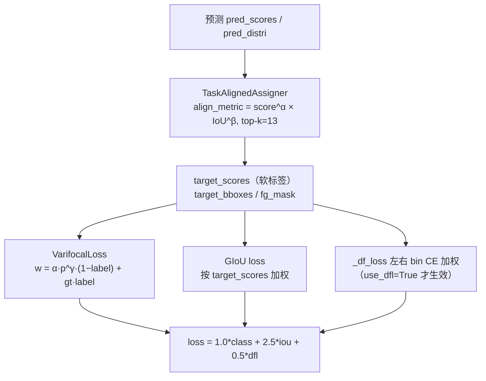

# YOLOv6 损失函数

::: tip 只想带走三件事
1. **分类 = VarifocalLoss（VFL）**，不是 BCE：正样本以 `gt_score`（TAL 归一化对齐分数）为软标签，负样本按 $\alpha p^\gamma$ 降权；
2. **回归 = GIoU（权重 2.5）+ DFL 分布焦点损失（权重 0.5，reg_max=16）**，但 `configs/yolov6s.py` 默认 **`use_dfl=False`**——标准训练只算 GIoU 的 LTRB 距离回归，DFL 留给蒸馏续训；
3. **标签分配 = TaskAlignedAssigner（topk=13、α=1.0、β=6.0）**，对齐度量 = 分类分数$^{\alpha}$ × IoU$^{\beta}$；论文初版的 SimOTA 在工程快照里已被 TAL 取代。
:::

## 全景图



## 1. 坐标回归：GIoU loss (`loss-iou`)

```python
bbox_weight = torch.masked_select(target_scores.sum(-1), fg_mask).unsqueeze(-1)
loss_iou = self.iou_loss(pred_bboxes_pos, target_bboxes_pos) * bbox_weight
if target_scores_sum > 1:
    loss_iou = loss_iou.sum() / target_scores_sum
```

- `iou_type='giou'`（<SrcLink file="v6:configs/yolov6s.py" :line="31" />）→ `IOUloss` 只走 GIoU 分支：`iou = iou - (c_area - union) / c_area`，最终 `loss = 1.0 - iou`（<SrcLink file="v6:yolov6/models/losses/loss.py" :line="214" :end="241" />）
- **正样本按质量加权**：`bbox_weight = target_scores.sum(-1)`，即 TAL 归一化后的对齐分数——分类越准、IoU 越高的正样本话语权越大
- 归一化除以 `target_scores_sum`（正样本软分数之和），**不是正样本个数**（<SrcLink file="v6:yolov6/models/losses/loss.py" :line="236" :end="241" />）
- 框格式 `xyxy`：预测框由 `dist2bbox` 从 anchor point 的 ltrb 距离解出（`x1y1 = anchor_point - lt`、`x2y2 = anchor_point + rb`）

## 2. 分布回归：DFL 与 use_dfl 开关 (`loss-dfl`)

```python
# 训练时解码（bbox_decode）
pred_dist = F.softmax(pred_dist.view(batch_size, n_anchors, 4, self.reg_max + 1), dim=-1).matmul(self.proj.to(pred_dist.device))
return dist2bbox(pred_dist, anchor_points)
```

- **DFL 的世界观**：每个方向（l/t/r/b）的坐标不是单值回归，而是 $reg\_max+1 = 17$ 个 bin 的 softmax 分布，期望 $\hat d = \sum_k p_k \cdot k$ 作为预测距离（`self.proj = torch.linspace(0, reg_max, reg_max+1)`，<SrcLink file="v6:yolov6/models/losses/loss.py" :line="44" :end="46" />；解码 <SrcLink file="v6:yolov6/models/losses/loss.py" :line="194" :end="198" />）
- **监督信号**：`bbox2dist` 把 GT 框转成 ltrb 连续距离（并 `clip(0, reg_max-0.01)`），`_df_loss` 取最近的左右两个整数 bin 做**距离加权交叉熵**：

```python
target_left = target.to(torch.long)
target_right = target_left + 1
weight_left = target_right.to(torch.float) - target
weight_right = 1 - weight_left
loss_left  = F.cross_entropy(pred_dist, target_left,  reduction='none') * weight_left
loss_right = F.cross_entropy(pred_dist, target_right, reduction='none') * weight_right
return (loss_left + loss_right).mean(-1, keepdim=True)
```

- 即目标距离 $t$ 落在 $[\lfloor t\rfloor, \lfloor t\rfloor+1]$ 之间，按到两端的距离分配权重（<SrcLink file="v6:yolov6/models/losses/loss.py" :line="267" :end="278" />）
- **⚠️ 开关状态必须说清**：`configs/yolov6s.py` 默认 `use_dfl=False, reg_max=0`（<SrcLink file="v6:configs/yolov6s.py" :line="32" :end="33" />）。此时 `bbox_decode` 跳过 softmax，`pred_distri` **直接就是 ltrb 四距离**；`BboxLoss` 里 `loss_dfl = pred_dist.sum() * 0.` 占位（<SrcLink file="v6:yolov6/models/losses/loss.py" :line="258" :end="259" />）——**标准训练的 DFL 项恒为 0**
- 只有**蒸馏续训**才打开 DFL：配置改 `use_dfl=True, reg_max=16`（官方 `docs/Train_custom_data.md` 反复强调 "Be sure to open use_dfl mode ... if you want to do self-distillation training further"）
- 推理侧同构：`reg_output = self.proj_conv(F.softmax(reg_output, dim=1))`，`proj_conv` 权重初始化为 `linspace(0, 16)` 且冻结（<SrcLink file="v6:yolov6/models/effidehead.py" :line="29" />、<SrcLink file="v6:yolov6/models/effidehead.py" :line="67" :end="69" />、<SrcLink file="v6:yolov6/models/effidehead.py" :line="108" :end="110" />）

## 3. 分类：VarifocalLoss（不是 BCE）(`loss-vfl`)

```python
def forward(self, pred_score, gt_score, label, alpha=0.75, gamma=2.0):
    weight = alpha * pred_score.pow(gamma) * (1 - label) + gt_score * label
    loss = (F.binary_cross_entropy(pred_score, gt_score, reduction='none') * weight).sum()
```

- 权重公式 $w = \alpha p^\gamma (1-y) + t\cdot y$（<SrcLink file="v6:yolov6/models/losses/loss.py" :line="201" :end="211" />）：
  - **正样本**（$y=1$）：$w = t$，且 BCE 的目标也是 $t$（软标签）——不是拉向 1.0，而是拉向"分类分数与 IoU 的对齐质量"
  - **负样本**（$y=0$）：$w = 0.75 p^2$——Focal 式降权，易分负样本的损失按 $p^2$ 衰减，压制海量负样本
- 调用处：`target_labels` 转 one-hot，`gt_score` 就是 TAL 输出的 `target_scores`（<SrcLink file="v6:yolov6/models/losses/loss.py" :line="160" :end="169" />），同样除以 `target_scores_sum` 归一化
- 注意 `F.binary_cross_entropy`（不是 `with_logits`）：head 输出已过 sigmoid（<SrcLink file="v6:yolov6/models/effidehead.py" :line="85" />）

> v5 读者路标：v5 是 `BCEcls` + 独立 objectness BCE（target 为 IoU ratio）；YOLOv6 **砍掉了 objectness 分支**，VFL 一个损失同时承担分类与"样本质量估计"，质量信息从 obj target 变成了 VFL 的软标签 $t$。

## 4. 标签分配：ATSS warmup → TaskAlignedAssigner (`loss-assign`)

```python
self.warmup_assigner = ATSSAssigner(9, num_classes=self.num_classes)
self.formal_assigner = TaskAlignedAssigner(topk=13, num_classes=self.num_classes, alpha=1.0, beta=6.0)
```

- **warmup 阶段**（`epoch_num < warmup_epoch`）用 `ATSSAssigner(topk=9)`；但 `warmup_epoch` 取自配置 `atss_warmup_epoch=0`（<SrcLink file="v6:configs/yolov6s.py" :line="30" />，装配见 <SrcLink file="v6:yolov6/core/engine.py" :line="290" :end="296" />）→ `epoch_num < 0` 恒假，**warmup 从不执行**，全程 TAL
- **TAL 的对齐度量**（<SrcLink file="v6:yolov6/assigners/tal_assigner.py" :line="117" :end="133" />）：

$$\text{align\_metric} = s_{cls}^{\alpha} \cdot \text{IoU}^{\beta}, \qquad \alpha = 1.0,\ \beta = 6.0$$

  IoU 权以 6 次方，强烈偏向"定位也准"的 anchor，而不只是分类分高
- **正样本三重掩码**：`mask_pos = mask_topk * mask_in_gts * mask_gt`（anchor 中心落在 GT 框内 ∧ 对齐度量排 top-13 ∧ 该 GT 有效，<SrcLink file="v6:yolov6/assigners/tal_assigner.py" :line="97" :end="115" />）
- **top-k 与冲突消解**：`torch.topk(metrics, 13)` 后 one-hot 展开成掩码（<SrcLink file="v6:yolov6/assigners/tal_assigner.py" :line="135" :end="150" />）；一个 anchor 被多个 GT 选中时 `select_highest_overlaps` 只保留 IoU 最高的那个（<SrcLink file="v6:yolov6/assigners/assigner_utils.py" :line="46" :end="58" />）
- **软标签归一化**：`target_scores = one_hot × norm_align_metric`，再乘正样本 IoU 归一（<SrcLink file="v6:yolov6/assigners/tal_assigner.py" :line="76" :end="81" />）——这就是喂给 VFL 的 `gt_score`
- 分配器整体 `@torch.no_grad()`，调用时传入 `pred_scores.detach() / pred_bboxes.detach()`（<SrcLink file="v6:yolov6/models/losses/loss.py" :line="96" :end="103" />）→ **分配结果是常量**，详见[反向传播推导](/versions/v6/loss-gradient)

## 5. 论文提法 vs 快照实现 (`loss-evolution`)

| 维度 | 论文（arXiv:2209.02976，2022-09） | 本快照工程实现 |
|------|----------------------------------|----------------|
| 标签分配 | 评测 SimOTA 与 TAL，结论**采用 TAL**（2.2 节；初代 2022-06 GitHub 版本曾用 SimOTA） | **TaskAlignedAssigner**（topk=13、α=1.0、β=6.0；文件注明参考 `Nioolek/PPYOLOE_pytorch`），另保留 ATSSAssigner(9) 作可选 warmup |
| 分类损失 | VarifocalLoss | VarifocalLoss（一致） |
| 回归损失 | SIoU / GIoU（2.3.2 双口径） | N/T/Lite 档 `iou_type='siou'`，S/M/L 档 `'giou'`——与论文口径一致 |
| DFL 用途 | 支撑回归自蒸馏（2.4 节：框回归蒸馏靠 DFL 实现） | `use_dfl=False` 默认关、蒸馏续训设 True/16——与论文设计一致 |

- SimOTA 用分类分与 IoU 的加权 cost 做二分匹配；TAL 直接用 $s^\alpha \cdot \text{IoU}^\beta$ 选 top-k，**样本选择与"分类-定位一致性"显式绑定**，训练更稳定
- 漂移方向与 v4 时代相反：初版代码（SimOTA）先于技术报告（TAL），最终报告与快照收敛到同一方案——快照只是多保留了 ATSS 预热开关（`atss_warmup_epoch`）

## 6. 权重平衡总表

| 损失项 | 权重（loss_weight） | 归一化 | 说明 |
|--------|---------------------|--------|------|
| class | 1.0 | ÷ target_scores_sum | VarifocalLoss，软标签质量加权 |
| iou | 2.5 | ÷ target_scores_sum | GIoU，正样本按对齐分数加权 |
| dfl | 0.5 | ÷ target_scores_sum | DFL 左右 bin CE，`use_dfl=False` 时恒 0 |

- 权重字典定义：`loss_weight={'class': 1.0, 'iou': 2.5, 'dfl': 0.5}`（<SrcLink file="v6:yolov6/models/losses/loss.py" :line="26" :end="29" />）
- 总损失 `loss = 1.0*class + 2.5*iou + 0.5*dfl`（<SrcLink file="v6:yolov6/models/losses/loss.py" :line="175" :end="177" />），日志里返回的三项均已乘过权重

## 与其他页的链接

- [反向传播推导](/versions/v6/loss-gradient)
- [训练技巧](/versions/v6/tricks)
- [理论 Concept](/versions/v6/concepts)
- [v5 损失函数（对比）](/versions/v5/losses)
