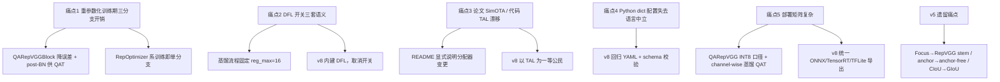

# YOLOv6 痛点追踪

YOLOv6（美团，2022-06）把"工业部署友好"推到了极致：重参数化骨干、解耦 anchor-free 头、TAL 标签分配、AMP/EMA/梯度累积一整套工程化训练栈。但每一个设计选择都同时是一笔债。本页先追踪 **v6 自己暴露的 5 个新痛点**，再看它如何回应 v5 遗留的痛点，最后给出"路标"——这些痛点如何指向 v6 release v4.0、v8 及后续工作。

## 5 个新痛点全景

| 痛点 | 严重度 | 后续版本的解法 |
| --- | --- | --- |
| [1. 重参数化只利好推理，训练期三分支显存/计算开销](#_1-重参数化只利好推理-训练期三分支显存-计算开销-pain-reparam-train-cost) | High | v6 release v4.0 的 QARepVGGBlock 减少重参数化误差；RepOptimizer 线（v6-F/I 系列）训练期即单分支 |
| [2. DFL 开关复杂，训练/蒸馏/部署三套语义](#_2-dfl-开关复杂-训练-蒸馏-部署三套语义-pain-dfl-switch) | Medium | v8 把 DFL 内建为默认（reg_max=16），不再有 `use_dfl` 布尔开关分叉 |
| [3. 论文与工程实现漂移：SimOTA → TAL](#_3-论文与工程实现漂移-simota-→-tal-pain-paper-code-drift) | Medium | v8 继承 TAL 为一等公民并公开配套文档；"以代码为准"成为社区共识 |
| [4. 配置系统变成 Python dict，失去 yaml 的语言中立性](#_4-配置系统变成-python-dict-失去-yaml-的语言中立性-pain-python-config) | Medium | v8 回归 YAML 配置（`yolov8*.yaml`），重新可被非 Python 工具链读取 |
| [5. 工业部署栈复杂，需维护多后端/多精度矩阵](#_5-工业部署栈复杂-需维护多后端-多精度矩阵-pain-deploy-stack) | High | v8 提供统一的 ONNX/TensorRT/TFLite 导出入口；蒸馏+QAT 流程收敛为一条主线 |

> **v8 路标**：v6 的三笔债在 v8 逐一清偿——DFL 从布尔开关变成内建默认、配置从 Python dict 回归 YAML、TAL 从"论文与代码漂移"变成公开设计点（详见本页末尾"路标"小节的 v8 路线条目与 [v8 痛点追踪](/versions/v8/painpoints)）。

> **v9 路标**：v6 的"重参数化训练期开销"在 v9 收到新答卷——GELAN 把多分支预算从"单元内部三分支"挪到拓扑层（两级级联 + 4 路 concat），RepConvN 融合后仍是单路推理（见 [v9 痛点追踪](/versions/v9/painpoints#_2-重参数化的梯度浪费与拓扑规划-pain-reparam-topology)）。

## 1. 重参数化只利好推理，训练期三分支显存/计算开销 (`pain-reparam-train-cost`)

**痛点**：RepVGGBlock 的收益全部兑现于部署时刻，训练期反而是净亏损。

- 训练态每个 RepVGGBlock 同时维护 `rbr_dense`（3×3）、`rbr_1x1`（1×1）、`rbr_identity`（BN）三条分支，前向要三次卷积/BN 计算再求和，显存还要为三条分支各保留一份梯度：
  <SrcLink file="v6:yolov6/layers/common.py" :line="244" :end="254" />
- 只有 `switch_to_deploy()` 把三分支折叠成单 3×3 后，参数量与 FLOPs 才真正减半（这是 v6 宣称"部署友好"的来源）：
  <SrcLink file="v6:yolov6/layers/common.py" :line="301" :end="318" />
- 训练越久，这笔"训练期多付、推理期赚回"的账越亏：重参数化的等价性只对单分支折叠成立，训练期的三分支本质是"为部署打工"的临时结构。
- 骨干/颈部越深（S 的 `num_repeats=[1,6,12,18,6]` 放大后），三分支开销越显著。

**后果**：训练成本高于等 FLOPs 的"单分支架构"；显存紧张的场景（大 batch 蒸馏、QAT）里重参数化结构反而成为瓶颈。

**已有的缓解**：v6 release v4.0 的 QARepVGGBlock 在折叠后额外保留 `post bn` 供 QAT 使用，并降低重参数化误差（<SrcLink file="v6:yolov6/layers/common.py" :line="321" :end="392" />，注意 L389-391 的 `# keep post bn for QAT`）；RepOptimizer 一系（HyperSearch/RepOpt）直接在训练期搜索单分支权重，训练即部署。

## 2. DFL 开关复杂，训练/蒸馏/部署三套语义 (`pain-dfl-switch`)

**痛点**：DFL（Distribution Focal Loss）在 v6 里不是"有/无"，而是一个牵动训练、蒸馏、导出三条链路的布尔开关。

- 配置里 `use_dfl=False`、`reg_max=0` 是默认值，注释明说"要配合蒸馏续训才置 True"：
  <SrcLink file="v6:configs/yolov6s.py" :line="32" :end="33" />
- 损失侧：`use_dfl` 为 False 时 DFL 项退化为 `pred_dist.sum() * 0.` 的占位，为 True 才走 `_df_loss`：
  <SrcLink file="v6:yolov6/models/losses/loss.py" :line="244" :end="259" />
- 头侧：推理 forward 里 `use_dfl` 决定是否做 `proj_conv` softmax + matmul 的积分还原：
  <SrcLink file="v6:yolov6/models/effidehead.py" :line="108" :end="110" />
- 同一配置还决定 `reg_max`、`proj` 投影向量是否构建（<SrcLink file="v6:yolov6/models/losses/loss.py" :line="44" :end="46" />），一旦训完想改开关，权重形状不兼容，必须重训。

**后果**：同一份权重在"普通训练 / 蒸馏续训 / 导出部署"三种场景下语义不同，切换开关等于换模型；新手极易在"关着 DFL 训完、导出时却按开 DFL 解码"这类组合上踩坑。

**已有的缓解**：v6 自身的蒸馏流程把 DFL 固定为开启（`reg_max=16`）以对齐教师；v8 则干脆把 DFL 内建为默认行为，`reg_max=16` 写死在架构里，消灭开关。

## 3. 论文与工程实现漂移：SimOTA → TAL (`pain-paper-code-drift`)

**痛点**：论文写的标签分配与开源代码跑的不一致，读者按论文复现会跑偏。

- v6 论文描述的分配器是 SimOTA 一族，但开源代码的正式分配器是 TaskAlignedAssigner（topk=13, α=1.0, β=6.0）：
  <SrcLink file="v6:yolov6/models/losses/loss.py" :line="41" :end="42" />
- 代码里还叠加了 ATSSAssigner(9) 作 warmup 分支，靠 `atss_warmup_epoch` 控制（默认 0 即全程 TAL）：
  <SrcLink file="v6:configs/yolov6s.py" :line="30" :end="30" />
  <SrcLink file="v6:yolov6/models/losses/loss.py" :line="85" :end="103" />
- TAL 的核心公式 `align_metric = bbox_scores.pow(alpha) * overlaps.pow(beta)` 只存在于代码，不在论文正文：
  <SrcLink file="v6:yolov6/assigners/tal_assigner.py" :line="117" :end="133" />

**后果**："论文不可复现、以 repo 为准"成为读 v6 的默认姿势；做对比实验的研究者若按论文实现 SimOTA，得到的数字与官方 checkpoint 对不上。

**已有的缓解**：v6 后续 release 在 README 中显式说明分配器变更；v8 把 TAL 直接作为公开设计点，文档与实现同步。

## 4. 配置系统变成 Python dict，失去 yaml 的语言中立性 (`pain-python-config`)

**痛点**：v6 用 `configs/yolov6s.py` 里的 Python dict 取代 v5 的 yaml，配置从"数据"变成了"代码"。

- 配置文件本身就是可执行 Python（model/solver/data_aug 三段 dict）：
  <SrcLink file="v6:configs/yolov6s.py" :line="2" :end="39" />
- 好处是 `depth_multiple`/`width_multiple`/`num_layers` 可以按公式缩放（<SrcLink file="v6:yolov6/models/yolo.py" :line="56" :end="67" />），比 v5 的硬编码 `depth_multiple` 更灵活。
- 代价是：yaml 可以被任意语言（C++ 部署工具、实验管理平台、Rust/Go 脚本）解析，Python dict 只有跑 Python 解释器才能读；配置里可以塞任意表达式，失去了静态校验和 schema 化的可能。

**后果**：v5 的"配置即数据"路线被回退；跨语言工具链（量化器、部署器、超参搜索器）必须引入 Python 依赖或写 AST 解析才能读模型结构。

**已有的缓解**：v8 回归 YAML（`yolov8*.yaml`）并附 JSON schema 校验；v6 生态内的工具则直接 `import` 配置模块。

## 5. 工业部署栈复杂，需维护多后端/多精度矩阵 (`pain-deploy-stack`)

**痛点**：v6 面向工业部署，但"部署友好"的代价是维护一张 ONNX/TensorRT/Caffe × FP32/FP16/INT8 × 蒸馏/QAT 的巨大矩阵。

- 精度表本身就是矩阵的证据：QARepVGG 系列在 INT8 下需要专门的量化口径才不掉点（<SrcLink file="v6:configs/qarepvgg/README.md" :line="17" :end="22" />，S 模型 INT8 从 41.3 提到 44.0）。
- QAT 流程要串起 PTQ → QAT → channel-wise 蒸馏 → TensorRT 引擎四步，任何一步换后端都要重验（<SrcLink file="v6:tools/qat/README.md" :line="5" :end="7" />，RepOpt-S QAT 后 TensorRT 43.3%，距 float 仅 0.1）。
- `switch_to_deploy()`、export 分支（<SrcLink file="v6:yolov6/models/effidehead.py" :line="114" :end="122" />）这类"导出专用代码路径"每个后端都要各写一份适配。

**后果**：模型迭代一次，全矩阵回归一遍；量化掉点问题的定位要在"结构—量化器—后端 kernel"三层之间来回排查。

**已有的缓解**：v8 提供统一导出入口（一条命令出 ONNX/TensorRT/TFLite）并内置量化友好结构；v6 自身靠 QARepVGG 的 post-BN 与 channel-wise 蒸馏把 INT8 掉点压到最小。

## 承接 v5 痛点：v6 如何回应

| v5 痛点 | v6 的回应 | 备注 |
| --- | --- | --- |
| Focus 结构部署不友好 | 用 RepVGGBlock 3×3 s2 stem 替代 Focus 切片 | <SrcLink file="v6:yolov6/models/efficientrep.py" :line="28" :end="33" />，见 [痛点 1](#_1-重参数化只利好推理-训练期三分支显存-计算开销-pain-reparam-train-cost) |
| anchor-based 检测头调参繁重 | EffiDeHead 全面 anchor-free，`dist2bbox` 直接回归 ltrb | <SrcLink file="v6:yolov6/models/effidehead.py" :line="131" :end="132" />，`anchors_init` 仅供 `--fuse_ab` 辅助分支（<SrcLink file="v6:configs/yolov6s.py" :line="25" :end="27" />） |
| CIoU 回归损失精度不足 | 换 GIoU 并加权（iou=2.5、dfl=0.5） | <SrcLink file="v6:configs/yolov6s.py" :line="31" :end="31" />，见 /versions/v6/losses |
| 无官方论文、设计缺动机 | 有论文了，但引出 SimOTA→TAL 漂移 | 见 [痛点 3](#_3-论文与工程实现漂移-simota-→-tal-pain-paper-code-drift) |
| yaml 配置硬编码 depth/width | `depth_multiple`/`width_multiple` 可缩放，但换成了 Python dict | 见 [痛点 4](#_4-配置系统变成-python-dict-失去-yaml-的语言中立性-pain-python-config) |
| anchor 可视化/分析工具链失效 | anchor-free 后该工具链失去对象，改为看 TAL 正样本分配 | <SrcLink file="v6:yolov6/assigners/tal_assigner.py" :line="21" :end="95" /> |

## 痛点谱系图

## 路标：痛点指向 v7 / v8 / 后续

先做一个消歧：下文的 "v4.0" 指 **YOLOv6 自己的 release v4.0**（2023，QARepVGGBlock/MBLABlock/蒸馏/量化增强），**不是** 2020 年的 YOLOv4。两者毫无关系。

- **v6 release v4.0（自身迭代）**：直接回应 [痛点 1](#_1-重参数化只利好推理-训练期三分支显存-计算开销-pain-reparam-train-cost) 与 [痛点 5](#_5-工业部署栈复杂-需维护多后端-多精度矩阵-pain-deploy-stack)——QARepVGGBlock/QARepVGGBlockV2 降低重参数化误差并保留 post-BN 供 QAT（<SrcLink file="v6:yolov6/layers/common.py" :line="321" :end="392" />）、MBLABlock 提供轻量移动端块（<SrcLink file="v6:yolov6/layers/common.py" :line="653" :end="692" />）、蒸馏与量化流程标准化（<SrcLink file="v6:tools/qat/README.md" :line="5" :end="7" />）。
- **v7 路线**：延续"训练技巧集成"思路，把 EMA/辅助头/混合精度这类工程收益进一步常规化；v6 的 EMA（<SrcLink file="v6:yolov6/utils/ema.py" :line="11" :end="40" />）与 warmup（<SrcLink file="v6:yolov6/solver/build.py" :line="36" :end="46" />）是这条线的直接前身。
- **v8 路线**：系统性回收 v6 的四笔债——DFL 内建消灭开关（痛点 2）、TAL 文档化消灭漂移（痛点 3）、YAML 回归消灭配置语言锁定（痛点 4）、统一导出消灭部署矩阵（痛点 5）；架构上 C2f 取代 BepC3/RepBlock 一族，进一步压缩"训练态≠部署态"的差异（呼应痛点 1）。
- **长期议题**：重参数化"训练期付账、推理期回收"的本质矛盾仍在，后续工作持续在"结构等价折叠"（QARepVGG、DBB、MobileOne）与"训练期即部署态"（RepOptimizer、switchable 归一化）两条路线之间摇摆收敛。

## 延伸阅读

- [YOLOv6 训练技巧](/versions/v6/tricks) — 本页痛点对应的 18 个 trick 实现细节
- [YOLOv6 源码走读](/versions/v6/code-walkthrough) — 从配置到损失的完整调用链
- [YOLOv6 损失函数](/versions/v6/losses) — VarifocalLoss / GIoU / DFL 的公式与实现
- [YOLOv6 网络结构](/versions/v6/architecture) — EfficientRep / RepBiFPANNeck / EffiDeHead
- [YOLOv5 痛点追踪](/versions/v5/painpoints) — 本页"承接 v5 痛点"表格的上文
- [术语表](/glossary) — 重参数化、TAL、DFL 等术语索引
- [v7 痛点追踪](/versions/v7/painpoints) — "v7 路线" bullet 对应的完整版本页
