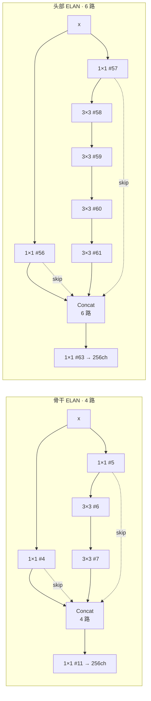
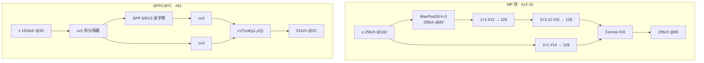
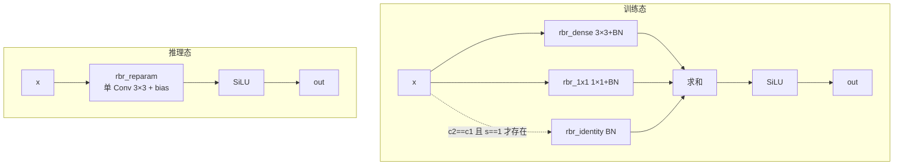
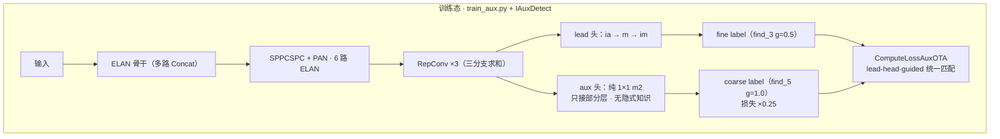
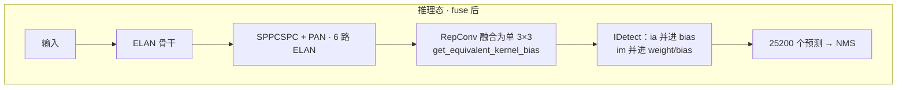

# YOLOv7 逐层图解

::: tip 只想带走三件事
1. v7 的"层"是**经典 yaml 层表**：`cfg/training/yolov7.yaml` 共 106 层（#0~#105），`parse_model` 逐行实例化，`depth/width_multiple=1.0` 即所见即所得；
2. 骨干 = Conv stem + 4 个 ELAN 块（4 路 Concat）+ 3 个 MP 下采样；头 = SPPCSPC + PAN 双向 + 4 个 6 路 Concat ELAN 块 + 三处 RepConv 收口；
3. 推理输出 `(bs, 25200, 85)` = $(80^2+40^2+20^2)$ 格 × 3 anchors ×（4 box + 1 真 objectness + 80 类）——anchor-based，与 v6 的 8400 不同。
:::

> 本页所有通道数均为 `cfg/training/yolov7.yaml` 在 `depth_multiple=1.0` / `width_multiple=1.0` 下的真实值（无缩放换算），输入按 640×640 推演。配置原文见 <SrcLink file="v7:cfg/training/yolov7.yaml" :line="1" :end="140" />。

## 1. 一眼看清：输入 → 输出的完整流程

```mermaid
flowchart LR
IMG["640×640×3"] --> C0["Conv 3×3 s1<br/>32ch @640"]
C0 --> C1["Conv 3×3 s2 → 3×3<br/>64ch @320 · P1/2"] ; C1 --> E1["ELAN #4-11<br/>4 路 Concat → 256ch @160 · P2/4"] ; E1 --> MP1["MP 块 #12-16<br/>MaxPool + 双路 Concat"] ; MP1 --> E2["ELAN #17-24<br/>→ 512ch @80 · P3/8"] ; E2 --> MP2["MP 块 #25-29"] ; MP2 --> E3["ELAN #30-37<br/>→ 1024ch @40 · P4/16"] ; E3 --> MP3["MP 块 #38-42"] ; MP3 --> E4["ELAN #43-50<br/>→ 1024ch @20 · P5/32"] ; E4 --> S["SPPCSPC #51<br/>→ 512ch @20"] ; S --> U1["上行 #52-55<br/>Upsample + cat(#37)"] ; U1 --> H1["6 路 ELAN #56-63<br/>→ 256ch @40"] ; H1 --> U2["上行 #64-67<br/>Upsample + cat(#24)"] ; U2 --> H2["6 路 ELAN #68-75<br/>→ 128ch @80"] ; H2 --> D1["下行 #76-80<br/>MP + cat(#63)"] ; D1 --> H3["6 路 ELAN #81-88<br/>→ 256ch @40"] ; H3 --> D2["下行 #89-93<br/>MP + cat(#51)"] ; D2 --> H4["6 路 ELAN #94-101<br/>→ 512ch @20"] ; H2 --> R1["RepConv #102<br/>128→256 @80"] ; H3 --> R2["RepConv #103<br/>256→512 @40"] ; H4 --> R3["RepConv #104<br/>512→1024 @20"] ; R1 --> DET["IDetect #105<br/>P3/P4/P5 · 3 组 anchors"] ; R2 --> DET ; R3 --> DET
```



## 2. 逐模块明细表（yolov7.yaml 层表组装，640×640 真实值）

| 部件 | 模块 | 位置 | 输入 → 输出 | 重复 n | 说明 |
|------|------|------|-------------|--------|------|
| 骨干 | Conv stem | yaml #0 | 3 → 32 @640 | 1 | 3×3 s1 |
| 骨干 | Conv 下采样 | #1-3 | 32→64@320→128@160 | 2 次 s2 | P1/2、P2/4 |
| 骨干 | ELAN 块 | #4-11 / #17-24 / #30-37 / #43-50 | 128→256@160 等 | 4 路 Concat ×4 | 出口 #11/#24/#37/#50 |
| 骨干 | MP 下采样块 | #12-16 / #25-29 / #38-42 | 256@160→256@80 等 | 3 | MaxPool + 双路 Concat |
| 颈 | SPPCSPC | #51（common.py） | 1024@20 → 512@20 | 1 | CSP 包裹 SPP |
| 颈 | 上行 Upsample+Concat | #52-55 / #64-67 | 512@20→512@40 等 | 2 | 路由骨干 #37/#24 |
| 颈 | 6 路 Concat ELAN 块 | #56-63 / #68-75 / #81-88 / #94-101 | → 256@40 / 128@80 / 256@40 / 512@20 | 6 路 ×4 | 两条 1×1 + 四条 3×3 |
| 颈 | PAN 下行 MP+Concat | #76-80 / #89-93 | cat(#63) / cat(#51) | 2 | 三路拼接（含侧路） |
| 头 | RepConv | #102-104 | 128→256@80 / 256→512@40 / 512→1024@20 | 3 | c2≠c1 → 无 identity 分支 |
| 头 | IDetect | #105 | 3 尺度 → (bs, 25200, 85) | 1 | anchor-based + ImplicitA/M |

## 3. 关键部件的「原理图 + 白话 + 代码」

### 3.1 ELAN：4 路 / 6 路 Concat 的梯度立交桥



**白话**：ELAN 不把梯度押注在一条深层链路上——先开两条 1×1 旁路，主链上串多个 3×3，Concat 时**每隔一个取一个**（`[-1,-3,-5,-6]` / `[-1,-2,-3,-4,-5,-6]`），让短路径和长路径的特征一起进输出。论文的 E-ELAN 在此基础上用 group conv + shuffle 增加路径多样性，但快照里没有独立的 E-ELAN 类，落地就是这些 yaml 里的 Conv+Concat 块。

<SrcLink file="v7:cfg/training/yolov7.yaml" :line="21" :end="28" /> <SrcLink file="v7:cfg/training/yolov7.yaml" :line="82" :end="89" />

### 3.2 MP 下采样与 SPPCSPC



**白话**：MP 块把"MaxPool 路（1×1 → 3×3 s2）"与"直连路（1×1）"拼起来，比单纯 stride 卷积多留一条细节通道；SPPCSPC 是 CSP 结构包住 SPP 金字塔（5/9/13 三池化），既扩感受野又用跨层连接省算力。

<SrcLink file="v7:models/common.py" :line="30" :end="34" />（MP） <SrcLink file="v7:models/common.py" :line="262" :end="280" />（SPPCSPC）

### 3.3 RepConv 与 RepConvN 规则：训练三分支 → 推理单卷积



**白话**：RepConv 是 RepVGG 式三分支，但 v7 给它立了规矩（论文 Fig.4 的 RepConvN 规则）：**凡是接在 residual 或 concat 连接之后的卷积，不能带 identity 分支**，否则破坏残差/拼接结构本身的梯度多样性。快照里没有 RepConvN 类，规则靠条件 identity 实现——`rbr_identity` 只在 `c2 == c1 and s == 1` 时存在；yolov7.yaml 的三处 RepConv 都是升维（128→256 / 256→512 / 512→1024），天然就是 RepConvN。

<SrcLink file="v7:models/common.py" :line="463" :end="582" />（`rbr_identity` 条件赋值 <SrcLink file="v7:models/common.py" :line="486" :end="486" />，BN 折算 `_fuse_bn_tensor` <SrcLink file="v7:models/common.py" :line="524" :end="552" />）

### 3.4 IDetect 与 IAuxDetect：隐式知识双头

```python
self.m  = nn.ModuleList(nn.Conv2d(x, self.no * self.na, 1) for x in ch)       # 输出 conv
self.ia = nn.ModuleList(ImplicitA(x) for x in ch)                             # 加性隐式知识
self.im = nn.ModuleList(ImplicitM(self.no * self.na) for _ in ch)             # 乘性隐式知识
...
x[i] = self.m[i](self.ia[i](x[i]))  # conv
x[i] = self.im[i](x[i])
# decode（YOLOv3 式）
y[..., 0:2] = (y[..., 0:2] * 2. - 0.5 + self.grid[i]) * self.stride[i]        # xy
y[..., 2:4] = (y[..., 2:4] * 2) ** 2 * self.anchor_grid[i]                    # wh
```

**白话**：IDetect 是 anchor-based 头——每格 3 组 anchors，`(σ·2-0.5+grid)·stride` 解中心、`(σ·2)²·anchor_grid` 解宽高；进输出 conv 前加一次 ImplicitA、出 conv 后乘一次 ImplicitM（YOLOR 隐式知识）。推理前 `fuse()` 把 ia 的加性并进 conv bias、im 的乘性并进 weight/bias——§4.3 freebie 的代码落点。IAuxDetect 在此之上再挂一个**纯 1×1 的 aux 头 `m2`**（无隐式知识），推理时直接丢弃 aux 只输出 lead。

<SrcLink file="v7:models/yolo.py" :line="97" :end="208" />（IDetect，decode <SrcLink file="v7:models/yolo.py" :line="134" :end="135" />，fuse <SrcLink file="v7:models/yolo.py" :line="178" :end="190" />） <SrcLink file="v7:models/yolo.py" :line="311" :end="430" />（IAuxDetect，aux 纯 conv <SrcLink file="v7:models/yolo.py" :line="329" :end="329" />，推理只回 lead <SrcLink file="v7:models/yolo.py" :line="362" :end="362" />）

### 3.5 训练态 vs 推理态：两套流水线





**白话**：训练态的"加料"全部集中在右半边——双头、双标签、三分支 RepConv、隐式知识；推理态这些要么被融合（RepConv、conv-BN、ia/im），要么被丢弃（aux 头），图里只剩单路卷积。这就是 trainable bag-of-freebies 的字面意思。

- 单头训练走 [train.py](https://github.com/yejinlei/agent-yolo/blob/main/source/yolov7/snapshot/train.py)（`ComputeLossOTA`<SrcLink file="v7:utils/loss.py" :line="556" :end="846" />），双头训练走 [train_aux.py](https://github.com/yejinlei/agent-yolo/blob/main/source/yolov7/snapshot/train_aux.py)（`ComputeLossAuxOTA`<SrcLink file="v7:utils/loss.py" :line="1176" :end="1697" />）
- aux 损失 ×0.25 的三处：<SrcLink file="v7:utils/loss.py" :line="1259" :end="1259" />（lbox）/ <SrcLink file="v7:utils/loss.py" :line="1269" :end="1269" />（lcls）/ <SrcLink file="v7:utils/loss.py" :line="1273" :end="1273" />（lobj）

## 4. 张量形状推演（yolov7.yaml，输入 640×640，bs 省略）

| # | 操作 | 输出形状 | 说明 |
|---|------|----------|------|
| 0 | Conv 3×3 s1 | 32×640×640 | 3 → 32 |
| 1-2 | Conv 3×3 s2 + Conv 3×3 | 64×320×320 | P1/2 |
| 3 | Conv 3×3 s2 | 128×160×160 | P2/4 |
| 4-9 | ELAN 分支：1×1 #4/#5 + 3×3 链 #6-#9 | 64×160×160 每路 | 旁路 + 主链 |
| 10-11 | Concat[-1,-3,-5,-6] + Conv 1×1 | 256×160×160 | ELAN 出口 = x3 |
| 12-16 | MP 块（MaxPool + 1×1 + 3×3 s2 + Concat） | 256×80×80 | P3/8 |
| 17-23 | ELAN 块（128ch 4 路） | 128×80×80 每路 | |
| 24 | Conv 1×1 | 512×80×80 | ELAN 出口 = x2 |
| 25-29 | MP 块 | 512×40×40 | P4/16 |
| 30-36 | ELAN 块（256ch 4 路） | 256×40×40 每路 | |
| 37 | Conv 1×1 | 1024×40×40 | ELAN 出口 = x1 |
| 38-42 | MP 块 | 1024×20×20 | P5/32 |
| 43-49 | ELAN 块（256ch 4 路） | 256×20×20 每路 | |
| 50 | Conv 1×1 | 1024×20×20 | ELAN 出口 = x0 |
| 51 | SPPCSPC | 512×20×20 | cv7(cat(y1,y2)) |
| 52-55 | 1×1 → Upsample → 与 #37 路 1×1 → Concat | 512×40×40 | 上行融合 |
| 56-62 | 6 路 ELAN（2×256 1×1 + 4×128 3×3） | Concat 1024×40×40 | |
| 63 | Conv 1×1 | 256×40×40 | **上行 P4 出口** |
| 64-67 | 1×1 → Upsample → 与 #24 路 1×1 → Concat | 256×80×80 | 上行融合 |
| 68-74 | 6 路 ELAN（2×128 1×1 + 4×64 3×3） | Concat 512×80×80 | |
| 75 | Conv 1×1 | 128×80×80 | **上行 P3 出口** |
| 76-80 | MP 块 + Concat[-1,-3,63] | 512×40×40 | 128+128+256，PAN 下行 |
| 81-87 | 6 路 ELAN（2×256 1×1 + 4×128 3×3） | Concat 1024×40×40 | |
| 88 | Conv 1×1 | 256×40×40 | **下行 P4 出口** |
| 89-93 | MP 块 + Concat[-1,-3,51] | 1024×20×20 | 256+256+512，PAN 下行 |
| 94-100 | 6 路 ELAN（2×512 1×1 + 4×256 3×3） | Concat 2048×20×20 | |
| 101 | Conv 1×1 | 512×20×20 | **下行 P5 出口** |
| 102 | RepConv 3×3（from #75） | 256×80×80 | 128→256，无 identity |
| 103 | RepConv 3×3（from #88） | 512×40×40 | 256→512 |
| 104 | RepConv 3×3（from #101） | 1024×20×20 | 512→1024 |
| 105 | IDetect[102,103,104] | (bs, 25200, 85) | 3 组 anchors |

- 骨干 ELAN 的 Concat 取 `[-1,-3,-5,-6]`（两条 1×1 + 两条 3×3），头部 ELAN 取 `[-1,-2,-3,-4,-5,-6]`（两条 1×1 + 四条 3×3）
- 推理输出位置数 $(80^2+40^2+20^2) \times 3 = 25200$；`z.append(y.view(bs, -1, self.no))` 把 anchor 维展平进预测数<SrcLink file="v7:models/yolo.py" :line="136" :end="136" />
- 训练输出：3 尺度各 `(bs, 3, ny, nx, 85)` 的列表（IAuxDetect 时额外 3 尺度 aux）；推理输出：`(torch.cat(z,1), x)`

## 5. 85 维输出的切分（每个预测相同）

| 维度 | 含义 | 来源 |
|------|------|------|
| 0-3 | x, y, w, h（原图坐标） | `(σ·2-0.5+grid)·stride` / `(σ·2)²·anchor_grid` |
| 4 | objectness | **真实 obj**（目标 `(1-gr)+gr·iou`），与 v6 的恒 1 占位不同 |
| 5-84 | 80 类 sigmoid 分数 | cls 通道 |

## 6. 结构规模

- 论文口径（Table 2）：YOLOv7 **36.9M 参数 / 104.7 GFLOPs**（640×640），V100 上 161 FPS
- 参数大头：骨干 1024ch 的 ELAN 块、颈部 6 路 Concat 后的 1024/2048 通道收拢、三处 RepConv 的 3×3
- `depth_multiple=1.0` / `width_multiple=1.0`，无缩放换算；X/W6/E6/D6/E6E 家族靠各自 yaml 的倍率与 P6 四尺度扩展

## 7. 与 v6 的架构对比

| 维度 | v6 | v7 |
|------|----|----|
| 配置 | Python dict（configs/yolov6s.py） | **yaml 层表**（106 层） |
| Stem | RepConv 3×3 s2 | Conv 3×3 s1 |
| 阶段块 | RepBlock / CSPStackRep | **ELAN**（Conv + 4 路 Concat） |
| 下采样 | 3×3 s2 conv | **MP 块**（MaxPool + 双路 Concat） |
| Neck | RepBiFPANNeck（BiFusion 三路） | SPPCSPC + PAN + 6 路 Concat ELAN |
| 尺度 | P2 融入，检测 P3/P4/P5 | P3/P4/P5（P6 家族 w6/e6/d6/e6e） |
| 检测头 | 解耦双分支（cls+ltrb，无 obj） | IDetect / IAuxDetect（obj+cls+xywh，ia/im） |
| 预测 | anchor-free（dist2bbox） | **anchor-based**（3 组 anchors，σ 解码） |
| 标签分配 | TAL top-13 | **双头 coarse-to-fine**（SimOTA 式 cost 匹配） |
| 损失 | GIoU + VFL + 可选 DFL | **CIoU + BCEobj + BCEcls**（老三样） |
| 部署 | switch_to_deploy | fuse()（conv-BN + ia/im 并入 + RepConv 融合） |
| 输出 | (bs, 8400, 85) | (bs, 25200, 85) |

## 延伸阅读

- [理论 Concept](/versions/v7/concepts)
- [架构与层速查](/versions/v7/layers)
- [损失函数详解](/versions/v7/losses)
- [v6 逐层图解（对比）](/versions/v6/architecture)
