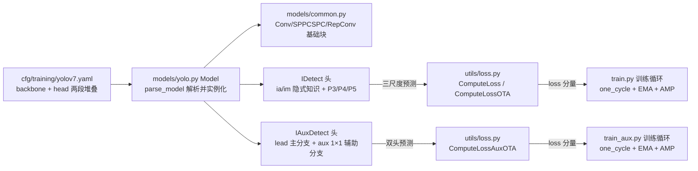
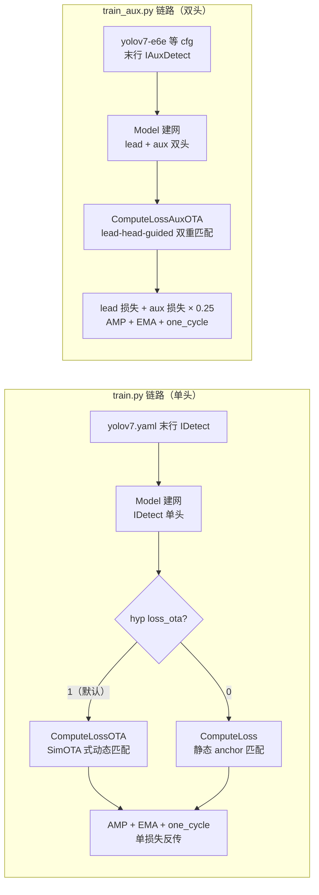

# YOLOv7 源码走读

本页沿 YOLOv7（中央研究院 + v4 作者回归，2022-07）的主调用链走读源码：**`cfg/training/yolov7.yaml` → `models/yolo.py` 的 `Model` / `parse_model`（建网）→ `models/common.py`（Conv / SPPCSPC / RepConv 等基础块）→ `models/yolo.py` 的 `IDetect` / `IAuxDetect`（检测头）→ `utils/loss.py`（三个损失类）→ `train.py` / `train_aux.py`（训练循环）**。所有行号均以站内快照 `source/yolov7/snapshot/`（main @ a207844）为准，可点击 SrcLink 跳转核对。

## 文件清单

| 文件 | 行数 | 功能 |
| --- | --- | --- |
| `cfg/training/yolov7.yaml` | 140 | 模型结构配置：backbone + head 两段模块堆叠，末行 IDetect |
| `models/yolo.py` | 843 | `Model` / `parse_model` 建网；Detect / IDetect / IAuxDetect 头 |
| `models/common.py` | 2019 | Conv / MP / DownC / SPPCSPC / ImplicitA / ImplicitM / RepConv 等基础块 |
| `utils/loss.py` | 1697 | ComputeLoss / ComputeLossOTA / ComputeLossAuxOTA 三个损失类 |
| `train.py` | 705 | 单头（lead head）训练入口 |
| `train_aux.py` | 699 | 辅助头（partial aux head）训练入口 |
| `data/hyp.scratch.p5.yaml` | 31 | 超参配置（含 `loss_ota` 开关） |
| `models/experimental.py` | 272 | 模型混合与权重加载工具 |
| `utils/datasets.py` | 1320 | 数据加载与增强（mosaic / mixup / HSV） |
| `utils/torch_utils.py` | 374 | ModelEMA、参数计数等训练工具 |
| `utils/autoanchor.py` | 160 | anchor 检查与自动锚框（check_anchors） |
| `test.py` | 353 | 验证与测速入口 |
| `detect.py` | 196 | 推理入口 |

## 调用链总览

## 两条训练链路

YOLOv7 有两套训练入口，共用建网与基础块，差别在检测头与损失类：

- `train.py` 面向 `cfg/training/yolov7.yaml` 这类单头配置，损失按 `hyp['loss_ota']` 在 `ComputeLossOTA` 与 `ComputeLoss` 之间二选一。
- `train_aux.py` 面向 `yolov7-e6e` 等带辅助头的配置，固定走 `ComputeLossAuxOTA`，主损失与辅助损失一并反传。

## 1. `cfg/training/yolov7.yaml` — 模块堆叠即结构

### 配置头与 anchors（L1-10）

配置延续 v5 的 yaml 风格（不像 v6 改成 Python dict）：`nc`、`depth_multiple` / `width_multiple` 缩放系数之后，L8-10 给出三组手工 anchors（P3/8、P4/16、P5/32）：

<SrcLink file="v7:cfg/training/yolov7.yaml" :line="1" :end="10" />

### backbone：ELAN 的四路聚合（L13-28）

每行格式是 `[from, number, module, args]`。L20-28 是 backbone 里的第一个 ELAN 块：两条 1×1 分支（其中一条从 `-2` 跳连）各自接四层 3×3，末尾 `Concat` 聚合 `[-1, -3, -5, -6]` 四路再 1×1 压通道：

<SrcLink file="v7:cfg/training/yolov7.yaml" :line="20" :end="28" />

下采样用 `MP`（maxpool + stride-2 卷积两路拼接，见 common.py L30），L30-42 演示 P2→P3 的过渡。

### head：SPPCSPC + 六路 ELAN + RepConv 收口（L74-139）

- L75 起 head 以 `SPPCSPC` 开场（CSP 结构的 SPP，common.py L262）；
- L82-89 是颈部的六路 ELAN：`Concat [-1, -2, -3, -4, -5, -6]` 聚合六条路径（比 backbone 的四路更深）：
  <SrcLink file="v7:cfg/training/yolov7.yaml" :line="82" :end="89" />
- L135-137 三个尺度的输出前各挂一个 `RepConv`（**planned re-param 的落点**，推理前融合成单 3×3）：
  <SrcLink file="v7:cfg/training/yolov7.yaml" :line="135" :end="137" />
- L139 末行 `[102, 103, 104], IDetect, [nc, anchors]` 宣告检测头：
  <SrcLink file="v7:cfg/training/yolov7.yaml" :line="139" :end="139" />

### 三个 cfg 目录的分工

- `cfg/training/`：7 份训练配置（yolov7 / x / w6 / tiny / e6e / e6 / d6），末行 `IDetect` 或 `IAuxDetect`，是本页走读的对象。
- `cfg/deploy/`：8 份部署配置（同名 7 份 + `yolov7-tiny-silu`），结构已按融合态改写，用于导出 TensorRT / ONNX。
- `cfg/baseline/`：11 份对照基线（yolor-w6 / p6 / e6 / d6 / csp / csp-x、yolov3、yolov3-spp、yolov4-csp、r50-csp、x50-csp），供复现论文里的对照实验，不参与主训练链路。

## 2. `models/yolo.py` — Model 与 parse_model 建网

### Model 初始化：五类头分支（L508-579）

`Model.__init__` 先读 yaml（L512-518），再调 `self.model, self.save = parse_model(deepcopy(self.yaml), ch=[ch])` 建网（L528），随后按头类型分支：

- `Detect` 分支（L534-540）：v5 遗留；
- `IDetect` 分支（L542-549）：算 stride（L544）、`m.anchors /= m.stride` 归一到网格空间（L546）、`_initialize_biases`（L548）：
  <SrcLink file="v7:models/yolo.py" :line="542" :end="549" />
- `IAuxDetect` 分支（L550-558）：先 `self.forward(...)` 取 `[:4]` 拿 stride（L552），bias 用 `_initialize_aux_biases`（L557）：
  <SrcLink file="v7:models/yolo.py" :line="550" :end="558" />
- `IBin` / `IKeypoint` 分支（L559-574）留给关键点等变体，最后 `initialize_weights`（L577）。

### parse_model：from/number/module/args 解析（L736-813）

入口签名 `parse_model(d, ch)`（L736），核心逻辑：

- L738 取 `anchors, nc, gd, gw`（depth/width 缩放系数）；L743 遍历 `d['backbone'] + d['head']` 的每一行；
- 重复数缩放 `n = max(round(n * gd), 1) if n > 1 else n`（L751）；卷积类白名单（L752-762）直接把 `c2` 当输出通道；
- 通道缩放 `c2 = make_divisible(c2 * gw, 8)`（L765）；
- CSP 系模块把重复数塞进 args（`args.insert(2, n); n = 1`，L778-779）；
- `Concat` 的输出通道是各来源求和 `c2 = sum([ch[x] for x in f])`（L782-783），`Shortcut` 是恒等通道（L786-787）；
- 头分派：`elif m in [Detect, IDetect, IAuxDetect, IBin, IKeypoint]: args.append([ch[x] for x in f])`（L790-793）；
- L803 `m_ = nn.Sequential(...) if n > 1 else m(*args)` 实例化，L808 记录 savelist，L813 `return nn.Sequential(*m), sorted(save)`。

## 3. `models/yolo.py` — IDetect 头

### 初始化：ia 与 im 隐式知识（L97-117）

IDetect（L97）在每尺度卷积输出之外挂两组 YOLOR 隐式模块：`self.ia = ModuleList(ImplicitA ...)`、`self.im = ModuleList(ImplicitM ...)`（L116-117），即"隐式知识" trick 的载体（另见 /versions/v7/tricks）。

### forward 与 decode（L119-138）

- 训练态输出每尺度 `(bs, na, ny, nx, no)` 张量；推理态 decode：`xy = (sigmoid * 2 - 0.5 + grid) * stride`、`wh = (sigmoid * 2) ** 2 * anchor_grid`（L134-135）：
  <SrcLink file="v7:models/yolo.py" :line="130" :end="138" />
- 注意 decode **没有** objectness 上界约束（与论文文字的差异见 /versions/v7/painpoints）。

### fuse 与 fuseforward（L140、L178-190）

`fuse()` 把隐式知识折进输出卷积：ImplicitA 并入 bias（L184）、ImplicitM 缩放 weight 与 bias（L189-190），之后走 `fuseforward`（L140）单路前向：

<SrcLink file="v7:models/yolo.py" :line="178" :end="190" />

## 4. `models/yolo.py` — IAuxDetect 双头

### lead 与 aux 两套分支（L311-332）

IAuxDetect（L311）维护两套输出卷积：`self.m` 是 lead 头（L328），`self.m2` 是纯 1×1 的 aux 头（L329）；隐式知识 `ia` / `im` **只挂在 lead 一侧**（L331-332）：

<SrcLink file="v7:models/yolo.py" :line="326" :end="332" />

### forward：训练双输出 推理只出 lead（L334-362）

训练态 `x` 里 lead（前 `nl` 个）与 aux（后 `nl` 个）都算损失；推理态只 decode lead 分支并返回 `(torch.cat(z, 1), x[:self.nl])`（L362），aux 分支的 `m2` 在部署时直接不参与输出：

<SrcLink file="v7:models/yolo.py" :line="334" :end="362" />

这正是 partial aux head "训时加料、推时零开销"的实现（对比 /versions/v7/tricks 第 7 条）。

### fuse 仅折叠 lead（L401-413）

`fuse()` 与 IDetect 同款，只把 `ia` / `im` 折进 `self.m`（lead 卷积）；aux 的 `m2` 是纯 1×1 卷积、无隐式模块可折：

<SrcLink file="v7:models/yolo.py" :line="401" :end="413" />

## 5. `models/common.py` — RepConv 三分支与融合

### 训练态三分支（L463-507）

RepConv（L463）训练态有三条分支：`rbr_dense`（3×3+BN）、`rbr_1x1`（1×1+BN）、`rbr_identity`（BN）。**identity 分支只在 `c2 == c1 and s == 1` 时存在**（L486）——这是论文 RepConvN 规则"带 residual/concat 连接的卷积不能有 identity 分支"在快照里的条件式实现（漂移细节见 /versions/v7/painpoints）：

<SrcLink file="v7:models/common.py" :line="480" :end="487" />

forward 三路求和过激活（L498-507）：

<SrcLink file="v7:models/common.py" :line="498" :end="507" />

### 等效卷积与 BN 折叠（L509-552）

- `get_equivalent_kernel_bias`：把三条分支折成单个 3×3 卷积的 kernel/bias（L509-515）；
- `_fuse_bn_tensor`：按分支类型把 BN 折进卷积——identity 分支用单位核构造等效 conv 再折 BN（L524-552）：
  <SrcLink file="v7:models/common.py" :line="524" :end="552" />

### 部署折叠（L561-584）

`fuse_conv_bn`（L561）是通用 conv+BN 折叠，`fuse_repvgg_block`（L584）把整个 RepConv 换成单 `nn.Conv2d`。通用 `Conv` 块同理：`forward` 走 conv→BN→act，`fuseforward` 直接走融合卷积（L107-111）。

## 6. `utils/loss.py` — 三个损失类与 build_targets

### 损失构件层（L16-421）

文件前半是可复用构件：`BCEBlurWithLogitsLoss`（L16）、`SigmoidBin`（L33）、`FocalLoss`（L121）、`QFocalLoss`（L151）、`RankSort`（L176）、`aLRPLoss`（L275）、`APLoss`（L345）。三个 `ComputeLoss*` 类从 L422 开始。

### ComputeLoss：静态 anchor 匹配（L422-555）

- init（L424-449）：`smooth_BCE`（L433）、`fl_gamma > 0` 时套 FocalLoss（L436-438）、每层 balance 权重（L441）；
- `__call__`（L450）：obj 目标是 `(1-gr) + gr*iou` 的软标签（L472）；
- `build_targets`（L500）按 anchor 形状比 `anchor_t` 阈值筛正样本，偏移系数 **`g = 0.5`**（L508）：
  <SrcLink file="v7:utils/loss.py" :line="500" :end="516" />

### ComputeLossOTA：SimOTA 式动态匹配（L556-848）

train.py 的默认损失。`__call__`（L582）每步调 `build_targets`（L638）做动态分配，代价矩阵是 `cls + 3.0 * (-log IoU)`（L737-740）；候选格子由 `find_3_positive`（L795）产生，偏移系数同样是 **`g = 0.5`**（L803）：

<SrcLink file="v7:utils/loss.py" :line="795" :end="811" />

### ComputeLossAuxOTA：双头双损失（L1176-1697）

train_aux.py 专用。要点：

- `__call__`（L1202）先做两次匹配，**都只传 lead 输出 `p[:self.nl]`**——aux 的正样本由 lead 头引导（lead-head-guided）：
  <SrcLink file="v7:utils/loss.py" :line="1202" :end="1208" />
- aux 损失乘 0.25 缩放（L1259 / L1269 / L1273）；
- `build_targets`（L1287，精细匹配）与 `build_targets2`（L1440，粗糙匹配）构成 coarse-to-fine 两级分配；
- `find_5_positive`（L1593）的偏移系数 **`g = 1.0`**（L1601），`find_3_positive`（L1646）则是 **`g = 0.5`**（L1654）。

### build_targets 差异：g=0.5 与 g=1.0

| 方法 | 用在哪 | 偏移系数 g | 语义 |
| --- | --- | --- | --- |
| `find_3_positive`（L795 / L1646） | OTA / AuxOTA 精细匹配 | 0.5 | 中心 + 上下左右 5 个偏移乘 0.5，格子收得更紧 |
| `find_5_positive`（L1593） | AuxOTA 粗糙匹配（build_targets2） | 1.0 | 同样 5 个偏移乘 1.0，邻域更宽、召回更高 |

两者的偏移集合相同（中心 + 上下左右，对角偏移在快照里被注释停用），唯一差别就是这个 bias 系数——这正是"coarse-to-fine"标签分配的旋钮。

## 7. `train.py` 与 `train_aux.py` — 两条训练链路

### 共同骨架（L195、L200、L299-301）

两个入口的工程层一致：one-cycle 余弦学习率 `lf = one_cycle(1, hyp['lrf'], epochs)`（L195）、`ModelEMA`（L200）、AMP `GradScaler`（L299），并都同时实例化两个损失类（train.py L300-301 是 `ComputeLossOTA` + `ComputeLoss`；train_aux.py L300-301 是 `ComputeLossAuxOTA` + `ComputeLoss`）。

### train.py：loss_ota 开关（L362-365）

前向后按 `hyp['loss_ota']` 二选一，默认（值为 1 或缺省）走 `ComputeLossOTA`，置 0 则退回静态匹配的 `ComputeLoss`：

<SrcLink file="v7:train.py" :line="362" :end="365" />

### train_aux.py：固定 ComputeLossAuxOTA（L300、L362）

train_aux.py 没有开关，训练步恒调 `compute_loss_ota`（即 `ComputeLossAuxOTA` 实例）：

<SrcLink file="v7:train_aux.py" :line="359" :end="366" />

### hyp 的三个关键开关（`data/hyp.scratch.p5.yaml`）

- L14 `anchor_t: 4.0`：静态匹配的 anchor 倍率阈值（只影响 `ComputeLoss`）；
- L16 `fl_gamma: 0.0`：默认不启用 FocalLoss；
- L31 `loss_ota: 1`：默认启用 OTA 动态匹配，注释明说"置 0 训练更快"。

## 阅读路线建议

1. **先看结构配置**：`cfg/training/yolov7.yaml` 通读一遍，对照 L20-28 的四路 ELAN 与 L82-89 的六路 ELAN，理解"模块堆叠即网络"。
2. **再看建网**：`models/yolo.py` 的 `parse_model`（L736 起）+ `Model.__init__` 的头分支（L534-558），弄清 yaml 行怎么变成 `nn.Module`。
3. **按需补基础块**：`models/common.py` 的 RepConv（L463 起）是理解"训练三分支→部署单 3×3"的钥匙（另见 /versions/v7/tricks 与 /versions/v7/painpoints）。
4. **读头**：`IDetect`（L97 起）→ `IAuxDetect`（L311 起），重点看训练/推理输出分叉（L347-362）与 `fuse`（L178 / L401）。
5. **读损失闭环**：`utils/loss.py` 的 `ComputeLossOTA.__call__` 从头到尾追一遍，再对照 `ComputeLossAuxOTA` 的双重匹配（L1205-1206）与 `g = 0.5 / 1.0` 差异。
6. **最后看工程层**：`train.py` / `train_aux.py` 的训练步（L299-377），对照"两条训练链路"的 mermaid 图走一遍。

## 延伸阅读

- [YOLOv7 网络结构](/versions/v7/architecture) — 本页结构章节的概念版
- [YOLOv7 核心概念](/versions/v7/concepts) — trainable bag-of-freebies 等概念铺垫
- [YOLOv7 损失函数](/versions/v7/losses) — 三个损失类的公式推导
- [YOLOv7 训练技巧](/versions/v7/tricks) — 13 个 trick 的动机与实现
- [YOLOv7 痛点追踪](/versions/v7/painpoints) — 论文与快照漂移的代价与路标
- [YOLOv6 源码走读](/versions/v6/code-walkthrough) — 上一版的调用链对照
