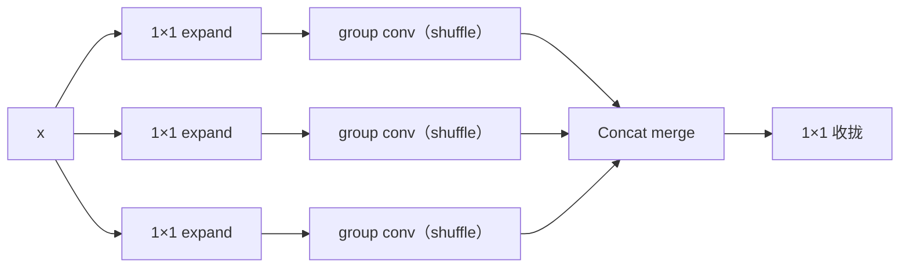

# YOLOv7 理论 Concept

::: tip 只想带走三件事
1. **所有改进都是 trainable bag-of-freebies**：E-ELAN、planned re-param、coarse-to-fine 标签分配全部只加在训练期，部署模型与基线同速——"免费涨点"是整篇论文的方法论；
2. **标签分配是主战场**：lead head guided label assigner 用 lead 头预测生成一套软标签，coarse 给 auxiliary head、fine 给 lead head，SimOTA 式动态匹配 $cost = L_{cls} + 3 \cdot (-\log IoU)$；
3. **anchor-based 的回归**：与 v6 的 anchor-free 分道扬镳，v7 回到 3 组 anchors + CIoU + BCE 老三样，涨点全靠结构设计与标签分配。
:::

## 1. trainable bag-of-freebies (`concept-bag-of-freebies`)

**定义**：YOLOv7 论文标题里的核心主张——把涨点手段全部放进训练阶段（更好的梯度传播、更准的标签分配、额外的辅助监督），推理图保持与基线完全一致，速度一分不掉。

**动机**：实时检测器的速度预算极为敏感，任何推理期开销（额外分支、复杂后处理、更深的网络）都会直接吃掉 FPS；而训练期开销是一次性的。"免费涨点"因此成为实时检测器的设计红线。

**实现**：论文的 freebies 分三类：

| 类别 | 手段 | 推理时去哪了 |
|------|------|--------------|
| 结构类 | E-ELAN、compound scaling、planned re-param | 多分支融成单 conv |
| 分配类 | lead-head-guided 标签分配、partial auxiliary head | aux 头整个丢弃 |
| 蒸馏/融合类 | EMA（mean teacher）、conv-BN 融合、隐式知识合并 | 并进 conv 的 weight/bias |

**与上版差异**：v6 的 RepVGGBlock 也是 freebie 思路（部署前 `switch_to_deploy`），但只是单个块的设计；v7 把"训练期加料、推理零开销"上升为组织全篇方法论的原则，从骨干缩放到标签分配都用它检验。

> v6 读者路标：v6 的答案是"把网络每个部件都换成可融合的 rep 块"；v7 的答案是"结构、分配、蒸馏三条线都只在训练期花钱"。

## 2. E-ELAN (`concept-e-elan`)

**定义**：Extended Efficient Layer Aggregation Network——用 expand（扩通道）、shuffle（分组卷积跨组混合）、merge（拼接收拢）三个动作构造 ELAN 变体，以 **cardinality + group conv** 增加梯度传播路径的多样性。

**动机**：堆深 concat 型网络时，梯度传播路径会逐渐"同质化"，加层的边际收益递减；论文要"只增梯度传播路径的多样性、不改变梯度路径本身"（不加长路径，所以收敛与速度都不受损）。

**实现**：输入先经多路 1×1 conv expand 扩大通道基数，各路经 group conv（shuffle）跨组交换信息，最后 concat merge 回收：



- 快照里的落地形态是 **ELAN 堆叠**：骨干每个阶段用 `[[-1,-3,-5,-6],1,Concat,[1]]` 把 4 条不同深度的 3×3 支路拼接（见 [架构与层速查](/versions/v7/layers)）；头部用 6 路 `[[-1,-2,-3,-4,-5,-6],1,Concat,[1]]`
- ELAN 的出处论文引用匿名技术报告《Designing Network Design Strategies》（论文引文 [1]）

<SrcLink file="v7:cfg/training/yolov7.yaml" :line="20" :end="28" />

**与上版差异**：v5 靠 C3（1×1 → 瓶颈栈 → 1×1）聚合、v6 靠 RepBlock 堆叠；v7 的 ELAN/E-ELAN 显式把"多深度支路 concat"当作梯度多样性来源，骨干与颈部全是这种块。

> v6 读者路标：v6 用"可融合的多分支"堆容量，v7 用"多路径 concat"堆梯度多样性——前者优化的是推理，后者优化的是训练。

## 3. concat 型模型的 compound scaling (`concept-compound-scaling`)

**定义**：对以 concat 为主旋律的网络，**computational block 只缩 depth，transition layer 按与 computational block 相同的变化量缩 width**——depth 与 width 不再独立缩放，而是"复合"联动。

**动机**：v4/v5 时代的 depth+width 独立缩放是对 add 型（ResNet 式）网络的经验结论；concat 型（DenseNet/ELAN 式）网络里通道是逐层累积的，transition layer 的宽度变化会牵动后续所有 concat 的输入通道，独立缩放容易失配。

**实现**：缩放最终仍由 `parse_model` 的两条公式执行——depth `n = max(round(n × gd), 1)`（n=1 不缩）、width `c2 = make_divisible(c2 × gw, 8)`；compound scaling 是论文 §3.2 对 **yaml 里 depth_multiple/width_multiple 取值组合**的设计约束：

$$
\text{transition width 变化量} = \text{computational block 的 depth 变化量}
$$

<SrcLink file="v7:models/yolo.py" :line="751" />
<SrcLink file="v7:models/yolo.py" :line="765" />

- 论文消融（Table 3）：base 缩放 51.7 AP → compound scaling **52.9 AP**（同计算量下纯赚 1.2）
- yolov7.yaml 本身是基准配置：`depth_multiple: 1.0`、`width_multiple: 1.0`，缩放全在系列变体（X/W6/E6/D6 等）的配置里

**与上版差异**：v5 的 `parse_model` 公式同构但 depth/width 独立调；v6 的缩放写在 Python dict 里也是独立两个系数；v7 第一次把"concat 型网络该怎么缩放"写成显式规则。

> v6 读者路标：v6s 的 0.33/0.50 是两个自由旋钮，v7 认为 concat 型网络里这两个旋钮必须联动。

## 4. planned re-parameterized convolution 与 RepConvN 规则 (`concept-planned-reparam`)

**定义**：不是所有层都该用 RepConv——**带 residual 或 concat 连接的卷积层不能有 identity 分支**（论文称无 identity 的版本为 RepConvN），其余层再"有计划地"选用 RepConv（论文 §4.1，Fig.4）。

**动机**：RepVGG 的 identity 分支本身携带一条"恒等梯度高速路"；把它塞进 ResNet 残差块或 DenseNet concat 块里，会与原有的残差/拼接路径冗余，反而破坏这些拓扑赖以生效的梯度多样性（消融 Table 4/5）。

**实现**：RepConv 训练态三分支（3×3 + 1×1 + identity），部署时融合成单 3×3。关键在 identity 分支的条件：

```python
self.rbr_identity = (nn.BatchNorm2d(num_features=c1) if c2 == c1 and s == 1 else None)
```

- **快照里没有 `RepConvN` 这个类**：identity 分支在 `c2 != c1` 或 `s != 1` 时自动为 `None`——即"论文命名 RepConvN、代码用条件 identity 实现"，二者是同一条规则
- yolov7.yaml 里三处 RepConv 都是改通道的（128→256 / 256→512 / 512→1024，`c2 != c1`），因此全部自动无 identity，正是 RepConvN 行为
- forward 里 `id_out = 0` 占位（identity 不存在时），`_fuse_bn_tensor` 把 identity 折算成"中心为 1 的 3×3 单位阵"再按 BN 的 $\gamma/\sigma$ 缩放

<SrcLink file="v7:models/common.py" :line="463" :end="582" />

**与上版差异**：v6 是"骨干/颈全 Rep 化"（RepVGGBlock 到处都是、都有 identity，靠 `switch_to_deploy` 收尾）；v7 是**有选择、有禁令**的 re-param——在哪用、在哪禁，本身就是方法。

> v6 读者路标：v6 的问题是"怎么把三分支折成一个 conv"，v7 追加了一个新问题——"哪些层根本不该有第三个分支"。

## 5. lead head guided label assigner (`concept-lead-head-guided`)

**定义**：用 **lead head 的预测 + GT** 生成一套软标签，同时供 lead head 与 auxiliary head 使用，而不是两个头各算各的标签（论文 §4.2）。

**动机**：多头训练里若各头独立分配标签，监督信号会互相矛盾；aux 头在训练早期预测很不准，若按它自己的预测分配正样本，等于让弱者带节奏。由最强的 lead 头统一分配，两头目标一致，训练更稳。

**实现**：`ComputeLossAuxOTA` 里 `build_targets`（lead）与 `build_targets2`（aux）两套目标都由**同一批预测 + GT 经相同 cost 公式匹配**生成，只是候选范围（见下一词条）与使用方不同：

<SrcLink file="v7:utils/loss.py" :line="1287" />
<SrcLink file="v7:utils/loss.py" :line="1440" />

**与上版差异**：v6 是 TAL 单头 top-k 分配（按 cls$^\alpha$×IoU$^\beta$ 对齐）；v5 是静态 anchor 宽高比匹配；v7 首次引入"由主头统一带辅头"的多头分配范式。

> v6 读者路标：v6 的 TAL 回答"单头怎么分"，v7 的 lead-head-guided 回答"多头怎么不分家"。

## 6. coarse-for-auxiliary 与 fine-for-lead (`concept-coarse-to-fine`)

**定义**：同一套匹配目标里，约束严的 **fine label 给 lead head**，放宽约束的 **coarse label 给 auxiliary head**（保 recall）——"coarse-to-fine"的双向指派。

**动机**：aux 头的职责是提供额外梯度、别拖后腿，宁可多给正样本（粗一点）保住 recall；lead 头是最终推理头，需要精确（细一点）的正样本。同一 GT 因此对两头给出松紧不同的监督。

**实现**：差异全在候选格收集的偏置 $g$ 上——两个函数的偏移集合相同（中心 + 上下左右十字邻域），$g$ 决定偏移距离：

| 目标 | 收集函数 | 偏置 g | 松紧 |
|------|----------|--------|------|
| lead（fine） | `find_3_positive` | 0.5 | 候选格聚拢在 GT 附近 |
| aux（coarse） | `find_5_positive` | 1.0 | 候选格扩到更宽的邻域 |

```python
def find_3_positive(self, p, targets):
    g = 0.5  # bias
    off = torch.tensor([[0, 0],
                        [1, 0], [0, 1], [-1, 0], [0, -1]], device=...).float() * g
```

<SrcLink file="v7:utils/loss.py" :line="795" />
<SrcLink file="v7:utils/loss.py" :line="803" />
<SrcLink file="v7:utils/loss.py" :line="1593" />
<SrcLink file="v7:utils/loss.py" :line="1601" />

- 论文消融（Table 6/7/8）：base 55.6 → coarse-to-fine 55.9 → + partial aux head 56.3 → 再叠加其余 freebies 56.8

**与上版差异**：v5/v6 对所有输出层一视同仁（同一套偏置）；v7 让不同头用不同松紧的正样本定义。

> v6 读者路标：v6 的正样本松紧由 topk 数量控制，v7 由偏置 g 控制，而且**每头可以不同**。

## 7. partial auxiliary head (`concept-partial-aux-head`)

**定义**：auxiliary head 不是每层都接，只接在网络**部分层**上（E-ELAN 配置下），且 aux 分支不带隐式知识；aux 损失统一降权 ×0.25。

**动机**：给所有层都加 aux 头开销大、且易让辅助监督喧宾夺主；接在部分层、降权训练，只借它的梯度正则效果，推理时整个丢掉。

**实现**：`IAuxDetect` 里 lead 头带 ImplicitA/ImplicitM，aux 头只有纯 1×1 conv——隐式知识不给 aux 用：

```python
self.m  = nn.ModuleList(nn.Conv2d(x, self.no * self.na, 1) for x in ch[:self.nl])   # lead
self.m2 = nn.ModuleList(nn.Conv2d(x, self.no * self.na, 1) for x in ch[self.nl:])  # aux（纯 1×1）
self.ia = nn.ModuleList(ImplicitA(x) for x in ch[:self.nl])                        # 只配 lead
```

- aux 损失 ×0.25 的三处落点：`lbox += 0.25 * (1.0 - iou_aux).mean()`、`lcls += 0.25 * BCEcls(...)`、`lobj += obji * balance + 0.25 * obji_aux * balance`
- 推理只输出 lead 头：`return (torch.cat(z, 1), x[:self.nl])`——aux 头的 3 路输出直接切掉

<SrcLink file="v7:models/yolo.py" :line="311" />
<SrcLink file="v7:models/yolo.py" :line="329" />
<SrcLink file="v7:utils/loss.py" :line="1259" />
<SrcLink file="v7:utils/loss.py" :line="1269" />
<SrcLink file="v7:utils/loss.py" :line="1273" />
<SrcLink file="v7:models/yolo.py" :line="362" />

**与上版差异**：v5/v6 没有 aux 头概念（v6 的蒸馏是另一条路）；v7 的 aux 头是"用完即弃"的训练脚手架，接口上表现为 `train_aux.py` 用 `ComputeLossAuxOTA`、推理图与普通版完全一致。

> v6 读者路标：v6 蒸馏续训靠"教师给软标签"，v7 靠"自家多长一个临时头"。

## 8. SimOTA 式动态匹配 (`concept-simota-matching`)

**定义**：正样本分配用动态最优传输风格的匹配：先算预测与 GT 的两两 cost，再按 dynamic-k 为每个 GT 选 cost 最小的若干预测——源自 OTA（论文引文 [20]，动态标签分配始祖）的 SimOTA 变体。

**动机**：静态规则（wh 比例、固定 topk）无法适应目标尺度与拥挤程度的变化；让"分类准 + 定位好"的预测自己竞争出正样本，分配与预测质量挂钩。

**实现**：cost 与 dynamic-k 的两条关键公式：

$$
cost = L_{cls}^{pair} + 3.0 \cdot (-\log IoU), \qquad
k_{dyn} = \mathrm{clamp}\Big(\sum_{top\text{-}k} IoU,\ \min=1\Big)
$$

```python
pair_wise_iou_loss = -torch.log(pair_wise_iou + 1e-8)
top_k, _ = torch.topk(pair_wise_iou, min(10, pair_wise_iou.shape[1]), dim=1)
dynamic_ks = torch.clamp(top_k.sum(1).int(), min=1)
cost = (
    pair_wise_cls_loss
    + 3.0 * pair_wise_iou_loss
)
```

- 候选收集在前（`find_3_positive`），跨层汇总后再算 cost；一个预测被多个 GT 选中时 **cost 最小者胜**
- top-k 口径按损失类而异：`ComputeLossOTA`（train.py）用 **top-10**；`ComputeLossAuxOTA`（train_aux.py）的 lead/aux 两路都用 **top-20**（候选更宽，配合 coarse-to-fine）
- 匹配只决定正样本归属；损失本体仍是老三样（见词条 11）

<SrcLink file="v7:utils/loss.py" :line="715" />
<SrcLink file="v7:utils/loss.py" :line="737" :end="740" />
<SrcLink file="v7:utils/loss.py" :line="1360" />
<SrcLink file="v7:utils/loss.py" :line="1513" />

**与上版差异**：v6 的 TAL 是固定 topk=13 的对齐指标分配、无 objectness；v5 是静态 anchor 匹配 + 邻居偏移；v7 动态决定"每个 GT 分几个正样本"。

> v6 读者路标：v6 固定"每 GT 13 个正样本"，v7 的正样本个数 $k_{dyn}$ 由 IoU 现算——目标好匹配就多分、难匹配就少分。

## 9. YOLOR 隐式知识 ImplicitA 与 ImplicitM (`concept-implicit-knowledge`)

**定义**：把一组可学习向量当作"隐式知识"，对特征做加性（ImplicitA）或乘性（ImplicitM）调制——YOLOR（论文引文体系中的前作）思路，训练学出来、推理并回卷积。

**动机**：显式知识（特征图、先验）都要花推理预算；隐式知识只是一个向量，训练时改善拟合，部署时可以**精确合并**进相邻 conv，零开销。

**实现**：

$$
ImplicitA:\ y = x + a \quad (a \text{ 初始化 } \mathcal{N}(0, 0.02)), \qquad
ImplicitM:\ y = m \odot x \quad (m \text{ 初始化 } \mathcal{N}(1, 0.02))
$$

- IDetect 里每个检测层配一对：`x[i] = self.m[i](self.ia[i](x[i]))` 再过 `self.im[i]`
- `fuse()` 把 ImplicitA 并进 conv 的 **bias**（`bias += W · a`），ImplicitM 并进 conv 的 **weight/bias**（`W *= m`、`bias *= m`）——这就是论文 §4.3"推理免费 freebie"的代码落点

<SrcLink file="v7:models/common.py" :line="433" :end="456" />
<SrcLink file="v7:models/yolo.py" :line="116" :end="125" />
<SrcLink file="v7:models/yolo.py" :line="178" :end="190" />

**与上版差异**：v5/v6 的检测头没有隐式知识；v7 把它装在 lead 头上（aux 头不配，见词条 7），并给出部署合并公式。

> v6 读者路标：v6 的"免费"是把多分支折成单 conv，v7 的"免费"还包括把一整个隐式知识向量折进 conv 参数。

## 10. EMA 与 mean teacher (`concept-ema-mean-teacher`)

**定义**：训练全程维护模型参数的指数滑动平均（EMA）副本，最终拿去做推理/评测的是 EMA 权重——即 mean teacher（论文引文 [75]）的最简形态。

**动机**：SGD 末端权重在损失盆地边缘抖动，EMA 平均掉抖动，几乎总是比末期裸权重高零点几个点；而它只花一份权重的显存，推理时换权重即可，速度不变。

**实现**：`ModelEMA`（`torch_utils`）在 `train_aux.py` 训练循环中每步更新，评测/导出走 EMA 权重；与 conv-BN 融合、隐式知识合并一起构成论文 §4.3 的"三条推理免费的 freebies"。

- 快照的 loss/模型代码不含 EMA 逻辑（它在训练脚本与 `torch_utils` 里），本页 SrcLink 只标模型侧的融合落点

**与上版差异**：EMA 在 v3/v4/v5 训练里也常见（非 v7 首创）；v7 的贡献是把它正式归入"trainable bag-of-freebies"清单，与结构/分配类改进并列计分。

> v6 读者路标：v6 蒸馏路线里教师模型另有其人；v7 的 mean teacher 就是自己的 EMA 影子。

## 11. CIoU 与 BCE 老三样 (`concept-ciou-bce`)

**定义**：损失本体不创新——仍是 v3/v5 传下来的三件套：CIoU 框回归 + BCE objectness + BCE 分类；objectness 的目标是 $(1-g_r) + g_r \cdot IoU$。

**动机**：论文的赌注是"损失本体够用，涨点在分配"；把变量控制在标签分配与 aux 头上，也便于消融归因。

**实现**：以 `ComputeLoss`（静态匹配版，v3/v5 全貌）为例，正样本三项：

```python
iou = bbox_iou(pbox.T, tbox[i], x1y1x2y2=False, CIoU=True)   # CIoU 回归
lbox += (1.0 - iou).mean()
tobj[b, a, gj, gi] = (1.0 - self.gr) + self.gr * iou.detach().clamp(0)  # obj 目标
lcls += self.BCEcls(ps[:, 5:], t)                             # BCE 分类
```

- 三层损失权重 `balance = {3: [4.0, 1.0, 0.4]}`（P3/P4/P5）
- 训练时回归与分类的解码同推理：`pxy = sigmoid·2 - 0.5`、`pwh = (sigmoid·2)² · anchor`（YOLOv3 式 anchor-based 解码）
- `ComputeLossOTA` / `ComputeLossAuxOTA` 只换目标生成（动态匹配 + aux ×0.25），损失本体不变

<SrcLink file="v7:utils/loss.py" :line="468" :end="486" />
<SrcLink file="v7:utils/loss.py" :line="472" />
<SrcLink file="v7:utils/loss.py" :line="442" />

**与上版差异**：v6 是 GIoU + VarifocalLoss + DFL、**没有 objectness 分支**；v7 回到 CIoU + BCEobj + BCEcls，与 v5 一脉相承。这也是 v6/v7 最刺眼的分叉——同一年的两个版本，一个删掉 objectness，一个把它原样保留。

> v6 读者路标：看到 `tobj`、`anchor_grid`、`(sigmoid·2)² · anchor` 这些名字，就该反应过来：这不是 v6 世界，是 v5 血统 + 2022 年的分配策略。

## 延伸阅读

- [损失函数详解](/versions/v7/losses)
- [反向传播推导](/versions/v7/loss-gradient)
- [v6 理论 Concept（对比）](/versions/v6/concepts)
- [术语表](/glossary)
