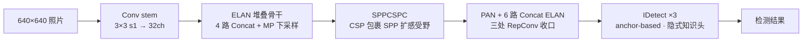
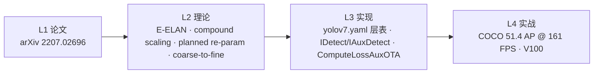
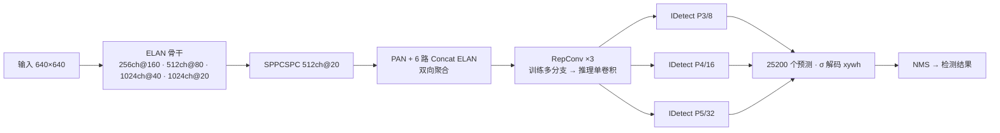
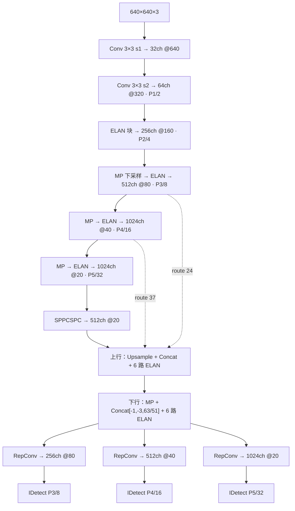

# YOLOv7 (2022-07)

> **TL;DR**
> - 一句话：trainable bag-of-freebies + E-ELAN + compound scaling，只花训练期成本
> - 解决：v6 训练配方不"可学"
> - 代价：推理结构比 v6 复杂
>
> **前置阅读**：[YOLOv6](/versions/v6/index) → [E-ELAN](/glossary#e-elan-efficiency-oriented-elastic) → [compound scaling](/glossary#compound-scaling) → [planned re-param](/glossary#planned-reparam-预规划重参数化)

**中央研究院 YOLOv7（trainable bag-of-freebies 的实时检测器）**

- 📄 论文：[YOLOv7: Trainable bag-of-freebies sets new state-of-the-art for real-time object detectors](https://arxiv.org/abs/2207.02696)（arXiv:2207.02696，2022-07-06 提交）
- 🏛️ 作者：Chien-Yao Wang、Alexey Bochkovskiy（YOLOv4 作者之一）、Hong-Yuan Mark Liao（中央研究院 Academia Sinica）
- 💻 源码：[WongKinYiu/yolov7](https://github.com/WongKinYiu/yolov7)（快照取自 main 分支 @ `a207844`，2023-11-03）
- 🎯 里程碑：**trainable bag-of-freebies**——E-ELAN、compound scaling、planned re-param、双头 coarse-to-fine 标签分配全部只花训练期成本，推理零开销；anchor-based 阵营的精度天花板

## 3 分钟电梯演讲

1. **训练堆容量、推理不花钱**：论文主题 trainable bag-of-freebies——aux head、YOLOR 隐式知识、EMA 全在训练期生效，推理时 RepConv 融合成单卷积、隐式知识并进 conv 的 weight/bias、aux 头直接丢弃。
2. **anchor-based 老将新作**：3 组 anchors + YOLOv3 式解码，损失仍是 CIoU + BCEobj + BCEcls 老三样（obj 目标 `(1-gr)+gr·iou`）——**变化全在标签分配**：lead-head-guided 的 SimOTA 式 cost 匹配，fine label 给 lead、coarse label 给 aux。
3. **planned re-param 有纪律地重参数化**：RepConv 只用在该用的位置，带 residual/concat 连接的卷积一律不给 identity 分支（RepConvN 规则），保护 ResNet/DenseNet 式梯度多样性。

> 已读过 [v6](/versions/v6/index)？本页下方有 v6→v7 逐项差异表；术语不熟先查[术语表](/glossary)。

## 四层闭环视图

## 核心贡献

1. **E-ELAN（expand/shuffle/merge）**：用 cardinality + group conv 只增不改梯度传播路径，加大网络规模而不牺牲训练效率；快照里以 yaml 的 Conv+Concat 多路块形态落地（骨干 4 路、头 6 路，无独立 E-ELAN 类）<SrcLink file="v7:cfg/training/yolov7.yaml" :line="21" :end="28" />
2. **concat 型模型的 compound scaling**：computational block 只缩 depth，transition layer 按同变化量缩 width（与 v4/v5 的 depth+width 独立缩放不同）<SrcLink file="v7:cfg/training/yolov7.yaml" :line="3" :end="4" />
3. **planned re-parameterized convolution 与 RepConvN 规则**：带 residual/concat 连接的卷积层不能有 identity 分支——快照中 RepConv 的 identity 分支在 `c2 != c1 or s != 1` 时自动为 None，用条件 identity 实现同一规则<SrcLink file="v7:models/common.py" :line="463" :end="582" />
4. **lead-head-guided 标签分配 + coarse-to-fine**：lead 头的预测与 GT 生成一套软标签供双头共用，fine label 给 lead、coarse label 给 auxiliary；aux 头只接部分层、不含隐式知识，损失统一 ×0.25<SrcLink file="v7:utils/loss.py" :line="1176" :end="1697" />
5. **三条推理免费的 freebies**：conv-BN 融合、YOLOR 隐式知识（ImplicitA/ImplicitM）并进 conv 的 bias/weight、EMA（mean teacher）作最终推理模型<SrcLink file="v7:models/yolo.py" :line="178" :end="190" />

## 推理效果一览

::: figure 图：v7 推理流水线——ELAN 骨干四级输出，SPPCSPC + PAN 双向聚合出 3 个尺度，三处 RepConv 融合收口，IDetect 逐位置解码 3 组 anchors，V100 上 161 FPS

:::

## 关键指标

**检测（COCO，论文 Table 2 口径，V100 测速，AP 为 test-dev；从零训练只用 COCO 数据）**

| 模型 | 参数量 | FLOPs | FPS（V100） | APtest-dev | 备注 |
|------|--------|-------|-------------|----------------------|------|
| YOLOv7 | 36.9M | 104.7G | 161 | **51.4** | val 51.2 |
| YOLOv7-X | 71.3M | — | 114 | 53.1 | |
| YOLOv7-W6 | 70.4M | — | 84 | 54.9 | 1280 输入 |
| YOLOv7-E6 | 97.2M | — | 56 | 56.0 | |
| YOLOv7-D6 | 154.7M | — | 44 | 56.6 | |
| YOLOv7-E6E | 151.7M | — | 36 | **56.8** | 集成模型 |
| YOLOv7-tiny-SiLU | 6.2M | — | 286 | 38.7 | |

- 口径提醒：与 v6 的 T4 + TensorRT fp16 口径不同，跨报告比 FPS 无意义；AP 也有 test-dev / val 双口径之分
- W6/E6/D6/E6E 为 P6 四尺度大模型家族（`cfg/training/` 下 w6/e6/d6/e6e 配置用 IAuxDetect 双头训练）

## 网络架构

- 结构由经典 yaml 层表驱动：<SrcLink file="v7:cfg/training/yolov7.yaml" :line="1" :end="10" />（nc=80、depth/width=1.0、3 组 anchors）
- 骨干 ELAN 块是 4 路 Concat（`[-1,-3,-5,-6]`：两条 1×1 + 两条 3×3），头内 ELAN 块是 6 路（`[-1,-2,-3,-4,-5,-6]`）
- 三处 RepConv（#102-104）输出通道 ≠ 输入通道，identity 分支自动为 None——RepConvN 规则的代码形态<SrcLink file="v7:cfg/training/yolov7.yaml" :line="135" :end="137" />
- 三头 stride 8/16/32、anchor-based：每格 3 anchors × 85 维（4 box + 1 objectness + 80 类），合计 $(80^2+40^2+20^2)\times 3 = 25200$ 个预测<SrcLink file="v7:cfg/training/yolov7.yaml" :line="139" :end="139" />

## 核心 Concept 一览

| Concept | 一句话 | 对应代码位置 |
|---------|--------|-------------|
| E-ELAN | expand/shuffle/merge 增梯度路径多样性 | <SrcLink file="v7:cfg/training/yolov7.yaml" :line="21" :end="28" />（yaml Conv+Concat 块） |
| MP 下采样 | MaxPool2d k=2，双路再 Concat | <SrcLink file="v7:models/common.py" :line="30" :end="34" /> |
| SPPCSPC | CSP 包裹 SPP，扩感受野 | <SrcLink file="v7:models/common.py" :line="262" :end="280" /> |
| RepConv / RepConvN | 训练三分支 → 推理单卷积，条件 identity | <SrcLink file="v7:models/common.py" :line="463" :end="582" /> |
| ImplicitA / ImplicitM | YOLOR 隐式知识，加性/乘性 | <SrcLink file="v7:models/common.py" :line="433" :end="461" /> |
| IDetect | anchor-based 头 + 隐式知识，fuse 并进 conv | <SrcLink file="v7:models/yolo.py" :line="97" :end="208" /> |
| IAuxDetect | 双头（lead + aux），推理只用 lead | <SrcLink file="v7:models/yolo.py" :line="311" :end="430" /> |
| ComputeLossOTA | SimOTA 式动态匹配（train.py） | <SrcLink file="v7:utils/loss.py" :line="556" :end="846" /> |
| ComputeLossAuxOTA | 双头损失，aux ×0.25（train_aux.py） | <SrcLink file="v7:utils/loss.py" :line="1176" :end="1697" /> |
| CIoU + BCE 老三样 | 损失本体不换，只换分配 | <SrcLink file="v7:utils/loss.py" :line="422" :end="553" /> |
| compound scaling | concat 型只缩 depth、transition 同量缩 width | <SrcLink file="v7:cfg/training/yolov7.yaml" :line="3" :end="4" /> |

## v6 → v7 关键差异

| 维度 | YOLOv6（美团，2022-06） | YOLOv7（中央研究院，2022-07） |
|------|------------------------|------------------------------|
| 出品方 | 美团（工业界） | 中央研究院 + v4 作者回归（学术界） |
| 里程碑定位 | 为部署而生的重参数化时代 | **trainable bag-of-freebies** |
| Anchor | anchor-free，无锚点 | **anchor-based**，3 组 anchors |
| 骨干 | EfficientRep（RepVGG 全线） | ELAN 堆叠（Conv + 多路 Concat） |
| 重参数化 | 全面 Rep 化（骨干/Neck 皆 Rep） | **planned re-param**：有选择用 RepConv，带 residual/concat 的卷积禁 identity 分支 |
| Neck | Rep-PAN（BiFusion 三路融合） | SPPCSPC + PAN + 6 路 Concat ELAN |
| 检测头 | EffiDeHead 解耦单头，无 objectness | IDetect（ImplicitA/M）/ IAuxDetect 双头，有 objectness |
| 标签分配 | TAL top-13 任务对齐 | lead-head-guided 双头 coarse-to-fine（SimOTA 式 cost 匹配） |
| 分类损失 | VarifocalLoss | BCEcls（可选 label smoothing / Focal） |
| 回归损失 | GIoU/SIoU + 可选 DFL | CIoU |
| Object | 无 objectness 分支 | BCEobj，目标 `(1-gr)+gr·iou` |
| 训练加料 | 蒸馏 + QAT + 长 epochs | aux head + EMA + 隐式知识（推理零开销） |
| 配置文件 | Python dict | yaml 层表（training/deploy 双份） |
| 测速口径 | T4 + TensorRT fp16 | V100（论文 Table 2） |

## 暴露的痛点

| 痛点 | 严重度 | 后续版本的解法 |
|------|--------|---------------|
| 训练管线分叉：train.py（单头 OTA）与 train_aux.py（双头 AuxOTA）两套脚本、7 个模型 × training/deploy 双份 yaml | High | 后续版本统一训练入口与配置体系 |
| 动态标签分配训练开销大：SimOTA 式 cost 矩阵逐图计算、top-k 匹配 | Medium | v8 的 TaskAlignedAssigner 单头简化 |
| 论文与代码漂移：RepConvN 只有其规则无其类；decoder 的距离约束论文有、代码无 | Medium | 文档与代码同步发布 |
| anchor 路线之争：v6/v8 阵营证明 anchor-free 可行，2022 年是分叉而非收敛 | Medium | v8 全面 anchor-free |
| 部分细节未核实：训练 schedule 在附录、coarse-to-fine 的公式级细节未与快照逐一对应 | Low | 读论文附录与代码自行核实 |

详见[痛点追踪](/versions/v7/painpoints)。

## 后续演进速览

- **v8（2023）**：Ultralytics 官方化重构（anchor-free + C2f + TAL + DFL）
- **v9（2024）**：学术重构（GELAN + 双头可编程梯度）
- **v10（2024）**：NMS-free 端到端推理（Ultralytics 8.1.34 fork）
- **v11-v12（2024-2025）**：官方线延续（C3k2 / A2C2f 等模块迭代）
- **v13（2025）**：论文回归 + HyperACE 学术线

> **v10-v13 已上线本站**：NMS-free / AGPL / HyperACE 等新一轮演进，详见 [v10 概览](/versions/v10/index) 起。

## 深入阅读

- [论文精读（arXiv:2207.02696，含论文 vs 快照对照）](/versions/v7/paper)
- [Architecture 逐层图解](/versions/v7/architecture)
- [理论 Concept](/versions/v7/concepts)
- [架构与层速查](/versions/v7/layers)
- [损失函数（CIoU + BCE + 双头标签分配）](/versions/v7/losses)
- [反向传播推导](/versions/v7/loss-gradient)
- [训练技巧（aux head + EMA + freebies）](/versions/v7/tricks)
- [源码走读](/versions/v7/code-walkthrough)
- [痛点追踪](/versions/v7/painpoints)
- [系列家族对照](/global/family) · [术语表](/glossary)
