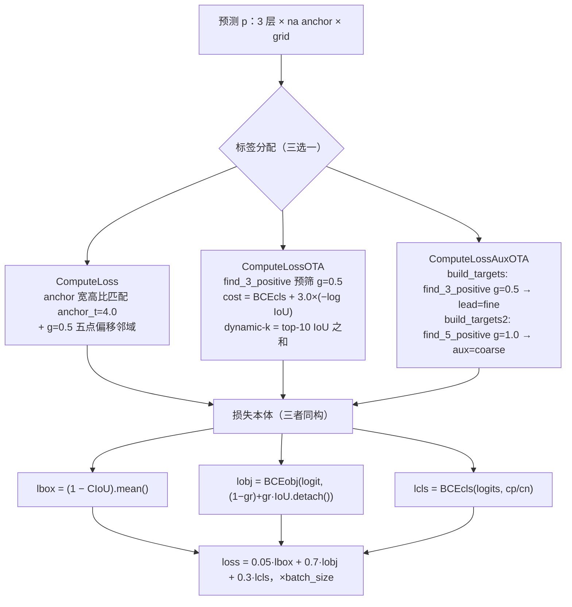

# YOLOv7 损失函数

::: tip 只想带走三件事
1. **损失本体是老三样**：CIoU 回归 + BCEobj + BCEcls，与 v3/v5 逐行同构——v7 的创新全在"**给谁算损失**"，即标签分配；
2. **三套分配器层层递进**：`ComputeLoss`（静态 anchor 宽高比匹配，基线）→ `ComputeLossOTA`（SimOTA 式动态匹配，`train.py` 默认）→ `ComputeLossAuxOTA`（lead + aux 双头 coarse-to-fine，`train_aux.py` 专用）；
3. **双头目标同源**：`ComputeLossAuxOTA` 里 lead 与 aux 两套目标都由 **lead 头预测**（`p[:self.nl]`）经同一 cost 匹配生成（论文 §4.2 lead-head-guided），aux 三项损失各 ×0.25。
:::

## 全景图



## 1. 损失本体：CIoU + BCEobj + BCEcls (`loss-core`)

```python
# Regression
pxy = ps[:, :2].sigmoid() * 2. - 0.5
pwh = (ps[:, 2:4].sigmoid() * 2) ** 2 * anchors[i]
pbox = torch.cat((pxy, pwh), 1)  # predicted box
iou = bbox_iou(pbox.T, tbox[i], x1y1x2y2=False, CIoU=True)  # iou(prediction, target)
lbox += (1.0 - iou).mean()  # iou loss
```

- **解码是 v5 同款 sigmoid 形变**：$x = 2\sigma(t_x) - 0.5$（网格单位，可越出中心半格）、$w = a_w\,(2\sigma(t_w))^2$（anchor 单位，$(0, 4a_w)$）（<SrcLink file="v7:utils/loss.py" :line="465" :end="467" />）
- **回归 = CIoU**（box1=预测、box2=GT）：

$$\mathrm{CIoU} = \mathrm{IoU} - \frac{\rho^2}{c^2} - \alpha v, \qquad v = \frac{4}{\pi^2}\left(\arctan\frac{w_2}{h_2} - \arctan\frac{w_1}{h_1}\right)^2, \qquad \alpha = \frac{v}{v - \mathrm{IoU} + 1}$$

  $v$ 度量两框宽高比的一致性，$\alpha$ 是 $v$ 与 IoU 之间的自适应权重，且**在 `torch.no_grad()` 下计算**——$\alpha v$ 只作常量权重、不参与求导（<SrcLink file="v7:utils/general.py" :line="378" :end="382" />）；损失取 `lbox += (1.0 - iou).mean()`（<SrcLink file="v7:utils/loss.py" :line="468" :end="469" />）
- **分类与 objectness 都是 `nn.BCEWithLogitsLoss`**（`pos_weight = cls_pw / obj_pw = 1.0`，<SrcLink file="v7:utils/loss.py" :line="430" :end="431" />）；分类目标 `cp/cn` 由 smooth_BCE 生成的软/硬标签填入（<SrcLink file="v7:utils/loss.py" :line="476" :end="479" />）
- **balance = [4.0, 1.0, 0.4]**：P3/P4/P5 三层的 obj 损失权重（<SrcLink file="v7:utils/loss.py" :line="442" />）
- **增益与汇总**：`lbox *= 0.05`、`lobj *= 0.7`、`lcls *= 0.3`，最终 `loss = (lbox + lobj + lcls) * bs`（<SrcLink file="v7:utils/loss.py" :line="492" :end="498" />；hyp 取值 <SrcLink file="v7:data/hyp.scratch.p5.yaml" :line="8" :end="12" />）

> v5 读者路标：解码、CIoU、BCEcls/BCEobj、balance 全部与 v5 `ComputeLoss` 同构，连 `gr` 软目标都一样（见第 5 节）。v7 的全部创新在"目标怎么来"——往下看。

## 2. 基线分配：ComputeLoss 静态 anchor 匹配 (`loss-static`)

```python
g = 0.5  # bias
off = torch.tensor([[0, 0],
                    [1, 0], [0, 1], [-1, 0], [0, -1],  # j,k,l,m
                    # [1, 1], [1, -1], [-1, 1], [-1, -1],  # jk,jm,lk,lm
                    ], device=targets.device).float() * g  # offsets
...
r = t[:, :, 4:6] / anchors[:, None]  # wh ratio
j = torch.max(r, 1. / r).max(2)[0] < self.hyp['anchor_t']  # compare
```

两步静态匹配（<SrcLink file="v7:utils/loss.py" :line="500" :end="525" />）：

1. **anchor 宽高比过滤**：GT wh 与 anchor wh 之比记 $r$，$\max(r, 1/r) < \texttt{anchor\_t} = 4.0$ 的 anchor 才算候选（<SrcLink file="v7:utils/loss.py" :line="522" :end="523" />）
2. **五点偏移邻域**：GT 中心所在网格 + 上、下、左、右各偏 `g = 0.5` 半格，共 5 个位置（<SrcLink file="v7:utils/loss.py" :line="508" :end="512" />），边界处按 `gxy % 1. < g` 判定是否扩边（<SrcLink file="v7:utils/loss.py" :line="530" :end="534" />）

- **目标与预测无关**：哪个 (anchor, 网格) 得到监督、得到什么框目标，只由 anchor 形状与 GT 位置决定，训练全程固定——这就是"静态"的含义
- **使用位置**：`train.py` 仅在 `hyp['loss_ota'] != 1` 时才走 `compute_loss`（<SrcLink file="v7:train.py" :line="362" :end="365" />）；官方 hyp 没有 `loss_ota` 键 → **默认走 OTA，`ComputeLoss` 只是基线/对照**（<SrcLink file="v7:train.py" :line="300" :end="301" />）

## 3. 动态匹配：ComputeLossOTA 的 SimOTA 式分配 (`loss-ota`)

```python
cls_preds_ = (
    p_cls.float().unsqueeze(0).repeat(num_gt, 1, 1).sigmoid_()
    * p_obj.unsqueeze(0).repeat(num_gt, 1, 1).sigmoid_()
)
y = cls_preds_.sqrt_()
pair_wise_cls_loss = F.binary_cross_entropy_with_logits(
   torch.log(y/(1-y)) , gt_cls_per_image, reduction="none"
).sum(-1)
del cls_preds_

cost = (
    pair_wise_cls_loss
    + 3.0 * pair_wise_iou_loss
)
```

`build_targets` 的完整流程（<SrcLink file="v7:utils/loss.py" :line="638" :end="793" />）：

- **① 预筛候选**：每层先用 `find_3_positive` 做一次静态匹配（anchor_t 宽高比 + g=0.5 五点偏移），把候选 (b, a, gj, gi) 收进来（<SrcLink file="v7:utils/loss.py" :line="641" />；实现 <SrcLink file="v7:utils/loss.py" :line="795" :end="846" />）——动态匹配只在这个候选集内做，兼顾效率
- **② 逐图跨层收集**：对每张图把所有层的候选预测 `fg_pred` 收集起来，解码到**像素域**（`× self.stride[i]`）转成 xyxy（<SrcLink file="v7:utils/loss.py" :line="675" :end="709" />）——匹配发生在图像坐标系，跨层公平可比
- **③ cost 矩阵**（GT × 候选，<SrcLink file="v7:utils/loss.py" :line="711" :end="740" />）：

$$\mathrm{cost} = \underbrace{\mathrm{BCE}\Big(\sqrt{\sigma(p_{cls})\cdot\sigma(p_{obj})},\ \mathrm{onehot}\Big)}_{\text{pair\_wise\_cls\_loss}} + 3.0 \times \underbrace{\big(-\log(\mathrm{IoU} + 10^{-8})\big)}_{\text{pair\_wise\_iou\_loss}}$$

  分类项用 $\sqrt{\sigma(p_{cls})\cdot\sigma(p_{obj})}$ 这个"分类 × 质量"联合概率对 one-hot 求 BCE（内部以 `torch.log(y/(1-y))` 折回 logits 形式）；IoU 项 $-\log(\mathrm{IoU})$ 对好框便宜、对差框昂贵，权重 3.0
- **④ dynamic-k**：每个 GT 取 top-10 候选的 IoU 之和作为正样本数 $k$（截断为整数、至少 1）（<SrcLink file="v7:utils/loss.py" :line="715" :end="716" />）——框匹配得越好，给的正样本越多
- **⑤ 贪心落点 + 冲突消解**：每个 GT 在 cost 最小的 $k$ 个候选上写 1（<SrcLink file="v7:utils/loss.py" :line="744" :end="748" />）；若一个候选被多个 GT 争抢，`cost` 最小的 GT 胜出，其余清零（<SrcLink file="v7:utils/loss.py" :line="751" :end="757" />）
- **损失本体不变**：选出 (b, a, gj, gi) 之后，回归/分类/obj 三项与第 1 节逐行相同（<SrcLink file="v7:utils/loss.py" :line="582" :end="636" />），obj 软目标同样是 `iou.detach()`

> SimOTA 路标：cost = 分类 BCE + $\lambda$·(−log IoU)、dynamic-k、冲突取最小——与 YOLOX 的 SimOTA 同源；差别在预筛方式：v7 用 anchor 形状（宽高比）预筛，YOLOX 用"中心点落在 GT 内"预筛。

## 4. 双头分配：ComputeLossAuxOTA 与 coarse-to-fine (`loss-aux`)

```python
bs_aux, as_aux_, gjs_aux, gis_aux, targets_aux, anchors_aux = self.build_targets2(p[:self.nl], targets, imgs)
bs, as_, gjs, gis, targets, anchors = self.build_targets(p[:self.nl], targets, imgs)
...
pi = p[i]
pi_aux = p[i+self.nl]
```

- **双头结构**：`p[i]` 是 lead 头第 i 层预测，`p[i+self.nl]` 是 aux 头第 i 层（<SrcLink file="v7:utils/loss.py" :line="1213" :end="1214" />）；双头损失在 `train_aux.py` 里装配（<SrcLink file="v7:train_aux.py" :line="300" :end="301" />）
- **§4.2 的代码落点——两套目标同源**：`build_targets`（lead，fine）与 `build_targets2`（aux，coarse）**都传入 `p[:self.nl]`**，即都拿 **lead 头的预测**做 cost 匹配（<SrcLink file="v7:utils/loss.py" :line="1205" :end="1206" />）——aux 头的监督目标跟随 lead 头，不让粗糙的 aux 预测自己给自己定目标（lead-head-guided）
- **fine vs coarse 只差一个 g**：
  - `build_targets` → `find_3_positive`，`g = 0.5`，五点半格偏移、候选区紧凑 = **fine-for-lead**（<SrcLink file="v7:utils/loss.py" :line="1287" :end="1289" />；<SrcLink file="v7:utils/loss.py" :line="1646" :end="1658" />）
  - `build_targets2` → `find_5_positive`，`g = 1.0`，同样 5 个偏移整格展开、候选区更宽 = **coarse-for-auxiliary**（<SrcLink file="v7:utils/loss.py" :line="1440" :end="1442" />；<SrcLink file="v7:utils/loss.py" :line="1593" :end="1605" />）
  - 两个 build 的其余流程（逐图跨层收集、cost = cls + 3.0×iou、冲突消解）几乎逐行相同，dynamic-k 上限都是 **20**（lead <SrcLink file="v7:utils/loss.py" :line="1360" :end="1361" />、aux <SrcLink file="v7:utils/loss.py" :line="1513" :end="1514" />）——注意与 `ComputeLossOTA` 的 top-10 不同
- **aux 三项损失各 ×0.25**：回归 `lbox += 0.25 * (1.0 - iou_aux).mean()`（<SrcLink file="v7:utils/loss.py" :line="1259" />）、分类 `lcls += 0.25 * self.BCEcls(...)`（<SrcLink file="v7:utils/loss.py" :line="1269" />）、obj `lobj += obji * balance[i] + 0.25 * obji_aux * balance[i]`（<SrcLink file="v7:utils/loss.py" :line="1271" :end="1273" />）
- aux 的 obj 目标同样是 `(1-gr) + gr * iou_aux.detach()`（<SrcLink file="v7:utils/loss.py" :line="1262" />）；增益与汇总同第 1 节（<SrcLink file="v7:utils/loss.py" :line="1279" :end="1285" />）

> 论文对照：§4.2 "coarse-to-fine lead head guided label assignment"——粗分配（g=1.0）供 aux 头学粗糙定位，细分配（g=0.5）供 lead 头学精细定位，两套目标由 lead 头统一引导；aux 头只在训练期存在，推理仍只输出 lead 头。×0.25 在梯度上的意义见 [反向传播推导](/versions/v7/loss-gradient)。

## 5. obj 软目标与正则开关 (`loss-obj`)

```python
tobj[b, a, gj, gi] = (1.0 - self.gr) + self.gr * iou.detach().clamp(0).type(tobj.dtype)  # iou ratio
```

- **obj 目标不是 1，而是 IoU 比例**：正样本位置目标 $t = (1 - gr) + gr \cdot \overline{\mathrm{IoU}}$（$\overline{\mathrm{IoU}}$ 为 detach 后截断的 CIoU 值），负样本为 0（`ComputeLoss` <SrcLink file="v7:utils/loss.py" :line="472" />、`ComputeLossOTA` <SrcLink file="v7:utils/loss.py" :line="610" />、`ComputeLossAuxOTA` lead <SrcLink file="v7:utils/loss.py" :line="1235" /> 与 aux <SrcLink file="v7:utils/loss.py" :line="1262" />）
- **`gr ≡ 1.0`**：`model.gr = 1.0` 写死，obj 软目标的退火代码被注释（<SrcLink file="v7:train.py" :line="288" />、<SrcLink file="v7:train.py" :line="343" />）→ 目标就是 $\overline{\mathrm{IoU}}$ 本身——obj 只学"定位质量"，不学"是不是物体"；`detach` 同时切断了 obj 损失向回归分支的梯度回流
- **label smoothing（默认关）**：`smooth_BCE(eps)` 给出 $c_p = 1 - 0.5\varepsilon$、$c_n = 0.5\varepsilon$（<SrcLink file="v7:utils/loss.py" :line="11" :end="13" />）；hyp 未设 `label_smoothing` → $\varepsilon = 0$、$c_p = 1$、$c_n = 0$（<SrcLink file="v7:utils/loss.py" :line="434" />）
- **FocalLoss（默认关）**：`fl_gamma > 0` 时把 BCEcls/BCEobj 包成 Focal（<SrcLink file="v7:utils/loss.py" :line="437" :end="439" />）；hyp 里 `fl_gamma: 0.0`（<SrcLink file="v7:data/hyp.scratch.p5.yaml" :line="16" />）→ 实际不包装
- **autobalance（默认关）**：`__init__(self, model, autobalance=False)`（<SrcLink file="v7:utils/loss.py" :line="424" />），打开后按各层 `obji` 滑动微调 balance（<SrcLink file="v7:utils/loss.py" :line="487" :end="491" />）

## 6. 变体类一览 (`loss-variants`)

`utils/loss.py` 还躺着一排实验性损失，快照里**都没有被 train.py / train_aux.py 使用**：

| 类 | 行号 | 内容 | 状态 |
|----|------|------|------|
| `FocalLoss` | <SrcLink file="v7:utils/loss.py" :line="121" /> | TF 式 focal 包装器：$p_t = y\cdot p + (1-y)(1-p)$，`modulating = (1-p_t)**gamma`，按 $p_t^\gamma$ 缩放 BCE | `fl_gamma > 0` 才启用，默认关 |
| `QFocalLoss` | <SrcLink file="v7:utils/loss.py" :line="151" /> | 质量版 focal：`modulating = \|y - p\|**gamma`，软标签回归 + focal 降权二合一 | 备用，未接线 |
| `aLRPLoss` | <SrcLink file="v7:utils/loss.py" :line="275" /> | 手写 `backward` 的 Average Localization Recall Precision 排序损失 | 备用，未接线 |
| `APLoss` | <SrcLink file="v7:utils/loss.py" :line="345" /> | 同为 `autograd.Function` 手写的 AP 排序损失 | 备用，未接线 |
| `ComputeLossBinOTA` | <SrcLink file="v7:utils/loss.py" :line="849" /> | SimOTA 分配 + `SigmoidBin` 分箱回归（把 wh 坐标离散成 bin），obj 损失也走分箱 | 备用，未接线 |

- `RankSort`（<SrcLink file="v7:utils/loss.py" :line="176" />）与 `BCEBlurWithLogitsLoss`（<SrcLink file="v7:utils/loss.py" :line="16" />）是这些排序/回归损失的底座件
- 真正上场的只有 `ComputeLoss` / `ComputeLossOTA` / `ComputeLossAuxOTA` 三兄弟（第 1-5 节）

## 7. 权重平衡总表

| 损失项 | hyp 增益 | 三层 balance | 目标 | 说明 |
|--------|----------|--------------|------|------|
| lbox | `box: 0.05` | — | GT 框 | $(1 - \mathrm{CIoU}).\mathrm{mean}()$，正样本均值 |
| lobj | `obj: 0.7` | [4.0, 1.0, 0.4] | $(1-gr)+gr\cdot\overline{\mathrm{IoU}}$ | BCEWithLogits，全图（含负样本） |
| lcls | `cls: 0.3` | — | $c_p / c_n$ | BCEWithLogits，仅正样本位置参与目标填充 |

- 增益定义：<SrcLink file="v7:data/hyp.scratch.p5.yaml" :line="8" :end="12" />；balance 定义：<SrcLink file="v7:utils/loss.py" :line="442" />；组装：<SrcLink file="v7:utils/loss.py" :line="492" :end="498" />（aux 版 <SrcLink file="v7:utils/loss.py" :line="1279" :end="1285" />）
- 总损失 `loss = (0.05·lbox + 0.7·lobj + 0.3·lcls) × batch_size`；`pos_weight = cls_pw = obj_pw = 1.0`，不额外加权正样本

## 8. 与 v5/v6 损失对照 (`loss-compare`)

| 维度 | v5 | v6 | v7（本快照） |
|------|----|----|--------------|
| 形态 | anchor-based | anchor-free（point） | anchor-based（3 组 anchors） |
| 回归 | CIoU | GIoU（权重 2.5）+ 可选 DFL | CIoU（三套分配器同构） |
| 分类 | BCEcls | VarifocalLoss（软标签质量加权） | BCEcls（cp/cn，smoothing 默认关） |
| objectness | 独立 BCE，目标 $gr$ 软化 IoU | **无 obj 分支**，质量内嵌 VFL | 独立 BCEobj，目标 $(1-gr)+gr\cdot\overline{\mathrm{IoU}}$ |
| 标签分配 | 静态 anchor 宽高比 + 5 偏移 | TaskAlignedAssigner（topk=13） | 静态基线 → SimOTA 式动态（cost = cls + 3·(−log IoU)、dynamic-k）→ 双头 coarse-to-fine |
| 多头监督 | 无 | 无 | lead + aux（aux 各项 ×0.25，目标同源 lead 头） |
| 归一化 | ×batch_size | ÷ target_scores_sum | ×batch_size |

- v7 像"v5 的损失 + YOLOX 的分配 + 多头粗细双分配"的组合：损失本体完全回退 v5 口径，全部预算花在**更聪明的正样本选择**上
- 对梯度感兴趣（p−t、CIoU 链式、标签分配不可导、×0.25 占比）请继续读 [反向传播推导](/versions/v7/loss-gradient)

## 与其他页的链接

- [反向传播推导](/versions/v7/loss-gradient)
- [训练技巧](/versions/v7/tricks)
- [理论 Concept](/versions/v7/concepts)
- [v6 损失函数（对比）](/versions/v6/losses)
