# YOLOv7 痛点追踪

YOLOv7（中央研究院 + YOLOv4 作者回归，2022-07）把"trainable bag-of-freebies"推到极致：E-ELAN、compound scaling、planned re-param、lead-head-guided 标签分配、partial auxiliary head……但每一个设计选择都同时是一笔债。本页先追踪 **v7 自己暴露的 8 个新痛点**，再看它如何回应 v6 遗留的痛点，最后给出"路标"——这些痛点如何指向 v8 及后续工作（路标是方向性观察，不是定论）。

## 8 个新痛点全景

| 痛点 | 严重度 | 后续版本的解法 |
| --- | --- | --- |
| [1. anchor-based 路线与同期 anchor-free 分道扬镳](#_1-anchor-based-路线与同期-anchor-free-分道扬镳-pain-anchor-route-split) | High | v8 一系归一 anchor-free + TAL，anchor 先验与 `anchor_t` 退场 |
| [2. RepConvN 论文命名与快照条件 identity 实现漂移](#_2-repconvn-论文命名与快照条件-identity-实现漂移-pain-repconvn-drift) | Medium | 无官方解法；本站走读页以快照代码为准还原条件 identity |
| [3. decoder 的 objectness 上界约束只存在于论文](#_3-decoder-的-objectness-上界约束只存在于论文-pain-decode-obj-cap) | Medium | v8 取消独立 objectness 输出，该约束失去落点 |
| [4. 少 75% 参数的宣称与 Table 1 不符](#_4-少-75-参数的宣称与-table-1-不符-pain-75pct-claim) | Low | 无解法；引用纪律上以 Table 1/2 数字为准 |
| [5. aux head 训练成本与双入口复杂度](#_5-aux-head-训练成本与双入口复杂度-pain-aux-train-cost) | Medium | v8 不采用辅助头，训练图与推理图归一 |
| [6. 手工 anchor 的迁移负担](#_6-手工-anchor-的迁移负担-pain-manual-anchors) | Medium | anchor-free 免先验免聚类 |
| [7. V100 测速口径与部署实测不可比](#_7-v100-测速口径与部署实测不可比-pain-bench-caliber) | Medium | 后续版本与第三方榜单逐步统一测速口径 |
| [8. 训练 schedule 与部分公式细节未核实](#_8-训练-schedule-与部分公式细节未核实-pain-unverified-items) | Low | 待附录与细节核实后本站补充 |

> **v8 路标**：2022 年的路线分叉在 v8 给出答案——anchor-free + TAL 归一、独立 objectness 分支取消、辅助头不再采用；v7 的成绩单（51.4 AP @ 161 FPS）仍是 anchor-based 路线在这条收敛线上最强的对照证据（见 [v8 痛点追踪](/versions/v8/painpoints)）。

> **v9 路标**：v7 的两笔账在 v9 各有下文——RepConvN 从"论文命名"落成快照里真实存在的独立类（GELAN 积木）；partial aux head 的辅助监督延续为 DualDDetect 双头 + 双 assigner 独立 TAL，主头输出 1.0 / 辅助输出 0.25 的加权混音（见 [v9 痛点追踪](/versions/v9/painpoints#_2-重参数化的梯度浪费与拓扑规划-pain-reparam-topology)、[辅助头梯度稀释](/versions/v9/painpoints#_3-辅助头梯度稀释-pain-aux-gradient-dilution)）。

## 1. anchor-based 路线与同期 anchor-free 分道扬镳 (`pain-anchor-route-split`)

**现状**：2022 年年中，"anchor 是否过时"并没有共识，而是一次公开分叉：一个月前的 v6 全线 anchor-free + TAL，v7 则完整保留 anchor-based 三件套——cfg 里的 3 组手工 anchors（<SrcLink file="v7:cfg/training/yolov7.yaml" :line="7" :end="10" />）、按宽高比筛候选的 `anchor_t` 匹配、decode 时的 anchor_grid 还原（`wh=(sigmoid*2)^2*anchor_grid`，<SrcLink file="v7:models/yolo.py" :line="134" :end="135" />）。同一年里两个"最强实时检测器"的路线完全相反。

**影响**：生态与知识被切成两套：anchor 聚类/可视化工具链 vs TAL 正样本分析；调参经验（anchor 数量、尺度分配、`anchor_t`）无法跨版本迁移；做对比实验的团队必须维护两套 head/损失实现。后来者问"该站哪边"，2022 年没有答案。

**路标**：这是路线分叉而不是终点。从后来的版本看 v8 一系走 anchor-free，anchor 先验退场；但 v7 的成绩（Table 2：51.4 AP @ 161 FPS）说明 anchor-based 在当时仍有竞争力——分叉的收敛是后来的事，不是此刻的结论。

## 2. RepConvN 论文命名与快照条件 identity 实现漂移 (`pain-repconvn-drift`)

**现状**：论文 §4.1 给"去掉 identity 分支的 RepConv"起了专名 RepConvN，规则是"带 residual/concat 连接的卷积层不能有 identity 分支"。但快照里没有 RepConvN 这个类——同一规则由 RepConv 的条件构造实现：identity 分支只在 `c2 == c1 and s == 1` 时存在（<SrcLink file="v7:models/common.py" :line="486" />）：

```python
self.rbr_identity = (nn.BatchNorm2d(num_features=c1) if c2 == c1 and s == 1 else None)
```

而 yolov7.yaml 里三处 RepConv 全部 c2≠c1（<SrcLink file="v7:cfg/training/yolov7.yaml" :line="135" :end="137" />），identity 自动为 None，行为即论文的 RepConvN。

**影响**：按论文搜代码搜不到 "RepConvN"；"RepConvN 是一种独立结构"的心智模型与代码不符。更重要的是规则本身——若工程师在 concat/残差位置误加 identity 分支，会破坏论文 Fig.4 强调的梯度多样性，而代码不会报错，只能靠人记住这条选位规则。

**路标**：承接 v6 痛点 3 的"论文 → 代码漂移"叙事；本站在源码走读页以快照为准还原条件 identity 的真身（<SrcLink file="v7:models/common.py" :line="463" :end="582" />），"以代码为准"继续是阅读姿势。

## 3. decoder 的 objectness 上界约束只存在于论文 (`pain-decode-obj-cap`)

**现状**：论文称推理 decoder 上加了"按预测位置到目标中心的距离限制 objectness 上界"的约束。但快照 IDetect 的 decode 是标准 YOLOv3 式还原（`xy=(sigmoid*2-0.5+grid)*stride`、`wh=(sigmoid*2)^2*anchor_grid`，<SrcLink file="v7:models/yolo.py" :line="134" :end="135" />），通读 forward/decode/fuseforward 找不到任何 objectness 上界约束的实现。

**影响**：按论文复现 decoder 的人会得到与官方 checkpoint 不一致的后处理；差异不出现在训练、只出现在推理最后一步，最难排查。"论文 vs 代码"清单上这一条直接落在推理正确性上。

**路标**：objectness 这一独立输出在后续 v8 头里被取消（分类分数与框置信度合一），这类 decoder 约束随之失去落点。路标，不是定论。

## 4. 少 75% 参数的宣称与 Table 1 不符 (`pain-75pct-claim`)

**现状**：论文 §5.2 有"比 YOLOv4 少 75% 参数"一类表述，与 Table 1 的参数量数字对不上，疑为原文笔误。可靠的口径是 Table 2：YOLOv7 36.9M / 104.7G / 161 FPS / 51.4 AP（val 51.2）。

**影响**：二手资料照抄这句会传播错误数字；对比实验若引用错误口径，结论跟着失真；读者对 v7 的"轻量化"认知被一句话带偏。

**路标**：没有后续版本的解法，只能靠引用纪律——本站在涉及 v7 指标时一律以 Table 1/2 的数字为准并注明出处表格，正文口号不作数据源。

## 5. aux head 训练成本与双入口复杂度 (`pain-aux-train-cost`)

**现状**：partial auxiliary head 把"训练买单、推理免费"的账写进了代码：train_aux.py 走 ComputeLossAuxOTA，同时算 lead 与 aux 两套 box/cls/obj 损失，aux 项统一 ×0.25 降权（<SrcLink file="v7:utils/loss.py" :line="1259" />、L1269、L1273）；推理则只输出 lead（`return x if self.training else (torch.cat(z, 1), x[:self.nl])`，<SrcLink file="v7:models/yolo.py" :line="362" />）。仓库因此有了两个训练入口（train.py / train_aux.py）与三个损失类（ComputeLoss / ComputeLossOTA / ComputeLossAuxOTA），外加 hyp 里的 `loss_ota` 总开关（data/hyp.scratch.*.yaml L31）。

**影响**：训练显存与计算量增加（多一个头的前向 + 两套 build_targets）；使用者要在"入口 × 损失类 × 开关"的组合里做选择，选错组合（例如拿 aux 权重走 train.py）会静默出错。

**路标**：aux head 是"训练期加料、推理零开销"哲学下训练侧代价的集中体现；从后续版本看 v8 不再采用辅助头设计，训练图与推理图归一。路标，不是定论。

## 6. 手工 anchor 的迁移负担 (`pain-manual-anchors`)

**现状**：v7 的一切 anchor 语义都锚定在 COCO 的 3 组手工先验上（<SrcLink file="v7:cfg/training/yolov7.yaml" :line="7" :end="10" />），正样本筛选还耦合了 hyp 的 `anchor_t: 4.0`（宽高比阈值，loss.py 的 build_targets 一族）。换数据集要么重新聚类 anchor，要么沿用先验忍受错配。

**影响**：目标形状分布特殊的数据集（遥感长条、工业缺陷、医疗细胞等）迁移成本高；anchor 质量直接封顶模型表现；anchor 数量与尺度还决定了 head 层级与输入档位（P5/P6 两系 cfg）。

**路标**：指向 anchor-free 方向——免先验、免聚类。v6 已如此，v8 一系归一。路标，不是"anchor 被证伪"的定论。

## 7. V100 测速口径与部署实测不可比 (`pain-bench-caliber`)

**现状**：Table 2 的 FPS 全部在 V100 上按论文口径测得；与 T4/3090 + TensorRT/ONNX 的部署实测并不可比——FPS 还绑着 batch、精度（FP32/FP16/INT8）、输入尺寸（640 与 1280 两档）、是否含 NMS 与前后处理。

**影响**：拿论文 FPS 对比自家硬件实测会系统性误判；"161 FPS SOTA"的口号换后端差异巨大（E6E 的 36 FPS 更是另一个档位）；选型决策被口径污染。

**路标**：部署测速需要统一口径（后端/精度/输入/含前后处理与否）；第三方榜单与后续版本逐步标准化测速条件。路标，不是定论。

## 8. 训练 schedule 与部分公式细节未核实 (`pain-unverified-items`)

**现状**：训练 schedule（epochs、batch、优化器、warmup）在论文附录而非正文；coarse-to-fine 的公式级细节、RepCSP/RCSP/RepRCSP 的具体换位等未逐一核实。本站对这些内容的处理是：能从快照代码确认的写行号（例如 find_3/find_5 的 `g=0.5`/`g=1.0` 邻域偏置），不能确认的明说"未核实"。

**影响**：严谨复现缺件；读者拿正文对照代码，会在"公式没写但代码有"的地方卡住（典型如两套 find_*_positive 只差 g 的语义）。

**路标**：待附录与更多消融细节核实后本站再补；当前相关表述一律保留"以代码为准"的余地。

## 承接 v6 痛点：v7 如何回应

| v6 痛点 | v7 的回应 | 备注 |
| --- | --- | --- |
| 重参数化只利好推理、训练期三分支开销 | planned re-param 收窄范围：只在 head 末端三处插 RepConv，骨干不全面 Rep 化，且按规则在 concat 处自动去掉 identity | <SrcLink file="v7:cfg/training/yolov7.yaml" :line="135" :end="137" />，见 [痛点 2](#_2-repconvn-论文命名与快照条件-identity-实现漂移-pain-repconvn-drift) |
| DFL 开关复杂、三套语义 | v7 回归 CIoU + anchor 回归，压根没有 DFL——问题缺席而非被解决 | 损失本体是 v3/v5 老三样，见 /versions/v7/losses |
| 论文与工程实现漂移（SimOTA → TAL） | 漂移继续：RepConvN 命名、decoder objectness 约束、75% 参数宣称三处；且 v7 分配器回到 SimOTA 系（ComputeLossOTA），2022 年分配器尚无共识 | 见 [痛点 2](#_2-repconvn-论文命名与快照条件-identity-实现漂移-pain-repconvn-drift)、[痛点 3](#_3-decoder-的-objectness-上界约束只存在于论文-pain-decode-obj-cap)、[痛点 4](#_4-少-75-参数的宣称与-table-1-不符-pain-75pct-claim) |
| Python dict 配置失去语言中立 | v7 保留 v3/v5 式纯 yaml（cfg/training/*.yaml 是数据不是代码），语言中立性得以保住 | <SrcLink file="v7:cfg/training/yolov7.yaml" :line="1" :end="10" /> |
| 工业部署栈复杂、多后端多精度矩阵 | cfg/deploy/ 部署配置 + conv-BN/ImplicitA/M 融合路径补齐导出侧，但论文测速口径痛点仍在 | <SrcLink file="v7:models/yolo.py" :line="178" :end="190" />，见 [痛点 7](#_7-v100-测速口径与部署实测不可比-pain-bench-caliber) |

## 痛点谱系图

```mermaid
flowchart TB
    P1["痛点1 anchor 与 anchor-free 路线分叉"] --> P1a["工具链与调参知识两套生态"]
    P1 --> P1b["v8 一系归一 anchor-free"]
    P2["痛点2 RepConvN 命名与条件 identity 漂移"] --> P2a["走读页以快照代码为准还原"]
    P3["痛点3 decoder objectness 约束只在论文"] --> P3a["以 IDetect decode 代码为准"]
    P3 --> P3b["v8 取消独立 objectness 输出"]
    P4["痛点4 75% 参数宣称与表格不符"] --> P4a["以 Table 1/2 数字为准"]
    P5["痛点5 aux head 训练成本"] --> P5a["双入口三损失类文档化"]
    P5 --> P5b["v8 训练图与推理图归一"]
    P6["痛点6 手工 anchor 迁移负担"] --> P6a["anchor-free 免先验免聚类"]
    P7["痛点7 V100 测速口径不可比"] --> P7a["统一后端精度输入口径"]
    P8["痛点8 附录与公式细节未核实"] --> P8a["核实后本站再补"]
    P0["v6 遗留痛点"] --> P0a["planned re-param 收窄 / yaml 回归 / 漂移继续"]
```



## 路标：痛点指向 v8 及后续

先做一个声明：下文是对后续版本（以 Ultralytics YOLOv8 一系为参照）公开资料的**方向性观察**，用来解释这些痛点可能的去向，**不是定论**，也不构成对任何版本的评价或背书。

- **anchor-free 归一**（回应 [痛点 1](#_1-anchor-based-路线与同期-anchor-free-分道扬镳-pain-anchor-route-split)、[痛点 6](#_6-手工-anchor-的迁移负担-pain-manual-anchors)）：从后来的版本看，旗舰实时检测器几乎都采用了 anchor-free + TAL 族分配，手工 anchor 先验与 `anchor_t` 超参退场。但这是工程生态的选择，不是"anchor 被理论证伪"——v7 的 AP 数字至今仍是 anchor-based 路线的强证据。
- **objectness 退场**（回应 [痛点 3](#_3-decoder-的-objectness-上界约束只存在于论文-pain-decode-obj-cap)）：v8 的头不再有独立 objectness 输出，分类分数与框置信度合一，论文所述的 decoder objectness 约束随之失去落点。
- **DFL 成为默认**（承接 v6 痛点 2）：v8 把 DFL（reg_max=16）内建为默认行为，v6 的布尔开关问题收束，v7 "没有 DFL"的状态也随之结束。
- **训练图与推理图归一**（回应 [痛点 5](#_5-aux-head-训练成本与双入口复杂度-pain-aux-train-cost) 与 v6 痛点 1）：辅助头、训练态三分支这类"训练期临时结构"在后续设计里减少，结构上更追求训练/部署一致。
- **文档与实现对齐**（回应 [痛点 2](#_2-repconvn-论文命名与快照条件-identity-实现漂移-pain-repconvn-drift)、[痛点 3](#_3-decoder-的-objectness-上界约束只存在于论文-pain-decode-obj-cap)、[痛点 4](#_4-少-75-参数的宣称与-table-1-不符-pain-75pct-claim)）：社区对可复现性的压力上升，后续项目更重视论文/README/代码三方一致；对 v7 而言，"以快照代码为准"仍是本站的写作纪律。
- **长期议题**：标签分配（SimOTA/TAL/静态匹配）与"训练期加料、推理零开销"的路线之争仍在继续，v7 是这条线上的重要一站，不是终点。

以上均为路标性观察；若后续核实出新证据，本页随事实更新。

## 延伸阅读

- [YOLOv7 训练技巧](/versions/v7/tricks) — 本页痛点对应的 13 个 trick 实现细节
- [YOLOv7 源码走读](/versions/v7/code-walkthrough) — 从配置到损失的完整调用链
- [YOLOv7 损失函数](/versions/v7/losses) — CIoU / BCEobj / BCEcls 与标签分配的分工
- [YOLOv7 网络结构](/versions/v7/architecture) — E-ELAN / RepConv / IDetect
- [YOLOv6 痛点追踪](/versions/v6/painpoints) — 本页"承接 v6 痛点"表格的上文
- [术语表](/glossary) — anchor-based、SimOTA、隐式知识等术语索引
