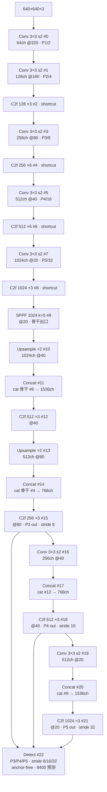
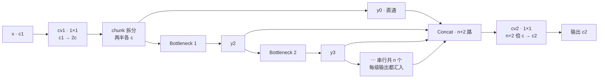
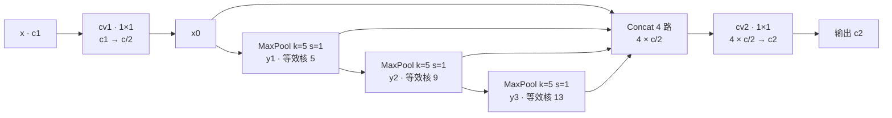
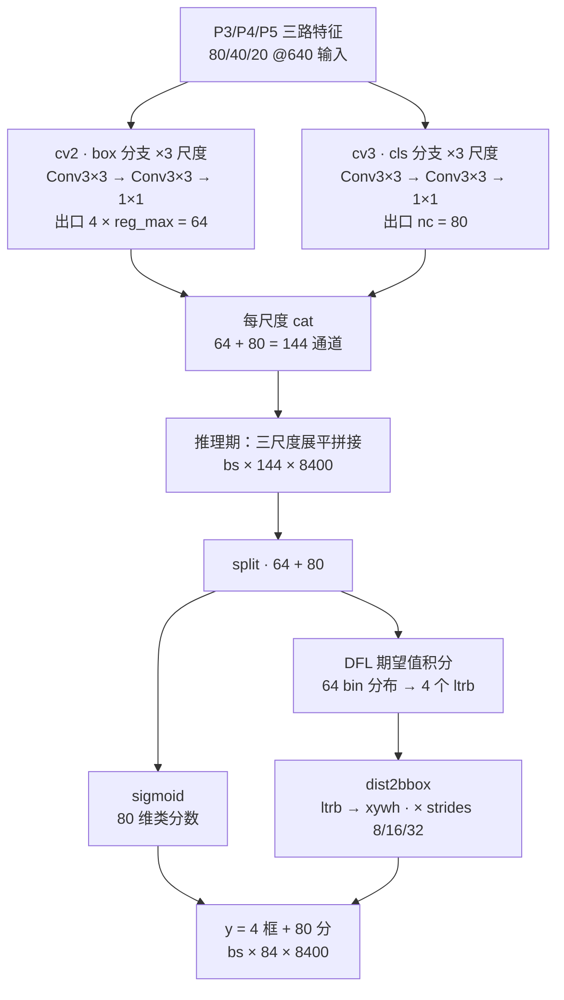

# YOLOv8 架构总览

> 以 `ultralytics/models/v8/yolov8.yaml`（C2f 骨干 + FPN+PAN 头 + anchor-free Detect）为例；层号 #0~#22 与 yaml 逐行对应，本页通道数为缩放前的基准值。配置原文见 <SrcLink file="v8:ultralytics/models/v8/yolov8.yaml" :line="1" :end="46" />，逐层明细见 [YOLOv8 逐层图解](/versions/v8/layers)。

> **读者路标**：C2f 是 v7 [ELAN](/glossary#elan-e-elan-高效层聚合) 梯度分流思想的模块化轻量版（对照 [v7 逐层图解](/versions/v7/layers)）；SPPF 是 v5 遗产；TAL 与 DFL 分别源自 TOOD 与 GFL——理论细节见 [TAL 任务对齐](/versions/v8/concepts#_3-tal-任务对齐标签分配-concept-tal) 与 [DFL 距离分布](/versions/v8/concepts#_4-dfl-距离分布框表示-concept-dfl)。

::: tip 只想带走三件事
1. **yaml 极简**：整张网络只有 **23 个顶层条目（#0~#22）**——骨干 10 条（Conv×5 + C2f×4 + SPPF×1）、头 13 条（Upsample×2 + Concat×4 + C2f×4 + Conv×2 + Detect×1），`parse_model` 按 `[from, repeats, module, args]` 四元组逐行实例化，n/s/m/l/x 五档共用同一份 yaml；
2. **数据流**：Conv s2 四级下采样 + [C2f](/versions/v8/concepts#_6-c2f-梯度分流结构-concept-c2f) 提特征 → SPPF 收尾 → [FPN](/glossary#fpn-特征金字塔) 自上而下 + [PANet](/glossary#panet-路径聚合网络) 自下而上 → [Detect](/versions/v8/concepts#_2-解耦检测头与无-objectness-设计-concept-decoupled-head)（P3/P4/P5）三头，**anchor-free（[anchor](/glossary#anchor-锚框-先验框) 点即网格中心）每格一个预测，stride 8/16/32 共 8400 个**（$80^2+40^2+20^2$，640 输入）；
3. **每预测 144 通道**：64 维 box 距离分布（4 边 × 16 bin，[DFL](/versions/v8/concepts#_4-dfl-距离分布框表示-concept-dfl) 期望值积分解码）+ 80 维类分数，**没有 objectness**——分类分数即置信度。
:::

## 1. 一眼看清：yolov8.yaml 全图

- 图中通道数为 yaml 声明的**基准宽度**；n/s/m/l/x 缩放规则见 §5，各档实际值见[逐层图解 §4](/versions/v8/layers)
- 骨干 C2f 显式传 `shortcut=True`（<SrcLink file="v8:ultralytics/models/v8/yolov8.yaml" :line="19" /> 的 `[128, True]`），头部 C2f 省略该参数、走签名默认 `False`——全 yaml 唯一一处同模块异配置
- FPN = #10~#15（Upsample + Concat 骨干 #6/#4），PAN = #16~#21（Conv s2 + Concat #12/#9）；三个出口 #15/#18/#21 **直接进 Detect，没有 v7 那样的 RepConv 收口**
- Concat 的输出通道 = 两路之和（#11 是 1024+512=1536），由 `parse_model` 自动累加（<SrcLink file="v8:ultralytics/nn/tasks.py" :line="515" :end="516" />）；`nn.Upsample` 不改通道（<SrcLink file="v8:ultralytics/nn/tasks.py" :line="521" :end="522" /> 的 else 分支）

## 2. C2f：split → n×Bottleneck → 全拼接

**白话**：C2f 把 cv1 的输出劈成两半——一半当快捷路，另一半串行过 n 个 Bottleneck；关键在**每一级的输出都汇入 Concat**（共 n+2 路），最后 cv2 一次性收拢。

- 对比 [C3](/glossary#c3)（v5~v7 主力）：C3 只有"主链末端 + 旁路" 3 路 concat；C2f 是 n+2 路——每级 Bottleneck 的梯度都有短路可抄，是 [CSP](/glossary#csp-跨阶段部分连接) 分流思想的 ELAN 化
- 对比 v7 ELAN：v7 手工摆 4/6 路 Conv 再"隔一取一"；C2f 模块化、n 可缩放——depth gain 直接作用在重复数上（<SrcLink file="v8:ultralytics/nn/tasks.py" :line="493" />、<SrcLink file="v8:ultralytics/nn/tasks.py" :line="501" :end="503" />）
- 隐藏通道 `c = int(c2 × 0.5)`；cv1 出 2c、**cv2 入 (2+n)×c**（<SrcLink file="v8:ultralytics/nn/modules/block.py" :line="176" />）——concat 路数随 n 增长，这是与 C3 最本质的构造差异
- forward：y 列表先装 chunk 的两半，再逐级 `extend` Bottleneck 输出，最后 `cat`（<SrcLink file="v8:ultralytics/nn/modules/block.py" :line="179" :end="183" />）；`forward_split`（L185-189）是把 chunk 换成 split 的 export 友好等价路径
- 内部 Bottleneck 用 `e=1.0`、两个 3×3、不再降维（<SrcLink file="v8:ultralytics/nn/modules/block.py" :line="271" :end="283" />）；骨干传 `shortcut=True` 时带残差，头部默认无残差

<SrcLink file="v8:ultralytics/nn/modules/block.py" :line="169" :end="189" />

## 3. SPPF：串行 3 次 MaxPool 等效 SPP 5/9/13

**白话**：[SPP](/glossary#spp-空间金字塔池化)（5/9/13）并联三个大核池化；SPPF 改成**串行 3 次 k=5**——第一次输出等效核 5、第二次 9、第三次 13，中间结果全部 concat，感受野一样、计算更省（官方注释原话 `equivalent to SPP(k=(5, 9, 13))`）。v7 头部入口用 SPPCSPC（真开三条并联池化 + CSP 旁路），v8 收敛回 v5 的 SPPF 并配 C2f；yolov8.yaml 只在 #9 用一次——骨干出口、PAN 顶点。

<SrcLink file="v8:ultralytics/nn/modules/block.py" :line="120" :end="135" /> <SrcLink file="v8:ultralytics/models/v8/yolov8.yaml" :line="26" />

## 4. Detect：anchor-free 解耦头，8400 × 144

**白话**：Detect 是 anchor-free 解耦头——

- **解耦双分支**：cv2 管框、cv3 管类，每尺度各一套 Conv3×3 ×2 + 1×1 出口（<SrcLink file="v8:ultralytics/nn/modules/head.py" :line="37" :end="40" />）；隐宽 `c2 = max(16, ch[0]//4, reg_max×4)`、`c3 = max(ch[0], nc)`（基准 256 通道输入时分别 64 与 256）。对比 v7 IDetect 的单支 1×1 一次出 255 通道，v8 的框和类互不干扰
- **无 anchor 张量、无 objectness**：`reg_max=16`、`no = nc + reg_max×4 = 144`（<SrcLink file="v8:ultralytics/nn/modules/head.py" :line="34" :end="35" />）；推理时 `make_anchors` 按 stride 生成**网格中心** anchor point（`grid_cell_offset=0.5`，head.py L51 调用、<SrcLink file="v8:ultralytics/yolo/utils/tal.py" :line="246" :end="258" /> 定义）——anchor 从 yaml 与模型里彻底消失
- **距离分布回归**：box 分支每边出 16 个 bin（共 64 维），DFL——权重锁死为 0..15 的 1×1 conv——积分出期望 ltrb（<SrcLink file="v8:ultralytics/nn/modules/block.py" :line="18" :end="36" />，GFL 论文方法、模块注释明示），再 `dist2bbox` 转 xywh、乘 stride 还原到原图像素（<SrcLink file="v8:ultralytics/nn/modules/head.py" :line="60" />、<SrcLink file="v8:ultralytics/yolo/utils/tal.py" :line="261" :end="270" />）
- **分类分数即置信度**：cls 分支 sigmoid 后直接当框的分用，NMS（[术语](/glossary#nms-非极大值抑制)）阶段不再乘 objectness——v5/v7 的 `no = nc+5+anchors` 公式作废
- **训练/推理双态**：训练直接返回三尺度 (bs, 144, H, W) 列表，交给 [TAL](/glossary#tal-task-alignment-learning) 分配与损失；推理才拼 8400×144、split、解码（<SrcLink file="v8:ultralytics/nn/modules/head.py" :line="48" :end="62" />）
- **先验 bias 初始化**：box 出口 bias 置 1.0、cls 出口按"每 640/s 格约 5 个目标"的先验置 `log(5/nc/(640/s)²)`——v5 传统（<SrcLink file="v8:ultralytics/nn/modules/head.py" :line="64" :end="71" />）；stride 由 DetectionModel 构建期用 256×256 假输入前向一次推算并顺带调 bias_init（<SrcLink file="v8:ultralytics/nn/tasks.py" :line="189" :end="197" />）

<SrcLink file="v8:ultralytics/nn/modules/head.py" :line="22" :end="71" />

## 5. scales 复合缩放：一份 yaml 五个型号

`parse_model` 读 `scales`（<SrcLink file="v8:ultralytics/nn/tasks.py" :line="467" :end="475" />）：depth 作用于重复数 n（L493），width 与 max_channels 作用于通道（L498，`make_divisible(min(c2, max_channels) × width, 8)`——**先夹 max 再乘 width**），C2f 家族把缩放后的 n 注入 args（L501-503）。这是 [compound scaling](/glossary#compound-scaling-复合缩放) 在 v8 的落法：不再像 v7 论文那样区分 computational block 与 transition 层，两个系数一把梭。

| scale | depth | width | max_channels | 效果速记 | yaml 注释 summary |
|-------|-------|-------|--------------|----------|--------------------|
| n | 0.33 | 0.25 | 1024 | C2f ×3→1、×6→2；通道 ÷4（末级 1024→256） | 225 层 / 3,157,200 参数 / 8.9 GFLOPs |
| s | 0.33 | 0.50 | 1024 | 重复同 n；通道 ÷2（末级 512） | 225 层 / 11,166,560 参数 / 28.8 GFLOPs |
| m | 0.67 | 0.75 | 768 | C2f ×3→2、×6→4；末级 min(1024,768)×0.75=576 | 295 层 / 25,902,640 参数 / 79.3 GFLOPs |
| l | 1.00 | 1.00 | 512 | 全深全宽；末级 1024 夹到 512 | 365 层 / 43,691,520 参数 / 165.7 GFLOPs |
| x | 1.00 | 1.25 | 512 | 全深；宽度 ×1.25（末级 512×1.25=640） | 365 层 / 68,229,648 参数 / 258.5 GFLOPs |

- 各档骨干通道（stem→末级）：n 16/32/64/128/256 · s 32/64/128/256/512 · m 48/96/192/384/576 · l 64/128/256/512/512 · x 80/160/320/640/640
- 层数跳档（225→295→365）来自 C2f 重复数随 depth 变化；GFLOPs/参数为 yaml 注释口径，与快照 README 表（8.7/28.6/78.9/165.2/257.8 GFLOPs）有微小出入——口径差异，详见[指标与测速口径](/versions/v8/painpoints#_7-指标与测速口径-pain-bench-caliber)
- 模型总装入口是 `DetectionModel`（<SrcLink file="v8:ultralytics/nn/tasks.py" :line="173" />）：`__init__` → `parse_model` → 构建期校准 stride/bias

<SrcLink file="v8:ultralytics/models/v8/yolov8.yaml" :line="6" :end="12" /> <SrcLink file="v8:ultralytics/nn/tasks.py" :line="462" :end="535" />（parse_model 全文）

## 延伸阅读

- [YOLOv8 逐层图解](/versions/v8/layers)
- [理论 Concept](/versions/v8/concepts)
- [损失函数详解](/versions/v8/losses)
- [yolov8.yaml 源码页](/versions/v8/source/yolov8-yaml)
- [v7 逐层图解（ELAN 对照）](/versions/v7/layers)
