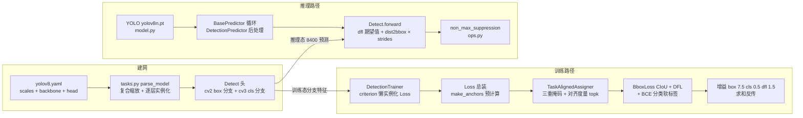

# YOLOv8 源码走读

本页沿 YOLOv8（Ultralytics 团队，2023-01；快照 v8.0.100 @ dce4efc）的两条主调用链走读源码：**训练链 `DetectionTrainer` → 损失总装 `Loss` → `make_anchors` 预计算 → `TaskAlignedAssigner` 分配 → `BboxLoss`（[CIoU](/glossary#ciou-loss) + [DFL](/glossary#dfl-distribution-focal-loss)）+ BCE 分类 → 反传**；**推理链 `YOLO('yolov8n.pt')` → predictor → `Detect.forward` 解码 → [NMS](/glossary#nms-非极大值抑制)**。所有行号均以站内快照 `source/yolov8/snapshot/`（v8.0.100）为准，可点击 SrcLink 跳转核对。单库多任务提示：同一快照里还有 segment / pose / classify 训练器，以及 tracker（ByteTrack/BOT-Sort）与 vit（RT-DETR/SAM）——YOLOv8 是产品线，`ultralytics/` 是单一代码库。

## 文件清单

| 文件 | 行数 | 功能 |
| --- | --- | --- |
| `ultralytics/models/v8/yolov8.yaml` | 46 | 模型结构配置：scales 五档 + backbone 层 0-9 + head 层 10-21，末行 Detect |
| `ultralytics/nn/tasks.py` | 639 | `DetectionModel` / `parse_model` 建网（YAML → nn） |
| `ultralytics/nn/modules/block.py` | 305 | DFL / SPPF / C2f / Bottleneck 等基础块 |
| `ultralytics/nn/modules/head.py` | 382 | Detect / Segment / Pose / Classify 头 |
| `ultralytics/yolo/utils/tal.py` | 276 | TaskAlignedAssigner 与 make_anchors / dist2bbox / bbox2dist |
| `ultralytics/yolo/utils/loss.py` | 75 | BboxLoss（CIoU + DFL）与 VarifocalLoss |
| `ultralytics/yolo/v8/detect/train.py` | 249 | DetectionTrainer 与检测损失总装类 `Loss` |
| `ultralytics/yolo/cfg/default.yaml` | 115 | 训练默认超参（增益 box 7.5 / cls 0.5 / dfl 1.5） |
| `ultralytics/yolo/engine/model.py` | 503 | `YOLO` 高层入口（load / predict） |
| `ultralytics/yolo/engine/predictor.py` | 345 | BasePredictor 推理循环（预处理 / 推理 / 后处理） |
| `ultralytics/yolo/v8/detect/predict.py` | 48 | DetectionPredictor：检测后处理（NMS） |
| `ultralytics/yolo/utils/ops.py` | 703 | non_max_suppression 等通用算子 |

## 调用链总览

## 训练路径：DetectionTrainer → Loss → TAL → BboxLoss → 反传

YOLOv8 只有一个训练入口（`ultralytics/yolo/v8/detect/train.py` 的 DetectionTrainer），没有 v7 式单头/双头两条链路；多任务靠继承分叉——segment 的 SegLoss（<SrcLink file="v8:ultralytics/yolo/v8/segment/train.py" :line="61" :end="62" />）与 pose 的 PoseLoss（<SrcLink file="v8:ultralytics/yolo/v8/pose/train.py" :line="74" :end="75" />）都继承同一个 `Loss` 基类，在三分量 box/cls/dfl 之外各加自己的损失项。

### 1. `ultralytics/models/v8/yolov8.yaml` — 模块堆叠即结构

配置头给出 `nc: 80`（L5）与 scales 五档（L6-12）：`[depth, width, max_channels]`，n 档 `[0.33, 0.25, 1024]` 到 x 档 `[1.00, 1.25, 512]`，n 档注释即官方 summary：225 层、3,157,200 参数、8.9 GFLOPs：

<SrcLink file="v8:ultralytics/models/v8/yolov8.yaml" :line="5" :end="12" />

backbone（层 0-9，L17-26）：两层 stride-2 Conv → C2f(128, True)（True 即 shortcut）→ Conv → C2f(256)×6 → Conv → C2f(512)×6 → Conv → C2f(1024)×3 → SPPF(1024, 5)；head（L30-46）：Upsample+Concat(P4) → C2f(512)，Upsample+Concat(P3) → C2f(256) @15，Conv s2+Concat → C2f(512) @18，Conv s2+Concat → C2f(1024) @21；末行 L46 `[15, 18, 21], 1, Detect, [nc]` 宣告 P3/P4/P5 三头检测：

<SrcLink file="v8:ultralytics/models/v8/yolov8.yaml" :line="46" :end="46" />

### 2. `ultralytics/nn/tasks.py` — parse_model 建网

`DetectionModel`（L173）在 `__init__` 里调 `parse_model` 完成建网（L185）：

<SrcLink file="v8:ultralytics/nn/tasks.py" :line="173" :end="186" />

`parse_model`（<SrcLink file="v8:ultralytics/nn/tasks.py" :line="462" :end="535" />）的核心步骤：

- L468-475 读 `scales`，按传入的 `scale` 取出 `depth, width, max_channels` 三元组（scales 复合缩放）：
  <SrcLink file="v8:ultralytics/nn/tasks.py" :line="467" :end="475" />
- L493 重复数缩放 `n = max(round(n * depth), 1)`；L498 通道缩放 `c2 = make_divisible(min(c2, max_channels) * width, 8)`；
- L501-503 C2f 系模块把缩放后的重复数塞进 args（`args.insert(2, n); n = 1`）：
  <SrcLink file="v8:ultralytics/nn/tasks.py" :line="501" :end="503" />
- L517-518 Detect/Segment/Pose 头收集各来源通道 `args.append([ch[x] for x in f])`；L524 实例化模块，L530 记录 savelist，L535 `return nn.Sequential(*layers), sorted(save)`。

### 3. `ultralytics/yolo/v8/detect/train.py` — DetectionTrainer 骨架

DetectionTrainer（L22）继承 BaseTrainer，只覆写任务相关钩子：`build_dataset`（L24）→ `build_yolo_dataset`、`get_dataloader`（L35）、`preprocess_batch`（L67，图像 /255）、`set_model_attributes`（L72，挂 nc/names/args）；`get_model`（L82-87）返回 DetectionModel；损失挂载在 `criterion`（L94-98）——首次调用时才实例化 `Loss(de_parallel(self.model))`（L97）：

<SrcLink file="v8:ultralytics/yolo/v8/detect/train.py" :line="94" :end="98" />

`get_validator`（L89-92）顺带声明 `loss_names = 'box_loss', 'cls_loss', 'dfl_loss'`（L91）——训练日志里的三个损失条目就是它们。

### 4. Loss 总装 — 三分量损失（train.py L137-230）

检测损失总装类在快照里就叫 `Loss`（L138；后世改名 v8DetectionLoss，见 [痛点 3](/versions/v8/painpoints#_3-命名漂移-loss-类与-v8detectionloss-pain-loss-naming)）。`__init__`（L140-158）里三件套：`bce = nn.BCEWithLogitsLoss(reduction='none')`（L146）、分配器 `TaskAlignedAssigner(topk=10, num_classes=self.nc, alpha=0.5, beta=6.0)`（L156）、回归损失 `BboxLoss(m.reg_max - 1, use_dfl=self.use_dfl)`（L157）。

`__call__`（L186-230）从预测到反传的完整闭环：

- L188 `loss = torch.zeros(3)` —— box / cls / dfl 三分量；L190-191 把三尺度特征 cat 成 `(b, h*w, no)` 再 split 成 `pred_distri`（reg_max×4=64 通道）与 `pred_scores`（nc 通道）；
- L199 调 `make_anchors(feats, self.stride, 0.5)` 预计算 anchor_points 与 stride_tensor：
  <SrcLink file="v8:ultralytics/yolo/v8/detect/train.py" :line="186" :end="199" />
- L202-205 targets 拼接（batch_idx + cls + bboxes）→ `preprocess` → `gt_labels, gt_bboxes, mask_gt`；L208 `bbox_decode`（L177-184）：预测分布 softmax 后对 proj 向量 0..15 做期望值积分，再 `dist2bbox` 还原预测框：
  <SrcLink file="v8:ultralytics/yolo/v8/detect/train.py" :line="208" :end="212" />
- L210-212 调分配器：传入的是 `pred_scores.detach().sigmoid()` 与 `pred_bboxes.detach()`——分配在 detach 与 `@torch.no_grad` 下进行，topk/argmax 这些离散操作不进梯度图；
- L216-218 分类损失：L217 是被注释掉的 varifocal_loss（[VFL](/glossary#varifocalloss-vfl) 留档），上位的是 BCE——`loss[1] = self.bce(pred_scores, target_scores).sum() / target_scores_sum`，目标是软标签；
- L221-224 `fg_mask` 非空时调 `self.bbox_loss(...)` 同时得 `loss[0]`（CIoU）与 `loss[2]`（DFL）；
- L226-228 乘增益 `self.hyp.box / hyp.cls / hyp.dfl`，L230 `return loss.sum() * batch_size, loss.detach()`：
  <SrcLink file="v8:ultralytics/yolo/v8/detect/train.py" :line="226" :end="230" />

### 5. 预计算与分配 — TaskAlignedAssigner（tal.py）

`make_anchors`（<SrcLink file="v8:ultralytics/yolo/utils/tal.py" :line="246" :end="258" />）：对每个 stride 层生成网格，`sx/sy = arange + grid_cell_offset`，偏移 0.5 表示 **anchor_points 取格子中心**（不是左上角）；返回拼好的 `anchor_points` 与 `stride_tensor`。没有 anchor 张量、没有先验框形状——这就是 anchor-free 在代码里的样子。

`TaskAlignedAssigner`（<SrcLink file="v8:ultralytics/yolo/utils/tal.py" :line="56" :end="79" />）类默认 `topk=13, alpha=1.0`（L71），检测训练实际传 topk=10 / alpha=0.5 / beta=6.0（见上节 L156）。`forward`（L82-126，`@torch.no_grad`）的分配流水线：

- `get_pos_mask`（<SrcLink file="v8:ultralytics/yolo/utils/tal.py" :line="128" :end="139" />）：三重掩码相乘 `mask_pos = mask_topk * mask_in_gts * mask_gt`（L137）——中心落在 GT 框内 × 对齐度量 topk × 有效 GT 掩码；
- `get_box_metrics`（L141-160）：overlaps 用 CIoU（L157），对齐度量 `align_metric = bbox_scores.pow(alpha) * overlaps.pow(beta)`（L159）——[TAL](/glossary#tal-task-alignment-learning) 的核心：分类准的还必须定位准：
  <SrcLink file="v8:ultralytics/yolo/utils/tal.py" :line="157" :end="159" />
- `select_topk_candidates`（L162-196）按 topk 取候选；冲突消解 `select_highest_overlaps`（<SrcLink file="v8:ultralytics/yolo/utils/tal.py" :line="28" :end="53" />）——一个 anchor 被多个 GT 争抢时归 IoU 最高者；
- 归一化（<SrcLink file="v8:ultralytics/yolo/utils/tal.py" :line="120" :end="124" />）：`target_scores = target_scores * norm_align_metric`——软标签：one-hot 乘上对齐度量归一值，同一份 target_scores 既当分类目标又当回归权重；
- 反向变换 `bbox2dist`（<SrcLink file="v8:ultralytics/yolo/utils/tal.py" :line="273" :end="276" />）：GT 框转 ltrb 距离并 clamp 到 `reg_max - 0.01`，供 DFL 当回归目标。

### 6. BboxLoss — CIoU + DFL（loss.py）与 BCE 分类

`BboxLoss`（<SrcLink file="v8:ultralytics/yolo/utils/loss.py" :line="27" :end="49" />）的 forward：

- L37 `weight = target_scores.sum(-1)[fg_mask]`——软标签求和当回归权重，对齐得好的正样本话语权大；
- L38-39 `iou = bbox_iou(..., CIoU=True)`，`loss_iou = ((1.0 - iou) * weight).sum() / target_scores_sum`；
- L43-45 DFL：`target_ltrb = bbox2dist(...)` 后调 `_df_loss`。

`_df_loss`（<SrcLink file="v8:ultralytics/yolo/utils/loss.py" :line="51" :end="60" />，L54 注释明示出自 Generalized Focal Loss）：`tl = target.long()`、`tr = tl + 1`、`wl = tr - target`、`wr = 1 - wl`——只打在真值两侧最近的两个 bin 上，线性加权交叉熵，让离散分布的期望值逼近目标距离。

分类分支不在 loss.py：BCE 调用点在 train.py L218，VFL 注释留档在 L217；VarifocalLoss 类本体存在于 <SrcLink file="v8:ultralytics/yolo/utils/loss.py" :line="11" :end="24" />，但检测线未使用。

### 7. 反传 — 增益与默认超参

三分量各乘增益（train.py L226-228）后求和反传，增益的源头在 default.yaml：`box: 7.5`（L87）、`cls: 0.5`（L88）、`dfl: 1.5`（L89）；同一文件还固化了优化器 SGD（L23）、lr0=0.01 / lrf=0.01（L80-81）、close_mosaic 默认 0（L30）：

<SrcLink file="v8:ultralytics/yolo/cfg/default.yaml" :line="87" :end="89" />

box 增益 7.5 是 v3 以来"坐标项数值天然小"传统的延续；dfl 1.5 说明 DFL 在 v8 不再是可选开关（v6 的布尔开关问题收束），而是与 CIoU 并列的默认回归损失。

## 推理路径：YOLO → predictor → Detect 解码 → NMS

### 8. `YOLO('yolov8n.pt')` — 高层入口（model.py）

`YOLO` 类（<SrcLink file="v8:ultralytics/yolo/engine/model.py" :line="32" :end="32" />）是全库统一入口：`__init__`（L72）默认 `model='yolov8n.pt'`；L100-107 按后缀分流——`.yaml` 走 `_new`（L126，从配置建新模型），`.pt` 走 `_load`（L146，加载权重）：

<SrcLink file="v8:ultralytics/yolo/engine/model.py" :line="100" :end="107" />

`__call__`（L109）是 `predict` 的别名；`predict`（<SrcLink file="v8:ultralytics/yolo/engine/model.py" :line="221" :end="249" />）里两处细节：L241 默认 `overrides['conf'] = 0.25`；L247-249 首次调用时 `self.predictor = TASK_MAP[self.task][3](overrides=..., _callbacks=...)`——按任务从 task_map 分派 predictor（detect → DetectionPredictor）。任务推断来自加载时的模型头类型，用户不需要显式指定。

### 9. `Detect.forward` — anchor-free 解码（head.py）

`Detect`（<SrcLink file="v8:ultralytics/nn/modules/head.py" :line="22" :end="41" />）的初始化：`self.reg_max = 16`（L34）、`self.no = nc + self.reg_max * 4`（L35）——对比 v5/v7 的 `no = nc + 5 + anchors`，objectness 分支取消；cv2 是 box 分支（出口 4×reg_max=64 通道），cv3 是 cls 分支（出口 nc 通道）（L37-40）；`self.dfl = DFL(self.reg_max)`（L41）。

`forward`（<SrcLink file="v8:ultralytics/nn/modules/head.py" :line="43" :end="62" />）是训练图与推理图的分叉点：

- L46-47 每尺度 `cat((cv2(x), cv3(x)), 1)`；**L48-49 训练态直接 `return x`**——训练时损失自己去做 DFL 期望值与分配，头不负责解码；
- 推理态：L51 `make_anchors(x, self.stride, 0.5)` 现场重建网格中心；L54-59 `x_cat` 后 `split((self.reg_max * 4, self.nc), 1)`；
- **L60 解码核心**：`dbox = dist2bbox(self.dfl(box), self.anchors, xywh=True) * self.strides`——DFL 模块（<SrcLink file="v8:ultralytics/nn/modules/block.py" :line="18" :end="35" />，softmax 后对固定 proj 0..15 求期望）把 64 通道分布积分成 4 个 ltrb 距离，`dist2bbox` 以网格中心为原点还原框，再乘 stride 回到像素坐标：
  <SrcLink file="v8:ultralytics/nn/modules/head.py" :line="60" :end="60" />
- L61 `y = torch.cat((dbox, cls.sigmoid()), 1)`——分类分数即框置信度，没有 objectness。

640 输入下三尺度 80×80 + 40×40 + 20×20 = **8400 预测 = 6400 + 1600 + 400**（stride 8/16/32），后处理按 conf=0.25 筛完再 NMS。

### 10. NMS — non_max_suppression（ops.py）

BasePredictor 循环（`ultralytics/yolo/engine/predictor.py`）把预处理 → 推理 → 后处理串起来；检测的后处理在 DetectionPredictor.postprocess（<SrcLink file="v8:ultralytics/yolo/v8/detect/predict.py" :line="12" :end="19" />）——L14 一行调 `ops.non_max_suppression(preds, self.args.conf, self.args.iou, agnostic=..., max_det=..., classes=...)`。

`non_max_suppression`（<SrcLink file="v8:ultralytics/yolo/utils/ops.py" :line="133" :end="146" />）默认 `conf_thres=0.25`、`iou_thres=0.45`、`max_det=300`：置信度过滤 → 按类（或 agnostic）做 torchvision.ops.nms → 输出每图 `(x1, y1, x2, y2, conf, cls)` 的 `(n, 6)` 张量。回到 postprocess：L25 `scale_boxes` 把框映射回原图尺寸，L28 包装成 `Results` 返回。

## 阅读路线建议

1. **先看结构配置**：`yolov8.yaml` 通读一遍（46 行），对照 scales 五档与 L46 的 `Detect([15, 18, 21])`，理解"模块堆叠即网络"。
2. **再看建网**：`tasks.py` 的 `parse_model`（L462 起），弄清 depth/width/max_channels 三旋钮怎么把一份 yaml 变成 n/s/m/l/x 五个模型。
3. **读头**：`head.py` 的 `Detect`（L22-62），重点看 L48 训练/推理分叉与 L60 的 DFL 期望值解码；配套读 `block.py` 的 `C2f`（L169-189，n+2 路 concat 梯度分流）与 `SPPF`（L120-135）。
4. **读训练闭环**：`train.py` 的 `Loss.__call__`（L186-230）从头到尾追一遍，再进 `tal.py` 的分配流水线（L82-126）与 `loss.py` 的 `BboxLoss`（L27-49）。
5. **读推理闭环**：`model.py` 的 `predict`（L221-249）→ `head.py` `Detect.forward`（L43-62）→ `ops.py` NMS（L133 起），对照调用链总览图走一遍。
6. **对照公式**：三分量损失的数学形式与梯度推导见损失页与反向传播页；本页负责"代码在哪一行"，那边负责"为什么是这个式子"。

## 延伸阅读

- [YOLOv8 损失函数](/versions/v8/losses) — box/cls/dfl 三分量的公式与软标签机制
- [YOLOv8 核心概念](/versions/v8/concepts) — TAL / DFL / C2f / 解耦头的概念版
- [YOLOv8 层结构](/versions/v8/layers) — yaml 逐层表与 n/s/m/l/x 五档对照
- [YOLOv8 痛点追踪](/versions/v8/painpoints) — 命名漂移、布局漂移与证据边界
- [YOLOv7 源码走读](/versions/v7/code-walkthrough) — 上一版的调用链对照（anchor-based 双入口）
- [术语表](/glossary) — TAL、DFL、NMS、CIoU 等术语索引
