# YOLOv8 理论 Concept

::: tip 只想带走三件事
1. **anchor-free 归一**：没有 anchor 张量，网格中心（+0.5 偏移）即预测点，回归 ltrb 四条距离的分布，8400 个预测 = 6400 + 1600 + 400；
2. **TAL + 软标签一条龙**：对齐度量 s^α·u^β 挑正样本，归一化后直接当分类目标与回归权重——分类与定位从此共用一个目标；
3. **以代码为论文**：TAL 源自 TOOD、DFL 源自 GFL、实现参考 PPYOLOE，快照里连论文引用都写在 docstring 中——v8 是产品线，不是论文。
:::

## 1. anchor-free 网格中心预测 (`concept-anchor-free`)

**定义**：v8 的 Detect 头里没有 [anchor](/glossary#anchor-锚框-先验框) 张量——每个输出特征图的格子中心（坐标加 0.5 偏移）就是一个预测点，网络直接回归「预测点到框四条边的距离 ltrb」。

**动机**：anchor 带来三重负担：k-means 聚类超参、按宽高比匹配的正样本规则、anchor 形状与数据分布的耦合。v6 已验证 anchor-free 可行，v8 把它定为全系列默认，回归从「相对模板的偏移」简化为「相对网格中心的距离」。

**实现**：`make_anchors` 用 `arange + grid_cell_offset(0.5)` 生成每层网格中心并跨层拼接：

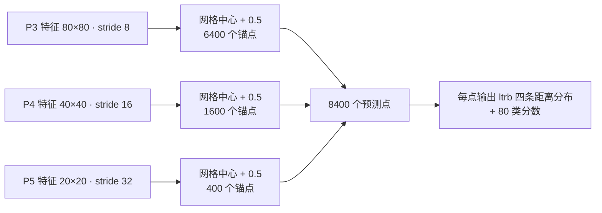

$$80^2 + 40^2 + 20^2 = 6400 + 1600 + 400 = 8400$$

解码两步走：DFL 期望值把 64 通道分布压成 4 个距离，`dist2bbox` 再以锚点为中心换算成框：

```python
sx = torch.arange(end=w, ...) + grid_cell_offset  # 网格 x 坐标整体 +0.5
...
x1y1 = anchor_points - lt                         # 距离 → 左上角
x2y2 = anchor_points + rb                         # 距离 → 右下角
```

<SrcLink file="v8:ultralytics/yolo/utils/tal.py" :line="246" :end="258" />
<SrcLink file="v8:ultralytics/yolo/utils/tal.py" :line="261" :end="270" />
<SrcLink file="v8:ultralytics/nn/modules/head.py" :line="60" />

- 推理态里 `make_anchors(x, self.stride, 0.5)` 与 `dist2bbox(...) * self.strides` 就发生在 Detect.forward（head.py:51、head.py:60），640 输入固定产出 8400 行预测

**与上版差异**：v7 每格预挂 3 组 anchors、回归宽高相对模板的缩放；v6 是 anchor-free 但 ltrb 是单值回归；v8 的「网格中心 + 距离分布」把 FCOS 式中心点与 GFL 式分布表示合成一套，并从此不再回头。

> v6 读者路标：v6 的 EffiDeHead 已经 anchor-free 回归 ltrb；v8 做的是把「预测点定在网格中心 +0.5、距离用分布表示」这套更完整的方案推广到全系列。

## 2. 解耦检测头与无 objectness 设计 (`concept-decoupled-head`)

**定义**：分类与回归各自一条独立卷积栈（cv3 / cv2），输出 concat；每个锚点的输出通道数 `no = nc + reg_max × 4 = 80 + 64 = 144`，其中没有任何 objectness 通道——分类分数 sigmoid 之后直接当框的置信度。

**动机**：TOOD 的核心观察是分类与定位两个任务偏好的特征不同，耦合头互相牵制；objectness 在 anchor-free 时代是冗余监督——「这里有没有物体」已由「分类分多高 + 框回得多准」共同回答，单独一条 obj 通道纯属重复计费。

**实现**：

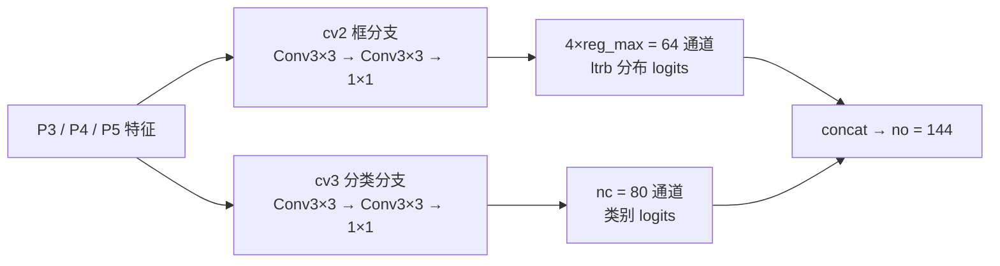

```python
self.reg_max = 16                                 # DFL 通道数
self.no = nc + self.reg_max * 4                   # 80 + 64 = 144，没有 +5
self.cv2 = ... nn.Conv2d(c2, 4 * self.reg_max, 1) # 框分支出口 64
self.cv3 = ... nn.Conv2d(c3, self.nc, 1)          # 分类分支出口 80
```

<SrcLink file="v8:ultralytics/nn/modules/head.py" :line="22" :end="41" />

- 训练态直接返回两分支 concat（head.py:48-49）；推理态 split 后各自解码，`cls.sigmoid()` 就是置信度（head.py:59-61）
- Segment / Pose 头继承 Detect 再挂自己的 cv4 分支（head.py:74、head.py:100）——一套解耦底座服务多任务

**与上版差异**：v5/v7 的耦合头是 `no = nc + 5 + anchors`（xywh + obj + 类，再乘每格 anchor 数）；v6 已删 objectness；v8 把「解耦 + 无 objectness + DFL 出口」固化成 Detect 标准形态，外加 v5 传统的先验 bias 初始化（head.py:64-71）。

> v6 读者路标：v6 的 EffiDeHead 首次解耦并砍掉 objectness；v8 延续同一形态，把回归出口改成 4×reg_max 的分布通道，让 DFL 无缝内建（见词条 4）。

## 3. TAL 任务对齐标签分配 (`concept-tal`)

**定义**：以对齐度量 \(t = s^{\alpha} \cdot u^{\beta}\)（s 为分类分数、u 为 [CIoU](/glossary#ciou-loss)）为唯一排序标准选正样本：「GT 框内的中心点 × 每 GT top-k × 有效 GT 掩码」三重掩码取交集；一个锚点被多个 GT 争抢时 [IoU](/glossary#iou-交并比) 最高者胜。

**动机**：分类排序与定位排序天然不一致——分类分最高的预测可能框得很歪。若只按类别分数挑正样本，等于奖励「说得响但框得烂」的预测；把两个分数乘在一起当排名，逼着分类头与回归头朝同一个方向使劲。

**实现**：

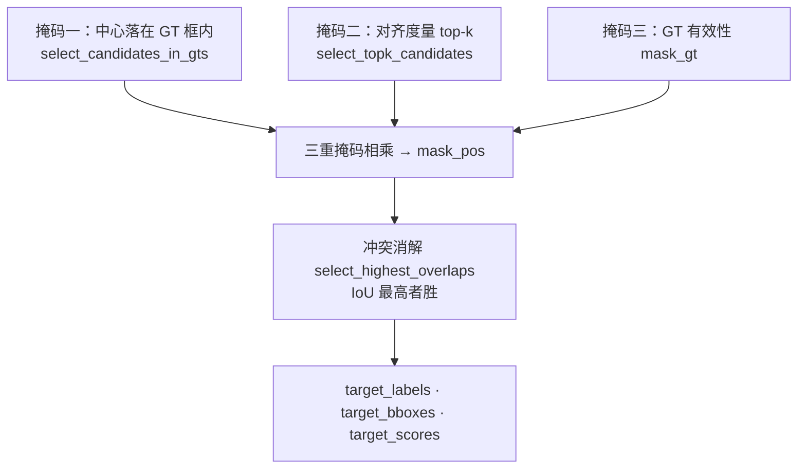

- 对齐度量一行写完：`align_metric = bbox_scores.pow(self.alpha) * overlaps.pow(self.beta)`（tal.py:159），其中 overlaps 是 clamp 到 0-1 的 CIoU（tal.py:157）
- 检测训练的实例化参数：`TaskAlignedAssigner(topk=10, num_classes=self.nc, alpha=0.5, beta=6.0)`（train.py:156）；类默认是 topk=13（tal.py:72）

<SrcLink file="v8:ultralytics/yolo/utils/tal.py" :line="57" :end="81" />
<SrcLink file="v8:ultralytics/yolo/utils/tal.py" :line="129" :end="139" />
<SrcLink file="v8:ultralytics/yolo/utils/tal.py" :line="29" />
<SrcLink file="v8:ultralytics/yolo/v8/detect/train.py" :line="156" />

**与上版差异**：v5 是静态宽高比匹配；v7 用 SimOTA 的动态 k 与 cost 排序（见 [SimOTA](/glossary#simota)）；v8 回到固定 topk，但排序标准换成「分类 × 定位」联合度量——正样本必须双优，且 β=6 让 IoU 权重远大于分类分（α=0.5）。

> v6 读者路标：v6 的 TAL 源码在 [tal_assigner.py 源码页](/versions/v6/source/tal-assigner-py) 已逐行走读过；v8 快照的 tal.py 与它几乎逐行同构，docstring 里直接注明参考 PPYOLOE 实现（tal.py:86），类默认 topk=13 不变，检测训练改用 topk=10、alpha=0.5。

## 4. DFL 距离分布框表示 (`concept-dfl`)

**定义**：每条边到锚点的距离不再回归成 1 个数，而是 reg_max=16 个离散 bin 上的概率分布——期望值即距离；训练损失只打在真值落点两侧相邻的两个 bin 上（线性加权交叉熵），这正是 Generalized Focal Loss 提出的 [DFL](/glossary#dfl-distribution-focal-loss)。

**动机**：真实标注的框边界常是模糊的（遮挡、截断、标注抖动）。单值回归假装「边界是确定的」；分布表示能说出「大概在这、可能偏一点」——模糊边界学出平缓分布，清晰边界学出尖锐分布，不确定性被显式建模。

**实现**：

$$\hat{d} = \sum_{i=0}^{15} i \cdot p_i, \qquad L_{\text{DFL}} = w_l \cdot \mathrm{CE}(z,\ t_l) + w_r \cdot \mathrm{CE}(z,\ t_r)$$

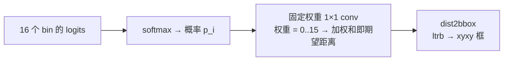

```python
self.conv = nn.Conv2d(c1, 1, 1, bias=False).requires_grad_(False)  # 权重固定不训练
x = torch.arange(c1, dtype=torch.float)
self.conv.weight.data[:] = nn.Parameter(x.view(1, c1, 1, 1))       # 0,1,...,15
```

<SrcLink file="v8:ultralytics/nn/modules/block.py" :line="18" :end="36" />
<SrcLink file="v8:ultralytics/yolo/utils/loss.py" :line="52" :end="60" />

- DFL 类 docstring 明写 "Proposed in Generalized Focal Loss"（block.py:21）；`_df_loss` 注释再次引用同一论文（loss.py:54）
- 训练侧的同款解码在 `bbox_decode`：softmax 后对 `proj = arange(16)` 求期望（train.py:177-184）；GT 反向转分布用 `bbox2dist`（tal.py:273）

**与上版差异**：v6 引入 DFL 但主要服务于框回归自蒸馏、默认不开；v8 把 DFL 内建成默认——4 条边 × 16 bin 固定占 64 通道，是 `no=144` 的主要构成（见词条 2）。

> v6 读者路标：v6 文档写过「标准训练默认不开 DFL」；v8 反过来了——reg_max ≤ 1（即不开 DFL）才是例外。

## 5. CIoU 与三分量损失加权 (`concept-loss-weights`)

**定义**：总损失 = 7.5·box + 0.5·cls + 1.5·dfl。box 是 1−[CIoU](/glossary#ciou-loss) 按软标签加权；cls 是 BCE（目标是软标签，见词条 9）；dfl 是双 bin 交叉熵；三项都除以 `target_scores_sum` 归一。

**动机**：三分量各管一件事——定位准、类别对、分布锐，7.5:0.5:1.5 的比例是「定位主导」的工业默认。没有 objectness 项可调，超参空间比 v5/v7 还小：损失设计本身不是 v8 的卖点，TAL 分配才是。

**实现**：

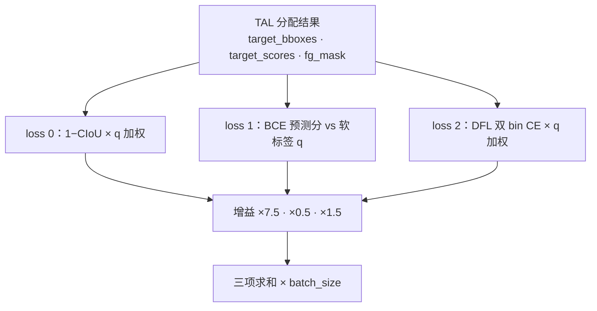

```python
loss = torch.zeros(3, device=self.device)  # box, cls, dfl
...
loss[0] *= self.hyp.box   # 7.5
loss[1] *= self.hyp.cls   # 0.5
loss[2] *= self.hyp.dfl   # 1.5
```

<SrcLink file="v8:ultralytics/yolo/v8/detect/train.py" :line="186" :end="230" />
<SrcLink file="v8:ultralytics/yolo/utils/loss.py" :line="35" :end="49" />

- `loss = torch.zeros(3)` 在 train.py:188；三项增益乘法在 train.py:226-228；增益定义在 default.yaml:87-89（box 7.5 / cls 0.5 / dfl 1.5）
- BboxLoss 里 `weight = target_scores.sum(-1)[fg_mask]`（loss.py:37）——软标签同时充当回归权重
- 分类用的 BCEWithLogits 留有一行被注释的 VFL 写法存档（train.py:217-218），检测主路径不用它

**与上版差异**：v7 是「CIoU + obj BCE + cls BCE」三件套，外加逐层 balance [4.0, 1.0, 0.4]；v8 无 obj 项、无逐层 balance，三分量固定增益一把梭，代码里 `loss = zeros(3)` 的三个槽位就是全部损失。

> v6 读者路标：v6 用 GIoU + VarifocalLoss + DFL 且无 obj；v8 与 v6 的差别是框损失换回 CIoU、分类换回 BCE、DFL 转正——这组组合在后世被叫作 v8DetectionLoss（快照里类名就叫 Loss）。

## 6. C2f 梯度分流结构 (`concept-c2f`)

**定义**：CSP 瓶颈的「全拼接」版：cv1 出 2c 通道 chunk 成两半，一半串 n 个 [Bottleneck](/glossary#c3)（3×3 + 3×3），每个 Bottleneck 的输出连同两半全部 concat（共 n+2 路），cv2 以 (2+n)·c 的入通道收拢。

**动机**：ELAN 的结论是梯度路径多样性主导 concat 型网络的可扩展性。C3 只有两路（瓶颈栈输出 + 直通），堆深后路径同质化；C2f 把每个中间层都引出来参与 concat——梯度高速路多 n 条，却不扩通道、不分组卷积，参数几乎不涨。

**实现**（n=2 为例）：

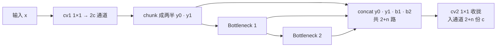

```python
self.cv2 = Conv((2 + n) * self.c, c2, 1)   # 入通道随 n 线性增长
def forward(self, x):
    y = list(self.cv1(x).chunk(2, 1))
    y.extend(m(y[-1]) for m in self.m)     # 每个 Bottleneck 输出都进列表
    return self.cv2(torch.cat(y, 1))
```

<SrcLink file="v8:ultralytics/nn/modules/block.py" :line="169" :end="189" />
<SrcLink file="v8:ultralytics/nn/modules/block.py" :line="272" :end="284" />

- cv2 入通道 (2+n)·c 在 block.py:176；forward 的 extend+cat 在 block.py:179-183；导出用等价的 forward_split（block.py:185-189）
- yaml 里 backbone 的 C2f 带 `[..., True]` 开 shortcut，head 的 C2f 默认 False（yolov8.yaml:19-25 对比 yolov8.yaml:32-44）

**与上版差异**：v5/v7 的 C3 是 2 路 concat；v7 的 E-ELAN 用 expand/shuffle/merge 三板斧扩基数；C2f 是「n+2 路全拼接」的极简版——骨干与颈部所有积木从 C3 换成 C2f，是 v8 结构层最大的一次换代。

> v7 读者路标：v7 的 E-ELAN（见 [v7 tricks §1](/versions/v7/tricks#_1-e-elan-扩展高效层聚合-trick-eelan)）靠扩通道 + 分组卷积堆路径多样性；C2f 只用「中间层全引出来」这一招，是同一思想的轻量落地。

## 7. SPPF 串行池化 (`concept-sppf`)

**定义**：只用一个 5×5 MaxPool 串行池 3 次，把原始特征与三次池化结果 concat（4 路）——数学上等价于 SPP(5,9,13) 的三路并联。

**动机**：SPP(5,9,13) 需要三个不同 kernel 的池化器；而两次 5×5 same-padding maxpool 的感受野等于 9×9、三次等于 13×13，且 max 运算可叠加——于是三个池化器退化成同一个池化器跑三遍，计算与显存都省，输出等价。

**实现**：

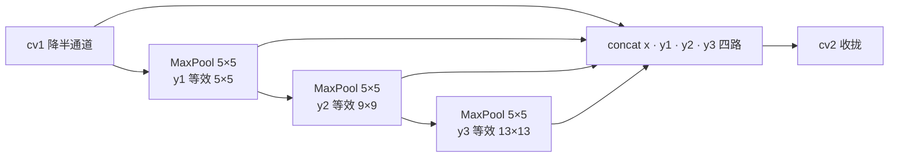

```python
y1 = self.m(x)
y2 = self.m(y1)
return self.cv2(torch.cat((x, y1, y2, self.m(y2)), 1))
```

<SrcLink file="v8:ultralytics/nn/modules/block.py" :line="120" :end="135" />

- 构造串 docstring 明写 `equivalent to SPP(k=(5, 9, 13))`（block.py:123）；v8 骨干尾部固定 `[-1, 1, SPPF, [1024, 5]]`（yolov8.yaml:26）
- [SPP](/glossary#spp-空间金字塔池化) 的等价性来自 same padding：池化不改特征图尺寸，串几次都还能和原特征 concat

**与上版差异**：SPPF 本是 v5 的发明、v6 又简化出 SimSPPF；v8 原样沿用 SPPF——它是 v8 骨干里少数「不是新东西」的部件，位置与 v5 完全一致（最后一个卷积块之后、neck 之前）。

> v7 读者路标：v7 把 SPP 塞进 SPPCSPC 大块里；v8 把它拆回独立的轻量 SPPF，骨干尾部一个块就完事。

## 8. FPN 与 PAN 多尺度聚合 (`concept-fpn-pan`)

**定义**：head 段 12 层（层 10-21）是最朴素的双向结构：先自顶向下（Upsample + Concat 骨干 P4/P3 → C2f），再自底向上（Conv s2 + Concat → C2f），层 15 / 18 / 21 三个尺度并排喂给 Detect。

**动机**：[FPN](/glossary#fpn-特征金字塔) 把深层语义送往浅层（小物体借语义），[PANet](/glossary#panet-路径聚合网络) 再把浅层定位信息送回深层（大物体借精确定位）——三个尺度各取所需，[NMS](/glossary#nms-非极大值抑制) 前的每一路都有合适的感受野。

**实现**：

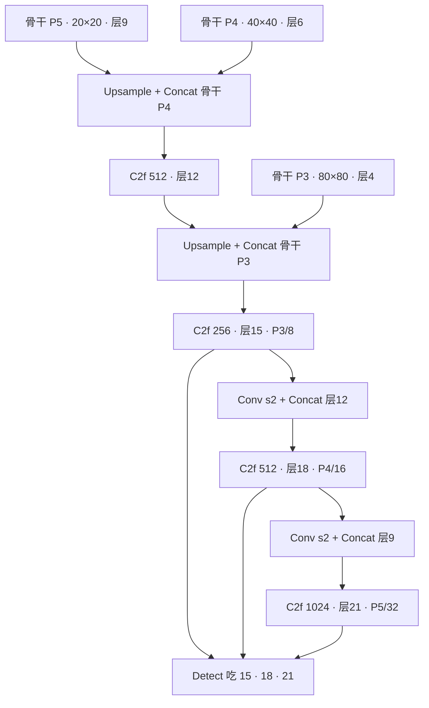

<SrcLink file="v8:ultralytics/models/v8/yolov8.yaml" :line="29" :end="46" />

- head 段 18 行里 Concat 只出现 4 次（yolov8.yaml:31、35、39、43），from 全是显式层号，没有 route 类间接寻址
- 三个检测尺度对应 stride 8/16/32，与词条 1 的 8400 = 6400 + 1600 + 400 一一对应

**与上版差异**：v7 的 neck 是 ELAN 式 6 路 Concat + 3 个 RepConv 收口；v8 回归 v5 式标准 FPN+PAN 形态——花样全部移进 C2f 块内部，neck 本身更好裁剪、更好导出。

> v7 读者路标：v7 neck 的卖点是梯度路径多样性；v8 neck 的卖点是「没有卖点」——拓扑回到最朴素的双向金字塔，复杂度被 C2f 封装（见词条 6）。

## 9. 软标签 target_scores (`concept-soft-label`)

**定义**：正样本的分类目标不是 [one-hot](/glossary#one-hot) 的 1，而是归一化后的对齐度量 q（数值上 ≈ 该预测的 CIoU，上限 1）——「这个正样本有多正」被写进目标本身。

**动机**：硬标签 1 对 IoU 0.3 的粗糙正样本一视同仁，分类分支被迫把烂框也推向高置信度；软标签让「框回得越准的正样本」分类目标越高，分类与定位在目标层面就对齐——这是 TAL 的后半句，也是词条 8 与词条 3 能共用一份张量的原因。

**实现**：

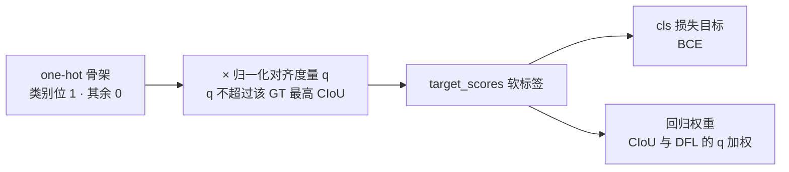

```python
align_metric *= mask_pos                                        # 只留正样本
pos_align_metrics = align_metric.amax(axis=-1, keepdim=True)    # 每 GT 最强对齐度
pos_overlaps = (overlaps * mask_pos).amax(axis=-1, keepdim=True) # 每 GT 最高 IoU
norm_align_metric = (align_metric * pos_overlaps / (pos_align_metrics + self.eps)).amax(-2).unsqueeze(-1)
target_scores = target_scores * norm_align_metric               # one-hot × 软权重
```

<SrcLink file="v8:ultralytics/yolo/utils/tal.py" :line="120" :end="125" />

- one-hot 骨架由 get_targets 的 scatter 先铺好（tal.py:235-238），软权重是 forward 里最后一趟乘法
- 这份 target_scores 一份两用：cls 损失的目标（train.py:218）与 BboxLoss 的 weight（loss.py:37）

**与上版差异**：v6 的 TAL 已有同款归一化；v5/v7 的分类目标是硬 1（v7 只把 obj 目标按 gr 与 IoU 混合）；v8 把「分类目标 ≈ IoU」写死在默认分配器里，训练管线里没有任何开关能关掉它。

> v6 读者路标：v6 论文里这叫 soft label 与 quality-aware；v8 没有论文可引，tal.py:120-125 这 6 行就是全部出处。

## 10. close_mosaic 末期关闭增广 (`concept-close-mosaic`)

**定义**：训练最后 N 个 epoch 关掉 [Mosaic](/glossary#mosaic-增强) 拼图增广；配置项 `close_mosaic` 默认 0（即不关），官方 CLI 示例常取 10。

**动机**：四图拼接后的训练分布与真实推理分布差异不小，全程开到收尾会让精度在末期抖动；末期切回单图分布，让模型「考前回归课本」。这一经验由 YOLOX 带火，v8 把它做进了默认配置体系，成为一键开关。

**实现**：

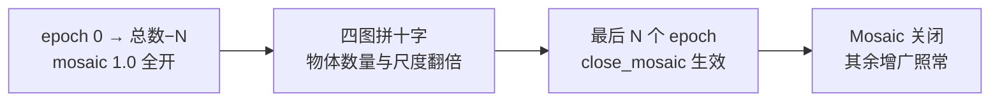

<SrcLink file="v8:ultralytics/yolo/cfg/default.yaml" :line="30" />
<SrcLink file="v8:ultralytics/yolo/data/augment.py" :line="116" :end="138" />

- `close_mosaic: 0  # (int) disable mosaic augmentation for final epochs`（default.yaml:30）；`mosaic: 1.0`（default.yaml:104）
- Mosaic 类支持 4 图（2×2，border 取半图）与 9 图（3×3，border 取整图）两种网格（augment.py:130-137），v8 默认数据管线用 4 图

**与上版差异**：v1-v7 快照的训练管线里 Mosaic 要么全程开、要么写死在脚本里，没有「末期关闭」这个旋钮；v8 起它成为一键配置，也是「训练技巧配置化」叙事的缩影（见 [数据增强 / jitter](/glossary#数据增强-jitter) 词条的演进）。

> v6 读者路标：v6 的增广开关写在 Python dict 里；v8 的 close_mosaic 回到 [yaml 驱动架构](/glossary#yaml-驱动架构)，一个数字控制最后一个增广的生死。

## 11. 复合缩放 scales (`concept-compound-scaling`)

**定义**：每档 scale 是 `[depth, width, max_channels]` 三元组：depth 缩 C2f 的重复次数 n、width 缩所有卷积通道、max_channels 给大通道数封顶（m/l/x 为 768/512/512）。n/s/m/l/x 五档共用同一份 yolov8.yaml，只换三元组。

**动机**：一份 yaml 服务全系列是运维刚需；max_channels 是 v8 的新增项——P5 的 1024 通道在小模型上纯浪费（算力换不来精度），封顶后 m/l/x 的骨干尾部通道预算被压回 768/512，参数量与 GFLOPs 的档距才拉得开。

**实现**：

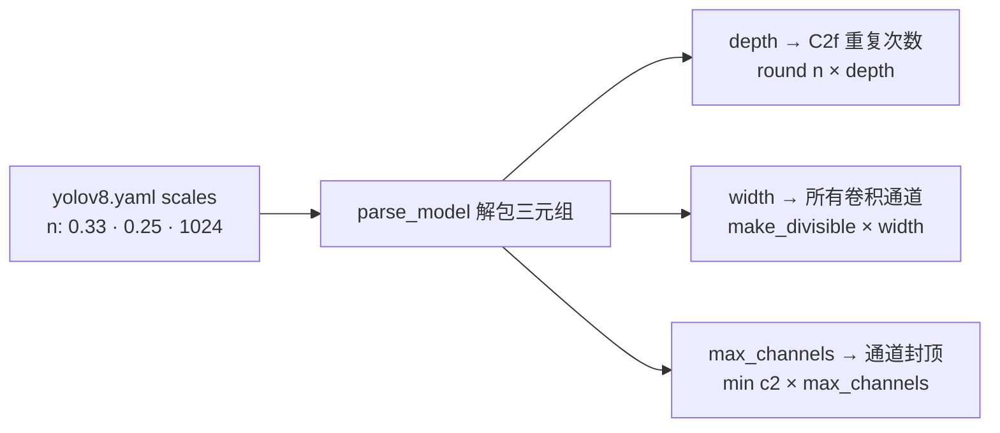

| scale | depth | width | max_channels | 参数量 | GFLOPs | mAP50-95 |
|---|---|---|---|---|---|---|
| n | 0.33 | 0.25 | 1024 | 3.2M | 8.7 | 37.3 |
| s | 0.33 | 0.50 | 1024 | 11.2M | 28.6 | 44.9 |
| m | 0.67 | 0.75 | 768 | 25.9M | 78.9 | 50.2 |
| l | 1.00 | 1.00 | 512 | 43.7M | 165.2 | 52.9 |
| x | 1.00 | 1.25 | 512 | 68.2M | 257.8 | 53.9 |

（指标为快照 README 口径：COCO val2017、单模型单尺度；yaml 内注释的 GFLOPs 略异——n 8.9 / s 28.8 / m 79.3 / l 165.7 / x 258.5，属两处统计口径差异。）

```python
depth, width, max_channels = scales[scale]               # 解包三元组
n = max(round(n * depth), 1) if n > 1 else n             # 重复次数
c2 = make_divisible(min(c2, max_channels) * width, 8)    # 通道
```

<SrcLink file="v8:ultralytics/models/v8/yolov8.yaml" :line="6" :end="12" />
<SrcLink file="v8:ultralytics/nn/tasks.py" :line="467" :end="475" />
<SrcLink file="v8:ultralytics/nn/tasks.py" :line="493" />
<SrcLink file="v8:ultralytics/nn/tasks.py" :line="498" />

- C2f 重复数 n 的注入点在 tasks.py:501-503（`args.insert(2, n)`），注入后 n 置 1 避免 Sequential 重复展开

**与上版差异**：v7 的 compound scaling 是论文规则——concat 型网络 depth/width 必须联动缩放（消融 +1.2 AP）；v8 退回工程简化：depth/width 两个自由系数 + max_channels 封顶，不再论证「复合」约束（对照 [compound scaling](/glossary#compound-scaling-复合缩放) 词条的 v7 版叙事）。

> v7 读者路标：v7 论证了「concat 型网络必须联动缩放」；v8 换成三元组查表——理论让位于可运维性，这是产品化路线的典型取舍。

## 12. 以代码为论文的工程叙事 (`concept-code-as-paper`)

**定义**：v8 没有论文。TAL 来自 TOOD、DFL 来自 GFL、实现参考 PPYOLOE，出处全写在源码 docstring 与官方文档里；「YOLOv8」是产品线名而非独立仓库，代码住在单一代码库 ultralytics/ultralytics，许可证从 v5 的 GPL-3.0 收紧为 AGPL-3.0 加商业双授权。

**动机**：论文评审周期以年计，而检测器的迭代以月计；把「设计动机 + 消融」搬进文档站与 release notes，可以让改进随代码同日发布。代价是学术锚点从 DOI 变成 commit hash——本站快照锚定 v8.0.100 @ dce4efc，就是这个体系里的「引用格式」。

**实现**（技术血脉）：

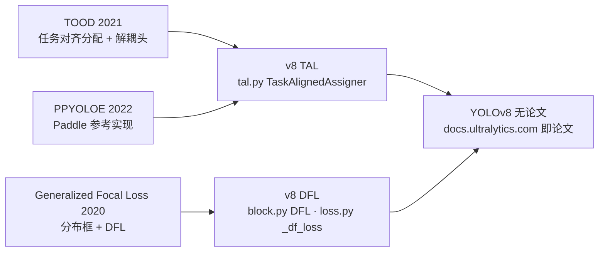

- 快照内的原文佐证有三处：
  - tal.py forward docstring："Reference https://github.com/Nioolek/PPYOLOE_pytorch/blob/master/ppyoloe/assigner/tal_assigner.py"（tal.py:86）
  - DFL 类 docstring："Proposed in Generalized Focal Loss https://ieeexplore.ieee.org/document/9792391"（block.py:21）
  - `_df_loss` 注释再次引用同一 GFL 论文（loss.py:54）
- README 不含论文引用、口径指向官方文档；快照根还有 tracker / vit / engine——单库同时装着检测、分割、姿态、分类与 RT-DETR、SAM

<SrcLink file="v8:ultralytics/yolo/utils/tal.py" :line="83" :end="87" />
<SrcLink file="v8:ultralytics/nn/modules/block.py" :line="18" :end="22" />
<SrcLink file="v8:ultralytics/yolo/utils/loss.py" :line="52" :end="60" />

**与上版差异**：v1-v7 每个版本都能指着论文里的 Table 消融说话；v8 的「消融」是 release notes 与文档页，学术血脉只能靠代码考古还原——本页 12 条 Concept 的每一条出处，最终都落在某一行 SrcLink 上。

> v6 读者路标：读 v6 时还能拿论文公式与 [tal_assigner.py 源码页](/versions/v6/source/tal-assigner-py) 逐条对照；读 v8 请把「论文 §x.y」的期待换成「哪个文件哪一行」——这正是本页的读法。

## 延伸阅读

- [损失函数详解](/versions/v8/losses)
- [反向传播推导](/versions/v8/loss-gradient)
- [v7 理论 Concept（对比）](/versions/v7/concepts)
- [术语表](/glossary)
