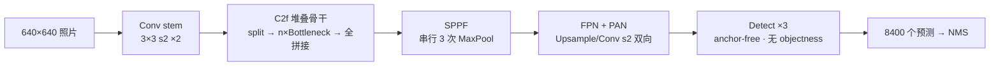
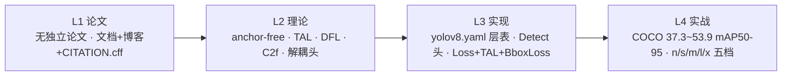
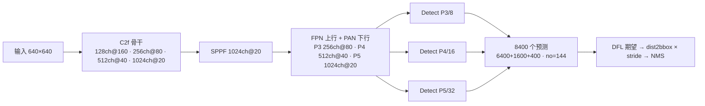
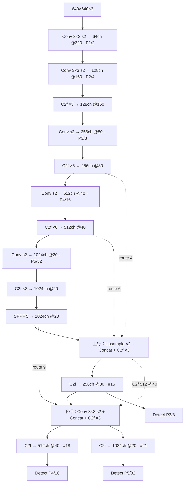

# YOLOv8 (2023-01)

**Ultralytics 工业级旗舰——anchor-free、TAL、DFL 与解耦头的"出厂默认"归一之作**

- 📄 论文：**无独立论文**——官方口径 [docs.ultralytics.com](https://docs.ultralytics.com) + 发布博客（详见[论文精读：以代码为论文](/versions/v8/paper)）
- 🏛️ 作者：Ultralytics（Glenn Jocher、Ayush Chaurasia、Jing Qiu）等团队
- 💻 源码：[ultralytics/ultralytics](https://github.com/ultralytics/ultralytics)（快照取自 tag `v8.0.100` @ `dce4efc`，2023-08）
- 🎯 里程碑：**anchor-free + TAL + DFL + 解耦头的工业级归一**——v6/v7 时代"anchor 用不用"的路线之争就此收官，"怎么写一个 YOLO"从此有了默认答案

## 3 分钟电梯演讲

1. **无论文的产品线旗舰**：v8 不再是"论文 + 独立仓库"，而是 ultralytics 单一代码库的持续发版——YOLOv8 是产品名不是仓库名，设计动机散落在官方文档、发布博客与 issue 里，引用走 `CITATION.cff` 软件引用。
2. **anchor-free 归一**：Detect 头里没有 anchor 张量，[anchor](/glossary#anchor-锚框-先验框) 退化为网格中心点（`make_anchors` 的 `grid_cell_offset=0.5`），回归的是框边到中心的 ltrb 距离分布；**没有 objectness 分支**，每位置输出 `no = nc + reg_max*4`，分类分数即框置信度；640 输入出 8400 个预测（6400+1600+400，stride 8/16/32）。
3. **TAL + DFL 从"可选开关"变"出厂默认"**：[TAL](/glossary#tal-task-alignment-learning)（topk=10、α=0.5、β=6.0）统一分类-定位对齐，[DFL](/glossary#dfl-distribution-focal-loss)（reg_max=16）内建进检测头，损失三分量 box/cls/dfl = 7.5/0.5/1.5 写死在 default.yaml；许可证从 v5/v7 的 GPL-3.0 转向 AGPL-3.0 商业双轨。

> 已读过 [v7](/versions/v7/index)？本页下方有 v7→v8 逐项差异表；TAL 的上一次登场在 [v6](/versions/v6/losses)，ELAN 的来龙去脉见 [v7 论文精读](/versions/v7/paper)；术语不熟先查[术语表](/glossary)。

## 四层闭环视图

## 核心贡献

1. **C2f（split → n×Bottleneck → 全拼接）**：取代 C3——cv1 出 2c 通道劈两半，一半逐级过 n 个 Bottleneck，**每级输出全部进 concat**（n+2 路），梯度旁路比 C3 多 n 条；v7 ELAN 的"多路梯度高速"思想以更轻的 CSP 形态落地<SrcLink file="v8:ultralytics/nn/modules/block.py" :line="169" :end="189" />
2. **anchor-free 解耦检测头，无 objectness**：cv2 是 box 分支（出口 4×reg_max=64 通道回归分布）、cv3 是 cls 分支（出口 nc 类分数），`self.no = nc + self.reg_max * 4`——对比 v5/v7 的 `nc+5+anchors`，objectness 通道整个消失<SrcLink file="v8:ultralytics/nn/modules/head.py" :line="22" :end="71" />
3. **TAL 任务对齐标签分配出厂即用**：对齐度量 = 分类分数^α × CIoU^β，检测训练实例化 topk=10、alpha=0.5、beta=6.0；正样本 = in_gt × topk × mask_gt 三重掩码，冲突由 `select_highest_overlaps` 按 IoU 最高裁决，target_scores 按度量归一化成软标签<SrcLink file="v8:ultralytics/yolo/utils/tal.py" :line="57" :end="81" />
4. **损失总装三分量 box/cls/dfl**：`loss = torch.zeros(3)` 起步——cls 用 BCEWithLogits 吃 target_scores 软标签（VFL 写法留了注释没启用）、box/dfl 委托 BboxLoss，最后按 hyp 增益 7.5/0.5/1.5 加权<SrcLink file="v8:ultralytics/yolo/v8/detect/train.py" :line="138" :end="230" />
5. **BboxLoss：CIoU + DFL，按 target_scores 加权**：回归损失 `(1−CIoU) × weight`、DFL 是真值两侧 bin 的线性加权交叉熵，`weight = target_scores.sum(-1)`——软标签一份数据同时当分类目标与回归权重<SrcLink file="v8:ultralytics/yolo/utils/loss.py" :line="26" :end="59" />

## 推理效果一览

::: figure 图：v8 推理流水线——C2f 骨干四级输出，SPPF + FPN/PAN 双向聚合出 P3/P4/P5 三尺度，Detect 每位置出 64 维回归分布 + 80 类分数，DFL 期望值积分 + dist2bbox 解码，8400 个预测经 NMS 收口

:::

## 关键指标

**检测（COCO val2017，单模型单尺度，README 表口径；延迟为 CPU ONNX 与 A100 TensorRT 两种环境）**

| 模型 | mAPval 50-95 | CPU ONNX ms | A100 TRT ms | 参数量 M | FLOPs B |
|------|--------------------------|-------------|-------------|----------|---------|
| YOLOv8n | 37.3 | 80.4 | 0.99 | 3.2 | 8.7 |
| YOLOv8s | 44.9 | 128.4 | 1.20 | 11.2 | 28.6 |
| YOLOv8m | 50.2 | 234.7 | 1.83 | 25.9 | 78.9 |
| YOLOv8l | 52.9 | 375.2 | 2.39 | 43.7 | 165.2 |
| YOLOv8x | 53.9 | 479.1 | 3.53 | 68.2 | 257.8 |

- 口径提醒：README 表给的是 **CPU ONNX** 与 **A100 TRT** 两列延迟，与 v7 论文的 V100 FPS、v6 的 T4 TRT fp16 **均不可直接比**；AP 是 val2017 口径，也不是 v7 的 test-dev
- 任务线：detect / segment / pose / classify 同库四开（同一代码库还带 RT-DETR、SAM 与 ByteTrack/BOT-Sort 跟踪器——单库多任务）

## 网络架构

- 结构由 **scales 五档 + yaml 层表**驱动：<SrcLink file="v8:ultralytics/models/v8/yolov8.yaml" :line="5" :end="12" />（nc=80，n 档 depth 0.33 / width 0.25 / max_channels 1024），骨干层 0-9 <SrcLink file="v8:ultralytics/models/v8/yolov8.yaml" :line="15" :end="26" />、head 层 10-21 <SrcLink file="v8:ultralytics/models/v8/yolov8.yaml" :line="29" :end="46" />
- 骨干 4 个 C2f（重复 3/6/6/3）全部 `shortcut=True`；head 4 个 C2f（重复 3/3/3/3）走默认 `shortcut=False`——同一模块，骨干带残差、head 不带<SrcLink file="v8:ultralytics/nn/modules/block.py" :line="172" :end="177" />
- 重复数 n 由 parse_model 注入构造参数（`args.insert(2, n)`），depth 缩放 `n = max(round(n × depth), 1)` 在此生效<SrcLink file="v8:ultralytics/nn/tasks.py" :line="461" :end="534" />
- 三头 stride 8/16/32、anchor-free：每位置 144 维输出（4×16 回归分布 + 80 类分数），$(80^2+40^2+20^2) = 8400$ 个预测；Detect 从三尺度特征收 `[15, 18, 21]`<SrcLink file="v8:ultralytics/nn/modules/head.py" :line="30" :end="41" />
- n 档复合缩放后全模型 225 层、3,157,200 参数、8.9 GFLOPs（yaml 注释口径）——scales 三参数换五档模型，见 [compound scaling](/glossary#compound-scaling-复合缩放)

## 核心 Concept 一览

| Concept | 一句话 | 对应代码位置 |
|---------|--------|-------------|
| [anchor-free 网格中心预测](/versions/v8/concepts#_1-anchor-free-网格中心预测-concept-anchor-free) | anchor_points=网格中心 0.5 偏移，回归 ltrb 距离 | <SrcLink file="v8:ultralytics/yolo/utils/tal.py" :line="246" :end="258" /> |
| [解耦检测头与无 objectness](/versions/v8/concepts#_2-解耦检测头与无-objectness-设计-concept-decoupled-head) | cv2 回归 / cv3 分类，no = nc + 64 | <SrcLink file="v8:ultralytics/nn/modules/head.py" :line="34" :end="40" /> |
| [TAL 任务对齐标签分配](/versions/v8/concepts#_3-tal-任务对齐标签分配-concept-tal) | 分数^α × CIoU^β 取 top-k 当正样本 | <SrcLink file="v8:ultralytics/yolo/utils/tal.py" :line="129" :end="160" /> |
| [DFL 距离分布框表示](/versions/v8/concepts#_4-dfl-距离分布框表示-concept-dfl) | 16 bins softmax × arange 期望值积分 | <SrcLink file="v8:ultralytics/nn/modules/block.py" :line="18" :end="36" /> |
| [CIoU 与三分量损失加权](/versions/v8/concepts#_5-ciou-与三分量损失加权-concept-loss-weights) | box 7.5 / cls 0.5 / dfl 1.5 | <SrcLink file="v8:ultralytics/yolo/cfg/default.yaml" :line="87" :end="89" /> |
| [C2f 梯度分流结构](/versions/v8/concepts#_6-c2f-梯度分流结构-concept-c2f) | split 后 n+2 路 concat，比 C3 多 n 条旁路 | <SrcLink file="v8:ultralytics/nn/modules/block.py" :line="179" :end="183" /> |
| [SPPF 串行池化](/versions/v8/concepts#_7-sppf-串行池化-concept-sppf) | 同一 MaxPool 串 3 次 ≈ SPP(5,9,13) | <SrcLink file="v8:ultralytics/nn/modules/block.py" :line="120" :end="135" /> |
| [FPN 与 PAN 多尺度聚合](/versions/v8/concepts#_8-fpn-与-pan-多尺度聚合-concept-fpn-pan) | 上行 Upsample+Concat，下行 Conv s2+Concat | <SrcLink file="v8:ultralytics/models/v8/yolov8.yaml" :line="29" :end="46" /> |
| [软标签 target_scores](/versions/v8/concepts#_9-软标签-target-scores-concept-soft-label) | 对齐度量归一化，兼分类目标与回归权重 | <SrcLink file="v8:ultralytics/yolo/utils/tal.py" :line="120" :end="125" /> |
| [close_mosaic 末期关闭增广](/versions/v8/concepts#_10-close-mosaic-末期关闭增广-concept-close-mosaic) | 最后 N epoch 把 mosaic/mixup/copy_paste 归零 | <SrcLink file="v8:ultralytics/yolo/data/dataset.py" :line="163" :end="168" /> |
| [复合缩放 scales](/versions/v8/concepts#_11-复合缩放-scales-concept-compound-scaling) | depth/width/max_channels 三参数五档 | <SrcLink file="v8:ultralytics/models/v8/yolov8.yaml" :line="6" :end="12" /> |
| [以代码为论文的工程叙事](/versions/v8/concepts#_12-以代码为论文的工程叙事-concept-code-as-paper) | 文档+博客+CITATION.cff 替代论文 | [CITATION.cff（GitHub 快照）](https://github.com/yejinlei/agent-yolo/blob/main/source/yolov8/snapshot/CITATION.cff) |

## v7 → v8 关键差异

| 维度 | YOLOv7（中央研究院，2022-07） | YOLOv8（Ultralytics，2023-01） |
|------|------------------------------|-------------------------------|
| 出品方 | 中央研究院 + v4 作者回归（学术界） | Ultralytics（工业界产品线） |
| 里程碑定位 | trainable bag-of-freebies | **anchor-free + TAL + DFL 的默认化归一** |
| Anchor | anchor-based，3 组 anchors | **anchor-free**：网格中心点 + ltrb 距离分布 |
| 检测头 | IDetect / IAuxDetect，有 objectness（no = nc+5） | 解耦 Detect，**无 objectness**（no = nc + 4×16） |
| 标签分配 | lead-head-guided 双头 coarse-to-fine | **TAL topk=10** 单头统一分配 |
| 回归损失 | CIoU | CIoU + **DFL**（reg_max=16 默认开启） |
| 分类损失 | BCEcls + BCEobj（obj 目标 `(1-gr)+gr·iou`） | BCE 吃**软标签**，obj 分支取消 |
| 骨干 | ELAN 堆叠（4 路 Concat） | **C2f**（split + n×Bottleneck + 全拼接） |
| Neck | SPPCSPC + PAN + 6 路 Concat ELAN | SPPF + FPN/PAN（Upsample / Conv s2 + Concat） |
| 重参数化 | planned re-param（RepConv 选位） | 不用重参数化（官方 yaml 只有 Conv/C2f/SPPF） |
| 配置文件 | yaml 层表，training/deploy 双份 | yaml + **scales 五档**，单库四任务 |
| 许可证 | GPL-3.0 | **AGPL-3.0**（开源 + 商业授权双轨） |
| 论文有无 | arXiv:2207.02696 | **无独立论文**（文档 + 博客 + CITATION.cff） |

## 暴露的痛点

| 痛点 | 严重度 | 后续解法 |
|------|--------|---------|
| 无正式论文：设计动机散落在文档/博客/issue，消融证据缺位 | High | 文档站持续维护 + CITATION.cff 固定引用口径 |
| AGPL-3.0 许可收紧：商用闭源需购买 Enterprise License | High | 开源/商业双轨授权 |
| 命名漂移：检测损失类就叫 `Loss`（后世文档称 v8DetectionLoss） | Low | 后续目录重构时明确命名 |
| 目录布局漂移：utils 在 `yolo/utils`、配置在 `yolo/cfg`，与后续顶层布局不一致 | Medium | 后续版本迁回 `ultralytics/utils` 顶层 |
| TAL 超参敏感：topk/alpha/beta 的取值直接左右分配质量 | Medium | 固化默认值并写进文档 |
| 版本 tag 缺口：v8.0.0~v8.0.4 只发 PyPI、未打 git tag | Low | 以 PyPI 版本号 + commit hash 为准 |
| 指标与测速口径：README 表 CPU ONNX 与 A100 TRT 双口径并存 | Medium | 表内标注环境，跨报告不直比 |
| anchor-free 路线收敛的证据边界：无论文级消融背书"为什么赢" | Medium | 以官方文档 + 第三方实测为准 |

详见[痛点追踪](/versions/v8/painpoints)。

## 深入阅读

- [论文精读（以代码为论文：时间线、学术血脉、引用口径）](/versions/v8/paper)
- [Architecture 逐层图解](/versions/v8/architecture)
- [理论 Concept](/versions/v8/concepts)
- [架构与层速查](/versions/v8/layers)
- [损失函数（box + cls + dfl 三分量与 TAL）](/versions/v8/losses)
- [反向传播推导](/versions/v8/loss-gradient)
- [训练技巧（工程化默认值）](/versions/v8/tricks)
- [源码走读](/versions/v8/code-walkthrough)
- [痛点追踪](/versions/v8/painpoints)
- [源码页：tasks.py](/versions/v8/source/tasks-py) · [block.py](/versions/v8/source/common-py) · [loss.py](/versions/v8/source/loss-py) · [yolov8.yaml](/versions/v8/source/yolov8-yaml)
- [系列家族对照](/global/family) · [术语表](/glossary)
