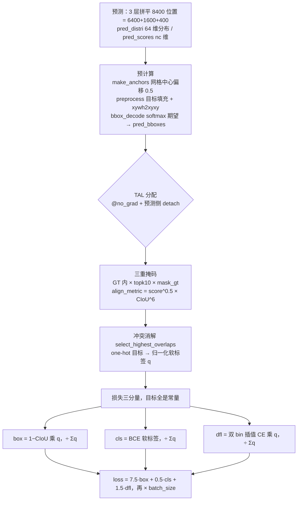
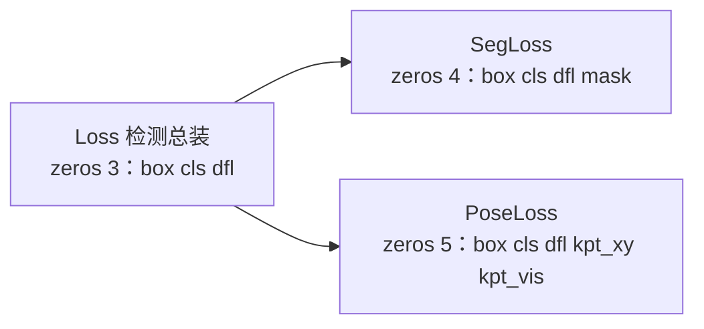

# YOLOv8 损失函数

::: tip 只想带走三件事
1. **损失只有三个分量**：`loss = [box, cls, dfl]`——CIoU 回归 + 软标签 BCE 分类 + DFL 分箱回归，各按增益 7.5 / 0.5 / 1.5 加权后 `× batch_size`；没有 objectness 分支，分类分数即框置信度；
2. **一份 `target_scores` 三处用**：既是分类的软标签目标，又按行求和充当 BboxLoss 的逐 anchor 回归权重，还以 `target_scores_sum` 的身份充当 box/cls/dfl 三项共同的归一化分母；
3. **分配与损失解耦**：TAL 在 `@torch.no_grad()` 里跑完、预测侧再 `detach`，产出 `target_bboxes / target_scores / fg_mask` 三件常量喂给损失；`VarifocalLoss` 注释留档未启用，`SegLoss` / `PoseLoss` 继承总装只追加自己的分量。
:::

## 全景图



## 1. 损失总装 box cls dfl 三分量 (`loss-core`)

```python
# ultralytics/yolo/v8/detect/train.py :: Loss.__call__ —— 总装流程（删节伪代码）
loss = torch.zeros(3, device=self.device)                            # box, cls, dfl
pred_distri, pred_scores = torch.cat(
    [xi.view(b, self.no, -1) for xi in feats], 2).split((self.reg_max * 4, self.nc), 1)
anchor_points, stride_tensor = make_anchors(feats, self.stride, 0.5)

# --- 预计算：目标标准化 ---
targets = torch.cat((batch['batch_idx'].view(-1, 1), batch['cls'].view(-1, 1), batch['bboxes']), 1)
targets = self.preprocess(targets, batch_size, scale_tensor=imgsz[[1, 0, 1, 0]])   # ×imgsz, xywh→xyxy
gt_labels, gt_bboxes = targets.split((1, 4), 2)
mask_gt = gt_bboxes.sum(2, keepdim=True).gt_(0)
pred_bboxes = self.bbox_decode(anchor_points, pred_distri)           # softmax 期望 → dist2bbox

# --- TAL 分配：预测侧 detach，产出的目标全是常量 ---
_, target_bboxes, target_scores, fg_mask, _ = self.assigner(
    pred_scores.detach().sigmoid(), (pred_bboxes.detach() * stride_tensor).type(gt_bboxes.dtype),
    anchor_points * stride_tensor, gt_labels, gt_bboxes, mask_gt)
target_scores_sum = max(target_scores.sum(), 1)                      # Σq，三项共同分母

# --- 三分量 ---
loss[1] = self.bce(pred_scores, target_scores.to(dtype)).sum() / target_scores_sum   # cls
if fg_mask.sum():
    target_bboxes /= stride_tensor                                   # 像素域 → feature 域
    loss[0], loss[2] = self.bbox_loss(pred_distri, pred_bboxes, anchor_points,
                                      target_bboxes, target_scores, target_scores_sum, fg_mask)

# --- 加权求和 ---
loss[0] *= self.hyp.box    # 7.5
loss[1] *= self.hyp.cls    # 0.5
loss[2] *= self.hyp.dfl    # 1.5
return loss.sum() * batch_size, loss.detach()
```

- **类名就叫 `Loss`**（后来社区称 v8DetectionLoss）：定义与总装全在 DetectionTrainer 同文件（<SrcLink file="v8:ultralytics/yolo/v8/detect/train.py" :line="137" :end="230" />）。`__init__` 备好三件套：`self.bce = nn.BCEWithLogitsLoss(reduction='none')`（<SrcLink file="v8:ultralytics/yolo/v8/detect/train.py" :line="146" />）、分配器 `TaskAlignedAssigner(topk=10, num_classes=self.nc, alpha=0.5, beta=6.0)`（<SrcLink file="v8:ultralytics/yolo/v8/detect/train.py" :line="156" />；类默认 topk=13 在 <SrcLink file="v8:ultralytics/yolo/utils/tal.py" :line="72" />）、`self.proj = torch.arange(m.reg_max)` 即 0..15（<SrcLink file="v8:ultralytics/yolo/v8/detect/train.py" :line="158" />）
- **预计算**：[make_anchors](/glossary#anchor-锚框-先验框) 以网格中心为 anchor point（`grid_cell_offset=0.5`，<SrcLink file="v8:ultralytics/yolo/utils/tal.py" :line="246" :end="258" />，调用在 <SrcLink file="v8:ultralytics/yolo/v8/detect/train.py" :line="199" />）；`preprocess` 按 `batch_idx` 把目标填充成 `(b, n_max, 5)` 并 `xywh2xyxy` 到像素域（<SrcLink file="v8:ultralytics/yolo/v8/detect/train.py" :line="160" :end="175" />）；`mask_gt` 标记有效 GT（<SrcLink file="v8:ultralytics/yolo/v8/detect/train.py" :line="205" />）；`bbox_decode` 把每位置 4×16 的分布 softmax 后对 proj 求期望、`dist2bbox` 得到 xyxy 预测框（<SrcLink file="v8:ultralytics/yolo/v8/detect/train.py" :line="177" :end="184" />）——anchor-free 解码，640 输入下 8400 = 6400+1600+400
- **分配即常量**：assigner 的预测侧输入全部 `detach()`（<SrcLink file="v8:ultralytics/yolo/v8/detect/train.py" :line="210" :end="212" />），产出的 `target_bboxes / target_scores / fg_mask` 不参与梯度——为什么与代价见 [TAL 分配的不可微边界](/versions/v8/loss-gradient#_5-tal-分配的不可微边界-grad-assign)
- **`target_scores_sum = max(target_scores.sum(), 1)`**（<SrcLink file="v8:ultralytics/yolo/v8/detect/train.py" :line="214" />）：三项共同的归一化分母，`max(..., 1)` 防空图除零
- **三分量各归其位**：cls 不依赖 `fg_mask`、全图位置都算（负样本也要学背景，<SrcLink file="v8:ultralytics/yolo/v8/detect/train.py" :line="216" :end="218" />）；box 与 dfl 只在 `fg_mask.sum()` 非零时算（<SrcLink file="v8:ultralytics/yolo/v8/detect/train.py" :line="221" :end="224" />），先 `target_bboxes /= stride_tensor` 把目标拉回 feature 域（<SrcLink file="v8:ultralytics/yolo/v8/detect/train.py" :line="222" />）
- **增益与汇总**：box 7.5 / cls 0.5 / dfl 1.5 来自 default.yaml（<SrcLink file="v8:ultralytics/yolo/cfg/default.yaml" :line="87" :end="89" />），最后 `loss.sum() * batch_size`、返回值 detach 供日志（<SrcLink file="v8:ultralytics/yolo/v8/detect/train.py" :line="226" :end="230" />）

> v7 读者路标：v7 的 `ComputeLossOTA` 把分配与三分量搅在同一个 `__call__` 里；v8 把分配拆成独立模块 [TaskAlignedAssigner](/glossary#tal-task-alignment-learning)（TAL），`Loss` 只做总装。旧版对照：[v7 损失函数](/versions/v7/losses)。

## 2. BboxLoss 与 CIoU (`loss-ciou`)

```python
weight = target_scores.sum(-1)[fg_mask]
iou = bbox_iou(pred_bboxes[fg_mask], target_bboxes[fg_mask], xywh=False, CIoU=True)
loss_iou = ((1.0 - iou) * weight).sum() / target_scores_sum
```

（<SrcLink file="v8:ultralytics/yolo/utils/loss.py" :line="35" :end="39" />；BboxLoss 类全文 <SrcLink file="v8:ultralytics/yolo/utils/loss.py" :line="27" :end="49" />）

- **bbox_iou 不定义在 loss.py**：`from .metrics import bbox_iou`（<SrcLink file="v8:ultralytics/yolo/utils/loss.py" :line="7" />），实现整段在 <SrcLink file="v8:ultralytics/yolo/utils/metrics.py" :line="75" :end="129" />
- **[CIoU loss](/glossary#ciou-loss) 定义**（[IoU](/glossary#iou-交并比) 系）：

$$\mathrm{CIoU} = \mathrm{IoU} - \frac{\rho^2}{c^2} - \alpha v, \qquad v = \frac{4}{\pi^2}\left(\arctan\frac{w_2}{h_2} - \arctan\frac{w_1}{h_1}\right)^2, \qquad \alpha = \frac{v}{v - \mathrm{IoU} + 1}$$

  $c^2$ 是最小包围框对角线平方、$\rho^2$ 是中心距（<SrcLink file="v8:ultralytics/yolo/utils/metrics.py" :line="118" :end="120" />）；$v$ 度量宽高比一致性，$\alpha$ 在 `torch.no_grad()` 下算出、只作常量权重（<SrcLink file="v8:ultralytics/yolo/utils/metrics.py" :line="122" :end="125" />）。调用时 box1=预测、box2=GT（`xywh=False, CIoU=True`）
- **weight 就是软标签质量 q**：`target_scores.sum(-1)` 把 nc 维质量压成每 anchor 一个标量——对齐得越好的正样本，回归损失话语权越大；这是 `target_scores` 三用之二
- **÷ target_scores_sum**：与 cls / dfl 同口径（<SrcLink file="v8:ultralytics/yolo/utils/loss.py" :line="39" />）
- **像素域匹配、feature 域回归**：assigner 吃 `pred_bboxes × stride_tensor`（<SrcLink file="v8:ultralytics/yolo/v8/detect/train.py" :line="211" />），损失计算前 `target_bboxes /= stride_tensor` 拉回（<SrcLink file="v8:ultralytics/yolo/v8/detect/train.py" :line="222" />）

> v6/v7 读者路标：v6 回归用 GIoU（增益 2.5）+ 可选 DFL，v7 用 CIoU 等权 `.mean()`；v8 回到 CIoU 但逐 anchor 乘 q。梯度推导见 [CIoU 的回归梯度](/versions/v8/loss-gradient#_2-ciou-的回归梯度-grad-ciou)。

## 3. DFL 损失的实现 (`loss-dfl`)

```python
tl = target.long()  # target left
tr = tl + 1  # target right
wl = tr - target  # weight left
wr = 1 - wl  # weight right
return (F.cross_entropy(pred_dist, tl.view(-1), reduction='none').view(tl.shape) * wl +
        F.cross_entropy(pred_dist, tr.view(-1), reduction='none').view(tl.shape) * wr).mean(-1, keepdim=True)
```

（<SrcLink file="v8:ultralytics/yolo/utils/loss.py" :line="51" :end="60" />；注释明示出处 Generalized Focal Loss，<SrcLink file="v8:ultralytics/yolo/utils/loss.py" :line="54" />）

- **[DFL](/glossary#dfl-distribution-focal-loss)（Distribution Focal Loss）的输入**：`pred_dist[fg_mask].view(-1, self.reg_max + 1)`（<SrcLink file="v8:ultralytics/yolo/utils/loss.py" :line="44" />）——`BboxLoss(m.reg_max - 1)` 传入 15（<SrcLink file="v8:ultralytics/yolo/v8/detect/train.py" :line="157" />），view 成 `(正样本数×4, 16)`，每行是一条 ltrb 边的 16 bin logit；target 来自 `bbox2dist(..., 15)` 且 `clamp(0, 14.99)`（<SrcLink file="v8:ultralytics/yolo/utils/tal.py" :line="273" :end="276" />）→ `tl ≤ 14 < 15`，插值恒有定义
- **双 bin 插值 CE**：目标距离 t 落在相邻整数 bin $[t_l, t_r]$ 之间，用 $w_l + w_r = 1$ 对两个 bin 的 [softmax](/glossary#softmax) 交叉熵做线性插值——既给了「分布」自由度，又只钉两根针、不监督整个分布
- **与解码互为镜像**：推理侧 `bbox_decode` 用 softmax 期望 $\sum_k k\,p_k$ 积分出距离（<SrcLink file="v8:ultralytics/yolo/v8/detect/train.py" :line="181" />）；训练侧 DFL 把分布质量往 $t_l / t_r$ 两个 bin 上押
- **聚合链**：`.mean(-1)` 对 ltrb 四条边平均（<SrcLink file="v8:ultralytics/yolo/utils/loss.py" :line="60" />）→ × q（<SrcLink file="v8:ultralytics/yolo/utils/loss.py" :line="44" />）→ ÷ Σq（<SrcLink file="v8:ultralytics/yolo/utils/loss.py" :line="45" />）
- 梯度与最优解：[DFL 的期望值梯度](/versions/v8/loss-gradient#_3-dfl-的期望值梯度-grad-dfl)；Concept 图解：[DFL 距离分布框表示](/versions/v8/concepts#_4-dfl-距离分布框表示-concept-dfl)

## 4. 分类 BCE 与软标签 (`loss-cls`)

```python
# loss[1] = self.varifocal_loss(pred_scores, target_scores, target_labels) / target_scores_sum  # VFL way
loss[1] = self.bce(pred_scores, target_scores.to(dtype)).sum() / target_scores_sum  # BCE
```

（<SrcLink file="v8:ultralytics/yolo/v8/detect/train.py" :line="216" :end="218" />；`self.bce` 定义 <SrcLink file="v8:ultralytics/yolo/v8/detect/train.py" :line="146" />）

- **目标是软标签**：`target_scores = q · one-hot`——one-hot 由 TAL scatter 产出、再乘归一化质量 q（<SrcLink file="v8:ultralytics/yolo/utils/tal.py" :line="120" :end="125" />），正类通道目标 $q \in (0, 1]$、其余通道 0
- **全 8400 位置都进 BCE**：负位置目标 0、梯度为压制方向——分类一支兼任「是不是物体」，这是无 objectness 设计的直接后果（cls 计算不带 `fg_mask` 条件，<SrcLink file="v8:ultralytics/yolo/v8/detect/train.py" :line="216" :end="218" />）
- **÷Σq 归一**：`max(target_scores.sum(), 1)`（<SrcLink file="v8:ultralytics/yolo/v8/detect/train.py" :line="214" />）
- **没有 pos_weight、没有 label smoothing**：v7 的 `cls_pw / obj_pw` 与 `smooth_BCE` 在 v8 检测损失里没有对应物，`reduction='none'` 之后手动求和再归一

> v6 读者路标：v6 用 [VarifocalLoss](/glossary#varifocalloss-vfl) 把质量乘在损失上（正样本按 IoU 加权、负样本 $\alpha\sigma^\gamma$ 降权）；v8 把「质量进目标」做到极致——质量写进软标签 q，损失本体反而是裸 BCE。梯度：[软标签下的分类梯度](/versions/v8/loss-gradient#_4-软标签下的分类梯度-grad-soft-label)。

## 5. TAL 分配进入损失计算 (`loss-tal`)

```python
mask_in_gts = select_candidates_in_gts(anc_points, gt_bboxes)   # 中心点落在 GT 内
align_metric, overlaps = self.get_box_metrics(...)              # score^α × CIoU^β
mask_topk = self.select_topk_candidates(align_metric, ...)      # topk=10
mask_pos = mask_topk * mask_in_gts * mask_gt                    # 三重掩码
```

（删节自 <SrcLink file="v8:ultralytics/yolo/utils/tal.py" :line="129" :end="139" />；分配主体 forward <SrcLink file="v8:ultralytics/yolo/utils/tal.py" :line="82" :end="127" />）

- **对齐度量**：

$$\mathrm{align\_metric} = s^{\alpha} \times \mathrm{CIoU}^{\beta}, \qquad \alpha = 0.5,\ \beta = 6.0$$

  $s$ 是 anchor 在 GT 类别通道上的预测分数（<SrcLink file="v8:ultralytics/yolo/utils/tal.py" :line="152" />），CIoU 以 GT 为 box1、预测为 box2 且 `clamp(0)`（<SrcLink file="v8:ultralytics/yolo/utils/tal.py" :line="157" :end="159" />）
- **三重掩码**：`mask_pos = mask_topk × mask_in_gts × mask_gt`——GT 内（中心点判定，<SrcLink file="v8:ultralytics/yolo/utils/tal.py" :line="12" :end="26" />）× 每 GT 的 topk=10（topk 值来自 <SrcLink file="v8:ultralytics/yolo/v8/detect/train.py" :line="156" />）× 有效 GT
- **冲突消解**：`select_highest_overlaps`——一个 anchor 被多个 GT 争抢时 CIoU 最大者胜（<SrcLink file="v8:ultralytics/yolo/utils/tal.py" :line="29" :end="54" />）
- **one-hot 目标**：`target_scores.scatter_(2, target_labels.unsqueeze(-1), 1)`（<SrcLink file="v8:ultralytics/yolo/utils/tal.py" :line="235" :end="238" />）
- **归一化成软标签**：先按每个 GT 自己的最大 align_metric 归一、再乘该 GT 的最大 CIoU、最后跨 GT 取 max（<SrcLink file="v8:ultralytics/yolo/utils/tal.py" :line="120" :end="125" />）→ $q \in (0, 1]$
- **产出三件套**：`target_bboxes / target_scores / fg_mask` 分别进入第 2/4/1 节的计算；分配全程 `@torch.no_grad()`，是常量不是计算图节点
- Concept 深链：[TAL 任务对齐标签分配](/versions/v8/concepts#_3-tal-任务对齐标签分配-concept-tal)、[软标签 target_scores](/versions/v8/concepts#_9-软标签-target-scores-concept-soft-label)

> SimOTA 路标：v7 SimOTA 用 cost = 分类 BCE + 3(−log IoU) + dynamic-k（[SimOTA](/glossary#simota) 谱系）；v8 的 TAL 源自 TOOD、参考 PPYOLOE 实现（tal.py 注释，<SrcLink file="v8:ultralytics/yolo/utils/tal.py" :line="86" />），用 align_metric + 固定 topk——同一「分类-定位对齐」思想的两代实现。

## 6. VarifocalLoss 存而未用 (`loss-vfl`)

```python
weight = alpha * pred_score.sigmoid().pow(gamma) * (1 - label) + gt_score * label
with torch.cuda.amp.autocast(enabled=False):
    loss = (F.binary_cross_entropy_with_logits(pred_score.float(), gt_score.float(), reduction='none') *
            weight).sum()
```

（<SrcLink file="v8:ultralytics/yolo/utils/loss.py" :line="11" :end="24" />；默认 `alpha=0.75, gamma=2.0`，<SrcLink file="v8:ultralytics/yolo/utils/loss.py" :line="18" />）

- **语义**：正样本（label=1）权重 = gt_score——质量即权重的 BCE；负样本权重 = $\alpha\,\sigma(z)^\gamma$——按当前预测分数降权
- **快照状态：存而未用**。检测总装只在注释里留档 `# VFL way`（<SrcLink file="v8:ultralytics/yolo/v8/detect/train.py" :line="217" />），下一行实际走裸 BCE（<SrcLink file="v8:ultralytics/yolo/v8/detect/train.py" :line="218" />）
- **为什么被 BCE 上位**：软标签已把质量写进目标 q，再叠 VFL 属于双重加权；裸 BCE 配 ÷Σq 的归一化让三个分量口径统一

| 维度 | VarifocalLoss（v6 用） | v8 检测实际（BCE 软标签） |
|------|------------------------|---------------------------|
| 质量去哪 | 乘在正样本损失上 | 写进目标 q + 归一化分母 |
| 正样本目标 | 硬 1，权重 gt_score | 软 q，目标本身就是质量 |
| 负样本降权 | $\alpha\sigma^\gamma$ | 无（梯度就是 $\sigma(z)$） |
| 归一化 | `.sum()` | `.sum() / Σq` |

源码整页浏览：[loss.py 源码页](/versions/v8/source/loss-py)。

## 7. 多任务损失继承 SegLoss PoseLoss (`loss-multitask`)

```python
class SegLoss(Loss):

    def __init__(self, model, overlap=True):  # model must be de-paralleled
        super().__init__(model)
        self.nm = model.model[-1].nm  # number of masks
        self.overlap = overlap
```

（<SrcLink file="v8:ultralytics/yolo/v8/segment/train.py" :line="61" :end="67" />）

```python
class PoseLoss(Loss):

    def __init__(self, model):  # model must be de-paralleled
        super().__init__(model)
        self.kpt_shape = model.model[-1].kpt_shape
        self.bce_pose = nn.BCEWithLogitsLoss()
        ...
        self.keypoint_loss = KeypointLoss(sigmas=sigmas)
```

（<SrcLink file="v8:ultralytics/yolo/v8/pose/train.py" :line="75" :end="85" />；KeypointLoss 定义 <SrcLink file="v8:ultralytics/yolo/utils/loss.py" :line="63" :end="75" />）



- **SegLoss**：`loss = torch.zeros(4)`（<SrcLink file="v8:ultralytics/yolo/v8/segment/train.py" :line="71" />）——前三分量口径与父类完全一致，第 4 维是 mask 损失；`__call__` 的 split / permute 前处理与检测逐行同构（<SrcLink file="v8:ultralytics/yolo/v8/segment/train.py" :line="69" :end="78" />）
- **PoseLoss**：`loss = torch.zeros(5)`（<SrcLink file="v8:ultralytics/yolo/v8/pose/train.py" :line="89" />）——第 4/5 维是关键点位置（KeypointLoss，OKS_SIGMA 加权）与关键点可见性（`bce_pose`）
- **继承的意义**：TAL 分配、BboxLoss、软标签 BCE、增益与归一这套总装是多任务公共底座——分割 / 姿态只「追加自己的分量」，不重写分配与回归

## 与其他页的链接

- [反向传播推导](/versions/v8/loss-gradient)
- [理论 Concept](/versions/v8/concepts)
- [loss.py 源码页](/versions/v8/source/loss-py)
- [v7 损失函数（对比）](/versions/v7/losses)
- [v6 损失函数（对比）](/versions/v6/losses)
