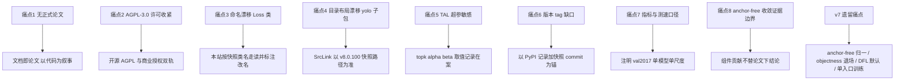

# YOLOv8 痛点追踪

YOLOv8（Ultralytics 团队，2023-01 首发，本站快照 v8.0.100 @ dce4efc，2023-08）把 anchor-free + [TAL](/glossary#tal-task-alignment-learning) + [DFL](/glossary#dfl-distribution-focal-loss) + 解耦头打包成工业级默认，用单一代码库持续发版的方式终结了"每代一论文一仓库"的传统——但发布方式本身也带来一类新痛点。本页先追踪 **v8 自己暴露的 8 个新痛点**，再看它如何回应 v7 遗留的痛点，最后给出痛点谱系图。

## 8 个新痛点全景

| 痛点 | 严重度 | 后续回应 |
| --- | --- | --- |
| [1. 无正式论文 文档即论文](#_1-无正式论文-文档即论文-pain-no-paper) | High | 本站以代码为论文；官方口径 docs.ultralytics.com + 发布博客 |
| [2. AGPL-3.0 许可收紧](#_2-agpl-3-0-许可收紧-pain-agpl) | High | 无官方解法；开源 AGPL + 商业授权双轨，下游按需评估 |
| [3. 命名漂移 Loss 类与 v8DetectionLoss](#_3-命名漂移-loss-类与-v8detectionloss-pain-loss-naming) | Medium | 本站按快照类名 `Loss` 走读并标注后世改名 |
| [4. 目录布局漂移 yolo 子包与 utils 迁移](#_4-目录布局漂移-yolo-子包与-utils-迁移-pain-layout-drift) | Medium | 本站 SrcLink 一律以 v8.0.100 快照路径为准 |
| [5. TAL 超参敏感 topk alpha beta](#_5-tal-超参敏感-topk-alpha-beta-pain-tal-hparams) | Medium | 本站记录检测线取值 topk=10 / alpha=0.5 / beta=6.0 |
| [6. 版本 tag 缺口与发布口径](#_6-版本-tag-缺口与发布口径-pain-tag-gap) | Low | 复现以 PyPI 发布记录 + 快照 commit dce4efc 为锚 |
| [7. 指标与测速口径](#_7-指标与测速口径-pain-bench-caliber) | Medium | README 注明 val2017 单模型单尺度，本站沿用并标注口径 |
| [8. anchor-free 路线收敛的证据边界](#_8-anchor-free-路线收敛的证据边界-pain-route-convergence) | Medium | 以代码为准还原组件位置，不替论文下结论 |

## 1. 无正式论文 文档即论文 (`pain-no-paper`)

**现状**：v1~v7 每一代都有一篇论文（或技术报告）作为引用与消融的锚点；v8 没有正式论文，官方口径是 docs.ultralytics.com 与发布博客（快照 README 只指向文档站）。设计依据散落在代码注释里：TAL 的分配器注释直接写明参考 PPYOLOE 实现（<SrcLink file="v8:ultralytics/yolo/utils/tal.py" :line="85" :end="85" />），DFL 的出处写在 loss 注释里（<SrcLink file="v8:ultralytics/yolo/utils/loss.py" :line="54" :end="54" />）。

**影响**：引用没有标准 BibTeX/DOI 入口；"为什么涨点"没有论文级逐组件消融可查；二手资料各自表述，同一版本的指标与训练口径容易以讹传讹。

**路标**：v8 把"论文"拆成了代码 + 文档，本站相应以"以代码为论文"为叙事（见 [YOLOv8 论文页](/versions/v8/paper) 与 [核心概念](/versions/v8/concepts)）。路标，不是"论文无用"的定论。

## 2. AGPL-3.0 许可收紧 (`pain-agpl`)

**现状**：快照 LICENSE 是 AGPL-3.0（对比 v5 的 GPL-3.0），且 Ultralytics 采用"开源 AGPL + 商业授权"双轨；快照每个源码文件头都带 AGPL 标记（如 <SrcLink file="v8:ultralytics/yolo/v8/detect/train.py" :line="1" :end="1" />）。

**影响**：AGPL 的网络分发条款让 SaaS/内网部署也要评估传染性；不少下游项目因此改用其他实现或购买商业授权；"YOLO 系随便商用"的旧印象不再成立，选型时许可证与算法指标必须一起看。

**路标**：这是商业模式选择而非技术问题；本站不构成法律意见，引用 v8 权重或代码时注明许可证与版本。路标，不是对任何授权方案的评价。

## 3. 命名漂移 Loss 类与 v8DetectionLoss (`pain-loss-naming`)

**现状**：v8.0.100 快照里检测损失总装类就叫 `Loss`（<SrcLink file="v8:ultralytics/yolo/v8/detect/train.py" :line="137" :end="138" />），后世版本才改名 v8DetectionLoss——按"v8DetectionLoss"检索这份快照一无所获。博客与教程多用新类名，对不上 8.0.x 早期源码。

**影响**：跨版本 diff 时同名类不同物、异名类同物；读者按教程类名搜快照代码会扑空；Segment/Pose 的继承链（SegLoss / PoseLoss 继承同一 Loss 基类）也随改名换位，检索资产（issue、博客）时新旧名混杂。

**路标**：本站 [损失页](/versions/v8/losses) 一律按快照类名 `Loss` 走读并标注后世改名；"以快照为准"是全站写作纪律（与 v7 痛点 2 的"论文 vs 代码"漂移同根，但这次漂移发生在时间轴上而非论文与代码之间）。

## 4. 目录布局漂移 yolo 子包与 utils 迁移 (`pain-layout-drift`)

**现状**：v8.0.100 还是旧布局：没有 ultralytics/utils/，通用工具在 ultralytics/yolo/utils/（tal.py、loss.py 都在这里）；训练默认配置在 ultralytics/yolo/cfg/default.yaml；模型 YAML 在 ultralytics/models/v8/。后续版本把 yolo/ 子包摊平到顶层，import 路径随之改变。

**影响**：按新版教程写的 `from ultralytics.utils.tal import ...` 在 8.0.100 上跑不通，反之亦然；博客代码片段良莠不齐，检索时容易拿错版本的路径；issue 里"import 报错"类问题一大半是布局错位。

**路标**：本站 SrcLink 一律以 v8.0.100 快照路径为准（如 `v8:ultralytics/yolo/utils/tal.py`），站内源码页只做白名单四个文件（tasks.py / block.py / loss.py / yolov8.yaml），其余自动跳 GitHub 快照外链。

## 5. TAL 超参敏感 topk alpha beta (`pain-tal-hparams`)

**现状**：TaskAlignedAssigner 类默认 topk=13、alpha=1.0（<SrcLink file="v8:ultralytics/yolo/utils/tal.py" :line="71" :end="79" />），而检测训练实例化时取 topk=10、alpha=0.5、beta=6.0（<SrcLink file="v8:ultralytics/yolo/v8/detect/train.py" :line="156" :end="157" />）——两处默认不一致。对齐度量 = 分类分数^alpha × CIoU^beta，三个魔法数都没有文档解释出处。

**影响**：换数据集（小目标密集、类别极不均衡）常需要重调 topk/alpha/beta；alpha/beta 改变对齐度量的量纲，间接影响 [软标签](/versions/v8/concepts) 的强度；复现实验要同时盯类默认与实例化两处取值。

**路标**：本站 [核心概念](/versions/v8/concepts) 第 3 条与 [损失页](/versions/v8/losses) 第 5 条记录了这些取值与语义；v6 的 TAL 用 topk=13，v8 检测线改 10——超参是经验值不是定理。路标，不是"调参无用"的定论。

## 6. 版本 tag 缺口与发布口径 (`pain-tag-gap`)

**现状**：v8.0.0~v8.0.4 从未打 git tag（仅发 PyPI），现存最早 tag 是 v8.0.5；且 YOLOv8 是产品线而非独立仓库——单一代码库 ultralytics/ultralytics 持续发版，"YOLOv8 的仓库"这个说法本身不准确。

**影响**：想 checkout "v8.0.0 原始状态"没有对应 commit 锚点，早期发布与代码状态只能靠 PyPI 记录间接还原；跨资料核对"v8 哪个版本引入 X"时缺少权威时间轴。

**路标**：本站快照取 v8.0.100 @ dce4efc（2023-08），所有行号引用以此为准；版本考古以 PyPI 发布记录补齐。路标，不是对发版流程的批评。

## 7. 指标与测速口径 (`pain-bench-caliber`)

**现状**：快照 README 指标表口径是 COCO val2017、单模型单尺度，测速给 CPU ONNX 与 A100 TensorRT 两列（如 YOLOv8n：37.3 mAP50-95 / 80.4 CPU ms / 0.99 TRT ms）——比 v7 的 V100 FPS 口径信息量更大，但仍是自报口径，前后处理链路说明有限。

**影响**：跨仓库对比仍要小心 batch、精度（FP32/FP16/INT8）、输入尺寸、是否含 NMS；第三方复测与官方数字存在系统性差异；"8.9 GFLOPs"这类数字还随输入尺寸变化。

**路标**：本站引用 v8 指标一律注明"README 口径，COCO val2017 单模型单尺度"（承接 [v7 痛点 7](/versions/v7/painpoints#_7-v100-测速口径与部署实测不可比-pain-bench-caliber) 的口径问题——透明度提升了，可比性问题没有根治）。

## 8. anchor-free 路线收敛的证据边界 (`pain-route-convergence`)

**现状**：v8 把 anchor-free + TAL + DFL + 解耦头固化为默认，但"归一"的证据是工程生态的选择（Ultralytics 一系的采用率与部署友好度），不是论文级逐组件消融——没有论文，也就没有"C2f vs C3""TAL vs [SimOTA](/glossary#simota)""DFL 开与关"在 v8 同一配置下的受控对照。

**影响**：说"v8 证明 anchor-free 更优"超出了证据范围；组件贡献只能靠社区实验与跨版本对比间接推断；路线之争（分配器、训练期加料）仍悬而未决。

**路标**：本站按组件还原实现位置（C2f → block.py、TAL → tal.py、DFL → loss.py），证据边界如实标注；anchor-based 的成绩（如 v7 Table 2）至今仍是另一条路线的强证据。路标，不是定论（对比 [v7 痛点 1](/versions/v7/painpoints#_1-anchor-based-路线与同期-anchor-free-分道扬镳-pain-anchor-route-split) 与 [v7 痛点 8](/versions/v7/painpoints#_8-训练-schedule-与部分公式细节未核实-pain-unverified-items)）。

## 承接 v7 痛点：v8 如何回应

| v7 痛点 | v8 的回应 | 备注 |
| --- | --- | --- |
| [1. anchor-based 路线与同期 anchor-free 分道扬镳](/versions/v7/painpoints#_1-anchor-based-路线与同期-anchor-free-分道扬镳-pain-anchor-route-split) | 旗舰线全面归一 [anchor](/glossary#anchor-锚框-先验框)-free：Detect 头没有 anchor 张量，anchor_points 取网格中心（grid_cell_offset=0.5），回归 ltrb 距离分布 | <SrcLink file="v8:ultralytics/yolo/utils/tal.py" :line="246" :end="258" />；分叉收束是生态选择，不是理论证伪，见 [痛点 8](#_8-anchor-free-路线收敛的证据边界-pain-route-convergence) |
| [2. RepConvN 论文命名与快照条件 identity 实现漂移](/versions/v7/painpoints#_2-repconvn-论文命名与快照条件-identity-实现漂移-pain-repconvn-drift) | v8 干脆没有论文——"论文 vs 代码"漂移的上游消失；代价是引用锚点也消失，并引入新的命名漂移（`Loss` 类） | 见 [痛点 1](#_1-无正式论文-文档即论文-pain-no-paper)、[痛点 3](#_3-命名漂移-loss-类与-v8detectionloss-pain-loss-naming) |
| [3. decoder 的 objectness 上界约束只存在于论文](/versions/v7/painpoints#_3-decoder-的-objectness-上界约束只存在于论文-pain-decode-obj-cap) | v8 取消独立 [objectness](/glossary#置信度-objectness) 输出：no = nc + reg_max×4，分类分数即框置信度，该约束彻底失去落点 | <SrcLink file="v8:ultralytics/nn/modules/head.py" :line="34" :end="35" /> |
| [4. 少 75% 参数的宣称与 Table 1 不符](/versions/v7/painpoints#_4-少-75-参数的宣称与-table-1-不符-pain-75pct-claim) | 无论文即无口号性宣称；README 指标表成为唯一数字口径，并注明 val2017 单模型单尺度 | 见 [痛点 7](#_7-指标与测速口径-pain-bench-caliber) |
| [5. aux head 训练成本与双入口复杂度](/versions/v7/painpoints#_5-aux-head-训练成本与双入口复杂度-pain-aux-train-cost) | v8 无辅助头、单训练入口：Detect 训练态直接输出两分支特征，推理态才做 DFL 解码 | <SrcLink file="v8:ultralytics/nn/modules/head.py" :line="48" :end="49" /> |
| [6. 手工 anchor 的迁移负担](/versions/v7/painpoints#_6-手工-anchor-的迁移负担-pain-manual-anchors) | anchor-free 免先验免聚类，TAL 按对齐度量动态分配正样本（三重掩码 in_gt × topk × mask_gt） | <SrcLink file="v8:ultralytics/yolo/utils/tal.py" :line="128" :end="139" /> |
| [7. V100 测速口径与部署实测不可比](/versions/v7/painpoints#_7-v100-测速口径与部署实测不可比-pain-bench-caliber) | README 同时给 CPU ONNX 与 A100 TRT 两列并注明数据集，口径更透明；但仍是自报数字，可比性问题没有根治 | 见 [痛点 7](#_7-指标与测速口径-pain-bench-caliber) |
| [8. 训练 schedule 与部分公式细节未核实](/versions/v7/painpoints#_8-训练-schedule-与部分公式细节未核实-pain-unverified-items) | 无论文可核；训练默认全部固化进 default.yaml（优化器、lr、增益、增广），代码即唯一真相 | <SrcLink file="v8:ultralytics/yolo/cfg/default.yaml" :line="80" :end="89" /> |

## 痛点谱系图

## 延伸阅读

- [YOLOv8 源码走读](/versions/v8/code-walkthrough) — 本页痛点对应的调用链证据
- [YOLOv8 论文页](/versions/v8/paper) — "以代码为论文"叙事的展开
- [YOLOv8 核心概念](/versions/v8/concepts) — TAL / DFL / C2f 的概念版
- [YOLOv8 训练技巧](/versions/v8/tricks) — 工程化默认值背后的取舍
- [YOLOv7 痛点追踪](/versions/v7/painpoints) — 本页"承接 v7 痛点"表格的上文
- [术语表](/glossary) — TAL、DFL、SimOTA 等术语索引
