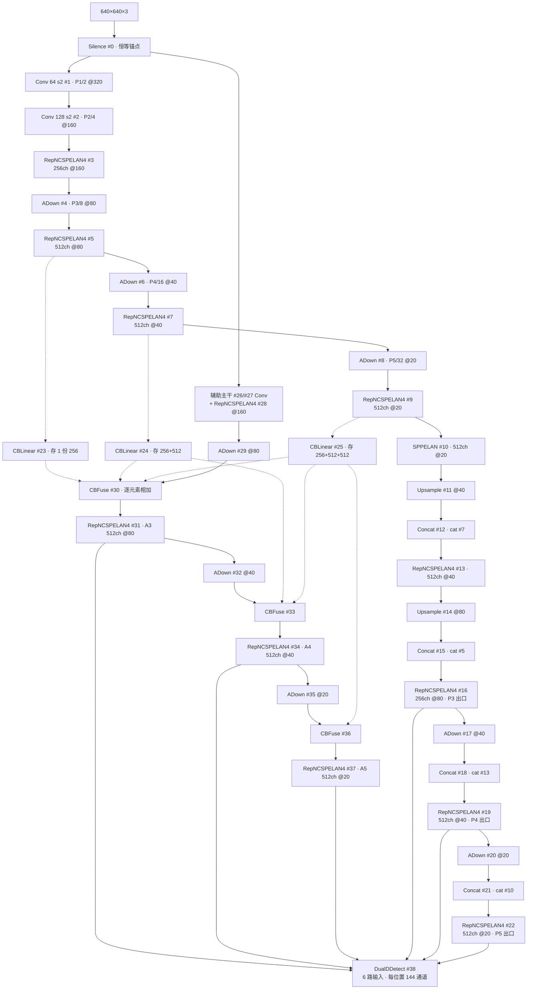
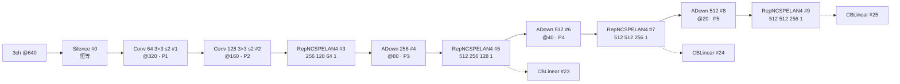
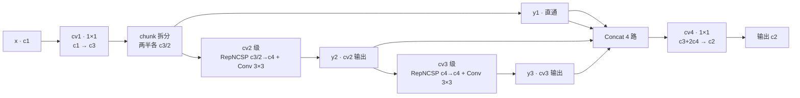
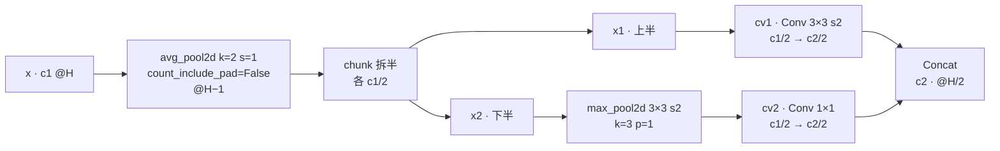
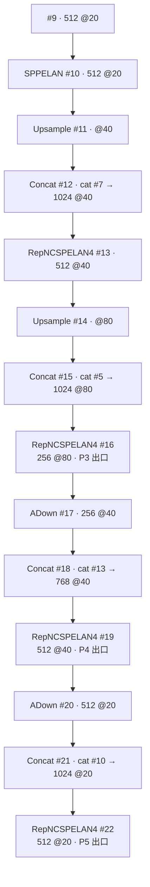
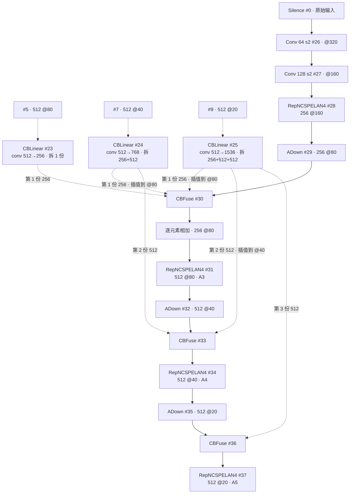
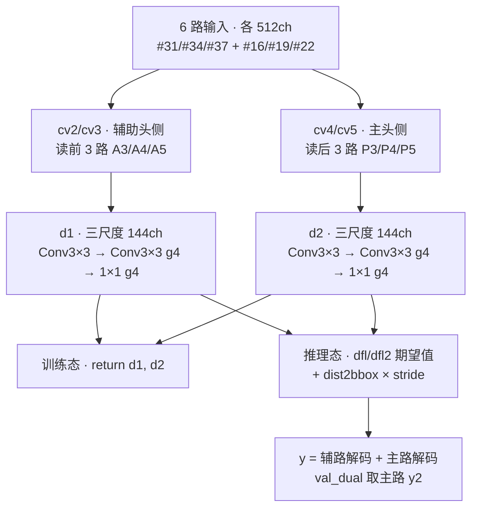

# YOLOv9 架构总览

> 以 `models/detect/yolov9-c.yaml`（124 行，`depth_multiple`/`width_multiple` 均为 1.0，anchors: 3）为蓝本：顶层条目 #0~#38 共 **39 条**——主分支骨干 #0~#9、主分支头 #10~#22、多级可逆辅助分支 #23~#37、DualDDetect 收官 #38。本页通道数为 yaml 声明值（v9 无复合缩放，每档一份独立 yaml）。配置原文见 <SrcLink file="v9:models/detect/yolov9-c.yaml" :line="1" :end="124" />，逐层明细见 [YOLOv9 层结构速查](/versions/v9/layers)。

> **读者路标**：从 [v8](/versions/v8/architecture) 过来的读者只需做三次"换名"：C2f → RepNCSPELAN4、Conv s2 下采样 → ADown、Detect → DualDDetect——FPN 上行 + 下行聚合的骨架拓扑与 v8 同构；真正的加法是 PGI 的[辅助分支](/versions/v9/architecture#_6-多级可逆辅助分支-23-37-cblinear-存档-→-cbfuse-相加-训练专用)。[ELAN](/glossary#elan-e-elan-高效层聚合) 血统的来龙去脉见 [v7 逐层图解](/versions/v7/layers)。

::: tip 只想带走三件事
1. **一份 yaml 39 条 = 一张半网络**：主分支 #0~#22（GELAN 骨干 + FPN 上行/ADown 下行头）负责推理；多级可逆辅助分支 #23~#37（CBLinear 路由 + 辅助主干 + CBFuse 融合）只在训练时给主分支喂梯度——[PGI](/glossary) 的落地。推理时整段拆除，主路输出一个比特都不变；
2. **积木四件套**：RepNCSPELAN4 ×12（GELAN 核心块：chunk 两半 → cv2/cv3 两级级联 → 4 路 concat）、ADown ×8（平均池化开路的下采样）、Conv ×4、SPPELAN ×1，再加 CBLinear ×3 / CBFuse ×3 / Silence ×1 / Upsample ×2 / Concat ×4——全部条目见 [layers 速查](/versions/v9/layers#_1-逐层明细表-yolov9-c-yaml-0-38-640-输入)；
3. **双头 6 路输入**：DualDDetect 读 [31, 34, 37, 16, 19, 22] 六路 512 通道特征，辅助路 cv2/cv3、主路 cv4/cv5 各配一个 [DFL](/glossary#dfl-distribution-focal-loss)，每位置输出 \(80 + 16 \times 4 = 144\) 通道。YOLOv9-C **25.5M 参数 / 102.8 GFLOPs / 53.0 AP**（README COCO val 640 口径）。
:::

## 1. 一眼看清：yolov9-c.yaml 全图

> 已读过 [v7 架构](/versions/v7/architecture) / [v8 架构](/versions/v8/architecture)？本节 v7/v8 读者只需关注图里多出的下排（辅助分支 #23~#37）与 DualDDetect 的 6 个入口——其余"骨干 → 池化收尾 → 上行 → 下行 → 三尺度出口"的节奏与 v8 同拍，只是积木换了名字。

::: figure 图：yolov9-c.yaml 全景——实线为主分支（推理也走），虚线为训练专用的辅助分支路由；DualDDetect #38 六路入口双头收官

:::

- yaml 的 `backbone` 段只装 #0~#9（<SrcLink file="v9:models/detect/yolov9-c.yaml" :line="14" :end="44" />），`head` 段装 #10~#38（<SrcLink file="v9:models/detect/yolov9-c.yaml" :line="47" :end="123" />）——v7 式"两段拼一张表"，`parse_model` 顺序遍历建网
- 虚线（CBLinear/CBFuse）是"旁路存档"：骨干 #5/#7/#9 的特征被复制一份供辅助分支用，主分支自身的数据流一寸不移——这正是论文里"辅助分支推理可拆"的结构前提
- 三出口 #16/#19/#22 与辅助三出口 #31/#34/#37 **同尺寸同通道**（512@80/40/20，P3 出口 256@80 除外——主 P3 是 256，辅 A3 是 512），两套特征在 DualDDetect 里各走各的头
- Concat 输出通道 = 两路之和（<SrcLink file="v9:models/yolo.py" :line="691" :end="692" />）；`nn.Upsample` 不改通道

## 2. 主干 #0~#9：Silence 起手，"Conv—RepNCSPELAN4—ADown"三拍循环

> 已读过 [v8 架构 §1](/versions/v8/architecture#_1-一眼看清-yolov8-yaml-全图)？v8 骨干第一层直接是 Conv，v9 在最前面垫了一个恒等层 Silence——本节 v7/v8 读者只需关注它的用途：给辅助分支 #26 提供一个"原始输入"抽头，其余五级"RepNCSPELAN4 + ADown"循环与 v8 的"C2f + Conv s2"逐级对应。

**逐层解说**：

- **#0 Silence**：`forward` 就是 `return x`（<SrcLink file="v9:models/common.py" :line="554" :end="558" />）。它不做任何特征变换，是纯粹的"锚点"——辅助主干 #26 的 from 写 `[0, 1, Conv, ...]`（yaml L89），靠这一层拿到未经污染的原始输入
- **#1/#2 两个 Conv s2**：Conv+BN+[SiLU](/glossary#silu-swish)，与 v8 stem 同款
- **#3 起的五级 RepNCSPELAN4**：参数四元组 `[c2, c3, c4, c5]`——#3 `[256, 128, 64, 1]` 读作"输出 256、级联隐宽 128/64、RepNCSP 内部重复 1"；内部数据流见 §3
- **#4/#6/#8 三个 ADown**：取代 v8 的 Conv s2 下采样，"平均池化开路"见 §4
- **虚线抽头**：#5/#7/#9 三级输出被 CBLinear 复制存档（yaml L84-86）——注意这三层本来就在 savelist 里（头部的 Concat 要用），CBLinear 不增加主分支负担

<SrcLink file="v9:models/detect/yolov9-c.yaml" :line="14" :end="44" />

## 3. RepNCSPELAN4 专节：GELAN 的核心块

> 已读过 [v8 架构 §2 C2f](/versions/v8/architecture#_2-c2f-split-→-n×bottleneck-→-全拼接)？C2f 是"n 个 Bottleneck 逐级并联、n+2 路全拼接"；RepNCSPELAN4 收敛为"两级级联、4 路 concat"——v7 [ELAN](/glossary#elan-e-elan-高效层聚合) 手摆的多分支拓扑回到模块内部，Bottleneck 换成可重参数化的 RepNCSP。

**白话**：cv1 把输入升到 c3 通道劈成两半——第一半原样直通，第二半先进 cv2 级（RepNCSP + Conv 3×3），cv2 的输出**继续**进 cv3 级（级联，不是各自从 chunk 出发）；两半 + 两级输出共 4 路 concat，cv4 一次收拢到 c2。

- forward 三行（<SrcLink file="v9:models/common.py" :line="590" :end="593" />）：`chunk(2, 1)` 得两半 → `y.extend(m(y[-1]) for m in [self.cv2, self.cv3])` 级联两步 → `cat` 4 路。对比 C2f 的 `y.extend` 循环里每个 Bottleneck 输出都进 concat（n+2 路），GELAN 只取两级——**串联保深度、并联省路数**
- RepNCSP（<SrcLink file="v9:models/common.py" :line="373" :end="384" />）与 [CSP](/glossary#csp-跨阶段部分连接) 同构：cv1/cv2 双 1×1 分流 → n 个 RepNBottleneck → cv3 收拢；内部块是重参数化的 RepNBottleneck（训练多分支、部署折叠成单 conv，[RepVGG](/glossary#repvgg-结构重参数化) 思路）
- 通道账：c3 = 级联首宽，chunk 后每半 c3/2；cv4 入口 c3 + 2×c4 与 4 路 concat 精确对齐（`__init__` L584-588）
- `forward_split`（L595-598）把 `chunk` 换成 `split((self.c, self.c), 1)`——ONNX 导出友好版
- 层 #3 `[256, 128, 64, 1]` 的读法：c2=256 输出、c3=128（chunk 每半 64）、c4=64、c5=1 重复——**c5 是 RepNCSPELAN4 唯一的"深度旋钮"**，e 档把它拧到 2

<SrcLink file="v9:models/common.py" :line="580" :end="598" />

## 4. ADown 专节：平均池化开路的下采样

> 已读过 [v8 架构](/versions/v8/architecture)？v8 的下采样是一根 Conv 3×3 s2；v7 则是 MP 块（MaxPool 路与 Conv 路并联 concat）。ADown 是两代思路的合体：先把 avgpool 提到两路之前共享，再劈两半各走一条下采样路。

**白话**：先 `avg_pool2d(x, 2, 1, 0, False, True)`——核 2 步幅 1 的平均池化把尺寸从 H 抹到 H−1，起"预平滑 + 掐掉奇数行列"的作用；通道维 chunk 两半后**上半走 conv3s2**（算得细）、**下半走 maxpool3s2 + conv1**（看得粗）；两路 concat 成 c2 @H/2。

- 三步全在 forward 里（<SrcLink file="v9:models/common.py" :line="77" :end="83" />）：avgpool → chunk → 两路各自下采样再 `torch.cat`，无隐藏状态
- 对比 v7 MP 块：v7 是 MaxPool 与并行 Conv 各处理**整份输入**再 concat（通道翻倍），ADown 把 avgpool 提前共享、两路各管一半通道——下采样同时控参
- `AConv`（<SrcLink file="v9:models/common.py" :line="60" :end="67" />）是它的简化版：avgpool + 单根 conv3s2，yolov9-c.yaml 没用到，留给其他配置
- `parse_model` 把 ADown 归入 Conv 家族统一做宽度增益（<SrcLink file="v9:models/yolo.py" :line="677" :end="685" />），yaml 里 `[256]` 一个参数就是输出通道

<SrcLink file="v9:models/common.py" :line="70" :end="83" /> <SrcLink file="v9:models/detect/yolov9-c.yaml" :line="28" />

## 5. 主头 #10~#22：SPPELAN 收尾 + FPN 上行 + ADown 下行

> 已读过 [v8 架构 §1](/versions/v8/architecture#_1-一眼看清-yolov8-yaml-全图)？头 13 条与 v8 一一对应：Upsample ×2 + Concat ×4 位置全同，Concat 回连对象从"骨干 #6/#4 + 头 #12 + SPPF #9"换成"骨干 #7/#5 + 头 #13 + SPPELAN #10"——层号整体后移 1 的原因见[layers 差异表](/versions/v9/layers#_5-gelan-c-yaml-拆掉辅助分支的对照组)。

**逐层解说**：

- **#10 SPPELAN `[512, 256]`**：装配成 SPPELAN(c1=512, c2=512, c3=256)——cv1 1×1 出 256 → **串行 3 个 SP(5)**（SP 就是 MaxPool k=5 的包装，<SrcLink file="v9:models/common.py" :line="187" :end="193" />，与 v8 SPPF 的"串行 3 次 k=5"同款）→ 4 路 concat（4×256=1024）→ cv5 1×1 收到 512。骨干出口的收尾池化、PAN 的顶点
- **#11~#16 FPN 上行**：Upsample ×2 → cat 骨干 #7（P4）→ RepNCSPELAN4(1024→512) → Upsample → cat 骨干 #5（P3）→ RepNCSPELAN4(1024→256)。**#16 是 P3 出口**（yaml L64 注释 P3/8-small）
- **#17~#22 下行**：ADown(256) → cat 头部 #13（768→512，**#19 是 P4 出口**）→ ADown(512) → cat #10（1024→512，**#22 是 P5 出口**）
- SPPELAN 与 SPPF 的差异只在包装：SPPF = cv1 + 3×MaxPool + concat + cv2（v8 block.py）；SPPELAN = 同一拓扑、模块名与归属库不同（v9 common.py）——v9 仓库是 v7 代码库 fork，模块全家住在 common.py

<SrcLink file="v9:models/common.py" :line="563" :end="577" /> <SrcLink file="v9:models/detect/yolov9-c.yaml" :line="47" :end="78" />

## 6. 多级可逆辅助分支 #23~#37：CBLinear 存档 → CBFuse 相加（训练专用）

> v7/v8 没有对应物，本节全是新内容。先记住一个事实：**这 15 层推理时可整体删除而主路结果不变**——主分支 #0~#22 的数据流完全不经过辅助分支，DualDDetect 主路只读主分支特征。这是 v9 论文 PGI（Programmable Gradient Information，可编程梯度信息）的核心工程承诺。

::: figure 图：辅助分支数据流——CBLinear 从骨干三级抽头存档，辅助主干从原始输入重跑一遍，CBFuse 在同名尺度把存档逐元素加回来

:::

**数据流三步走**：

- **路由 #23~#25（CBLinear 存档）**：from 直接指向骨干层 5/7/9。CBLinear 就是一个 1×1 conv 输出 `sum(c2s)` 通道、再 `split(self.c2s, dim=1)` 拆成多份（<SrcLink file="v9:models/common.py" :line="631" :end="639" />）：#23 存 1 份 `[256]`，#24 存 2 份 `[256, 512]`，#25 存 3 份 `[256, 512, 512]`——层越深存得越多，"多级"由此而来
- **辅助主干 #26~#28（重新出发）**：#26 的 from 是 0（Silence）——从原始图像重新过一遍 stem 级结构；辅助分支**不共享主干任何权重**，是一套独立的小骨干
- **融合 #29~#36（CBFuse 相加）**：每个尺度三拍"ADown 下采样 → CBFuse 加存档 → RepNCSPELAN4"。CBFuse 把 from 列表里前几路（按 `idx` 参数取对应份数）各自 interpolate 到末路（ADown 输出）的尺寸，stack 后**逐元素相加**（<SrcLink file="v9:models/common.py" :line="641" :end="650" />）——不是 concat，通道数不变，所以 #30/#33/#36 的输出通道就等于 ADown 那一路

**份数对齐表**（CBLinear 拆出的第 n 份供给第 n 个尺度）：

| CBFuse 层 | 尺度 | 取哪几份 | 输出 |
|-----------|------|----------|------|
| #30 `[23, 24, 25, -1]` idx `[0, 0, 0]` | P3 | #23 第 1 份 + #24 第 1 份 + #25 第 1 份 + ADown #29 | 256 @80 |
| #33 `[24, 25, -1]` idx `[1, 1]` | P4 | #24 第 2 份 + #25 第 2 份 + ADown #32 | 512 @40 |
| #36 `[25, -1]` idx `[2]` | P5 | #25 第 3 份 + ADown #35 | 512 @20 |

- **#31/#34/#37 输出即 A3/A4/A5**：与主分支 P4/P5 同尺寸同通道（512@80/40/20），专配 DualDDetect 的辅助头（A3 是 512，比主 P3 的 256 宽一倍）
- **训练专用，推理拆除**：主分支三出口 #16/#19/#22 不依赖 #23~#37 的任何输出；部署时删掉这 15 层、把头换成单路即可——仓库里现成的"拆后版"就是 gelan 系 yaml（[layers §5](/versions/v9/layers#_5-gelan-c-yaml-拆掉辅助分支的对照组)）。yaml 本身不区分训练/推理，"拆"是部署方换配置的操作
- **梯度意义**：辅助头（读 A3/A4/A5）的损失反传会经由 CBFuse → CBLinear 一路回到骨干 #5/#7/#9——相当于给主骨干的深层注入一条额外梯度高速；论文称这套"辅助可逆分支 + 辅助监督"用于缓解深度网络的信息瓶颈，是 PGI 三件套之二

<SrcLink file="v9:models/detect/yolov9-c.yaml" :line="81" :end="116" /> <SrcLink file="v9:models/common.py" :line="631" :end="650" />

## 7. DualDDetect #38：6 路输入的双头收官

> 已读过 [v8 架构 §4 Detect](/versions/v8/architecture#_4-detect-anchor-free-解耦头-8400-×-144)？anchor-free、DFL、无 objectness 的公式全数继承；本节 v7/v8 读者只需关注"6 入口对折成两套头"的装法与主辅两路的权重分工。

**白话**：6 路输入对折——`nl = len(ch)//2 = 3`，前 3 路（#31/#34/#37，yaml 注释 A3/A4/A5）进 cv2/cv3 算出 **d1**，后 3 路（#16/#19/#22，P3/P4/P5）进 cv4/cv5 算出 **d2**；两套各带一个 DFL（`self.dfl` / `self.dfl2`），每位置 144 通道 = 64 维框分布 + 80 类分数。

- `no = nc + reg_max × 4 = 144`（<SrcLink file="v9:models/yolo.py" :line="201" :end="203" />），与 v8 Detect 的输出公式一字不差——objectness 在 v9 依然不存在
- 分组卷积：box 分支（cv2/cv4）的中间 3×3 与出口 1×1 都按 `g=4` 分组（L210/L214），cls 分支（cv3/cv5）不分组（L212/L216）——控参压在框回归侧
- 隐宽：`c2 = make_divisible(max(ch[0]//4, 64, 16), 4) = 128`（ch[0]=512）、`c3 = max(512, min(160, 128)) = 512`——box 分支隐宽 128、cls 分支隐宽 512，主辅两套同款（L207-208）
- **训练态**：`return [d1, d2]`（L227-228），交给 `loss_tal_dual.py` 的双路损失——**主头侧 d2 全权重，辅助头侧 d1 ×0.25**（详见[源码走读](/versions/v9/code-walkthrough)），对应论文 lead head / auxiliary head 的分工
- **推理态**：两路各自 DFL 期望值 + `dist2bbox` 解码，`y = [d1 解码, d2 解码]`（L233-238）；`val_dual.py` L199 取 `preds[0][1]`——**主路才是验证/部署口径**
- **bias_init 双份**：cv2/cv3 与 cv4/cv5 都按"每 640/s 格约 5 个目标"先验置 bias（L246-256）；stride 由 DetectionModel 构建期用 256×256 假输入前向推得 [8, 16, 32]（<SrcLink file="v9:models/yolo.py" :line="560" :end="569" />）
- **拆除辅助分支后**：cv4/cv5 + #16/#19/#22 就是完整的单头网络——"辅助分支推理可去"在代码结构上的落点
- 指标：YOLOv9-C 25.5M 参数 / 102.8 GFLOPs / 53.0 AP（README COCO val 640 口径；同表 S 7.2M / M 20.1M / E 58.1M，[mAP](/glossary#map-mean-average-precision) 为 val 口径）

<SrcLink file="v9:models/yolo.py" :line="190" :end="256" /> <SrcLink file="v9:models/detect/yolov9-c.yaml" :line="123" />

## 延伸阅读

- [YOLOv9 层结构速查](/versions/v9/layers) — #0~#38 全层表、模块速查、gelan-c/e 档差异
- [YOLOv9 源码走读](/versions/v9/code-walkthrough) — parse_model / DualDDetect / 双路损失逐行走读
- [v8 架构总览](/versions/v8/architecture) — C2f / SPPF / Detect 对照
- [v7 逐层图解](/versions/v7/layers) — ELAN 原始拓扑
- [术语表](/glossary) — DFL、TAL、CSP 等术语索引
