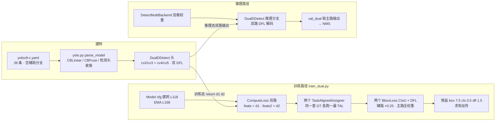

# YOLOv9 源码走读

本页沿 YOLOv9（WongKinYiu & AlexeyAB 等，2024-02；快照 WongKinYiu/yolov9 main @ 7d639b1，2024-02-19，论文 arXiv:2402.13616 发布前两天）的**训练调用链**走读源码：`train_dual.py` 加载 `yolov9-c.yaml` → `DetectionModel` / `parse_model` 建网（CBLinear / CBFuse / DualDDetect 三个特殊分支）→ `DualDDetect` 双态前向 → `ComputeLoss` 双路损失（双 [TAL](/glossary#tal-task-alignment-learning) 分配器）→ EMA 与验证。仓库是 YOLOv7 代码库的 fork（models/、utils/ 目录结构与 v7 相同），所有行号以站内快照 `source/yolov9/snapshot/` 为准，可点击 SrcLink/SrcSnippet 跳转核对。单仓多入口提示：train.py（gelan 单头）/ train_dual.py（yolov9 双头）/ train_triple.py（三头）三链并存，val_dual.py / val_triple.py 对应验证。

## 文件清单

> 已读过 [v8 源码走读](/versions/v8/code-walkthrough)？v9 的文件布局回到 v7 式——models/ + utils/ 平铺，没有 v8 的 ultralytics 包结构；行数先对齐，后面所有行号都出自这批文件。

| 文件 | 行数 | 功能 |
| --- | --- | --- |
| `models/detect/yolov9-c.yaml` | 124 | 结构配置：骨干 #0-#9 + 头 #10-#22 + 辅助分支 #23-#37 + DualDDetect #38 |
| `models/yolo.py` | 763 | `parse_model` / `DetectionModel` 建网 + Detect 家族六个头 |
| `models/common.py` | 1200 | [GELAN](/glossary) 块（RepNCSPELAN4/ADown/SPPELAN）+ CBNet（CBLinear/CBFuse）+ 隐式先验 |
| `utils/loss_tal_dual.py` | 385 | 双路 ComputeLoss：双 assigner + 双 BboxLoss |
| `utils/tal/assigner.py` | 179 | TaskAlignedAssigner（v8 同款 TAL 分配器） |
| `train_dual.py` | 644 | 双头训练入口（yolov9 系列用） |
| `val_dual.py` | 393 | 双头验证入口（取主路输出进 NMS） |
| `data/hyps/hyp.scratch-high.yaml` | — | 官方推荐超参（box 7.5 / cls 0.5 / dfl 1.5） |

## 调用链总览

> 已读过 [v8 源码走读](/versions/v8/code-walkthrough)？建网→训练→验证三段式与 v8 相同；v9 的分叉点是模型本身：双头返回 [d1, d2]，训练侧因此换 loss_tal_dual 双路总装。

## 建网：train_dual.py → DetectionModel → parse_model

> 已读过 [v8 源码走读](/versions/v8/code-walkthrough)？v8 的建网在 ultralytics/nn/tasks.py，v9 回到 v7 式 models/yolo.py——四元组遍历、深度/宽度增益的逻辑同源；本节 v8 读者只需关注三个新分支：CBLinear、CBFuse、检测头家族的通道收集。

### 1. train_dual.py — 双头训练入口

yolov9 系列（c/e 档）官方用 `python train_dual.py --cfg models/detect/yolov9-c.yaml --hyp hyp.scratch-high.yaml --epochs 500 --close-mosaic 15`（README 命令）。三个关键行：

- **L40** `from utils.loss_tal_dual import ComputeLoss`——双路损失；**L41-42** 注释掉的 `ComputeLossLH` / `ComputeLossLHCF` 是 lead-head 引导备选（见 §9），快照默认不启用
- **L118** 无预训练权重时 `model = Model(cfg, ch=3, nc=nc, anchors=hyp.get('anchors')).to(device)`——`Model` 是 `DetectionModel` 的别名（yolo.py L624），cfg 即 yolov9-c.yaml
- **L168** `ema = ModelEMA(model) if RANK in {-1, 0} else None`——[EMA](/glossary#ema-指数移动平均) 影子权重，验证与最终部署用它

<SrcSnippet file="v9:train_dual.py" :start="40" :end="42" hl="40" />

::: details 逐行注释
- **L40** `from utils.loss_tal_dual import ComputeLoss`：默认双路损失——与 train.py（gelan 单头，L39 用 utils/loss_tal）分家，训练入口按"有没有辅助分支"选文件
- **L41** `#from utils.loss_tal_dual import ComputeLossLH as ComputeLoss`：lead-head 引导版备选，取消注释即切换——v7"lead head guided label assigner"的延续
- **L42** `#from utils.loss_tal_dual import ComputeLossLHCF as ComputeLoss`：另一备选入口——注意快照的 loss_tal_dual.py 里只实现了 ComputeLoss（L106）与 ComputeLossLH（L254）两个类，ComputeLossLHCF 不在其中，取消注释会 ImportError，仅留档
:::

### 2. parse_model — CBLinear / CBFuse / 检测头三个特殊分支

`parse_model`（<SrcLink file="v9:models/yolo.py" :line="659" :end="727" />）主干与 v7 相同：逐条解析 `[from, n, m, args]` 四元组（L670）、eval 字符串参数、深度增益（L676）。yolov9 新增/关键的三处：

- **Conv 家族（L677-685）**：Conv/AConv/ADown/RepNCSPELAN4/SPPELAN 统一 `c1, c2 = ch[f], args[0]` + 宽度增益——gw=1.0 时原样通过
- **CBLinear（L697-700）**：`c2 = args[0]`（c2s 列表本身，如 `[256, 512]`）、`c1 = ch[f]`——from 指向骨干层 5/7/9，直接读那层的通道数
- **CBFuse（L701-702）**：`c2 = ch[f[-1]]`——输出通道取 from 列表末位（ADown 那路），相加不改通道
- **检测头家族（L704-705）**：`args.append([ch[x] for x in f])`——DualDDetect 收到 6 路通道表 `[512]×6`
- **savelist（L722）**：显式层号 from 自动进 save——CBLinear 的"隔空抽头"（#23-#25 取 #5/#7/#9）、#26 取 #0、Concat 回连全靠 `_forward_once` 的 save 机制支撑

<SrcSnippet file="v9:models/yolo.py" :start="691" :end="705" hl="697-705" />

::: details 逐行注释
- **L691-692** `elif m is Concat: c2 = sum(ch[x] for x in f)`：Concat 输出通道 = 各路之和——#12 是 512+512=1024
- **L697** `elif m is CBLinear:`：辅助路由层开始分派
- **L698** `c2 = args[0]`：yaml 里 `[[256, 512]]` 的外层列表，即拆分方案 c2s；注意 c2 这里是**列表**，但下游没有层再读 ch[23] 的"通道"（CBFuse 只取 from 末位），所以安全
- **L699** `c1 = ch[f]`：f 是显式层号（5/7/9），读那层输出通道（512）
- **L700** `args = [c1, c2, *args[1:]]`：装配成 CBLinear(c1=512, c2s=[256, 512])——`__init__` 里 `nn.Conv2d(c1, sum(c2s), ...)` 出 768 通道再 split
- **L701-702** `elif m is CBFuse: c2 = ch[f[-1]]`：CBFuse 无可学习参数，`__init__` 只存 idx；输出通道抄 from 末位（ADown 路）
- **L704** `elif m in {Detect, ..., DualDDetect, ...}:`：六个检测头统一分派
- **L705** `args.append([ch[x] for x in f])`：把 6 路输入的通道表 append 进 args——DualDDetect(n=1, nc=80, ch=[512×6])
:::

### 3. DetectionModel — stride 校准与双头 bias_init

`DetectionModel.__init__`（<SrcLink file="v9:models/yolo.py" :line="527" :end="573" />）读 yaml → L545 `self.model, self.save = parse_model(...)` → 构建期校准。stride/bias 分两派：

- **单头派 L551-559**：Detect/DDetect/Segment——256×256 假输入前向一次，`s / x.shape[-2]` 推 stride
- **双头派 L560-569**：DualDetect/DualDDetect/TripleDDetect——`forward = lambda x: self.forward(x)[0]`。训练态 DualDDetect 返回 `[d1, d2]`，取 `[0]` 即 d1（三个尺度特征图），对每张算 `256 / 边长` 得 **[8, 16, 32]**，随后 `m.bias_init()` 一次性初始化主辅两套 bias

<SrcSnippet file="v9:models/yolo.py" :start="560" :end="569" hl="564-565" />

::: details 逐行注释
- **L560** `if isinstance(m, (DualDetect, TripleDetect, DualDDetect, TripleDDetect)):`：双头家族统一走这段
- **L561** `s = 256`：构建期假输入边长
- **L562** `m.inplace = self.inplace`：inplace 开关透传；L563 是注释掉的旧 lambda——作者的试错留痕
- **L564** `forward = lambda x: self.forward(x)[0]`：模型此刻 `self.training == True`，DualDDetect.forward 返回 `[d1, d2]`；`[0]` 取 d1——一个三尺度特征列表
- **L565** `m.stride = torch.tensor([s / x.shape[-2] for x in forward(...)])`：遍历 d1 的三张特征图，256/32=8、256/16=16、256/8=32 → stride=[8,16,32]
- **L569** `m.bias_init()`：DualDDetect 的 bias_init（L246-256）会连 cv2/cv3（辅助头侧）与 cv4/cv5（主头侧）一起初始化——只在构建期跑一次
:::

## 前向：_forward_once 与 DualDDetect 双态

> 已读过 [v8 源码走读 §9](/versions/v8/code-walkthrough#_9-detect-forward-—-anchor-free-解码-head-py)？v8 Detect 是"训练直返、推理解码"两态；DualDDetect 是它的 6 入口翻倍版——分叉逻辑一模一样，只是 d1/d2 两套各走一遍。

### 4. _forward_once — 39 层顺序执行

`BaseModel._forward_once`（<SrcLink file="v9:models/yolo.py" :line="474" :end="485" />）三件事：from 解析（负索引/多路列表，L477-478）、`x = m(x)` 逐层执行（L481）、`y.append(x if m.i in self.save else None)`（L482）。辅助分支不改变主路：#5/#7/#9 本来就在 savelist（头部 Concat 要用），CBLinear 只是同一特征多读一份——这就是"主分支数据流不被辅助分支触碰"的运行时证据。

### 5. DualDDetect.forward — 训练/推理分叉

`__init__`（L198-218）：`nl = len(ch)//2 = 3`（6 路对折）、`no = nc + reg_max×4 = 144`；cv2/cv3 读 `ch[:nl]`（辅助头侧）、cv4/cv5 读 `ch[nl:]`（主头侧）；box 分支（cv2/cv4）中间 3×3 与出口 1×1 均 `g=4` 分组、cls 分支不分组；`self.dfl` / `self.dfl2` 双份。`forward`（L220-238）：

- **L225-226** 逐尺度 `d1.append(cat((cv2[i], cv3[i]), 1))`、`d2.append(cat((cv4[i], cv5[i]), 1))`——每尺度出 64+80=144 通道
- **L227-228** `if self.training: return [d1, d2]`——训练态直返，解码留给损失
- **推理态 L229-238**：`make_anchors(d1, stride, 0.5)` 重建网格中心 → 两路各自 `view → split(64, 80)` → `dfl/dfl2` 期望值积分 → `dist2bbox × strides` → `y = [d1 解码, d2 解码]`

<SrcSnippet file="v9:models/yolo.py" :start="220" :end="238" hl="225-228,233-238" />

::: details 逐行注释
- **L220** `def forward(self, x):`：x 是 6 路特征列表 [A3, A4, A5, P3, P4, P5]
- **L221** `shape = x[0].shape`：取第一路形状，后面展平用
- **L224-226** `for i in range(self.nl):`：i=0/1/2 对应 P3/P4/P5 三个尺度——d1 用 x[i]（A3/A4/A5）走 cv2/cv3，d2 用 x[self.nl+i]（P3/P4/P5）走 cv4/cv5；每路 cat 出 144 通道
- **L227-228** `if self.training: return [d1, d2]`：训练直返两个列表——loss_tal_dual 从这里接走
- **L229-231** 推理态：dynamic 或输入形状变化时 `make_anchors(d1, self.stride, 0.5)` 重建 anchor_points/stride_tensor——anchor-free 的网格中心
- **L233-234** d1 路：三尺度 `view(shape[0], self.no, -1)` 展平拼接 → `split((reg_max×4, nc), 1)` 拆出 box 分布与 cls 分数 → `dist2bbox(self.dfl(box), ...) * self.strides` 解码出 dbox
- **L235-236** d2 路：同款，但用 `self.dfl2` 解码出 dbox2
- **L237-238** `y = [d1 解码, d2 解码]`，`return y if self.export else (y, [d1, d2])`——val_dual.py L199 取 `preds[0][1]`，即 y[1]（d2 解码，主头侧输出）做验证；L239-244 还有几行注释掉的旧返回形态，是作者的试错留痕
:::

## 损失：ComputeLoss 双路

> 已读过 [v8 源码走读 §4-7](/versions/v8/code-walkthrough#_4-loss-总装-—-三分量损失-train-py-l137-230)？v8 是"一套 TAL + 三分量"；v9 是"两套 TAL + 两个 BboxLoss"——同一批 GT 各跑一遍分配，两路权重不对称。分配器本体与 v8 逐式同款（<SrcLink file="v9:utils/tal/assigner.py" :line="51" /> 起），本节只看双路总装。

### 6. 双套分配器与双套回归损失（__init__ L108-145）

- **L134-137 / L138-141**：`self.assigner` 与 `self.assigner2`——两个独立的 TaskAlignedAssigner，超参相同：`topk=int(os.getenv('YOLOM', 10))`、`alpha=YOLOA 0.5`、`beta=YOLOB 6.0`（环境变量可调）
- **L142-143**：`self.bbox_loss` 与 `self.bbox_loss2`——两个 BboxLoss（[CIoU](/glossary#ciou-loss) + DFL）
- **L144**：`self.proj = torch.arange(m.reg_max)`——DFL 期望值积分的 0..15 序列

### 7. __call__ L170-251 — 双路损失完整闭环

- **L172-173** `feats = p[1][0]`、`feats2 = p[1][1]`：双头模型返回 `(y, [d1, d2])`，p 是该元组——**feats=d1（辅助头侧，读 A3/A4/A5），feats2=d2（主头侧，读 P3/P4/P5）**
- **L175-183** 两路各自三尺度 `view → cat → split` 出 pred_distri（64 维分布）与 pred_scores（80 维分数）
- **L188** `make_anchors(feats, ...)` 只算一次——两路特征同尺寸（80/40/20），共享 anchor_points
- **L199-205 主分配 + L206-212 辅分配**：**同一套 GT、两套 TAL**——各自用本路的 `pred_scores.detach().sigmoid()` 与 `pred_bboxes.detach()` 做对齐度量，分配在 no_grad 下进行
- **L221-223 分类**：`loss[1] = BCE(d1 路) × 0.25`，再 `+= BCE(d2 路)` 全量
- **L226-245 回归**：fg_mask 非空调 `bbox_loss`（d1 路）×0.25；fg_mask2 非空调 `bbox_loss2`（d2 路）全量
- **L247-249 增益**：box 7.5 / cls 0.5 / dfl 1.5——与 hyp.scratch-high.yaml 一致

**读法**：主头侧 d2（读主分支 P3/P4/P5、推理保留、val_dual 验证的那路）全权重；辅助头侧 d1（读辅助分支 A3/A4/A5、推理拆除的那路）×0.25——辅助路提供的是打了折扣的额外梯度，经 CBFuse → CBLinear 反传回骨干 #5/#7/#9。命名依据：yaml L123 头注释 `DualDDetect(A3, A4, A5, P3, P4, P5)` 中 A 即 auxiliary；对应论文 lead head（d2）/ auxiliary head（d1）的分工——**别按"代码里谁排第一谁是主头"来记**，第一路 d1 恰恰是辅助头侧。

<SrcSnippet file="v9:utils/loss_tal_dual.py" :start="170" :end="223" hl="172-173,199-212,221-223" />

::: details 逐行注释
- **L170** `def __call__(self, p, targets, img=None, epoch=0):`：p 是模型输出元组 (y, [d1, d2])，targets 是 (batch_idx, cls, xywh) 拼好的 GT
- **L171** `loss = torch.zeros(3)`：box / cls / dfl 三分量，与 v8 同款账本
- **L172** `feats = p[1][0]`：p[1] = [d1, d2]，取 d1——**辅助头侧**三尺度特征
- **L173** `feats2 = p[1][1]`：d2——**主头侧**三尺度特征
- **L175-178** d1 路：三尺度 `view(bs, no, -1)` 拼接 → `split((64, 80), 1)` → permute 成 (bs, h*w, no)
- **L180-183** d2 路：同款拆分
- **L188** `anchor_points, stride_tensor = make_anchors(feats, self.stride, 0.5)`：网格中心偏移 0.5，两路共用
- **L191-193** targets 预处理：拼 batch → xywh2xyxy → mask_gt
- **L196-197** 两路 bbox_decode：分布 softmax 后对 proj 0..15 求期望 → dist2bbox 得预测框
- **L199-205** assigner（d1 路）：detach 后做 TAL——分类分数^α × CIoU^β 对齐度量，topk 选正样本
- **L206-212** assigner2（d2 路）：**同一套 GT 独立再跑一遍**——两路的正样本集合可以不同
- **L215/L217** `target_scores_sum = max(sum, 1)`：两路各自的归一化分母
- **L221-223** 分类损失：`BCE(pred_scores, target_scores) / sum × 0.25` + `BCE(pred_scores2, target_scores2) / sum2` 全量——**0.25 压的是 d1（辅助头侧）**
- **L226-235** d1 路回归：fg_mask 有正样本才算，box/dfl 各 ×0.25
- **L236-245** d2 路回归：全权重加进来
- **L247-249** 三分量乘增益 7.5/0.5/1.5
- **L251** `return loss.sum() * batch_size, loss.detach()`：与 v8 同款返回
:::

### 8. BboxLoss — CIoU + DFL（L61-103）

- **L74** `iou = bbox_iou(pred_bboxes_pos, target_bboxes_pos, xywh=False, CIoU=True)`；L72 回归权重 `weight = target_scores.sum(-1)` 的掩码版——软标签既当分类目标又当回归权重
- **L81-87** DFL：`bbox2dist` 把 GT 转成 ltrb 距离 → `_df_loss`（L93-103）只打在真值两侧最近的两个 bin 上，线性加权交叉熵
- 与 v8 loss.py 的 BboxLoss 完全同构——v9 fork 自 v7 代码库，TAL 系损失实为 v8 思想的移植

<SrcSnippet file="v9:utils/loss_tal_dual.py" :start="67" :end="87" hl="74,81-87" />

::: details 逐行注释
- **L69-72** 正样本掩码提取：`mask_select` 出 fg_mask 内的预测框/真值框/权重
- **L74** CIoU：Complete-IoU，v5 以来的回归主力
- **L75-78** `loss_iou = (1 - iou) × weight`，除以 target_scores_sum 归一
- **L82-85** DFL 分支：dist_mask 提正样本分布；bbox2dist(anchor_points, target_bboxes, reg_max) 把 xyxy 真值转 ltrb 并 clamp
- **L86-87** `_df_loss(...) × bbox_weight` 求和归一——两侧 bin 加权的交叉熵
:::

### 9. ComputeLossLH — lead-head 引导备选（默认不启用）

`ComputeLossLH`（L252-385）与默认版两处差异：

- **只有一个 assigner**（L280-283），且分配用 **pred_scores2 / pred_bboxes2**（d2 路，主头侧）跑（L340-346）——v7"lead head guided label assigner"（[术语](/glossary#lead-head-guided-label-assigner-引导头标签分配)）的延续：由推理用的头决定正样本
- 两路**共享同一份 target**（L353-355 用同一 target_scores），d1 路仍 ×0.25（L354/L366-367）
- train_dual.py L41 注释即切换开关，快照默认不启用

## EMA 与验证

> 已读过 [v8 源码走读](/versions/v8/code-walkthrough)？v8 的验证链在 ultralytics 引擎类里；v9 回到 v7 式独立 val 脚本——**验证取哪个头的输出**，是这一节最值得看的一行。

### 10. EMA（train_dual.py L168）与 val_dual.py 取主路

- **L168** `ema = ModelEMA(model) if RANK in {-1, 0} else None`：指数移动平均影子权重，每个 batch 后更新；最终保存/验证用 ema 权重（v7 传统）
- **val_dual.py L191** `preds, train_out = model(im) if compute_loss else (model(im, augment=augment), None)`——推理态 DualDDetect 返回 `(y, [d1, d2])`，y 含两路解码
- **val_dual.py L199** `preds = preds[0][1]`——**从 y=[d1 解码, d2 解码] 里取 d2 路即主头侧输出**进 [NMS](/glossary#nms-非极大值抑制)。这一行是"推理保留哪个头"的最直接答案：主头侧（读主分支 P3/P4/P5）才是部署口径，辅助头侧随辅助分支一起退役

## 源码页索引

> 配套整文件浏览页——本页是"挑关键行"，下面四页是"看全文"。

- [models/common.py 源码页](/versions/v9/source/common-py) — GELAN / CBNet / 隐式先验全家
- [models/yolo.py 源码页](/versions/v9/source/yolo-py) — parse_model 与检测头家族
- [utils/loss_tal_dual.py 源码页](/versions/v9/source/loss-tal-dual-py) — 双路损失全文
- [yolov9-c.yaml 源码页](/versions/v9/source/yolov9-c-yaml) — 结构配置原文

## 阅读路线建议

1. **先看结构配置**：`yolov9-c.yaml` 通读（124 行），对照三层结构——主分支 0-22 / 辅助分支 23-37 / DualDDetect 38，理解"一份 yaml 两张半网络"。
2. **再看建网**：`yolo.py` 的 `parse_model`（L659-727），重点盯 L697-705 三个特殊分支；再读 `DetectionModel` L560-569 的双头 stride/bias 校准。
3. **读头**：`DualDDetect`（L190-256），L227-228 训练分叉与 L233-238 双路解码；配套读 `common.py` 的 RepNCSPELAN4（L580-598）与 ADown（L70-83）。
4. **读训练闭环**：`loss_tal_dual.py` 的 `ComputeLoss.__call__`（L170-251）从头到尾追一遍——特别注意 L172-173 的 d1/d2 取向与 0.25/全量权重差；再进 `assigner.py` 的 TAL 流水线与 BboxLoss（L61-103）。
5. **读验证闭环**：`val_dual.py` L191-199，确认推理口径取主路；对照 train_dual.py L168 的 EMA。
6. **对照公式**：双路损失的数学形式与 PGI 梯度分析见理论页（规划中）；本页负责"代码在哪一行"。

## 延伸阅读

- [YOLOv9 架构总览](/versions/v9/architecture) — 全图与三大模块图解
- [YOLOv9 层结构速查](/versions/v9/layers) — #0~#38 全层表与模块速查
- [YOLOv8 源码走读](/versions/v8/code-walkthrough) — 上一版调用链对照（单头 TAL）
- [术语表](/glossary) — TAL、DFL、CIoU、EMA 等术语索引
