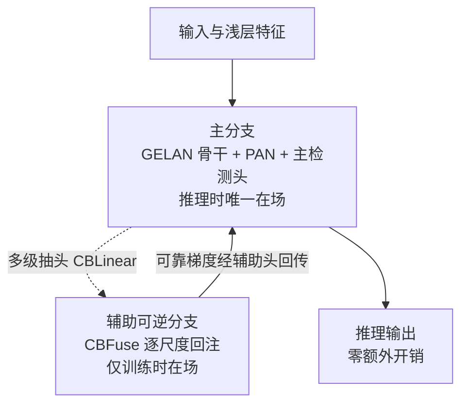
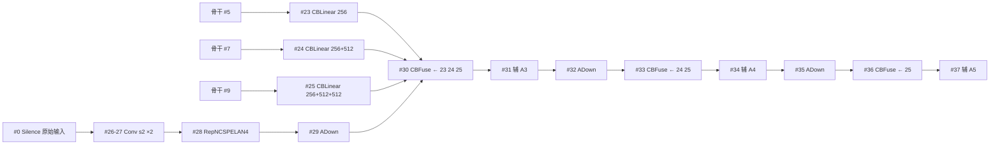
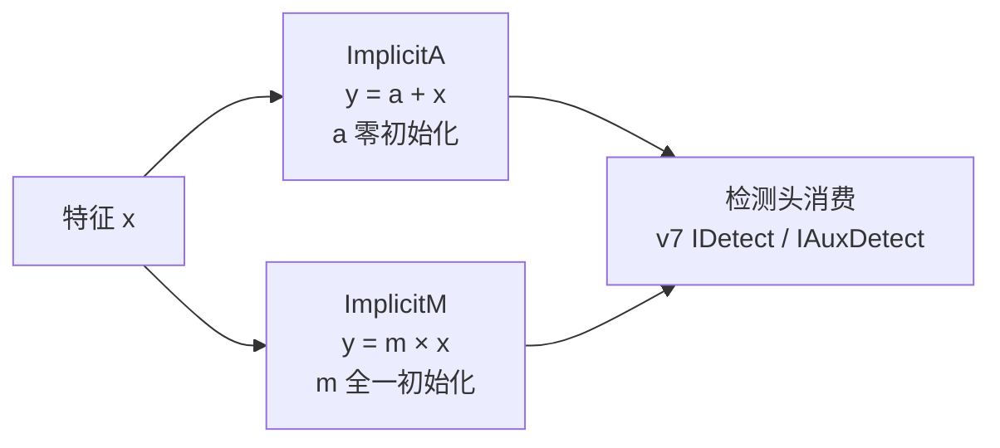
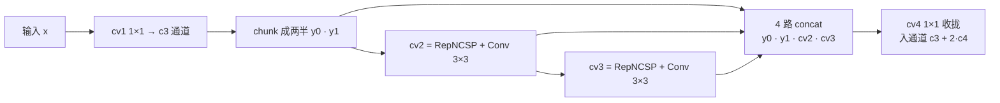
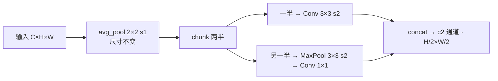
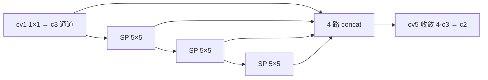
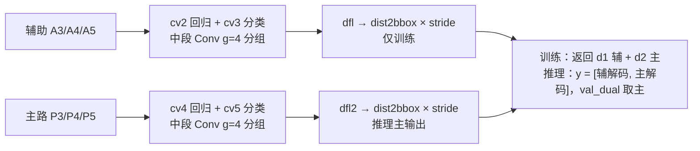
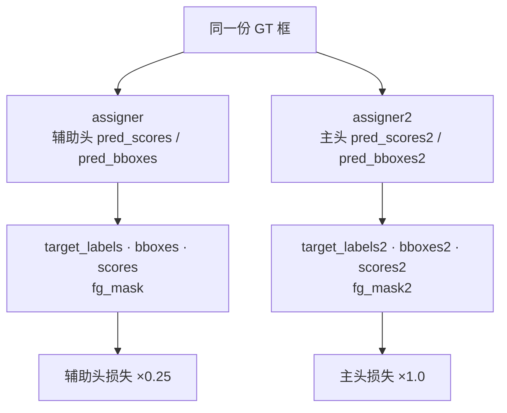
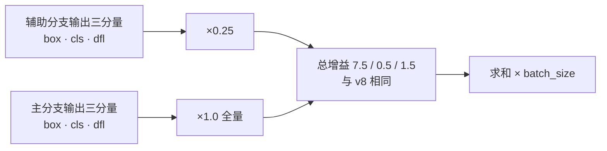
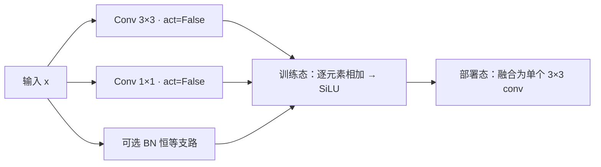

# YOLOv9 理论 Concept

::: tip 只想带走三件事
1. **PGI：训练时多教、推理时轻装**——辅助可逆分支（CBLinear 抽头 + CBFuse 回注）只在训练在场，推理整段拆除、主分支零开销；
2. **GELAN：两级级联 4 路拼接**——RepNCSPELAN4 把「梯度路径规划」做进拓扑，比 C2f 的 n+2 路全拼接更省拼接预算；
3. **双头双分配、主头主导**——主辅两个检测头各自独立 TAL（topk=10），损失辅助分支输出（d1，cv2/cv3）×0.25、主分支输出（d2，cv4/cv5）×1.0，共享骨干的训练梯度由主分支主导，辅助分支提供额外监督与梯度通路、推理拆除。
:::

## 1. PGI 可编程梯度信息总览 (`concept-pgi`)

**定义**：PGI（Programmable Gradient Information）是 v9 的总方法论：为了让主分支拿到「不受信息瓶颈污染」的可靠梯度，训练时在主分支旁挂一条多级辅助可逆分支，把深层特征逐尺度注回辅助主干与辅助检测头；推理时辅助分支整体拆除，主分支保留全部推理能力。

**动机**：论文的两大靶子——深度网络的**信息瓶颈**（逐层不可逆变换让输入信息不断流失，判别能力补不回已丢失的信息）与**梯度不可靠**（回传梯度穿过不可逆变换后失真，深层参数学的是被污染的目标）。辅助分支的存在让「监督信号 → 参数更新」这条主声道绕开这两个坑。

**实现**：



- 三件套的落点：辅助分支在 yaml 层 23-37<SrcLink file="v9:models/detect/yolov9-c.yaml" :line="81" :end="116" />；主辅双头在 DualDDetect<SrcLink file="v9:models/yolo.py" :line="190" :end="237" />；训练梯度靠双 assigner 独立分配加主头主导加权（主输出 ×1.0 / 辅输出 ×0.25）<SrcLink file="v9:utils/loss_tal_dual.py" :line="134" :end="143" />
- 「可编程」指梯度成了设计资源：往哪注（c 版 3 级 / e 版 5 级抽头）、注多少（辅助输出 ×0.25 / 主输出 ×1.0）、辅助头怎么配（DDetect/DualDDetect/TripleDDetect）全是旋钮

**与上版差异**：v7 有 IAuxDetect 辅助头（检测头层面的深监督）；v8 干脆没有辅助分支；v9 把辅助做成「可拆除的主干级路由」——辅助的是梯度，不是输出。

> v8 读者路标：v8 的设计哲学是「没有训练期专用分支，一切为推理而生」；v9 把脚手架重新请回来，但立了新规矩——推理时必须能整段拆掉，部署图不许变胖。

## 2. 辅助可逆分支与 CBLinear/CBFuse 路由 (`concept-aux-branch`)

**定义**：CBLinear 是「一个卷积出 sum(c2s) 个通道、再按 c2s 切成多路」的通道拆分器；CBFuse 把多路特征 interpolate 到目标尺寸后逐元素相加。两者组合把主干多级特征「路由」进辅助主干，构成 PGI 的可逆分支工程形态。

**动机**：论文的可逆分支借鉴 RevCol 的 reversible columns 思想（inverted multibranch），但工程落地不堆数学可逆算子，而是保证「浅层信息不丢」：骨干 5/7/9 层各自抽头，辅助主干从层 0（Silence）拿原始输入重新下采样，每级用 CBFuse 把对应抽头注回——辅助特征同时携带深语义与浅细节。

**实现**：



```python
class CBLinear(nn.Module):
    def forward(self, x):
        outs = self.conv(x).split(self.c2s, dim=1)   # 一个 conv 出 sum(c2s) 通道再按组拆
        return outs

class CBFuse(nn.Module):
    def forward(self, xs):
        target_size = xs[-1].shape[2:]
        res = [F.interpolate(x[self.idx[i]], size=target_size, mode='nearest') for i, x in enumerate(xs[:-1])]
        out = torch.sum(torch.stack(res + xs[-1:]), dim=0)   # 多路对齐尺寸后逐元素相加
        return out
```

<SrcLink file="v9:models/common.py" :line="631" :end="650" />
<SrcLink file="v9:models/detect/yolov9-c.yaml" :line="81" :end="116" />

- Silence（恒等层）是 yaml 第 0 层，辅助主干从它抽原始输入重新下采样<SrcLink file="v9:models/common.py" :line="554" :end="558" />
- parse_model 为这两个新原语专门加了两条通道数分派：CBLinear 整份 c2s 列表透传、CBFuse 取末路通道数<SrcLink file="v9:models/yolo.py" :line="697" :end="702" />
- e 档路由更密：CBLinear 从骨干 1/3/5/7/9 层五级拆分、CBFuse 五处回注<SrcLink file="v9:models/detect/yolov9-e.yaml" :line="45" :end="54" />

**与上版差异**：v7 的辅助只在检测头（IAuxDetect 挂浅层特征）；v8 无辅助；v9 的辅助在通道级——从骨干中段就开始逐尺度路由，Concat 不再是 neck 的专利。

> v8 读者路标：v8 的 yaml 里 Concat 全是显式层号、没有「跨分支路由」概念；CBLinear/CBFuse 是 v9 新增的两种路由原语，读懂层 23-37 就读懂了 PGI 的骨架。

## 3. ImplicitA/ImplicitM 可学习先验 (`concept-implicit`)

**定义**：ImplicitA 给特征加一个可学习的逐通道偏置（\(y = a + x\)），ImplicitM 乘一个可学习的逐通道系数（\(y = m \cdot x\)）；分别以全零/全一初始化、std=0.02 扰动——「先验」由训练学出来。

**动机**：来自 YOLOR（v7 团队的 implicit knowledge 工作）：在检测头前挂 implicit 表达，让网络在「观察」（特征）之外学一点「先验」（如颜色统计、位置倾向）。PGI 论文把「给主分支补充可学习信息」视为历史手段之一，v9 代码库原样保留了这对模块。

**实现**：



```python
class ImplicitA(nn.Module):
    def __init__(self, channel):
        self.implicit = nn.Parameter(torch.zeros(1, channel, 1, 1))
        nn.init.normal_(self.implicit, std=.02)     # 零均值小扰动起步
    def forward(self, x):
        return self.implicit + x                    # 加性先验
```

<SrcLink file="v9:models/common.py" :line="605" :end="613" />
<SrcLink file="v9:models/common.py" :line="616" :end="624" />

- 快照注意：模块定义在 `##### YOLOR #####` 注释区，yolov9-c.yaml 的 DualDDetect 并未挂 implicit——这对模块是 v7 IDetect/IAuxDetect 表头的遗产，v9 快照里「留而未用」，算 PGI 思想的历史注脚

**与上版差异**：v7 的 IDetect/IAuxDetect 在 cv2/cv3 前插 ImplicitA、检测输出前插 ImplicitM；v8 的 Detect 没有任何 implicit；v9 保留定义但主路径不用。

> v8 读者路标：v8 头里找不到 implicit；读 v9 快照时别被 `##### YOLOR #####` 注释区迷惑——那是 v7 血统的存档，不是 v9 的新增。

## 4. GELAN 与 RepNCSPELAN4 两级级联 4 路拼接 (`concept-gelan`)

**定义**：GELAN（Generalized ELAN）把 ELAN 从「Conv 级联 + 隔一取一」的固定拼法推广成「任意计算块当节点、按拓扑规划梯度路径」；落地实例 RepNCSPELAN4：cv1 出两半，一半直通，另一半先进 cv2（RepNCSP + Conv 3×3）、其输出再进 cv3（RepNCSP + Conv 3×3）——两级级联，最后 4 路 concat 由 cv4 收拢。

**动机**：v7 ELAN 论证了梯度路径多样性主导 concat 型网络的可扩展性；v8 C2f 用 n+2 路逐级全拼接实现。GELAN 的取舍是「少拼接路数、让路径跨级联」——4 路里既有直通、也有一级输出与两级输出，路径长度层次更多，拼接预算不随深度涨。

**实现**：



```python
def forward(self, x):
    y = list(self.cv1(x).chunk(2, 1))
    y.extend((m(y[-1])) for m in [self.cv2, self.cv3])   # 级联：cv2 的输出喂 cv3
    return self.cv4(torch.cat(y, 1))
```

<SrcLink file="v9:models/common.py" :line="580" :end="598" />
<SrcLink file="v9:models/common.py" :line="373" :end="384" />

- 与 C2f 对照：C2f 是 n 个 Bottleneck 逐级并联、n+2 路全拼接；GELAN 是两级串联、固定 4 路——参数与拼接预算更好控
- RepNCSP 内部是 RepNBottleneck，cv1 用 RepConvN（见词条 10）<SrcLink file="v9:models/common.py" :line="299" :end="309" />
- 导出优化：forward_split 用 split 替代 chunk<SrcLink file="v9:models/common.py" :line="595" :end="598" />
- 骨干 4 个 + neck 5 个 RepNCSPELAN4 全库铺开<SrcLink file="v9:models/detect/yolov9-c.yaml" :line="14" :end="78" />

**与上版差异**：v8 全库 C2f；v9 全库 RepNCSPELAN4——「每级输出都进 concat」换成「两级级联 + 4 路」，是 v9 结构层最大的一次换代。

> v8 读者路标：C2f 的灵魂是「每级输出都进 concat」（n+2 路，见 [v8 词条](/versions/v8/concepts#_6-c2f-梯度分流结构-concept-c2f)）；GELAN 反向操作——只留 4 路，把省下的预算换成两级级联的深度。

## 5. ADown 平均池化下采样 (`concept-adown`)

**定义**：v9 的下采样模块：先对整图做 2×2、步幅 1 的平均池化（带 overlap、尺寸不变），再 chunk 成两半——一半走 Conv 3×3 s2，另一半走 MaxPool 3×3 s2 + Conv 1×1，最后 concat。

**动机**：普通 Conv s2 下采样「一步跨两像素」容易丢信息；平均池化先把邻域信息「糊」进每个像素，等于下采样前做了一次低成本的信息备份；两半分别走平均化路线与最大化路线，两种统计口径各留一份。

**实现**：



```python
x = torch.nn.functional.avg_pool2d(x, 2, 1, 0, False, True)  # 尺寸不变的平均池化
x1, x2 = x.chunk(2, 1)
x1 = self.cv1(x1)                                   # Conv 3×3 s2
x2 = torch.nn.functional.max_pool2d(x2, 3, 2, 1)    # MaxPool 3×3 s2
x2 = self.cv2(x2)                                   # Conv 1×1
return torch.cat((x1, x2), 1)
```

<SrcLink file="v9:models/common.py" :line="70" :end="83" />

- v9 骨干三次下采样（层 4/6/8）与 neck 两次下采样（层 17/20）全部是 ADown<SrcLink file="v9:models/detect/yolov9-c.yaml" :line="28" />
- 姊妹模块 AConv（avg_pool + Conv 3×3 s2）同样住在 common.py，快照 yaml 未调用<SrcLink file="v9:models/common.py" :line="60" :end="67" />

**与上版差异**：v5~v8 的下采样就是一个 Conv 3×3 s2；v9 换成 ADown——「先平均、再分路」成为骨干与 neck 的标配下采样。

> v8 读者路标：v8 的 P1~P5 全靠 Conv s2；v9 每次分辨率减半前都先过平均池化——下采样不再是「最便宜的那一步」。

## 6. SPPELAN 串行池化金字塔 (`concept-sppelan`)

**定义**：SPP 与 ELAN 的合体：cv1 压通道后串行过 3 个 SP(5)（5×5 MaxPool，SP 即 MaxPool2d 薄封装），每级输出连同 cv1 结果 4 路 concat，cv5 收敛回 c2。

**动机**：v8 SPPF 已证明「5×5 串 3 次 ≈ SPP·5·9·13」的等价性；SPPELAN 把这 4 路 concat 接到 ELAN 式收拢（cv5），命名上宣告「SPP 也是 GELAN 体系的一个节点」——骨干尾部的多感受野聚合角色不变。

**实现**：



```python
y = [self.cv1(x)]
y.extend(m(y[-1]) for m in [self.cv2, self.cv3, self.cv4])   # cv2/cv3/cv4 = 三个 SP·5
return self.cv5(torch.cat(y, 1))
```

<SrcLink file="v9:models/common.py" :line="563" :end="577" />

- yaml 层 10：`[-1, 1, SPPELAN, [512, 256]]`，骨干尾与 neck P5 下行都靠它聚合<SrcLink file="v9:models/detect/yolov9-c.yaml" :line="50" />
- SP 本体就是 MaxPool2d 的薄封装<SrcLink file="v9:models/common.py" :line="187" :end="193" />

**与上版差异**：v7 把 SPP 装进 SPPCSPC 大块；v8 拆成独立 SPPF；v9 的 SPPELAN 与 SPPF 逐行同构（cv1 + 串行 MaxPool + concat + 收拢），只是收拢层命名 cv5、归入 GELAN 注释区——位置和角色与 v8 完全一致。

> v8 读者路标：SPPF（见 [v8 词条](/versions/v8/concepts#_7-sppf-串行池化-concept-sppf)）与 SPPELAN 是同一招的两个名字；v9 的区别只在「名字跟着 ELAN 家族走」。

## 7. DualDDetect 双头解耦 (`concept-dual-ddetect`)

**定义**：双头 DFL 检测头：6 路输入 = 3 路辅助（A3/A4/A5）+ 3 路主路（P3/P4/P5）；`nl = len(ch) // 2`，前半 ch[:nl]（辅助特征）进辅助分支 cv2/cv3、后半 ch[nl:]（主特征）进主分支 cv4/cv5；两个 DFL（dfl/dfl2）各解一路；主辅两路输出通道同为 no = nc + 4×16。

**动机**：PGI 的「辅助梯度」最终要落到检测头层面——辅助特征需要一个自己的出口参与损失；主分支结构保持与 v8 Detect 同构（DFL 解码、dist2bbox、sigmoid 分数），保证推理路径零改动、部署时辅助整路可弃。

**实现**：



```python
self.nl = len(ch) // 2                  # 6 路输入 → 3 个检测尺度
self.no = nc + self.reg_max * 4         # 与 v8 相同：80 + 64 = 144
self.cv2 = ... (Conv(x, c2, 3), Conv(c2, c2, 3, g=4), Conv2d(c2, 4*reg_max, 1, groups=4)) for x in ch[:self.nl]
self.cv4 = ... 同构 for x in ch[self.nl:]
self.dfl, self.dfl2 = DFL(self.reg_max), DFL(self.reg_max)
# 训练态：return [d1 辅, d2 主]；推理态：y = [d1 辅解码, d2 主解码]，val_dual.py 取 y[1] 主路
```

<SrcLink file="v9:models/yolo.py" :line="197" :end="218" />
<SrcLink file="v9:models/yolo.py" :line="226" :end="237" />

- bias_init 主辅两套各初始化一遍<SrcLink file="v9:models/yolo.py" :line="245" :end="255" />；parse_model 把 DualDDetect 与 Detect 系并列分派<SrcLink file="v9:models/yolo.py" :line="704" :end="705" />
- 主辅两支的回归支（cv2/cv4）中段 Conv 都用 g=4 分组卷积、出口 1×1 也 groups=4——v8 的 Detect 没有这一手，参数省且分组互不干扰
- 单头版 DDetect 供 gelan 系使用<SrcLink file="v9:models/yolo.py" :line="78" />；三头版 TripleDDetect 配合 train_triple.py 存在

**与上版差异**：v8 单头 Detect（无辅助路）；v7 IAuxDetect 是「主头 + 深监督头」的从属关系；v9 双头地位平等、各自 TAL 分配（见词条 8），只是推理时留主去辅。

> v8 读者路标：v8 的 Detect 解耦头结构（回归 + 分类两支 + DFL）在 v9 由吃主分支 P3/P4/P5 的 cv4/cv5/dfl2 承接、推理保留（见 [v8 解耦头词条](/versions/v8/concepts#_2-解耦检测头与无-objectness-设计-concept-decoupled-head)）；新增的只是「再配一套 cv2/cv3/dfl 吃辅助特征 A3/A4/A5」。

## 8. 主辅双头独立 TAL 分配 (`concept-dual-tal`)

**定义**：ComputeLoss 实例化两个 TaskAlignedAssigner（assigner 与 assigner2，topk=10、α=0.5、β=6.0，可用环境变量 YOLOM/YOLOA/YOLOB 覆盖）；同一份 GT 分别对辅助头预测（d1，cv2/cv3 吃 A3/A4/A5）与主头预测（d2，cv4/cv5 吃 P3/P4/P5）各跑一遍 TAL，两套正样本互不共享。

**动机**：主辅特征质量不同——辅助头吃 CBFuse 融合过的「浅注深」特征，其对齐度量分布与主头不同；若共用一套分配，辅助头会被主头的对齐度量绑架。独立分配让两条分支各自对齐各自的预测质量。

**实现**：



```python
self.assigner = TaskAlignedAssigner(topk=int(os.getenv('YOLOM', 10)), alpha=..., beta=...)
self.assigner2 = TaskAlignedAssigner(topk=int(os.getenv('YOLOM', 10)), alpha=..., beta=...)
...
target_labels, target_bboxes, target_scores, fg_mask = self.assigner(...)     # 辅助头（d1）
target_labels2, ..., fg_mask2 = self.assigner2(...)                           # 主头（d2）
```

<SrcLink file="v9:utils/loss_tal_dual.py" :line="134" :end="143" />
<SrcLink file="v9:utils/loss_tal_dual.py" :line="199" :end="212" />

- 独立分配之外还有 lead-head 引导版 ComputeLossLH：辅助头直接采用主头的分配结果<SrcLink file="v9:utils/loss_tal_dual.py" :line="254" />（引导逻辑在 L342-348——用主头 pred_scores2/pred_bboxes2 跑分配），辅助头损失同样 ×0.25、主头 ×1.0——v7 lead-head 思路的延续；train_dual.py 里注释备选、快照默认不启用<SrcLink file="v9:train_dual.py" :line="40" :end="42" />
- assigner 本体在 utils/tal/assigner.py：类默认 topk=13，实例化传 10，与 v8 同款<SrcLink file="v9:utils/tal/assigner.py" :line="51" :end="62" />

**与上版差异**：v8 一个 assigner 一套正样本；v7 lead-guided 是「粗对辅助、细对主头」的两套分配；v9 默认两套**平行**分配（谁也不引导谁），想用引导式要手动换 ComputeLossLH。

> v8 读者路标：v8 的 TAL 只跑一遍、实例化 topk=10（见 [v8 TAL 词条](/versions/v8/concepts#_3-tal-任务对齐标签分配-concept-tal)）；v9 把它复制成两份——分配逻辑零改动、翻倍使用，连环境变量开关都一模一样。

## 9. 主头主导的损失权重 1.0 vs 0.25 (`concept-aux-weight`)

**定义**：双头损失的加权规则：分类 loss = 辅助分支输出 BCE × 0.25 + 主分支输出 BCE × 1.0；box/dfl 辅助分支输出各 ×0.25、主分支输出全量计入；最后再乘总增益 7.5 / 0.5 / 1.5。主头的有效权重是辅助头的 4 倍。

**动机**：主分支输出（d2，吃 P3/P4/P5）是推理/验证唯一保留的头（val_dual.py 取 d2），必须拿全量权重 1.0 按最终任务直接收敛；辅助分支输出（d1，吃 A3/A4/A5）以 0.25 的较低权重提供 PGI 的辅助监督与额外梯度通路——量级上不淹没主任务信号。主头是主角、辅头是助教，反向传播的主声道在主分支侧，辅助分支是「加课」而非「代练」。

**实现**：

$$\mathcal{L} = 7.5\,\bigl(\mathcal{L}^{m}_{box} + 0.25\,\mathcal{L}^{a}_{box}\bigr) + 0.5\,\bigl(\mathcal{L}^{m}_{cls} + 0.25\,\mathcal{L}^{a}_{cls}\bigr) + 1.5\,\bigl(\mathcal{L}^{m}_{dfl} + 0.25\,\mathcal{L}^{a}_{dfl}\bigr)$$

上标 \(m\) 主分支输出、\(a\) 辅助分支输出。



```python
loss[1] = self.BCEcls(pred_scores, target_scores.to(dtype)).sum() / target_scores_sum
loss[1] *= 0.25                                   # 辅助分支输出（d1）分类打 2.5 折
loss[1] += self.BCEcls(pred_scores2, target_scores2.to(dtype)).sum() / target_scores_sum2  # 主分支输出（d2）全量
...
loss[0] *= 0.25                                   # 辅助分支输出 box 打 2.5 折
loss[2] *= 0.25                                   # 辅助分支输出 dfl 打 2.5 折
...
loss[0] += loss0_                                 # 主分支输出全量计入
loss[2] += loss2_
loss[0] *= 7.5  # box gain
loss[1] *= 0.5  # cls gain
loss[2] *= 1.5  # dfl gain
```

<SrcLink file="v9:utils/loss_tal_dual.py" :line="219" :end="249" />

- VFL 写法留注释未启用（L220）——与 v8 检测损失的注释存档如出一辙
- 别把两组权重搞混：0.25/1.0 是主辅声部的混音，7.5/0.5/1.5 是三分量的总增益，后者在 hyp.scratch-high.yaml 里同口径

**与上版差异**：v7 有逐层 balance [4.0, 1.0, 0.4] 且辅助头（IAuxDetect）损失独立加权；v8 无辅助项；v9 的 0.25/1.0 是「主头主导」的显式表达——数值上主声部是辅助声部的 4 倍。

> v8 读者路标：v8 三分量增益 7.5/0.5/1.5（见 [v8 损失词条](/versions/v8/concepts#_5-ciou-与三分量损失加权-concept-loss-weights)）在 v9 原样保留；新增的只是主辅两声部的 0.25/1.0 混音。

## 10. RepConvN 重参数化 (`concept-repconvn`)

**定义**：RepConv 的 N 版：训练态并行两条卷积——Conv 3×3 与 Conv 1×1（外加可选 BN 恒等支路），forward 直接相加再激活；部署态用 get_equivalent_kernel_bias 把三条支路融合成单个 3×3 conv。

**动机**：训练期多分支提升容量与梯度多样性，推理期融合回单路不添延迟——planned re-param（v7）的家族手法。GELAN 体系里的 RepNBottleneck 用它当积木（cv1 = RepConvN），让 RepNCSPELAN4 的「N」有着落：级联每一级内部都是重参数化瓶颈。

**实现**：



```python
def forward(self, x):
    id_out = 0 if self.bn is None else self.bn(x)
    return self.act(self.conv1(x) + self.conv2(x) + id_out)   # 训练态三路相加
```

<SrcLink file="v9:models/common.py" :line="86" :end="111" />

- 融合数学：get_equivalent_kernel_bias 把 1×1 核 pad 成 3×3、BN 转恒等核再加总<SrcLink file="v9:models/common.py" :line="113" :end="117" />；docstring 注明基于 RepVGG<SrcLink file="v9:models/common.py" :line="87" :end="89" />
- RepNBottleneck：cv1 用 RepConvN、cv2 用普通 Conv、带残差<SrcLink file="v9:models/common.py" :line="299" :end="309" />
- 推理导出链路：融合后 RepNCSPELAN4 走 forward_split 的拆分路径<SrcLink file="v9:models/common.py" :line="595" :end="598" />

**与上版差异**：v8 官方 yaml 完全不用重参数化；v7 RepConv 用于 neck 收口（planned re-param 选位）；v9 把重参数化下沉进骨干/neck 每一块 GELAN（RepNBottleneck + RepConvN）——「rep 前缀」成了 GELAN 积木的默认材质。

> v8 读者路标：v8 砍掉重参数化是为了「好导出」；v9 把它请回来并证明融合后不添开销。词条出处见 [RepConv/RepConvN](/glossary#repconv-repconvn-计划重参数化)。

## 延伸阅读

- [v9 概览（指标表与 v8→v9 差异表）](/versions/v9/index)
- [v9 论文精读（PGI 与 GELAN 的论文叙事）](/versions/v9/paper)
- [v8 理论 Concept（C2f/TAL/DFL 对照）](/versions/v8/concepts)
- [v7 理论 Concept（ELAN 与 lead-head 对照）](/versions/v7/concepts)
- [术语表](/glossary)
