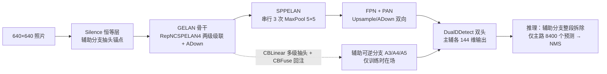
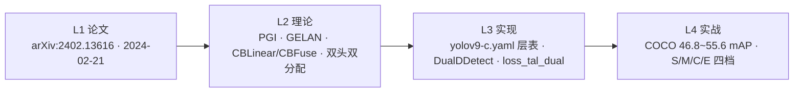
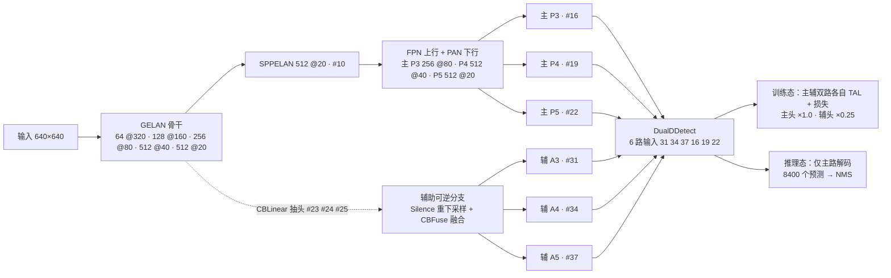
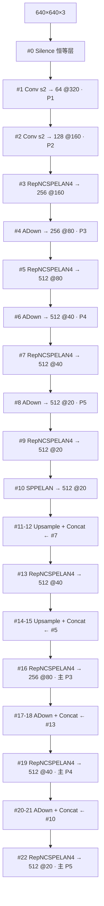
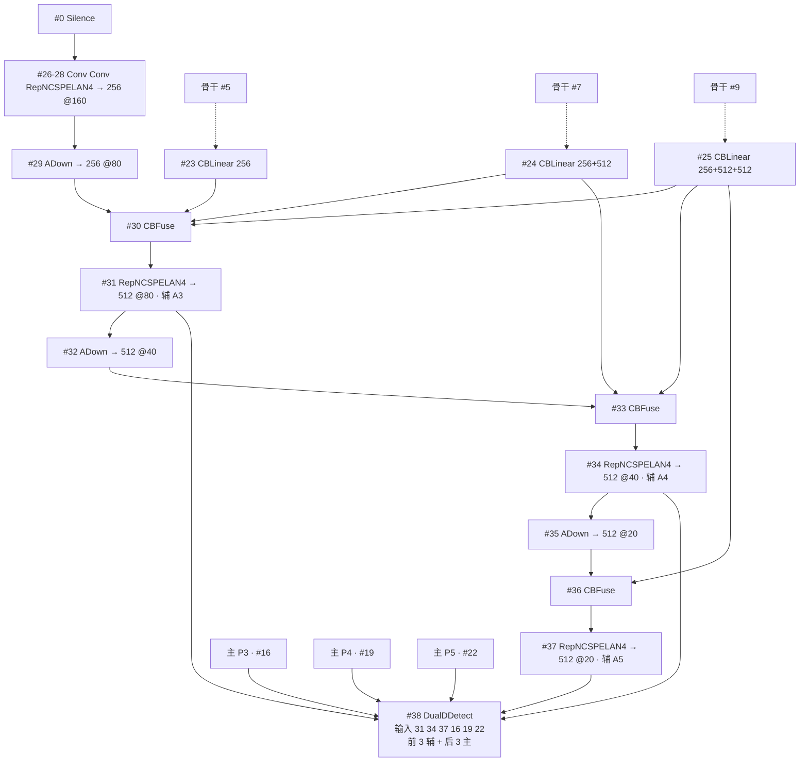

# YOLOv9 (2024-02)

> **TL;DR**
> - 一句话：PGI 可编程梯度信息 + GELAN 两级级联，训练多学、推理不亏
> - 解决：训练效率 vs 推理速度的取舍
> - 代价：辅助分支只在训练期，部署时要剥除
>
> **前置阅读**：[YOLOv8](/versions/v8/index) → [梯度信息](/glossary#梯度信息) → [GELAN](/glossary#gellan-generalized-elan) → [CBFuse / CBLinear](/glossary#cblinear-cbfuse)

**PGI 可编程梯度信息 + GELAN——辅助分支管梯度、主分支管推理，「论文 + 实现同步」的学术回归之作**

- 📄 论文：arXiv:2402.13616《YOLOv9: Learning What You Want to Learn Using Programmable Gradient Information》（2024-02-21，详见[论文精读](/versions/v9/paper)）
- 🏛️ 作者：WongKinYiu、Chien-Yao Wang 等（v7 原班团队回归，国家高能物理研究所参与）
- 💻 源码：[WongKinYiu/yolov9](https://github.com/WongKinYiu/yolov9)（快照取自 main @ `7d639b1`，2024-02-19——比论文发布早两天）
- 🎯 里程碑：**PGI 让「训练多学、推理不亏」第一次可以兼得**——多级可逆辅助分支训练期回传可靠梯度、推理期整段拆除零开销，GELAN 骨干两级级联轻量高效，COCO 55.6% AP（E 档，README 口径）站上论文发布时点实时检测器的 SOTA 位

## 3 分钟电梯演讲

1. **PGI：主分支推理零开销的可靠梯度**：训练时多级可逆辅助分支从骨干 5/7/9 层抽头（CBLinear 拆通道、CBFuse 融合回注），把不受信息瓶颈污染的梯度送给辅助检测头；推理时整段辅助分支拆除，主分支照常收口、零额外开销——练的时候多教，上场的时候轻装。
2. **GELAN：两级级联的轻量高效聚合**：广义 ELAN 把任意计算块当节点、以拓扑设计规划梯度路径——RepNCSPELAN4 里 cv1 出两半、两级 RepNCSP 级联、4 路 concat 收拢；对比 v8 C2f 的 n+2 路全拼接，GELAN 用更少的拼接路数保住梯度多样性。
3. **anchor-free + TAL + DFL 延续 v8 默认，双头训练**：\(no = nc + 4 \times 16\)、[TAL](/glossary#tal-task-alignment-learning) topk=10/α=0.5/β=6.0、增益 7.5/0.5/1.5 全套沿用 v8 口径；新意在于主辅两个检测头各自独立 TAL 分配，且主分支输出（d2，吃 P3/P4/P5）监督权重 1.0、辅助分支输出（d1，吃 A3/A4/A5）×0.25——主头损失是辅助头的 4 倍，共享骨干梯度由主分支主导，辅助分支提供额外监督与梯度通路。

> 已读过 [v7](/versions/v7/index) / [v8](/versions/v8/index)？本页下方有 v8→v9 逐项差异表；ELAN 的出身见 [v7 论文精读](/versions/v7/paper)，C2f 的对照见 [v8 理论 Concept](/versions/v8/concepts)；术语不熟先查[术语表](/glossary)。

## 四层闭环视图

## 核心贡献

1. **PGI 可编程梯度信息**：把「训练信息不被深度吃掉」拆成三件事——主分支保留推理能力、辅助可逆分支回传可靠梯度、多级辅助信息按尺度注回；推理时辅助分支整体拆除，部署图与 v8 一样干净<SrcLink file="v9:models/detect/yolov9-c.yaml" :line="81" :end="116" />
2. **辅助可逆分支的通道级路由 CBLinear/CBFuse**：CBLinear 一个卷积出 sum(c2s) 个通道再按组 split，CBFuse 把多路特征 interpolate 到目标尺寸后逐元素相加——可逆性不靠堆 reversible 单元，而靠「主干多级抽头 + 逐尺度注回辅助主干」<SrcLink file="v9:models/common.py" :line="631" :end="650" />
3. **GELAN 广义高效层聚合**：RepNCSPELAN4——cv1 出两半，两级 RepNCSP 串联（cv2 的输出喂 cv3），4 路 concat 由 cv4 收拢；把 ELAN 从「固定积木拼接」推广成「任意块 + 拓扑规划梯度路径」<SrcLink file="v9:models/common.py" :line="580" :end="598" />
4. **DualDDetect 双头解耦检测**：6 路输入 = 3 辅 + 3 主，cv2/cv3 辅助分支（吃 A3/A4/A5）、cv4/cv5 主分支（吃 P3/P4/P5），两支回归支中段都用 Conv g=4 分组卷积，dfl/dfl2 两个 DFL；训练返回 [d1, d2] 双路，推理只走 d2 主路<SrcLink file="v9:models/yolo.py" :line="190" :end="237" />
5. **主辅双头独立 TAL + 主头主导加权**：两个 TaskAlignedAssigner（topk=10、α=0.5、β=6.0）对同一份 GT 各自分配；辅助分支输出（d1，cv2/cv3）cls/box/dfl 各 ×0.25，主分支输出（d2，cv4/cv5）全权重 1.0——主头损失是辅助头的 4 倍，主导共享骨干梯度，辅助分支是训练期辅助监督 + 梯度通路（PGI），推理拆除<SrcLink file="v9:utils/loss_tal_dual.py" :line="199" :end="223" />

## 推理效果一览

::: figure 图：v9 训练/推理双态流水线——GELAN 骨干 + FPN/PAN 产出主路 P3/P4/P5；辅助分支从骨干 #5/#7/#9 抽头、从 Silence 重新下采样出 A3/A4/A5；DualDDetect 训练态主辅双路各自解码，推理态只保留主路

:::

## 关键指标

**检测（COCO val，输入 640，README 表口径）**

| 模型 | APval | AP50 | AP75 | 参数量 M | FLOPs G |
|------|------------------|------|------|----------|---------|
| YOLOv9-S | 46.8 | 63.4 | 50.7 | 7.2 | 26.7 |
| YOLOv9-M | 51.4 | 68.1 | 56.1 | 20.1 | 76.8 |
| YOLOv9-C | 53.0 | 70.2 | 57.8 | 25.5 | 102.8 |
| YOLOv9-E | 55.6 | 72.8 | 60.6 | 58.1 | 192.5 |

- 口径提醒：README 只给 S/M/C/E 四档（论文另有 t/s 补充档）；val 口径，与 v7 论文的 test-dev 不直比；README 没有延迟列，对比 v8 README 的 CPU ONNX / A100 TRT 双延迟表时只比 AP 与参数量
- 训练入口：yolov9 系用 `train_dual.py --cfg models/detect/yolov9-c.yaml --hyp hyp.scratch-high.yaml --epochs 500 --close-mosaic 15`（双头损失 <SrcLink file="v9:train_dual.py" :line="40" :end="42" />）；gelan 系用 `train.py --cfg models/detect/gelan-c.yaml`（单头）；另有 train_triple.py 三头变体

## 网络架构

::: figure 图：yolov9-c 主干与主分支——GELAN 骨干五次降采样出 P3/P4/P5，FPN 上行 + PAN 下行收在层 16/19/22

:::

::: figure 图：yolov9-c 多级可逆辅助分支（层 23-37）——骨干 5/7/9 层 CBLinear 抽头，辅助主干从 Silence 重新下采样，ADown 与 CBFuse 交替逐级融合出 A3/A4/A5

:::

- 结构由 **yaml 层表**驱动，没有 v8 式 scales：depth_multiple = width_multiple = 1.0、anchors: 3，S/M/C/E 每档一份独立 yaml<SrcLink file="v9:models/detect/yolov9-c.yaml" :line="4" :end="11" />；骨干层 0-9 <SrcLink file="v9:models/detect/yolov9-c.yaml" :line="14" :end="44" />、head 主路层 10-22 <SrcLink file="v9:models/detect/yolov9-c.yaml" :line="47" :end="78" />、辅助分支层 23-37 <SrcLink file="v9:models/detect/yolov9-c.yaml" :line="81" :end="116" />、检测头一行收 6 路<SrcLink file="v9:models/detect/yolov9-c.yaml" :line="123" />
- DualDDetect 从 [31, 34, 37, 16, 19, 22] 收 6 路输入：前 3 路辅助、后 3 路主路，`nl = len(ch) // 2`、`no = nc + reg_max*4` 与 v8 同口径<SrcLink file="v9:models/yolo.py" :line="197" :end="203" />
- GELAN 基线对照：gelan-c.yaml 无辅助分支，单头 DDetect 收 [15, 18, 21]——README 的 gelan 档就是「只有 GELAN 没有 PGI」的消融对照<SrcLink file="v9:models/detect/gelan-c.yaml" :line="79" />
- E 档辅助路由更深：CBLinear 从骨干 1/3/5/7/9 层五级拆分（层 10-14）、CBFuse 五处回注<SrcLink file="v9:models/detect/yolov9-e.yaml" :line="45" :end="54" />，DualDDetect 输入 [35, 32, 29, 42, 45, 48]<SrcLink file="v9:models/detect/yolov9-e.yaml" :line="143" />

## 核心 Concept 一览

| Concept | 一句话 | 对应代码位置 |
|---------|--------|-------------|
| [PGI 可编程梯度信息总览](/versions/v9/concepts#_1-pgi-可编程梯度信息总览-concept-pgi) | 辅助可逆分支 + 多级辅助信息，主分支推理零开销 | <SrcLink file="v9:models/detect/yolov9-c.yaml" :line="81" :end="116" /> |
| [辅助可逆分支与 CBLinear/CBFuse 路由](/versions/v9/concepts#_2-辅助可逆分支与-cblinear-cbfuse-路由-concept-aux-branch) | 主干多级抽头拆通道，逐尺度注回辅助主干 | <SrcLink file="v9:models/common.py" :line="631" :end="650" /> |
| [ImplicitA/ImplicitM 可学习先验](/versions/v9/concepts#_3-implicita-implicitm-可学习先验-concept-implicit) | 加性/乘性逐通道可学习偏置，YOLOR 遗产 | <SrcLink file="v9:models/common.py" :line="605" :end="624" /> |
| [GELAN 与 RepNCSPELAN4 两级级联 4 路拼接](/versions/v9/concepts#_4-gelan-与-repncspelan4-两级级联-4-路拼接-concept-gelan) | 两级 RepNCSP 串联 4 路 concat，ELAN 的广义化 | <SrcLink file="v9:models/common.py" :line="580" :end="598" /> |
| [ADown 平均池化下采样](/versions/v9/concepts#_5-adown-平均池化下采样-concept-adown) | avgpool 先糊再 chunk，conv/maxpool 分路收拢 | <SrcLink file="v9:models/common.py" :line="70" :end="83" /> |
| [SPPELAN 串行池化金字塔](/versions/v9/concepts#_6-sppelan-串行池化金字塔-concept-sppelan) | cv1 + 串行 3 次 SP·5 → 4 路 concat 收拢 | <SrcLink file="v9:models/common.py" :line="563" :end="577" /> |
| [DualDDetect 双头解耦](/versions/v9/concepts#_7-dualddetect-双头解耦-concept-dual-ddetect) | 6 路 = 3 辅 + 3 主，主辅各一套 cv 与 DFL | <SrcLink file="v9:models/yolo.py" :line="190" :end="237" /> |
| [主辅双头独立 TAL 分配](/versions/v9/concepts#_8-主辅双头独立-tal-分配-concept-dual-tal) | 同一份 GT 跑两遍 TAL，两套正样本互不共享 | <SrcLink file="v9:utils/loss_tal_dual.py" :line="134" :end="143" /> |
| [主头主导的损失权重 1.0 vs 0.25](/versions/v9/concepts#_9-主头主导的损失权重-1-0-vs-0-25-concept-aux-weight) | 辅助分支输出（d1，cv2/cv3）×0.25、主分支输出（d2，cv4/cv5）×1.0，主头损失是辅助头的 4 倍 | <SrcLink file="v9:utils/loss_tal_dual.py" :line="219" :end="249" /> |
| [RepConvN 重参数化](/versions/v9/concepts#_10-repconvn-重参数化-concept-repconvn) | 3×3 + 1×1 训练并存，部署融合回单路 | <SrcLink file="v9:models/common.py" :line="86" :end="111" /> |

## v8 → v9 关键差异

| 维度 | YOLOv8（Ultralytics，2023-01） | YOLOv9（v7 团队回归，2024-02） |
|------|------------------------------|-------------------------------|
| 出品方 | Ultralytics（工业界产品线） | v4/v7 学术团队 + 国家高能物理研究所回归 |
| 论文 | **无独立论文**（文档 + 博客 + CITATION.cff） | arXiv:2402.13616，**论文与实现同步发布** |
| 骨干 | C2f（split + n×Bottleneck + 全拼接） | **GELAN**（RepNCSPELAN4 两级级联 4 路拼接） |
| 下采样 | Conv 3×3 s2 | **ADown**（平均池化 + conv/maxpool 分路） |
| Neck | SPPF + FPN/PAN | SPPELAN + FPN/PAN（积木全换 GELAN 系） |
| 检测头 | 单头 Detect，no = nc + 4×16 | **DualDDetect 双头**：主辅各 no = nc + 4×16，回归支中段 g=4 分组卷积 |
| 标签分配 | 单 assigner TAL topk=10 | **双 assigner**：主辅各自独立 TAL（ComputeLossLH 备选 lead-head 引导式） |
| 损失 | BCE + CIoU + DFL，增益 7.5/0.5/1.5 | 同款三分量 + **双头加权**：主分支输出 ×1.0、辅助分支输出 ×0.25，主头主导 |
| 辅助分支 | 无 | **PGI 多级可逆辅助分支**（CBLinear/CBFuse 路由，推理时整段拆除） |
| 重参数化 | 不用（官方 yaml 只有 Conv/C2f/SPPF） | **RepConvN + RepNBottleneck**：GELAN 积木默认材质，部署融合 |
| 配置文件 | 一份 yaml + scales 五档 | 每档独立 yaml（yolov9-c/e、gelan-c/e/t），depth/width = 1.0 |
| 训练入口 | 单一 train 接口 | **train.py / train_dual.py / train_triple.py 三入口分立**（单头/双头/三头） |
| 指标口径 | README COCO val2017 + 双延迟列 | README **COCO val 640**：S 46.8 / M 51.4 / C 53.0 / E 55.6 AP，无延迟列 |
| 许可证 | AGPL-3.0 开源 + 商业双轨 | 快照根**无 LICENSE 文件**（引用时以仓库当前口径为准） |

## 后续演进速览

- **v10（2024）**：Ultralytics NMS-free 端到端（fork 自 8.1.34）
- **v11（2024）**：官方线 v1 版本——C3k2 + C2PSA 迭代
- **v12（2025）**：官方线 A2C2f + A2CBB 等新块
- **v13（2025）**：论文回归 + HyperACE（Apache-2.0）

> **v10-v13 读者路标**：v9 之后 YOLO 分叉为「Ultralytics 官方线」与「学术重构线」，详见 [v10 概览](/versions/v10/index) 起。

## 深入阅读

- [论文精读（PGI 与 GELAN 的动机、方法与实验叙事）](/versions/v9/paper)
- [理论 Concept（10 条逐个拆解）](/versions/v9/concepts)
- [v8 概览（对照上一代默认值）](/versions/v8/index) · [v8 论文精读（以代码为论文）](/versions/v8/paper) · [v8 理论 Concept](/versions/v8/concepts)
- [v7 论文精读（ELAN 与 lead-head 的出身）](/versions/v7/paper)
- [系列家族对照](/global/family) · [术语表](/glossary)
