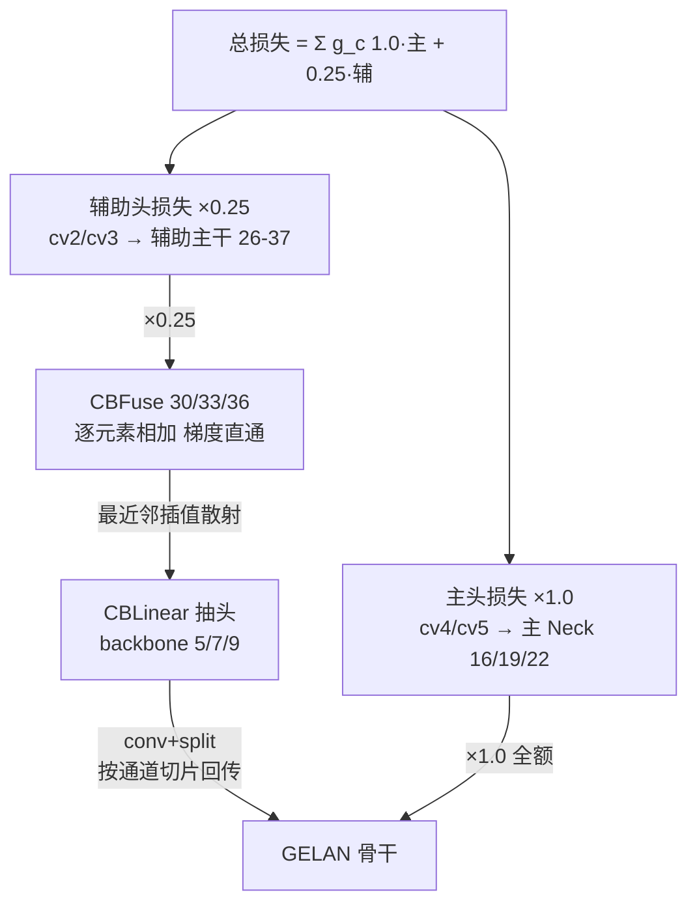

# YOLOv9 反向传播推导

::: tip 只想带走三件事
1. **分量梯度与 v8 逐字相同**：软标签 BCE 合并梯度 \(\sigma(z) - qy\)、CIoU 经期望距离线性链式 ±1、DFL 双 bin 梯度 \(w_l(p_k-\delta_{t_l}) + w_r(p_k-\delta_{t_r})\) 且最优分布期望恰为目标值——v9 没动这些公式，只换了代码出处；
2. **v9 真正的新推导只有双头聚合**：总损失 = 1.0·主头 + 0.25·辅助头，对共享骨干参数 \(\partial L/\partial\theta_s = \partial L_{m}/\partial\theta_s + 0.25\,\partial L_{a}/\partial\theta_s\)——主分支的梯度话语权是辅助分支的 4 倍，两支在同一批骨干参数上累加，辅助分支提供 PGI 的额外监督与梯度通路；
3. **辅助分支的梯度经 CBLinear/CBFuse 回流主干**：CBFuse 逐元素相加、梯度直通（最近邻插值把梯度散回抽头层），CBLinear 是 conv + split、梯度按通道切片经卷积核回传；推理时辅助分支整体拆除，不影响主分支任何权重。
:::

## 0. 梯度来源与记号

| | darknet (v1-v4) | PyTorch (v5-v9) |
|--|-----------------|-----------------|
| 梯度计算 | 手写 `delta_xxx` | `autograd` 自动 |
| 标签分配梯度 | 不涉及 | 分配结果在 autograd 之外（v6 显式 `no_grad` + `detach`，v7 离散索引隐式常量，v8 装饰器 + detach 双保险，v9 两套 assigner 各上双保险） |

本页记号：

- 上标 \(m\)：主头（main，DualDDetect 的 cv4/cv5 分支，吃主分支特征 P3/P4/P5，推理保留），上标 \(a\)：辅助头（auxiliary，cv2/cv3 分支，吃辅助特征 A3/A4/A5）
- \(z\)：分支输出的 logit，\(p = \sigma(z)\)；分类与 DFL 共用这套记号
- \(y\)：one-hot 类别目标（TAL scatter 产出，<SrcLink file="v9:utils/tal/assigner.py" :line="175" :end="177" />）
- \(q\)：软标签质量，分类目标 \(t = q \cdot y\)，\(q \in (0, 1]\) 由 align_metric 归一化而来（<SrcLink file="v9:utils/tal/assigner.py" :line="98" :end="102" />），是 detach 常量；主辅两套记 \(q^m, q^a\)
- \(s_k, k = 0..15\)：某条 ltrb 边 16 个 bin 的分布 logit；\(p_k = \mathrm{softmax}(s)_k\)
- \(t\)：目标距离（feature 像素），\(t_l = \lfloor t \rfloor\)、\(t_r = t_l + 1\)、\(w_l = t_l + 1 - t\)、\(w_r = 1 - w_l\)
- CIoU 里 box1=预测、box2=GT（BboxLoss 的调用顺序，<SrcLink file="v9:utils/loss_tal_dual.py" :line="75" />）
- \(\Sigma_q = \max(\sum \text{target\_scores},\ 1)\)：归一化分母，主头 \(\Sigma_q^m\)、辅助头 \(\Sigma_q^a\) 各一套（<SrcLink file="v9:utils/loss_tal_dual.py" :line="215" :end="217" />）
- \((\lambda, g_{box}, g_{cls}, g_{dfl}) = (0.25,\ 7.5,\ 0.5,\ 1.5)\)：λ = 0.25 是辅助分支输出的内层权重（主分支输出为 1.0），三者为三分量增益（<SrcLink file="v9:utils/loss_tal_dual.py" :line="222" />、<SrcLink file="v9:utils/loss_tal_dual.py" :line="234" :end="235" />、<SrcLink file="v9:utils/loss_tal_dual.py" :line="247" :end="249" />）

## 1. 双头聚合的总梯度 (`grad-dual`)

这是 v9 相对 v8 唯一全新的推导。总损失（[损失页第 2 节](/versions/v9/losses#_2-双头权重-主头-×1-0-辅助头-×0-25-loss-dual)的装配，<SrcLink file="v9:utils/loss_tal_dual.py" :line="219" :end="251" />）：

$$L = b \sum_{c \in \{box,\, cls,\, dfl\}} g_c \Big( L_c^{m} + \lambda\, L_c^{a} \Big)$$

其中 \(b\) 是 batch_size。按参数的作用域拆成三类——梯度聚合规则一眼可读：

**只出现在主头路径的参数** \(\theta_m\)（cv4/cv5 分支、主 Neck 层 16/19/22）：

$$\frac{\partial L}{\partial \theta_m} = b \sum_c g_c\, \frac{\partial L_c^{m}}{\partial \theta_m}$$

**只出现在辅助路径的参数** \(\theta_a\)（cv2/cv3 分支、辅助主干层 26-37、CBLinear 的 conv）：

$$\frac{\partial L}{\partial \theta_a} = b \sum_c g_c\, \lambda\, \frac{\partial L_c^{a}}{\partial \theta_a}$$

**共享骨干参数** \(\theta_s\)（GELAN 骨干 + Silence 抽头之前的所有层）：

$$\boxed{\ \frac{\partial L}{\partial \theta_s} = b \sum_c g_c \Big( \underbrace{\frac{\partial L_c^{m}}{\partial \theta_s}}_{\text{主头全权重}} + \underbrace{0.25\, \frac{\partial L_c^{a}}{\partial \theta_s}}_{\text{辅助头辅助监督}} \Big)\ }$$

- **4 倍话语权**：对同一个骨干参数，主分支每项损失的梯度系数是辅助分支的 \(1/\lambda = 4\) 倍——共享骨干的训练梯度由主分支主导（主分支出 \(4/5\)、辅助分支出 \(1/5\)）；辅助分支以 λ=0.25 提供额外监督与梯度通路，这就是 PGI「用辅助分支规划主分支梯度」的数学形态：辅助分支「陪练」特征而不绑架主任务目标
- **为什么辅助头还要留 0.25**：两条独立的 TAL 分配产生两套可能不同的正样本目标（<SrcLink file="v9:utils/loss_tal_dual.py" :line="199" :end="212" />），辅助头的 0.25 让辅助分支的监督也参与拉扯共享骨干——若权重为 0，辅助分支整段（CBLinear/CBFuse/辅助主干/cv2-cv3）拿不到梯度、PGI 形同虚设；推理拆掉辅助分支后，主头在「被辅助监督带教过的特征」上仍按自己的目标收敛
- **λ 只乘梯度、不进分配**：0.25 出现在损失加权处（<SrcLink file="v9:utils/loss_tal_dual.py" :line="222" />、<SrcLink file="v9:utils/loss_tal_dual.py" :line="234" :end="235" />），而分配器在 no_grad 里早跑完了——**分配与加权解耦**，这是与 v7「按层 balance 加权」的本质区别（v7 的 balance 逐层缩放输出通道，v9 整头一个系数）
- **\(\Sigma_q^m \neq \Sigma_q^a\)**：两套软标签各除各的分母，主辅分量的量纲各自归一后再按 1.0 / 0.25 混合



> v8 读者路标：v8 的总梯度就是单头三分量加权（[v8 反向传播推导](/versions/v8/loss-gradient) 第 6 节）；v9 在其外面套了一层 \(1.0\,\partial_m + 0.25\,\partial_a\) 的线性组合——理解了这一节，v9 的梯度行为就只比 v8 多这一个公式。

## 2. CIoU 的回归梯度 (`grad-ciou`)

**与 v8 相同的公式，v9 的代码出处**。回归损失（主头，辅助头同款换下标）：

$$L_{iou}^{m} = \frac{\sum_i \big(1 - \mathrm{CIoU}_i\big)\, q_i^m}{\Sigma_q^m}$$

[CIoU loss](/glossary#ciou-loss) 的实现在 `utils/metrics.py`（`from utils.metrics import bbox_iou`，<SrcLink file="v9:utils/loss_tal_dual.py" :line="8" />），加权与归一在 BboxLoss（<SrcLink file="v9:utils/loss_tal_dual.py" :line="73" :end="79" />）：

$$\mathrm{CIoU} = \mathrm{IoU} - \frac{\rho^2}{c^2} - \alpha v, \qquad v = \frac{4}{\pi^2}\left(\arctan\frac{w_2}{h_2} - \arctan\frac{w_1}{h_1}\right)^2, \qquad \alpha = \frac{v}{v - \mathrm{IoU} + 1}$$

对预测框参数 \(\theta\)（GT 侧全是常量）：

$$\frac{\partial L}{\partial \theta} \propto -\frac{\partial \mathrm{IoU}}{\partial \theta} + \frac{\partial}{\partial \theta}\frac{\rho^2}{c^2} + \alpha\frac{\partial v}{\partial \theta}$$

- **\(\alpha\) 在 `torch.no_grad()` 下计算、是常量权重**，不产生 \(\partial \alpha / \partial \theta\) 项；IoU 与 \(\rho^2/c^2\) 的实现全部走 autograd（与 v7/v8 同一口径，来自同一份 `bbox_iou` 代码）
- 真正值得手写的只有 \(v\) 的派生项。记 \(\theta_i = \arctan\frac{w_i}{h_i}\)，则 \(v = \frac{4}{\pi^2}(\theta_2 - \theta_1)^2\)，只有 \(\theta_1\) 依赖预测：

$$\frac{\partial v}{\partial w_1} = \frac{8}{\pi^2}(\theta_1 - \theta_2)\cdot\frac{h_1}{w_1^2 + h_1^2}, \qquad \frac{\partial v}{\partial h_1} = \frac{8}{\pi^2}(\theta_2 - \theta_1)\cdot\frac{w_1}{w_1^2 + h_1^2}$$

$$\boxed{\ \alpha\,\partial v\ \text{把预测宽高比拉向 GT 宽高比，与面积、位置无关}\ }$$

### 2.1 链式传导到分布参数

预测框是 **ltrb 期望距离的线性函数**（`bbox_decode` → `dist2bbox`，<SrcLink file="v9:utils/loss_tal_dual.py" :line="162" :end="168" />）：

$$b_1\_{x_1} = a_x - d_l, \qquad b_1\_{x_2} = a_x + d_r, \qquad d_l = \sum_{k=0}^{15} k\,p_k$$

- \(\partial \mathrm{box} / \partial d = \pm 1\)——**没有 v5/v7 的 \(2\sigma(1-\sigma)\) 自我限幅**；再往里一层，\(d\) 是 softmax 期望，对 \(s_k\) 的梯度经 softmax 雅可比传播（见[第 3 节](#_3-dfl-的期望值梯度-grad-dfl)）
- **权重即话语权**：\(\times q_i / \Sigma_q\)——对齐质量高的正样本对回归梯度贡献大（<SrcLink file="v9:utils/loss_tal_dual.py" :line="73" :end="79" />）；主辅两份这样的梯度按 \(1.0 / 0.25\) 比例汇入骨干（主头全权重、辅助头 λ，[第 1 节](#_1-双头聚合的总梯度-grad-dual)）

> v8 读者路标：本节公式与 [v8 CIoU 梯度推导](/versions/v8/loss-gradient#_2-ciou-的回归梯度-grad-ciou) 完全相同，可整段跳过；只需确认 v9 出处行号——CIoU 调用在 loss_tal_dual.py L75、加权归一在 L78-79。

## 3. DFL 的期望值梯度 (`grad-dfl`)

**与 v8 相同的推导框架，v9 的 `_df_loss` 在 <SrcLink file="v9:utils/loss_tal_dual.py" :line="94" :end="103" />**。[DFL](/glossary#dfl-distribution-focal-loss) 对一条边取相邻两 bin 的 [softmax](/glossary#softmax) 交叉熵插值。设分布 \(p = \mathrm{softmax}(z)\)，目标 \(t \in [0, 14.99]\)：

$$L = w_l\,\mathrm{CE}(z, t_l) + w_r\,\mathrm{CE}(z, t_r), \qquad t_l = \lfloor t \rfloor,\ \ t_r = t_l + 1,\ \ w_l = t_l + 1 - t,\ \ w_r = 1 - w_l$$

交叉熵对 logit 的导数是标准结果（\(\mathrm{CE}(z, j) = -z_j + \log\sum_k e^{z_k}\)）：

$$\frac{\partial\, \mathrm{CE}(z, j)}{\partial z_k} = p_k - \delta_{[k=j]}$$

于是：

$$\boxed{\ \frac{\partial L}{\partial z_k} = w_l\,(p_k - \delta_{[k=t_l]}) + w_r\,(p_k - \delta_{[k=t_r]})\ }$$

由 \(w_l + w_r = 1\) 可化简为 \(\frac{\partial L}{\partial z_k} = p_k - w_l\,\delta_{[k=t_l]} - w_r\,\delta_{[k=t_r]}\)——梯度把分布质量往相邻两根「针」上押，押的比例就是插值权重。

- **最优解与期望恒等式**：令梯度为零，得 \(p^* = w_l\, e_{t_l} + w_r\, e_{t_r}\)，此时期望

$$\sum_k k\,p^*_k = w_l\, t_l + w_r\,(t_l + 1) = t_l + w_r = t$$

  **分布回归等价于回归期望**：DFL 的极小点恰好是「期望值等于目标」的分布——均值被钉死，方差完全自由；推理端用 softmax 期望积分解码因此是无损的
- **实现口径**：`F.cross_entropy` 自带 log-sum-exp，梯度交给 autograd；`.mean(-1)` 对 ltrb 四条边平均（<SrcLink file="v9:utils/loss_tal_dual.py" :line="103" />）→ \(\times\) `bbox_weight`（<SrcLink file="v9:utils/loss_tal_dual.py" :line="87" />）→ \(\div \Sigma_q\)（<SrcLink file="v9:utils/loss_tal_dual.py" :line="88" />）
- **边界安全**：target 由 `bbox2dist(anchor_points, target_bboxes, self.reg_max)` 产出、`reg_max` 传 15（<SrcLink file="v9:utils/loss_tal_dual.py" :line="85" />、<SrcLink file="v9:utils/loss_tal_dual.py" :line="142" />）→ \(t_l \le 14 < 15\)，插值恒有定义
- **双头聚合下的 DFL**：主辅各一份 DFL 梯度，辅助头份额乘 0.25（<SrcLink file="v9:utils/loss_tal_dual.py" :line="235" />）——分布 bin 的梯度同样按 4:1 比例由主分支主导

> v8 读者路标：与 [v8 DFL 推导](/versions/v8/loss-gradient#_3-dfl-的期望值梯度-grad-dfl) 逐式相同；v9 把 v8 的 `pred_dist[fg_mask]` 布尔索引换成 `masked_select` + view（<SrcLink file="v9:utils/loss_tal_dual.py" :line="83" :end="84" />），梯度语义不变——布尔索引与 masked_select 都是 gather 型算子。

## 4. 软标签下的分类梯度 (`grad-soft-label`)

**与 v8 相同的合并梯度**。v9 的分类是 `nn.BCEWithLogitsLoss(pos_weight=..., reduction='none')`（<SrcLink file="v9:utils/loss_tal_dual.py" :line="113" />），sigmoid 与 BCE 一起求导。逐元素损失（带 pos_weight \(w_+\)，目标 \(t \in \{0,1\}\)）：

$$L = -\Big[w_+\,y\ln p + (1-y)\ln(1-p)\Big], \qquad p = \sigma(z)$$

$$\frac{\partial L}{\partial z} = w_+\,y\,(p - 1) + (1-y)\,p$$

hyp 给 `cls_pw: 1.0`（<SrcLink file="v9:data/hyps/hyp.scratch-high.yaml" :line="10" />），\(w_+ = 1\) 时退化为与 v8 完全一致的形式：

$$\boxed{\ \frac{\partial L}{\partial z} = \sigma(z) - t = \sigma(z) - q\,y = \underbrace{q\,y\,\big(\sigma(z) - y\big)}_{\text{质量加权目标项}} + \underbrace{(1 - q\,y)\,\sigma(z)}_{\text{背景压制项}}\ }$$

- **按通道拆开**：正类通道（\(y=1\)）梯度 \(p - q\)——logit 的平衡点从 1 降到 q，**分类分数的天花板就是对齐质量**；背景通道（\(y=0\)）梯度 \(p\)，纯压制
- **q 是常量**：q 由 TAL 在 `@torch.no_grad()` 里算出（align_metric 归一化，<SrcLink file="v9:utils/tal/assigner.py" :line="98" :end="102" />），梯度不会经目标「作弊」回流
- **全局归一化再稀释**：损失 \(\div \Sigma_q\)（辅助头 <SrcLink file="v9:utils/loss_tal_dual.py" :line="215" />、主头 <SrcLink file="v9:utils/loss_tal_dual.py" :line="217" />，均为 detach 常量）——按 batch 内「总质量」而非「样本数」平均
- **双头聚合下的分类梯度**：主辅各一份 \(\sigma(z) - qy\)，按 [第 1 节](#_1-双头聚合的总梯度-grad-dual) 的 \(1.0 / 0.25\) 汇入共享骨干；主辅两头的 \(q\) 来自两套独立分配，同一个骨干位置可能「主头说是负样本、辅助头说是正样本」——此时它同时收到压制与拉升两个方向的梯度，净方向由 4 倍话语权的主分支定

> v8 读者路标：与 [v8 软标签分类梯度](/versions/v8/loss-gradient#_4-软标签下的分类梯度-grad-soft-label) 相同，v8 强调「没有 pos_weight」；v9 的 pos_weight 接口在但值为 1.0，结论不变。VarifocalLoss 的正样本项 \(gt\_score\,(\sigma(z) - y)\) 与第一项同形（v9 留档未启用，见[损失页](/versions/v9/losses#_7-vfl-与-focal-备选类存而未用-loss-vfl)）。

## 5. 辅助分支梯度的回流路径 (`grad-cb`)

v9 的辅助分支不是平行宇宙——它的梯度要流回共享骨干才有意义。回流通路分四段：

**第一段：损失 → 辅助头 → 辅助主干**。辅助头 cv2/cv3 的梯度以 ×0.25 权重回传到辅助主干层 26-37（yolov9-c.yaml 的 multi-level reversible auxiliary branch，<SrcLink file="v9:models/detect/yolov9-c.yaml" :line="81" :end="116" />）——这些层只服务辅助头，梯度不外溢。

**第二段：CBFuse 逐元素相加，梯度直通**。CBFuse 的前向（<SrcLink file="v9:models/common.py" :line="645" :end="649" />）：

$$\mathrm{out} = \sum_{i} \mathrm{interpolate}(x_i,\ \text{size}=\mathrm{shape}(x_{last})) + x_{last}$$

- 逐元素相加（`torch.sum(torch.stack(...), dim=0)`）的 backward 是恒等散射：\(\partial \mathrm{out} / \partial x_{last} = I\)，**梯度直通到最后一路输入**（辅助主干自己的 ADown 输出）
- 其余各路经 `F.interpolate(mode='nearest')` 上采样后再相加：backward 把每个目标像素的梯度**原路散回最近的源像素**——0/1 稀疏常量掩码，无缩放因子；\(\partial \mathrm{out} / \partial x_i = \text{最近邻上采样掩码}^\top\)
- 落到 yolov9-c.yaml：CBFuse 在层 30/33/36 分别融合 CBLinear 抽头 23/24/25 与辅助主干的 ADown 输出（<SrcLink file="v9:models/detect/yolov9-c.yaml" :line="98" :end="113" />）——骨干抽头的梯度从这里进入 CBLinear

**第三段：CBLinear 是 conv + split，梯度按通道切片回传**。CBLinear 的前向（<SrcLink file="v9:models/common.py" :line="630" :end="638" />）：

$$\mathrm{outs} = \mathrm{split}\big(\mathrm{conv}(x),\ c2s\big)$$

- `split` 只是视图切分：第 \(k\) 路输出对应 conv 输出通道的一个区间，conv 的 backward 是 1×1 反卷积 \(\partial L / \partial x = W^{\top} \delta\)
- 关键性质：**只有被 CBFuse 消费的那几路通道才有非零 \(\delta\)**——yolov9-c 里 CBLinear 从 backbone 层 5/7/9 分别抽 [256] / [256,512] / [256,512,512] 三路（<SrcLink file="v9:models/detect/yolov9-c.yaml" :line="84" :end="86" />），层 7 的第二路 512 通道与第一路 256 通道各自携带自己那份梯度，经同一个 conv 核汇回层 7 的输出特征
- 所以骨干抽头层（5/7/9）同时收到两份梯度：主分支损失经 P3-P5 主 Neck 回流的 ×1.0 份额 + 辅助分支经 CBFuse→CBLinear 回流的 ×0.25 份额——**「多级可逆」在梯度上的含义：骨干每一级的原始信息都能被辅助损失直接访问**

**第四段：Silence 恒等层**。辅助主干从第 0 层（Silence）重新下采样（<SrcLink file="v9:models/detect/yolov9-c.yaml" :line="89" :end="95" />）——Silence 是恒等映射（v7 遗产），前向直通、梯度直通，只是给辅助分支一个独立的层号锚点。

**ImplicitA / ImplicitM 的梯度**（<SrcLink file="v9:models/common.py" :line="604" :end="623" />）。可学习先验 \(y = a + x\) 与 \(y = m \cdot x\)，\(a, m\) 是 \((1, C, 1, 1)\) 参数：

$$\frac{\partial L}{\partial a} = \sum_{u,v} \frac{\partial L}{\partial y_{:,:,u,v}}, \qquad \frac{\partial L}{\partial m} = \sum_{u,v} \frac{\partial L}{\partial y_{:,:,u,v}} \odot x_{:,:,u,v}$$

- \(a\) 是逐通道加性偏置 → 对空间位置求和；\(m\) 逐通道缩放 → 求和时逐元素乘 \(x\)
- **implicit 参数只在自己分支更新**：它只出现在挂载它的分支前向里，梯度也只从经过它的那路损失回流——挂在主分支就吃 \(\times 1.0\) 份额，挂在辅助分支就吃 \(\times 0.25\) 份额，不存在跨分支串扰
- **快照状态**：这两个类定义保留在 common.py 的 YOLOR 区，但快照所有 detect yaml（yolov9-c/e、gelan 系）均未挂载——上式适用于自定义 yaml 启用它们的场景

$$\boxed{\ \text{推理时辅助分支整体拆除：CV4/CV5、辅助主干、CBLinear/CBFuse 全部不进部署图，主分支权重照常}\ }$$

> v8 读者路标：v8 没有辅助分支，本节全部是新知识。对照 [v7 的部分辅助头](/glossary#partial-auxiliary-head-部分辅助头)——v7 把辅助头接在骨干中段、梯度经 concat 混流；v9 的 CBNet 方案用 conv+split+逐元素加实现同样的「梯度回流」，且回流点是骨干多级抽头而非单一汇点。

## 6. TAL 分配的不可微边界 (`grad-assign`)

```python
target_labels, target_bboxes, target_scores, fg_mask = self.assigner(
    pred_scores.detach().sigmoid(),
    (pred_bboxes.detach() * stride_tensor).type(gt_bboxes.dtype),
    anchor_points * stride_tensor,
    gt_labels,
    gt_bboxes,
    mask_gt)
```

（辅助头 <SrcLink file="v9:utils/loss_tal_dual.py" :line="199" :end="205" />；主头同款 <SrcLink file="v9:utils/loss_tal_dual.py" :line="206" :end="212" />）

- **双重切断 ×2**：assigner forward 整体 `@torch.no_grad()`（<SrcLink file="v9:utils/tal/assigner.py" :line="61" :end="62" />）+ 调用处预测侧 `.detach()`——v8 的两道锁，v9 给两个 assigner 各上一遍
- **离散决策清单**（v9 行号）：`torch.topk` 选候选（<SrcLink file="v9:utils/tal/assigner.py" :line="142" />）、`argmax` 冲突消解（<SrcLink file="v9:utils/tal/assigner.py" :line="41" />、<SrcLink file="v9:utils/tal/assigner.py" :line="47" />）、`F.one_hot` 计数与 one-hot 写入（<SrcLink file="v9:utils/tal/assigner.py" :line="148" />、<SrcLink file="v9:utils/tal/assigner.py" :line="175" />）、`torch.where` 过滤（<SrcLink file="v9:utils/tal/assigner.py" :line="146" />、<SrcLink file="v9:utils/tal/assigner.py" :line="177" />）、布尔掩码——这些操作没有导数可言
- **常量进入损失**：`target_bboxes / target_scores / fg_mask`（主辅两套共六个张量）在三分量里都是常量，autograd 图只包含网络输出路径——**梯度只对两头的 `pred_distri / pred_distri2 / pred_scores / pred_scores2` 回传**
- **主辅独立性带来的额外性质**：两套分配互不影响，辅助头的分配变化不会经梯度扰动主头的目标（反之亦然）——分配层面的解耦比 v7 SimOTA 的动态 k 更彻底
- **梯度的实际通路**：BboxLoss 的 `masked_select` 是 gather 型算子（<SrcLink file="v9:utils/loss_tal_dual.py" :line="71" :end="73" />），box/dfl 梯度只流向被选中的正样本；cls BCE 铺满全部 8400 位置（每头，<SrcLink file="v9:utils/loss_tal_dual.py" :line="221" :end="223" />），负样本位置经背景项收到 \(p\) 的压制梯度
- **通行做法**：类 EM 的 E 步——先固定分配优化预测，分配下个迭代再更新；v6 的 TAL、v7 的 SimOTA、v8 的 TAL、v9 的双 TAL 四代分配器都把分配挡在 autograd 之外

> v8 读者路标：与 [v8 的不可微边界](/versions/v8/loss-gradient#_5-tal-分配的不可微边界-grad-assign) 结论一致，行号换成 v9；新增的理解点只有一个——「跑两遍分配」不是计算浪费，而是给两条梯度通路各配一套独立的 E 步。

## 7. 全流程串起来

```text
Input → GELAN 骨干 → 主 Neck 16/19/22 → cv4/cv5 → 主头 d2 ─────────┐
      └→ CBLinear 抽头 5/7/9 → 辅助主干 26-37 → cv2/cv3 → 辅助头 d1 ─┤
                                                                    ├→ 两套 TAL 独立分配（@no_grad + detach → 常量）
  主头 ×1.0：
    lcls = BCE(z, q·y).sum / Σq      梯度 p − qy（正通道 p−q，背景 p）
    liou = (1 − CIoU)·q / Σq         梯度 −∂IoU + ∂(ρ²/c²) + α∂v，链式 ±1 到期望距离（线性）
    ldfl = [wl·CE(z,tl) + wr·CE(z,tl+1)].mean(4边)·q / Σq
                                     梯度 wl(p−δtl) + wr(p−δtl+1)，最优分布期望恰为 t
  辅助头 ×0.25：同款公式，独立的 q/Σq/fg_mask
→ loss = 7.5·(主+0.25辅)box + 0.5·(主+0.25辅)cls + 1.5·(主+0.25辅)dfl → × batch_size
→ loss.backward()：
    cv4/cv5 与主 Neck 收 ×1.0 全额份额
    cv2/cv3 与辅助主干收 ×0.25 份额
    共享骨干逐参数累加 1.0·∂主 + 0.25·∂辅
    辅助支 → CBFuse 逐元素加直通 + 最近邻插值散射 → CBLinear conv+split 按通道切片 → 骨干抽头 5/7/9
```

（总装 <SrcLink file="v9:utils/loss_tal_dual.py" :line="170" :end="251" />；训练侧 AMP 前向与 backward 调用 <SrcLink file="v9:train_dual.py" :line="313" :end="322" />）

## 8. 与 v8 的梯度对比

| 维度 | v8 | v9（本快照） |
|------|----|--------------|
| 分类梯度 | \(p - qy\) | 相同（pos_weight=1.0 等效裸 BCE） |
| 回归梯度 | CIoU ×q；链式 ±1（期望距离线性） | 相同公式，出处 loss_tal_dual.py L75-79 |
| DFL | \(w_l(p_k-\delta_{t_l}) + w_r(p_k-\delta_{t_r})\) | 相同公式，出处 `_df_loss` L94-103 |
| 分配 | 1 套 TAL（topk=10 写死） | 2 套独立 TAL（topk/α/β 可环境变量覆盖） |
| 头与分支 | 单头单分支 | 双头：主 ×1.0 + 辅 ×0.25，主头主导 4 倍 |
| 辅助回流 | 无辅助分支 | CBFuse 梯度直通 + CBLinear 按通道切片经 conv 核回流 |
| Implicit 先验 | 无 | 类定义在、yaml 未挂载；启用则只在自己分支更新 |
| 归一化分母 | ÷Σq 一套 | ÷Σq 与 ÷Σq2 两套 |
| 增益来源 | default.yaml 读入 | 损失文件写死 7.5/0.5/1.5 |
| 分配切断 | `@no_grad` + `detach` 双保险 | 相同双保险 ×2（两个 assigner） |

## 与其他页的链接

- [损失函数](/versions/v9/losses)
- [架构解析](/versions/v9/architecture)
- [训练技巧](/versions/v9/tricks)
- [v8 反向传播推导（对比）](/versions/v8/loss-gradient)
- [v7 反向传播推导（对比）](/versions/v7/loss-gradient)
- [术语表](/glossary)
