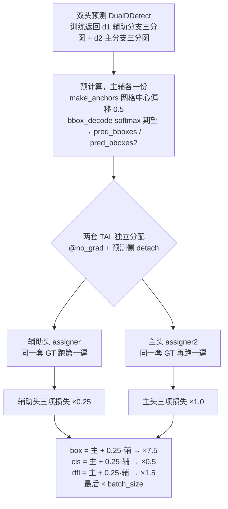

# YOLOv9 损失函数

::: tip 只想带走三件事
1. **三分量与 v8 完全同构**：`loss = [box, cls, dfl]`——CIoU 回归 + 软标签 BCE 分类 + DFL 分箱回归，增益 7.5 / 0.5 / 1.5，最后 × batch_size；TAL 分配、`target_scores` 软标签、÷Σq 归一这套底座原封不动；
2. **v9 的变化只有一个词：双头**——主头与辅助头各自独立跑一遍 TAL 分配（两个 assigner 实例，topk=10 / α=0.5 / β=6.0），辅助分支输出（d1，cv2/cv3 吃 A3/A4/A5）三项损失全部 ×0.25、主分支输出（d2，cv4/cv5 吃 P3/P4/P5）×1.0：**主分支贡献的梯度是辅助分支的 4 倍**，辅助分支提供 PGI 的辅助监督与额外梯度通路；
3. **lead-head 引导版 `ComputeLossLH` 留档未启用**：主头的分配结果直接给辅助头用（v7 lead-head guided 思路的延续），在 train_dual.py 里被注释掉；hyp 里还有一行 v7 残留的重复键 `dfl: 0.7`，被后面的 `dfl: 1.5` 覆盖。
:::

## 全景图



## 1. 损失总装 三分量与 v8 同构 (`loss-core`)

```python
# utils/loss_tal_dual.py :: ComputeLoss.__call__ —— 总装流程（删节伪代码）
loss = torch.zeros(3, device=self.device)                            # box, cls, dfl
feats = p[1][0] if isinstance(p, tuple) else p[0]                    # 辅助分支三分图（d1，cv2/cv3）
feats2 = p[1][1] if isinstance(p, tuple) else p[1]                   # 主分支三分图（d2，cv4/cv5）

pred_distri, pred_scores = torch.cat(
    [xi.view(feats[0].shape[0], self.no, -1) for xi in feats], 2).split((self.reg_max * 4, self.nc), 1)
pred_distri2, pred_scores2 = torch.cat(
    [xi.view(feats2[0].shape[0], self.no, -1) for xi in feats2], 2).split((self.reg_max * 4, self.nc), 1)

anchor_points, stride_tensor = make_anchors(feats, self.stride, 0.5)
targets = self.preprocess(targets, batch_size, scale_tensor=imgsz[[1, 0, 1, 0]])   # ×imgsz, xywh→xyxy
gt_labels, gt_bboxes = targets.split((1, 4), 2)
mask_gt = gt_bboxes.sum(2, keepdim=True).gt_(0)
pred_bboxes = self.bbox_decode(anchor_points, pred_distri)           # softmax 期望 → dist2bbox
pred_bboxes2 = self.bbox_decode(anchor_points, pred_distri2)         # 主分支同款解码
```

（<SrcLink file="v9:utils/loss_tal_dual.py" :line="170" :end="197" />；`ComputeLoss` 类全文 <SrcLink file="v9:utils/loss_tal_dual.py" :line="106" :end="251" />）

- **先说与 v8 完全同构的部分**：`loss = torch.zeros(3)` 起步、三分量 box/cls/dfl、`make_anchors` 网格中心偏移 0.5、640 输入下 8400 = 6400+1600+400 个位置、`bbox_decode` 把每位置 4×16 的分布 softmax 后对 proj 求期望再 `dist2bbox`（<SrcLink file="v9:utils/loss_tal_dual.py" :line="162" :end="168" />）、`preprocess` 按 batch_idx 填充目标并 `xywh2xyxy`（<SrcLink file="v9:utils/loss_tal_dual.py" :line="147" :end="160" />）——这一整套在 v9 里逐行能对上 v8 的 `Loss.__call__`
- **类名 `ComputeLoss`**：train_dual.py 默认导入它（<SrcLink file="v9:train_dual.py" :line="40" />），实例化在训练主循环前（<SrcLink file="v9:train_dual.py" :line="257" />）；`__init__` 备好 `self.BCEcls = nn.BCEWithLogitsLoss(pos_weight=..., reduction='none')`（<SrcLink file="v9:utils/loss_tal_dual.py" :line="113" />）、两个 assigner（<SrcLink file="v9:utils/loss_tal_dual.py" :line="134" :end="141" />）、两个 BboxLoss（<SrcLink file="v9:utils/loss_tal_dual.py" :line="142" :end="143" />）、`self.proj = torch.arange(m.reg_max)` 即 0..15（<SrcLink file="v9:utils/loss_tal_dual.py" :line="144" />）
- **双头输入从哪来**：yolov9 系列的检测头是 [DualDDetect](/versions/v9/architecture)，`nl = len(ch) // 2`——yolov9-c.yaml 传 6 路输入 `[31, 34, 37, 16, 19, 22]`，前 3 路是辅助分支 A3/A4/A5、后 3 路是主分支 P3/P4/P5（<SrcLink file="v9:models/detect/yolov9-c.yaml" :line="123" />）；训练期 forward 直接返回 `[d1, d2]`（<SrcLink file="v9:models/yolo.py" :line="227" :end="228" />），验证期返回 `(y, [d1, d2])` 元组——`__call__` 开头的 `isinstance(p, tuple)` 就是在区分这两种形态（<SrcLink file="v9:utils/loss_tal_dual.py" :line="172" :end="173" />）
- **头出口通道同 v8**：`no = nc + reg_max*4`、`reg_max = 16` 写在 DualDDetect 构造函数里（<SrcLink file="v9:models/yolo.py" :line="202" :end="203" />），辅助分支 cv2/cv3 与主分支 cv4/cv5 各出一套 64+nc 通道（<SrcLink file="v9:models/yolo.py" :line="209" :end="216" />）
- **与 v8 的三处接口差异**（总装逻辑本体不变）：增益 7.5/0.5/1.5 直接写死在损失文件里（<SrcLink file="v9:utils/loss_tal_dual.py" :line="247" :end="249" />）——v8 是从 default.yaml 读 `self.hyp.box`；BCEcls 带 `pos_weight=cls_pw` 接口（<SrcLink file="v9:utils/loss_tal_dual.py" :line="113" />，hyp 给 1.0 等效无）；`smooth_BCE` 与 `self.balance` 这些 v7 遗产还挂在 `__init__` 里（<SrcLink file="v9:utils/loss_tal_dual.py" :line="14" :end="16" />、<SrcLink file="v9:utils/loss_tal_dual.py" :line="124" />），软标签路径并不使用

> v8 读者路标：v8 的 [Loss 总装](/versions/v8/losses#_1-损失总装-box-cls-dfl-三分量-loss-core) 把分配拆给 TAL、自己只做三分量；v9 沿用同一分工，只是总装要伺候两个头——读完本节你只需要记住「所有计算都变成两份」。旧版对照：[v7 损失函数](/versions/v7/losses)。

## 2. 双头权重 主头 ×1.0 辅助头 ×0.25 (`loss-dual`)

```python
# --- cls loss：辅助分支输出 ×0.25 + 主分支输出全量 ---
# loss[1] = self.varifocal_loss(pred_scores, target_scores, target_labels) / target_scores_sum  # VFL way
loss[1] = self.BCEcls(pred_scores, target_scores.to(dtype)).sum() / target_scores_sum # BCE
loss[1] *= 0.25
loss[1] += self.BCEcls(pred_scores2, target_scores2.to(dtype)).sum() / target_scores_sum2 # BCE

# --- bbox/dfl loss：同一配方、两套 BboxLoss 实例 ---
if fg_mask.sum():
    loss[0], loss[2], iou = self.bbox_loss(pred_distri, pred_bboxes, anchor_points,
                                           target_bboxes, target_scores, target_scores_sum, fg_mask)
    loss[0] *= 0.25
    loss[2] *= 0.25
if fg_mask2.sum():
    loss0_, loss2_, iou2 = self.bbox_loss2(pred_distri2, pred_bboxes2, anchor_points,
                                           target_bboxes2, target_scores2, target_scores_sum2, fg_mask2)
    loss[0] += loss0_
    loss[2] += loss2_

loss[0] *= 7.5  # box gain
loss[1] *= 0.5  # cls gain
loss[2] *= 1.5  # dfl gain
return loss.sum() * batch_size, loss.detach()  # loss(box, cls, dfl)
```

（cls <SrcLink file="v9:utils/loss_tal_dual.py" :line="219" :end="223" />；辅助分支 bbox <SrcLink file="v9:utils/loss_tal_dual.py" :line="226" :end="235" />；主分支 bbox <SrcLink file="v9:utils/loss_tal_dual.py" :line="236" :end="245" />；增益与返回 <SrcLink file="v9:utils/loss_tal_dual.py" :line="247" :end="251" />）

- **总损失的形状**：

$$L = b \cdot \Big[\, 7.5\,\big(L_{box}^{m} + 0.25\,L_{box}^{a}\big) + 0.5\,\big(L_{cls}^{m} + 0.25\,L_{cls}^{a}\big) + 1.5\,\big(L_{dfl}^{m} + 0.25\,L_{dfl}^{a}\big) \Big]$$

  上标 \(m\) 主分支输出（d2）、\(a\) 辅助分支输出（d1），\(b\) 是 batch_size；增益乘在「主+辅」求和之后，展开即等价于 \(7.5 \times L_{box}^m + 7.5 \times 0.25\,L_{box}^a\)。**主头的有效权重是辅助头的 4 倍**——共享骨干上的梯度由主分支主导，辅助分支以 0.25 权重提供 PGI 的辅助监督与额外梯度通路，这正是 PGI 论文「用辅助分支规划主分支梯度」的训练面落地
- **辅助头为什么留 0.25 而不是 0**：如果辅助输出完全不进损失，CBLinear 抽头、辅助主干与 cv2/cv3 整段就没有任何梯度来源，PGI 的辅助监督通路形同虚设；0.25 让辅助分支自己的 TAL 分配也参与拉扯共享特征，又不淹没主任务信号——推理时拆掉辅助分支后，主头是在「被辅助监督带教过的特征」上继续按自己的目标收敛
- **两套归一化分母**：辅助头 `target_scores_sum = max(target_scores.sum(), 1)`（<SrcLink file="v9:utils/loss_tal_dual.py" :line="215" />）、主头 `target_scores_sum2 = max(target_scores2.sum(), 1)`（<SrcLink file="v9:utils/loss_tal_dual.py" :line="217" />）——两套分配的正样本质量各归各自的分母
- **目标先拉回 feature 域**：`target_bboxes /= stride_tensor`、`target_bboxes2 /= stride_tensor`（<SrcLink file="v9:utils/loss_tal_dual.py" :line="214" :end="216" />）——匹配在像素域、回归在 feature 域，与 v8 同一口径
- **`fg_mask` 与 `fg_mask2` 可以不同**：主辅两套 TAL 各自选正样本，所以两个 `if fg_mask.sum()` 分支相互独立；`bbox_loss` 返回的第三个值 `iou` 在 `__call__` 里被丢弃（<SrcLink file="v9:utils/loss_tal_dual.py" :line="227" />、<SrcLink file="v9:utils/loss_tal_dual.py" :line="237" />）
- 双头梯度如何经共享骨干回传、CBLinear/CBFuse 的回流路径，见[反向传播推导](/versions/v9/loss-gradient#_1-双头聚合的总梯度-grad-dual)

> v8 读者路标：v8 只有单头，本节是 v9 损失页唯一「全新」的机制。对照 v7 的双头（[v7 损失函数](/versions/v7/losses) 里 aux 与 lead 按层加权 balance），v9 的做法更简单粗暴：整头一个系数，0.25 / 1.0，不再逐层配平。

## 3. BboxLoss CIoU + DFL (`loss-bbox`)

```python
bbox_weight = torch.masked_select(target_scores.sum(-1), fg_mask).unsqueeze(-1)

iou = bbox_iou(pred_bboxes_pos, target_bboxes_pos, xywh=False, CIoU=True)
loss_iou = 1.0 - iou
loss_iou *= bbox_weight
loss_iou = loss_iou.sum() / target_scores_sum
```

（<SrcLink file="v9:utils/loss_tal_dual.py" :line="73" :end="79" />；BboxLoss 类全文 <SrcLink file="v9:utils/loss_tal_dual.py" :line="62" :end="92" />，`_df_loss` <SrcLink file="v9:utils/loss_tal_dual.py" :line="94" :end="103" />）

- **[CIoU loss](/glossary#ciou-loss) 定义与 v8 逐字相同**（[IoU](/glossary#iou-交并比) 系）：

$$\mathrm{CIoU} = \mathrm{IoU} - \frac{\rho^2}{c^2} - \alpha v, \qquad v = \frac{4}{\pi^2}\left(\arctan\frac{w_2}{h_2} - \arctan\frac{w_1}{h_1}\right)^2, \qquad \alpha = \frac{v}{v - \mathrm{IoU} + 1}$$

  实现从 `utils.metrics import bbox_iou`（<SrcLink file="v9:utils/loss_tal_dual.py" :line="8" />），调用时 box1=预测、box2=GT、`xywh=False, CIoU=True`（<SrcLink file="v9:utils/loss_tal_dual.py" :line="75" />）；梯度推导见 [CIoU 的回归梯度](/versions/v9/loss-gradient#_2-ciou-的回归梯度-grad-ciou)
- **weight 就是软标签质量 q**：`target_scores.sum(-1)` 把 nc 维质量压成每 anchor 一个标量（<SrcLink file="v9:utils/loss_tal_dual.py" :line="73" />）——对齐得越好话语权越大，与 v8「target_scores 三用」之二同源
- **与 v8 的写法差异**：v8 用布尔索引 `pred_bboxes[fg_mask]`，v9 用 `masked_select` + view 展平（<SrcLink file="v9:utils/loss_tal_dual.py" :line="70" :end="72" />）——同一语义两种实现；v9 的 BboxLoss 还多返回一个 `iou` 张量
- **DFL 部分同样同构**：`use_dfl` 开关下（<SrcLink file="v9:utils/loss_tal_dual.py" :line="82" />），`pred_dist_pos` 被 view 成 `(正样本数×4, 16)` 的 16-bin logit（<SrcLink file="v9:utils/loss_tal_dual.py" :line="83" :end="84" />），目标由 `bbox2dist(anchor_points, target_bboxes, self.reg_max)` 产出 ltrb（<SrcLink file="v9:utils/loss_tal_dual.py" :line="85" :end="86" />，`reg_max` 传入 15，<SrcLink file="v9:utils/loss_tal_dual.py" :line="142" />）；
- **[DFL](/glossary#dfl-distribution-focal-loss) 双 bin 插值 CE**（<SrcLink file="v9:utils/loss_tal_dual.py" :line="94" :end="103" />）：

$$L_{dfl} = w_l\,\mathrm{CE}(z, t_l) + w_r\,\mathrm{CE}(z, t_r), \qquad t_l = \lfloor t \rfloor,\ \ t_r = t_l + 1,\ \ w_l + w_r = 1$$

  与 v8/v6 逐行同源——只钉真值两侧最近的两个 bin；聚合链 `.mean(-1)` 对 ltrb 四条边平均 → × q → ÷ Σq（<SrcLink file="v9:utils/loss_tal_dual.py" :line="87" :end="88" />）
- **两个实例**：辅助头 `bbox_loss` 与主头 `bbox_loss2` 各一个（<SrcLink file="v9:utils/loss_tal_dual.py" :line="142" :end="143" />）——无状态模块，拆两份只是为了两套正样本互不串扰

> v8 读者路标：v8 的 [BboxLoss 与 CIoU](/versions/v8/losses#_2-bboxloss-与-ciou-loss-ciou) 讲透的「CIoU + DFL、按 q 加权、÷Σq」三件套在 v9 一字未改；唯一要适应的是变量名从 `weight` 变成 `bbox_weight`、布尔索引变成 `masked_select`。

## 4. 分类 BCE 与软标签 (`loss-cls`)

```python
# loss[1] = self.varifocal_loss(pred_scores, target_scores, target_labels) / target_scores_sum  # VFL way
loss[1] = self.BCEcls(pred_scores, target_scores.to(dtype)).sum() / target_scores_sum # BCE
```

（<SrcLink file="v9:utils/loss_tal_dual.py" :line="220" :end="221" />；`self.BCEcls` 定义 <SrcLink file="v9:utils/loss_tal_dual.py" :line="113" />）

- **目标是软标签**：`target_scores = q · one-hot`——one-hot 由 TAL scatter 产出、再乘归一化质量 q（<SrcLink file="v9:utils/tal/assigner.py" :line="175" :end="177" />、<SrcLink file="v9:utils/tal/assigner.py" :line="98" :end="102" />），正类通道目标 \(q \in (0, 1]\)、其余通道 0
- **全 8400 位置都进 BCE**：负位置目标 0、梯度为压制方向——分类一支兼任「是不是物体」，v9 与 v8 一样没有 objectness 分支；主辅两个头各算一份（<SrcLink file="v9:utils/loss_tal_dual.py" :line="221" :end="223" />）
- **v7 的 cls_pw 接口回来了**：`BCEcls` 构造带 `pos_weight=torch.tensor([h["cls_pw"]])`（<SrcLink file="v9:utils/loss_tal_dual.py" :line="113" />）——v8 曾把这个接口删掉，v9 从 v7 代码库继承时带了回来；hyp 给 `cls_pw: 1.0`，权重为 1 等效裸 BCE，梯度与 v8 完全一致
- **`cp / cn`（label smoothing 目标）定义而未用**：`smooth_BCE(eps=h.get("label_smoothing", 0.0))` 在 `__init__` 里跑过（<SrcLink file="v9:utils/loss_tal_dual.py" :line="116" />），但 TAL 软标签路径的目标直接来自 `target_scores`，这对平滑目标没有接入点；`fl_gamma > 0` 时 BCEcls 会被 [FocalLoss](#_7-vfl-与-focal-备选类存而未用-loss-vfl) 包一层（<SrcLink file="v9:utils/loss_tal_dual.py" :line="119" :end="121" />），hyp 默认 0.0
- **÷Σq 归一**：主辅各除各的 `max(sum, 1)`（<SrcLink file="v9:utils/loss_tal_dual.py" :line="215" :end="217" />）

> v8 读者路标：v8 的 [分类 BCE 与软标签](/versions/v8/losses#_4-分类-bce-与软标签-loss-cls) 强调「没有 pos_weight、没有 label smoothing」；v9 因为代码底子是 v7，这两个接口在文件里都在，但默认值让它们全部失效——实际行为与 v8 等价。

## 5. TAL 分配 两套 assigner 各跑各的 (`loss-tal`)

```python
target_labels, target_bboxes, target_scores, fg_mask = self.assigner(
    pred_scores.detach().sigmoid(),
    (pred_bboxes.detach() * stride_tensor).type(gt_bboxes.dtype),
    anchor_points * stride_tensor,
    gt_labels,
    gt_bboxes,
    mask_gt)
target_labels2, target_bboxes2, target_scores2, fg_mask2 = self.assigner2(
    pred_scores2.detach().sigmoid(),
    (pred_bboxes2.detach() * stride_tensor).type(gt_bboxes.dtype),
    anchor_points * stride_tensor,
    gt_labels,
    gt_bboxes,
    mask_gt)
```

（辅助头 <SrcLink file="v9:utils/loss_tal_dual.py" :line="199" :end="205" />；主头 <SrcLink file="v9:utils/loss_tal_dual.py" :line="206" :end="212" />；两个实例定义 <SrcLink file="v9:utils/loss_tal_dual.py" :line="134" :end="141" />）

- **两个独立实例、参数相同**：`TaskAlignedAssigner(topk=os.getenv('YOLOM', 10), alpha=os.getenv('YOLOA', 0.5), beta=os.getenv('YOLOB', 6.0))`（<SrcLink file="v9:utils/loss_tal_dual.py" :line="134" :end="141" />）——与 v8 相同的 topk=10 / α=0.5 / β=6.0，但 v9 可以用环境变量覆盖（v8 是写死的）；类默认 topk=13 仍在（<SrcLink file="v9:utils/tal/assigner.py" :line="52" />）
- **对齐度量**（[TAL](/glossary#tal-task-alignment-learning)）：

$$\mathrm{align\_metric} = s^{\alpha} \times \mathrm{CIoU}^{\beta}, \qquad \alpha = 0.5,\ \beta = 6.0$$

  \(s\) 是 anchor 在 GT 类别通道上的预测分数（<SrcLink file="v9:utils/tal/assigner.py" :line="127" />），CIoU 以 GT 为 box1、预测为 box2 且 `clamp(0)`（<SrcLink file="v9:utils/tal/assigner.py" :line="129" :end="130" />）
- **三重掩码**：`mask_pos = mask_topk × mask_in_gts × mask_gt`（<SrcLink file="v9:utils/tal/assigner.py" :line="116" />）——GT 内（中心点判定，<SrcLink file="v9:utils/tal/assigner.py" :line="8" :end="22" />）× 每 GT 的 topk=10（<SrcLink file="v9:utils/tal/assigner.py" :line="133" :end="154" />）× 有效 GT
- **冲突消解**：`select_highest_overlaps`——一个 anchor 被多个 GT 争抢时 CIoU 最大者胜（<SrcLink file="v9:utils/tal/assigner.py" :line="25" :end="48" />）
- **one-hot 目标与软标签归一**：`F.one_hot(target_labels, self.num_classes)` 后按 fg_mask 过滤（<SrcLink file="v9:utils/tal/assigner.py" :line="175" :end="177" />）；先按每个 GT 自己的最大 align_metric 归一、再乘该 GT 的最大 CIoU、最后跨 GT 取 max（<SrcLink file="v9:utils/tal/assigner.py" :line="98" :end="102" />）→ \(q \in (0, 1]\)
- **主辅各自分配是 v9 的关键设计**：同一批 GT 对两个头的预测各跑一遍 TAL——两套分配各自对齐各自的预测质量、互不绑架；两套 `fg_mask / fg_mask2` 独立进入第 2 节的加权
- **文件组织变化**：v8 的分配器在单文件 `utils/tal.py`；v9（继承 v7 布局）拆成 `utils/tal/` 包——`assigner.py` 加 `anchor_generator.py`（make_anchors / dist2bbox / bbox2dist，<SrcLink file="v9:utils/loss_tal_dual.py" :line="9" />）；forward 的 docstring 明示参考 PPYOLOE 实现（<SrcLink file="v9:utils/tal/assigner.py" :line="63" :end="64" />），与 v8 同源
- 分配全程 `@torch.no_grad()`（<SrcLink file="v9:utils/tal/assigner.py" :line="61" :end="62" />）+ 调用处预测侧 `detach()`——不可微边界的完整推导见 [TAL 分配的不可微边界](/versions/v9/loss-gradient#_6-tal-分配的不可微边界-grad-assign)

> v8 读者路标：v8 的 [TAL 分配进入损失计算](/versions/v8/losses#_5-tal-分配进入损失计算-loss-tal) 里 align_metric、三重掩码、软标签归一的公式可以原样搬过来；v9 唯一的新事实是「跑两遍」——以及 SimOTA（[SimOTA 词条](/glossary#simota)）之后三代分配器「分配挡在 autograd 外」的惯例在这里继续成立。

## 6. ComputeLossLH lead-head 引导版 (`loss-lh`)

```python
# 分配直接用主头的预测来算——lead head guided assigner
target_labels, target_bboxes, target_scores, fg_mask = self.assigner(
    pred_scores2.detach().sigmoid(),
    (pred_bboxes2.detach() * stride_tensor).type(gt_bboxes.dtype),
    anchor_points * stride_tensor,
    gt_labels,
    gt_bboxes,
    mask_gt)
```

（<SrcLink file="v9:utils/loss_tal_dual.py" :line="342" :end="348" />；`ComputeLossLH` 类全文 <SrcLink file="v9:utils/loss_tal_dual.py" :line="254" :end="385" />）

- **与默认版的第一个差别：只分配一次**。`ComputeLossLH.__init__` 只有一个 assigner（<SrcLink file="v9:utils/loss_tal_dual.py" :line="282" :end="285" />）、一个 BboxLoss（<SrcLink file="v9:utils/loss_tal_dual.py" :line="286" />）两个头共用；分配用**主头**的 `pred_scores2 / pred_bboxes2` 跑（<SrcLink file="v9:utils/loss_tal_dual.py" :line="342" :end="348" />），产出的一套 `target_scores / fg_mask` 同时喂主头和辅助头（<SrcLink file="v9:utils/loss_tal_dual.py" :line="355" :end="357" />、<SrcLink file="v9:utils/loss_tal_dual.py" :line="360" :end="379" />）
- **语义**：主分支输出（d2，吃主 FPN/PAN 的 P3/P4/P5）对应推理保留的 lead head，用它算出的分配更贴近最终任务，让辅助头照着主头的判断学正样本——[lead head guided label assigner](/glossary#lead-head-guided-label-assigner-引导头标签分配) 思路（v7 论文提出）在 v9 代码里的延续
- **辅助头损失同样 ×0.25、主头 ×1.0**（<SrcLink file="v9:utils/loss_tal_dual.py" :line="356" />、<SrcLink file="v9:utils/loss_tal_dual.py" :line="368" :end="369" />）、增益同 7.5/0.5/1.5（<SrcLink file="v9:utils/loss_tal_dual.py" :line="381" :end="383" />）——权重结构与默认版一致
- **两个实现细节**：LH 版的 `target_scores_sum = target_scores.sum()` 没有 `max(..., 1)` 防零（<SrcLink file="v9:utils/loss_tal_dual.py" :line="351" />，空图会除零——默认版修了这里）；bbox loss 的第二个条件分支写的仍是 `if fg_mask.sum():`（<SrcLink file="v9:utils/loss_tal_dual.py" :line="370" />，因为只有一套分配，两处条件必然同值）

| 维度 | ComputeLoss（默认启用） | ComputeLossLH（留档） |
|------|--------------------------|------------------------|
| assigner 数量 | 2 个，主辅各分配一次 | 1 个，用主头预测分配一次 |
| 分配依据 | 各自的预测 | 主头的预测 |
| BboxLoss 实例 | 2 个 | 1 个共用 |
| 辅助头权重 | ×0.25 | ×0.25 |
| 归一化分母 | `max(sum, 1)` ×2 | `sum()` 无防零 |
| 快照状态 | train_dual.py L40 导入 | train_dual.py L41-42 注释掉 |

- **快照状态**：train_dual.py 只启用 `ComputeLoss`（<SrcLink file="v9:train_dual.py" :line="40" />），`ComputeLossLH` 与 `ComputeLossLHCF` 的导入被注释（<SrcLink file="v9:train_dual.py" :line="41" :end="42" />）；且注释里提到的 `ComputeLossLHCF` 类在快照文件里并不存在——文件里只有 `ComputeLoss` 与 `ComputeLossLH` 两个损失类，coarse-for-lead 版本没有随这份开源发布

> v8 读者路标：v8 没有双头，无对应物；读过 [v7 tricks 的 lead head 词条](/versions/v7/tricks) 的话，本节就是那个概念的 TAL 化改写——v7 在 assigner 里做引导，v9 把引导收紧成「直接借用主头的分配结果」。

## 7. VFL 与 Focal 备选类存而未用 (`loss-vfl`)

```python
class VarifocalLoss(nn.Module):
    def forward(self, pred_score, gt_score, label, alpha=0.75, gamma=2.0):
        weight = alpha * pred_score.sigmoid().pow(gamma) * (1 - label) + gt_score * label
        with torch.cuda.amp.autocast(enabled=False):
            loss = (F.binary_cross_entropy_with_logits(pred_score.float(), gt_score.float(),
                                                       reduction="none") * weight).sum()
        return loss
```

（<SrcLink file="v9:utils/loss_tal_dual.py" :line="19" :end="29" />；FocalLoss <SrcLink file="v9:utils/loss_tal_dual.py" :line="32" :end="59" />；smooth_BCE <SrcLink file="v9:utils/loss_tal_dual.py" :line="14" :end="16" />）

- **[VarifocalLoss](/glossary#varifocalloss-vfl) 与 v6/v8 逐行同源**：正样本（label=1）权重 = gt_score、负样本权重 = \(\alpha\,\sigma(z)^\gamma\)——快照里定义了但没有任何调用点，只在 `__call__` 的注释里留档 `# VFL way`（<SrcLink file="v9:utils/loss_tal_dual.py" :line="220" />）
- **FocalLoss 是活的但默认关**：`g = h["fl_gamma"]`，`g > 0` 时把 BCEcls 包成 FocalLoss（<SrcLink file="v9:utils/loss_tal_dual.py" :line="119" :end="121" />）——hyp.scratch-high.yaml 给 `fl_gamma: 0.0`（<SrcLink file="v9:data/hyps/hyp.scratch-high.yaml" :line="17" />），出厂即关闭
- **为什么被 BCE 上位**：与 v8 同理——软标签已把质量写进目标 q，再叠 VFL 属于双重加权；裸 BCE 配 ÷Σq 的归一化让三个分量口径统一

| 维度 | VarifocalLoss（v6 用） | v9 检测实际（BCE 软标签） |
|------|------------------------|---------------------------|
| 质量去哪 | 乘在正样本损失上 | 写进目标 q + 归一化分母 |
| 正样本目标 | 硬 1，权重 gt_score | 软 q，目标本身就是质量 |
| 负样本降权 | \(\alpha\sigma^\gamma\) | 无（梯度就是 \(\sigma(z)\)） |
| 归一化 | `.sum()` | `.sum() / Σq`（主辅各一套） |

> v8 读者路标：v8 的 [VarifocalLoss 存而未用](/versions/v8/losses#_6-varifocalloss-存而未用-loss-vfl) 表格在本节原样成立；v9 多出来的只是 FocalLoss 这条「fl_gamma 大于零才生效」的活开关——它来自 v7 代码库，v8 里没有这一层包装。

## 8. hyp 超参 增益与 v7 残留键 (`loss-hyp`)

```yaml
# data/hyps/hyp.scratch-high.yaml（损失相关节选）
box: 7.5    # box loss gain            ← L8
cls: 0.5    # cls loss gain            ← L9
cls_pw: 1.0 # cls BCELoss positive_weight  ← L10
dfl: 0.7    # obj loss gain (scale with pixels)  ← L11：v7 残留重复键，注释口径还是 obj
obj_pw: 1.0 # obj BCELoss positive_weight        ← L12：v7 残留，v9 无 objectness 分支
dfl: 1.5    # dfl loss gain            ← L13：同名键后值覆盖，实际生效 1.5
```

（<SrcLink file="v9:data/hyps/hyp.scratch-high.yaml" :line="8" :end="13" />；完整超参表见[训练技巧页](/versions/v9/tricks#_2-数据增强-高强度包与-close-mosaic-trick-aug)）

- **`dfl: 0.7` 是 v7 hyp 的复制残留**：L11 的注释还写着「obj loss gain (scale with pixels)」——v7 时代这一行是 `obj` 增益；迁到 v9 时改键名为 `dfl` 却忘了删旧行，于是出现同名键。`yaml.safe_load` 对同名键保留**后出现的值**，所以实际生效的是 L13 的 **1.5**，与损失文件里 `loss[2] *= 1.5` 的注释互相印证（<SrcLink file="v9:utils/loss_tal_dual.py" :line="249" />）
- **损失代码真正读取的 hyp 键**：`box` / `cls` / `dfl` 三个增益虽然在文件里写死，hyp 的同名键只是文档作用；实际读的是 `cls_pw`（<SrcLink file="v9:utils/loss_tal_dual.py" :line="113" />）、`fl_gamma`（<SrcLink file="v9:utils/loss_tal_dual.py" :line="119" />）、`label_smoothing`（<SrcLink file="v9:utils/loss_tal_dual.py" :line="116" />，来自 CLI `--label-smoothing` 注入）
- **v7 残留键清单**：`cls_pw` / `obj_pw`（<SrcLink file="v9:data/hyps/hyp.scratch-high.yaml" :line="10" :end="12" />）、`iou_t` / `anchor_t`（<SrcLink file="v9:data/hyps/hyp.scratch-high.yaml" :line="14" :end="15" />）、注释掉的 `anchors`（<SrcLink file="v9:data/hyps/hyp.scratch-high.yaml" :line="16" />）——anchor-free 之后 `iou_t / anchor_t / anchors` 都没有消费方，`anchor_t` 还在 train_dual.py 里被硬编码重设一遍（<SrcLink file="v9:train_dual.py" :line="70" />）
- **增益口径与 v8 对齐**：7.5 / 0.5 / 1.5 三分量的相对比例与 v8 default.yaml 完全一致——v9 损失端的调参手感可以从 v8 无损迁移；双头 0.25/1.0 的内层权重不在 hyp 里、不可调

> v8 读者路标：v8 读 [default.yaml](/versions/v8/tricks#_5-训练默认超参-trick-hparams) 时增益有类型校验的配置体系；v9 回到 v7 式「yaml 手写 + 代码写死」——读超参时先看损失文件里的硬编码，再回 hyp 找对应键，注意重复键以后值为准。

## 与其他页的链接

- [反向传播推导](/versions/v9/loss-gradient)
- [训练技巧](/versions/v9/tricks)
- [架构解析](/versions/v9/architecture)
- [v8 损失函数（对比）](/versions/v8/losses)
- [v7 损失函数（对比）](/versions/v7/losses)
- [术语表](/glossary)
