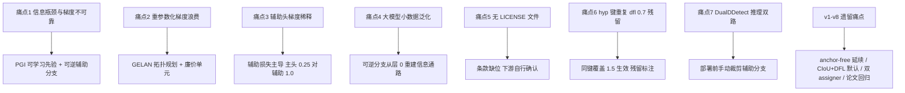

# YOLOv9 痛点追踪

YOLOv9（Wang 等人，论文 arXiv:2402.13616，2024-02-21 发布；本站快照 WongKinYiu/yolov9 main @ 7d639b1，2024-02-19——论文发布前两天的代码状态）带着**正式论文**回归 v7 代码库的目录结构，打出 PGI（Programmable Gradient Information）与 GELAN 两张牌：前者直指"反向传播的梯度是否可靠"，后者主张"梯度路径要拓扑规划"。本页先追踪 **v9 自己暴露的 7 个痛点**（4 个命题级新痛点 + 3 处快照遗留），再把 v1-v8 全部痛点在 v9 的状态一次盘完，最后给出痛点谱系图。

## 7 个痛点全景

> 已读过 [v7](/versions/v7/painpoints)/[v8](/versions/v8/painpoints) 的痛点页？v8 的痛点是"工程化默认的代价"，v9 的痛点回到**训练机制本身**——前四个全是冲着梯度来的，后三个是快照里肉眼可见的不干净。

| 痛点 | 严重度 | 后续回应 |
| --- | --- | --- |
| [1. 信息瓶颈与梯度不可靠](#_1-信息瓶颈与梯度不可靠-pain-info-bottleneck) | High | PGI：可学习先验 + 可逆辅助分支 |
| [2. 重参数化的梯度浪费与拓扑规划](#_2-重参数化的梯度浪费与拓扑规划-pain-reparam-topology) | Medium | GELAN：拓扑规划 + 廉价单元，gelan-c 作消融基线 |
| [3. 辅助头梯度稀释](#_3-辅助头梯度稀释-pain-aux-gradient-dilution) | High | 辅助损失主导：主头 ×0.25、辅助头 ×1.0 |
| [4. 大模型小数据泛化](#_4-大模型小数据泛化-pain-large-model-small-data) | Medium | PGI 可逆分支重建浅层信息通路 |
| [5. 无 LICENSE 文件](#_5-无-license-文件-pain-license-missing) | High | 无解；下游集成前自行确认上游许可状态 |
| [6. hyp 键重复与 v7 残留](#_6-hyp-键重复与-v7-残留-pain-hyp-residue) | Low | 本站按 yaml 覆盖语义以 1.5 口径讲解 |
| [7. DualDDetect 推理仍输出双路](#_7-dualddetect-推理仍输出双路-pain-dual-inference-output) | Medium | 部署前手动裁剪辅助分支，导出自证 |

## 1. 信息瓶颈与梯度不可靠 (`pain-info-bottleneck`)

**现状**：论文核心命题——网络加深后，前向逐层压缩信息（信息瓶颈），反向传播时浅层收到的梯度来自深层"已经丢掉部分信息的表征"，**未必还能正确指导浅层学出想要的答案**（what you want to learn）。此前所有加深加宽的堆料路线都默认"深层梯度回传浅层即可"，没有机制保证其可靠性。v9 的回应是 PGI，代码落点两处：可学习先验 [ImplicitA](/versions/v9/source/common-py#L605-L613)/[ImplicitM](/versions/v9/source/common-py#L616-L624)（<SrcLink file="v9:models/common.py" :line="605" :end="624" />，v7 YOLOR 隐式知识的复用），以及**多级可逆辅助分支**——CBLinear 从骨干抽头、CBFuse 逐级回注（<SrcLink file="v9:models/detect/yolov9-c.yaml" :line="81" :end="116" />，见 [yolov9-c.yaml 源码页](/versions/v9/source/yolov9-c-yaml)）。

**影响**：这不是"精度不够"的结果性痛点，而是"训练机制是否可信"的机制性痛点——射程覆盖整个 YOLO 谱系的加深加宽史。论文据此把 YOLOv9-S/E 推到 46.8%/55.6% AP（README 口径，COCO val 640；全部四档指标见下方延续性痛点表 v8 行的消融说明与本站各指标页标注）。

**路标**：v7 的 E-ELAN 已经在"梯度路径多样性"上做文章（见 [v7 痛点 1](/versions/v7/painpoints#_1-anchor-based-路线与同期-anchor-free-分道扬镳-pain-anchor-route-split) 的反面），v9 把命题升级成"梯度**可靠性**"。本节 v7/v8 读者只需关注：ImplicitA/ImplicitM 是 v7 遗产的原样复用，真正的新东西是 CBLinear/CBFuse 那条辅助分支。

## 2. 重参数化的梯度浪费与拓扑规划 (`pain-reparam-topology`)

**现状**：v6/v7 的重参数化是"训练态多分支、推理态融合单路"，但**训练态哪条分支的梯度值得花算力，没有规划**——RepConv 的三分支（3×3、1×1、条件 identity）是逐块局部决定。GELAN 的回应是把分支预算挪到**拓扑层**：RepNCSPELAN4 用两级串联的 RepNCSP（cv2 的输出喂给 cv3），4 路 concat 收束（<SrcLink file="v9:models/common.py" :line="580" :end="598" />）——对比 v8 的 C2f 是 n 个 Bottleneck 逐级并联全拼接（n+2 路），GELAN 只保留两条串联支路的梯度路径。

**影响**：同样走"训练多分支 → 推理融合"，GELAN 把钱花在拓扑而不是单元内部；且仓库给出 `gelan-c.yaml`（无辅助分支的 GELAN 基线）与 `yolov9-c.yaml`（完整版）两档配置，涨点可以拆成"GELAN 结构"与"PGI 辅助"两笔账——这是 v6/v7 重参数化路线从未提供过的消融接口。

**路标**：v6 [痛点 1](/versions/v6/painpoints#_1-重参数化只利好推理-训练期三分支显存-计算开销-pain-reparam-train-cost)（训练期开销）与 v7 [痛点 2](/versions/v7/painpoints#_2-repconvn-论文命名与快照条件-identity-实现漂移-pain-repconvn-drift)（RepConvN 命名漂移）在此收口——v9 快照里 RepConvN 以独立类真实存在（<SrcLink file="v9:models/common.py" :line="86" :end="111" />），v7 论文里的命名这次落地了。本节 v7/v8 读者只需关注：RepConvN 与 v7 RepConv 的差异只在命名与 BN 分支的组织方式。

## 3. 辅助头梯度稀释 (`pain-aux-gradient-dilution`)

**现状**：v7 已有 aux head，但只是 gain 加权，辅助监督强度仍弱于主头——浅层参数从辅助路收到的梯度被"稀释"。v9 直接反转权重：cls loss = 主头 ×0.25 + 辅助头 ×1.0（<SrcLink file="v9:utils/loss_tal_dual.py" :line="221" :end="223" />），box/dfl 主头同样 ×0.25（<SrcLink file="v9:utils/loss_tal_dual.py" :line="234" :end="235" />）、辅助头全量（<SrcLink file="v9:utils/loss_tal_dual.py" :line="244" :end="245" />）——**辅助头损失权重是主头的 4 倍**。且主头/辅助头各配一个独立 TAL assigner（<SrcLink file="v9:utils/loss_tal_dual.py" :line="134" :end="141" />），同一套 GT 各分配一遍（<SrcLink file="v9:utils/loss_tal_dual.py" :line="199" :end="212" />），互不共享正样本集合。

**影响**：辅助头从"训练期附赠"变成"训练期主体"，主头反而像收口出口——稀释问题从根上重排。代价同样明显：两套 cv 分支 + 两遍 TAL 分配 + 两套 BboxLoss，显存与训练时长显著上升；且推理侧输出仍带双路（见 [痛点 7](#_7-dualddetect-推理仍输出双路-pain-dual-inference-output)）。

**路标**：v7 [痛点 5](/versions/v7/painpoints#_5-aux-head-训练成本与双入口复杂度-pain-aux-train-cost)（aux head 训练成本与双入口）在 v9 **不降反升**——v9 的回应是收益论证而非成本削减：train.py/train_dual.py 双入口结构原样保留。本节 v7 读者只需关注：权重从"辅助弱于主"到"辅助主导"这一个数字的翻转。

## 4. 大模型小数据泛化 (`pain-large-model-small-data`)

**现状**：YOLOv9-E 58.1M 参数对着 COCO 一个数据集训练，大模型小数据的过拟合与"深层表征遗忘浅层"风险高。PGI 的可逆辅助分支让训练期重建"从输入到输出的完整信息通路"（yolov9-c.yaml 从层 0 的 Silence 重新过一遍 Conv/RepNCSPELAN4 生成辅助特征，<SrcLink file="v9:models/detect/yolov9-c.yaml" :line="89" :end="95" />），等价于给浅层装上防遗忘的梯度锚——论文据此主张小数据下大模型可训。

**影响**：这条命题把"数据效率"而非"算力效率"立为卖点；但所有消融证据都产自 COCO，"可逆分支提升泛化"在其他数据集上未证，命题的外推边界要如实标注。

**路标**：v8 [痛点 8](/versions/v8/painpoints#_8-anchor-free-路线收敛的证据边界-pain-route-convergence)（证据边界）的延续——v9 有论文级消融补强，但本站仍不替论文下结论。本节 v7/v8 读者只需关注：辅助分支的输入锚点是层 0（Silence），这正是 yaml 里那个恒等层存在的唯一理由。

## 5. 无 LICENSE 文件 (`pain-license-missing`)

**现状**：快照仓库根目录**没有 LICENSE 文件**（本站快照口径，100 个文件里没有许可文本）。论文与代码照常发布，但许可条款没有落盘——对比 v8 每个源码文件头都带 AGPL 标记，v9 是零标记。

**影响**：下游引用与商用比 v8 的 AGPL-3.0 更不确定：v8 至少"条款已知、按条款评估"，v9 是"条款缺位"——严格说在补上许可前，默认按作者保留所有权利理解最稳妥。集成前只能去仓库/论文页确认当时的许可状态。

**路标**：承接 [v8 痛点 2](/versions/v8/painpoints#_2-agpl-3-0-许可收紧-pain-agpl) 的许可话题，但性质从"条款收紧"变成"条款缺位"。本站不构成法律意见；快照行号引用与源码学习不受影响。

## 6. hyp 键重复与 v7 残留 (`pain-hyp-residue`)

**现状**：`data/hyps/hyp.scratch-high.yaml` L11 有一条 `dfl: 0.7`，注释还是 v7 时代的 "obj loss gain (scale with pixels)"（<SrcLink file="v9:data/hyps/hyp.scratch-high.yaml" :line="11" :end="13" />）——L13 才是真正的 `dfl: 1.5`。yaml 同名键后者覆盖，实际生效 1.5，但 0.7 像个幽灵键躺在文件里。这是 v7 代码库 fork 的直接痕迹：v9 连 v7 的超参文件残留一起继承。

**影响**：按注释理解超参会得出错误语义（0.7 与 obj gain 无关）；跨 hyp 文件 diff 或脚本改键时，重复键会静默吞掉前面的值；检索资产（博客、issue）里若有人引用 0.7，读者难以分辨对错。

**路标**：v3 [痛点 7](/versions/v3/painpoints#_7-快照事实-truth-thresh-1-监督分支是死代码-pain-truth-thresh-dead)（truth_thresh 死代码）同类的"配置残留"问题。本站 [loss_tal_dual.py 源码页](/versions/v9/source/loss-tal-dual-py) 一律按 1.5 口径讲解，并在此处明确标注残留。路标，不是对 fork 策略的批评。

## 7. DualDDetect 推理仍输出双路 (`pain-dual-inference-output`)

**现状**：DualDDetect 的推理分支把主路、辅助路**一起**返回：`y = [主, 辅]`（<SrcLink file="v9:models/yolo.py" :line="237" :end="238" />）。紧随其后的注释代码 L239-244 显示作者试过"只留辅助路"（`y = torch.cat((dbox2, cls2.sigmoid()), 1)` 后 `return (y, d2)`）再改回双路——辅助主导训练，推理接口却把辅助路也带到部署端。

**影响**：部署导出（ONNX/TensorRT）必须自证只取主路 `y[0]`，否则输出维度翻倍直接报错；更隐蔽的是辅助分支的 CBLinear/CBFuse/Conv 各层在推理图里仍然存活——参数量与 FLOPs 存在"训练图"与"部署图"两个口径，README 表的 25.5M/102.8G（YOLOv9-C）属于哪个口径，代码没有写死。

**路标**：v7 [痛点 5](/versions/v7/painpoints#_5-aux-head-训练成本与双入口复杂度-pain-aux-train-cost) 的另一半（双入口复杂度）在推理侧的延续——论文主张"辅助分支部署期零成本"的前提是**手动裁剪**，仓库本身不提供这步。详见 [models/yolo.py 源码页](/versions/v9/source/yolo-py) 的 DualDDetect 卡片。

## 延续性痛点：v1-v8 各痛点在 v9 的状态

> 已读过 [v8](/versions/v8/painpoints) 的"承接 v7 痛点"表？那张表只回看 v7 一代；v9 把 v1-v8 全谱系 56 个痛点一次盘完。状态列只做速查，叙事见上文 1-7 节；"未回应"指 v9 快照没有针对性代码或论文主张，不代价值判断。

| 版本 | 痛点 | v9 的状态 |
| --- | --- | --- |
| v1 | [1. 小目标召回差](/versions/v1/painpoints#_1-小目标召回差-pain-small-object-recall) | 三尺度延续；辅助分支给浅层补可靠梯度（PGI 主张） |
| v1 | [2. 边界框定位粗糙](/versions/v1/painpoints#_2-边界框定位粗糙-pain-boundary-box-accuracy) | CIoU + DFL 已成默认（v6-v8 引入，v9 沿用） |
| v1 | [3. 相似形状混淆](/versions/v1/painpoints#_3-相似形状混淆-pain-similar-shape) | 无专项回应；PGI 主张整体改善梯度质量 |
| v1 | [4. NMS 阈值敏感](/versions/v1/painpoints#_4-nms-阈值敏感-pain-nms-threshold-sensitive) | 未回应，仍 greedy NMS |
| v1 | [5. Anchor 敏感性](/versions/v1/painpoints#_5-anchor-敏感性-pain-anchor-sensitive) | anchor-free 已根治（v6-v8），v9 双头无 anchor 张量 |
| v1 | [6. 两阶段方法太慢](/versions/v1/painpoints#_6-两阶段方法太慢-pain-two-stage-latency) | 历史问题已了；v9 以 GELAN 廉价单元继续压参数与 FLOPs |
| v2 | [1. 单尺度检测头：小目标仍然弱](/versions/v2/painpoints#_1-单尺度检测头-小目标仍然弱-pain-single-scale-head) | FPN+PAN 三尺度，延续已解决状态 |
| v2 | [2. 定位仍无 IoU 直接梯度](/versions/v2/painpoints#_2-定位仍无-iou-直接梯度-pain-no-iou-gradient) | CIoU + DFL 已根治 |
| v2 | [3. Softmax 类别头限制多标签](/versions/v2/painpoints#_3-softmax-类别头限制多标签-pain-softmax-single-label) | BCE 独立 sigmoid 已默认 |
| v2 | [4. Anchor 先验依赖数据集](/versions/v2/painpoints#_4-anchor-先验依赖数据集-pain-anchor-dataset-bias) | anchor-free 已根治 |
| v2 | [5. 快照 bug：test_yolo 残留强转](/versions/v2/painpoints#_5-快照-bug-test-yolo-残留-detection-layer-强转-pain-test-yolo-cast-bug) | darknet C 代码已不复存在 |
| v2 | [6. 快照 hack：DOABS 坐标系](/versions/v2/painpoints#_6-快照-hack-doabs-坐标系-pain-doabs-hack) | PyTorch 实现无此约束 |
| v2 | [7. WordTree 层级分类复杂](/versions/v2/painpoints#_7-wordtree-层级分类复杂-pain-wordtree-complexity) | 路线已消亡 |
| v2 | [8. NMS 阈值敏感（遗留自 v1）](/versions/v2/painpoints#_8-nms-阈值敏感-遗留自-v1-pain-nms-threshold) | 未回应 |
| v3 | [1. AP75 弱：坐标损失仍无 IoU 直接梯度](/versions/v3/painpoints#_1-ap75-弱-坐标损失仍无-iou-直接梯度-pain-no-iou-gradient) | CIoU + DFL 已根治 |
| v3 | [2. 大目标召回弱](/versions/v3/painpoints#_2-大目标召回弱-pain-large-object-weak) | 多尺度 + PANet 延续 |
| v3 | [3. GT 单 anchor 独占，正样本极度稀疏](/versions/v3/painpoints#_3-gt-单-anchor-独占-正样本极度稀疏-pain-sparse-positives) | TAL topk 多正样本已默认（v6-v8） |
| v3 | [4. Anchor 先验依赖数据集](/versions/v3/painpoints#_4-anchor-先验依赖数据集-pain-anchor-dataset-bias) | anchor-free 已根治 |
| v3 | [5. 快照 bug：test_yolo 用未初始化的 l.side](/versions/v3/painpoints#_5-快照-bug-test-yolo-用未初始化的-l-side-pain-test-yolo-side-bug) | 已不复存在 |
| v3 | [6. 快照事实：坐标 delta 缺 σ′，损失是 BCE/MSE 混合体](/versions/v3/painpoints#_6-快照事实-坐标-delta-缺-σ′-损失是-bce-mse-混合体-pain-mixed-gradient-semantics) | BCE + CIoU + DFL 语义统一，混合梯度语义成历史 |
| v3 | [7. 快照事实：truth_thresh=1 监督分支是死代码](/versions/v3/painpoints#_7-快照事实-truth-thresh-1-监督分支是死代码-pain-truth-thresh-dead) | 已不复存在；同类"配置残留"见 [痛点 6](#_6-hyp-键重复与-v7-残留-pain-hyp-residue) |
| v3 | [8. NMS 阈值敏感（遗留自 v1）](/versions/v3/painpoints#_8-nms-阈值敏感-遗留自-v1-pain-nms-sensitive) | 未回应 |
| v4 | [1. AP75 仍落后 EfficientDet](/versions/v4/painpoints#_1-ap75-仍落后-efficientdet-pain-ap75-gap) | CIoU + DFL 已根治；README 口径 YOLOv9-C AP75 57.8% |
| v4 | [2. Anchor 仍是手工超参](/versions/v4/painpoints#_2-anchor-仍是手工超参-pain-anchor-manual) | anchor-free 已根治 |
| v4 | [3. Mosaic 训练初期不稳定](/versions/v4/painpoints#_3-mosaic-训练初期不稳定-pain-mosaic-unstable) | close_mosaic 延续（README 命令 `--close-mosaic 15`） |
| v4 | [4. 代码复杂度高（trick 堆叠）](/versions/v4/painpoints#_4-代码复杂度高-trick-堆叠-pain-code-complexity) | 复杂度回升：fork v7 代码库 + train/val 各双入口 |
| v4 | [5. 快照事实：SAT 代码就绪但未启用](/versions/v4/painpoints#_5-快照事实-sat-代码就绪但未启用-pain-sat-not-enabled) | 未回应 |
| v4 | [6. 快照事实：DIoU-NMS 代码就绪但用 greedy](/versions/v4/painpoints#_6-快照事实-diou-nms-代码就绪但用-greedy-pain-diou-nms-not-used) | 未回应，仍 greedy |
| v4 | [7. 快照事实：CIoU 长宽比梯度缺 1/(1+ar²) 因子](/versions/v4/painpoints#_7-快照事实-ciou-长宽比梯度缺-1-1-ar2-因子-pain-ciou-gradient-missing-factor) | 未回应（本站未复核 v9 的 bbox_iou 是否同型） |
| v5 | [1. 无正式论文](/versions/v5/painpoints#_1-无正式论文-pain-no-paper) | v9 带论文回归（arXiv:2402.13616），直接回应 |
| v5 | [2. Focus 部署不友好](/versions/v5/painpoints#_2-focus-部署不友好-pain-focus-deploy) | 无 Focus；Silence 恒等层占位（<SrcLink file="v9:models/common.py" :line="554" :end="558" />） |
| v5 | [3. Anchor 仍存在](/versions/v5/painpoints#_3-anchor-仍存在-pain-anchor-still) | anchor-free 已根治 |
| v5 | [4. CIoU 长宽比梯度缺因子](/versions/v5/painpoints#_4-ciou-长宽比梯度缺因子-pain-ciou-gradient) | 未回应 |
| v5 | [5. 模型 yaml 硬编码三头](/versions/v5/painpoints#_5-模型-yaml-硬编码三头-pain-yaml-hardcode) | 延续逐档独立 yaml：yolov9-c.yaml 无 v8 式 scales 段 |
| v5 | [6. 无 Anchor 可视化工具](/versions/v5/painpoints#_6-无-anchor-可视化工具-pain-anchor-visualization) | 未回应 |
| v6 | [1. 重参数化只利好推理，训练期开销](/versions/v6/painpoints#_1-重参数化只利好推理-训练期三分支显存-计算开销-pain-reparam-train-cost) | 未根治；GELAN 把多分支预算挪到拓扑层（见 [痛点 2](#_2-重参数化的梯度浪费与拓扑规划-pain-reparam-topology)） |
| v6 | [2. DFL 开关复杂，三套语义](/versions/v6/painpoints#_2-dfl-开关复杂-训练-蒸馏-部署三套语义-pain-dfl-switch) | 只增不减：双头各带一套 DFL 与 use_dfl 开关 |
| v6 | [3. 论文与工程实现漂移：SimOTA → TAL](/versions/v6/painpoints#_3-论文与工程实现漂移-simota-→-tal-pain-paper-code-drift) | 论文与快照只差 2 天，同步发布缓解漂移 |
| v6 | [4. 配置系统变成 Python dict](/versions/v6/painpoints#_4-配置系统变成-python-dict-失去-yaml-的语言中立性-pain-python-config) | 回归 yaml + 命令行；但 hyp 重复键残留（见 [痛点 6](#_6-hyp-键重复与-v7-残留-pain-hyp-residue)） |
| v6 | [5. 工业部署栈复杂](/versions/v6/painpoints#_5-工业部署栈复杂-需维护多后端-多精度矩阵-pain-deploy-stack) | 未回应；双路输出又添一道裁剪负担（见 [痛点 7](#_7-dualddetect-推理仍输出双路-pain-dual-inference-output)） |
| v7 | [1. anchor-based 与 anchor-free 分道](/versions/v7/painpoints#_1-anchor-based-路线与同期-anchor-free-分道扬镳-pain-anchor-route-split) | 沿 anchor-free 延续；gelan-c.yaml 作消融基线 |
| v7 | [2. RepConvN 论文命名与快照实现漂移](/versions/v7/painpoints#_2-repconvn-论文命名与快照条件-identity-实现漂移-pain-repconvn-drift) | 命名落地：RepConvN 独立成类（<SrcLink file="v9:models/common.py" :line="86" :end="89" />） |
| v7 | [3. objectness 上界约束只存在于论文](/versions/v7/painpoints#_3-decoder-的-objectness-上界约束只存在于论文-pain-decode-obj-cap) | 头无 objectness 输出，延续 v8 口径 |
| v7 | [4. 少 75% 参数的宣称与 Table 1 不符](/versions/v7/painpoints#_4-少-75-参数的宣称与-table-1-不符-pain-75pct-claim) | 论文提供正式消融表；README 另立指标口径 |
| v7 | [5. aux head 训练成本与双入口复杂度](/versions/v7/painpoints#_5-aux-head-训练成本与双入口复杂度-pain-aux-train-cost) | 不降反升：辅助损失主导 ×1.0，双入口保留（见 [痛点 3](#_3-辅助头梯度稀释-pain-aux-gradient-dilution)） |
| v7 | [6. 手工 anchor 的迁移负担](/versions/v7/painpoints#_6-手工-anchor-的迁移负担-pain-manual-anchors) | anchor-free 延续 |
| v7 | [7. V100 测速口径与部署实测不可比](/versions/v7/painpoints#_7-v100-测速口径与部署实测不可比-pain-bench-caliber) | README 指标表无测速列——口径问题换了个缺位形式 |
| v7 | [8. 训练 schedule 与公式细节未核实](/versions/v7/painpoints#_8-训练-schedule-与部分公式细节未核实-pain-unverified-items) | 论文 + hyp 可核；但 hyp 有重复键残留（见 [痛点 6](#_6-hyp-键重复与-v7-残留-pain-hyp-residue)） |
| v8 | [1. 无正式论文 文档即论文](/versions/v8/painpoints#_1-无正式论文-文档即论文-pain-no-paper) | v9 有论文，直接回应 |
| v8 | [2. AGPL-3.0 许可收紧](/versions/v8/painpoints#_2-agpl-3-0-许可收紧-pain-agpl) | 反转成条款缺位：仓库无 LICENSE 文件（见 [痛点 5](#_5-无-license-文件-pain-license-missing)） |
| v8 | [3. 命名漂移 Loss 类与 v8DetectionLoss](/versions/v8/painpoints#_3-命名漂移-loss-类与-v8detectionloss-pain-loss-naming) | ComputeLoss 独立成文件，但 ComputeLoss/ComputeLossLH 两套并存，检索负担仍在 |
| v8 | [4. 目录布局漂移 yolo 子包与 utils 迁移](/versions/v8/painpoints#_4-目录布局漂移-yolo-子包与-utils-迁移-pain-layout-drift) | 布局再度洗牌：回到 v7 式 models/、utils/，与 ultralytics 包互不兼容 |
| v8 | [5. TAL 超参敏感 topk alpha beta](/versions/v8/painpoints#_5-tal-超参敏感-topk-alpha-beta-pain-tal-hparams) | 双 assigner 各一套 topk=10/α=0.5/β=6.0，可经 YOLOM/YOLOA/YOLOB 环境变量覆盖——敏感面 ×2 |
| v8 | [6. 版本 tag 缺口与发布口径](/versions/v8/painpoints#_6-版本-tag-缺口与发布口径-pain-tag-gap) | 本站以快照 commit 7d639b1 为锚；早期 tag 情况未考古 |
| v8 | [7. 指标与测速口径](/versions/v8/painpoints#_7-指标与测速口径-pain-bench-caliber) | README COCO val 640 自报口径延续，且删掉了测速列 |
| v8 | [8. anchor-free 路线收敛的证据边界](/versions/v8/painpoints#_8-anchor-free-路线收敛的证据边界-pain-route-convergence) | 论文给出 gelan-c vs yolov9-c 消融（结构/辅助拆开算账），证据补强 |

## 痛点谱系图

## 延伸阅读

- [YOLOv9 models/common.py 源码页](/versions/v9/source/common-py) — GELAN 与 PGI 积木的逐行证据
- [YOLOv9 models/yolo.py 源码页](/versions/v9/source/yolo-py) — 双头家族与 parse_model 的建网证据
- [YOLOv9 utils/loss_tal_dual.py 源码页](/versions/v9/source/loss-tal-dual-py) — 0.25/1.0 权重不对称的代码落点
- [YOLOv9 models/detect/yolov9-c.yaml 源码页](/versions/v9/source/yolov9-c-yaml) — 可逆辅助分支的结构配置
- [YOLOv8 痛点追踪](/versions/v8/painpoints) — 本页延续性痛点表的直接上文
- [术语表](/glossary) — [ELAN](/glossary#elan-e-elan-高效层聚合)、[RepConvN](/glossary#repconv-repconvn-计划重参数化)、[lead head](/glossary#lead-head-guided-label-assigner-引导头标签分配) 等术语索引
