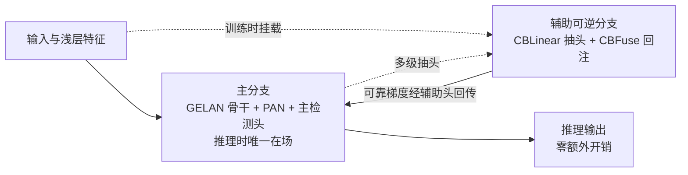

# YOLOv9 论文精读

> **arXiv:2402.13616《YOLOv9: Learning What You Want to Learn Using Programmable Gradient Information》（2024-02-21）**
> 快照取自 [WongKinYiu/yolov9](https://github.com/WongKinYiu/yolov9) main @ `7d639b1`（2024-02-19，比论文发布早两天）。
> 本页回到 v1~v7 的「论文驱动」叙事精读：动机、方法、消融、对比——并处处对照 v8 的「以代码为论文」，看这场学术回归到底回应了什么。

## 1. Motivation：论文与实现同步回归

v4/v7 的原班作者（Chien-Yao Wang、WongKinYiu 等）时隔两年回到 YOLO 主线，此番还有国家高能物理研究所的参与。他们选择在 v8 发布一年后正面回应——不是接续「文档即论文」的产品线叙事，而是把「论文 + 实现同步」重新立为标杆：

- **对「以代码为论文」的回应**：v8 把设计动机散落在文档、博客与 issue 里，消融证据缺位（见 [v8 论文精读](/versions/v8/paper)）。v9 反其道而行：论文标题本身就是一句主张——*Learning What You Want to Learn Using Programmable Gradient Information*——信息瓶颈与梯度可靠性两大命题、PGI/GELAN 两大方法、成套消融全部进论文；
- **快照比论文早两天**：2024-02-19 仓库已可复现全部结果，2024-02-21 论文挂 arXiv——「论文即说明书，代码即证据」两边同时交付，这正是不满「评审周期追不上迭代」的学术团队给出的折中答案；
- **在 v7 的地基上盖楼**：仓库是 YOLOv7 代码库的 fork，目录结构与 v7 相同（models/、utils/、data/），训练脚本沿用 v7 骨架——读 v9 源码时会觉得「一半是 v7」，这不是巧合而是策略：地基可信，改动集中在新方法上。

一句话：v1~v6 是「论文驱动」，v7 是「论文 + 代码双轨」，v8 是「代码驱动」，**v9 把钟摆拉回「论文 + 代码同步」**。

> 已读过 [v7](/versions/v7/paper) / [v8](/versions/v8/paper)？本节 v7/v8 读者只需关注一件事：v9 的叙事立场站在 v7 一侧——v8 没有论文可精读，v9 有，且作者就是当年写 v7 论文的同一批人。

## 2. 发布时间线：快照与论文只差两天

| 时间 | 事件 | 证据 |
|------|------|------|
| 2024-02-19 | 本站快照锚定 main @ `7d639b1`：100 个文件、v7 目录结构、根目录**无 LICENSE 文件**、requirements 为 torch>=1.7.0 | 本站快照 |
| 2024-02-21 | arXiv:2402.13616 发布，副标题即方法名 PGI | [论文页](https://arxiv.org/abs/2402.13616) |

- 三个训练入口分立是 v9 源码的第一眼特征：`train.py`（gelan 单头，`from utils.loss_tal import ComputeLoss`）、`train_dual.py`（yolov9 双头，`from utils.loss_tal_dual import ComputeLoss`<SrcLink file="v9:train_dual.py" :line="40" :end="42" />，注释里还留着 ComputeLossLH/ComputeLossLHCF 两个备选）、`train_triple.py`（三头变体），对应 `val_dual.py` / `val_triple.py`——「几种头型几份脚本」延续 v7 风格，与 v8 的单接口哲学相反；
- 时间线本身说明治理方式：没有 PyPI 持续发版、没有 CITATION.cff，引用锚点就是论文号 + commit hash——学术仓库的运作节奏。

> 已读过 [v7](/versions/v7/paper) / [v8](/versions/v8/paper)？v7 读者会立刻认出这个仓库——目录、脚本、hyp 文件全是 v7 骨架；v8 读者注意这里没有 version 字段与软件引用文件，锚点换成了 commit。

## 3. 两大问题：信息瓶颈与梯度不可靠

论文开篇把深度网络的训练困境归为两条，这也是 PGI 立论的靶子：

1. **信息瓶颈（information bottleneck / loss of information）**：深度网络逐层变换中，输入数据可能丢失大量信息。「能算对答案」与「保留了完整信息」不是一回事——判别能力可以靠深层特征硬补，但被丢掉的信息（小目标、遮挡、密集场景）补不回来。论文的关键词是**可逆性（reversibility）**：若每层变换可逆，信息就不会在前传中流失；而「不可逆 + 越深」意味着丢得越多。
2. **梯度不可靠（unreliable gradient）**：深层网络 + 多分支结构里，梯度从损失出发层层回传，每经过一次不可逆变换就失真一分；用「失真的梯度」更新「深层参数」，网络学到的不是原始目标而是被污染的目标。concat 型网络（v7 ELAN、v8 C2f）缓解了路径多样性问题，但没回答「梯度本身可不可信」。

一句话：v8 关心「怎么把网络搭得能训」，v9 追问「**梯度从哪来、信息往哪去**」——前者是工程命题，后者是学习命题。

> 已读过 [v7](/versions/v7/paper) / [v8](/versions/v8/paper)？v7 的 ELAN 回答的是「梯度路径够不够多」，v8 的 C2f 把它轻量化；v9 说这还不够——路径多不代表信号真，这正是 PGI 要补的那一环。

## 4. PGI：辅助可逆分支 + 多级辅助信息 + 主分支零开销

PGI（Programmable Gradient Information，可编程梯度信息）是论文的方法主体，由三件套组成：

1. **主分支保留推理能力**：主分支可以就是任一现有网络——v9 里是 GELAN 骨干 + PAN + 检测头主路。推理时只留它，部署图与 v8 一样干净；
2. **辅助可逆分支**：训练时挂在主分支旁，用 inverted multibranch（倒置多分支）结构把深层特征逐级注回——思想上借鉴 RevCol 的 reversible columns。v9 的工程落地没有去堆数学上的可逆算子，而是「主干多级抽头（CBLinear 拆通道）+ 辅助主干从头再下采样 + CBFuse 逐尺度融合」：辅助特征同时携带深语义与浅细节，梯度回传时不穿过主分支的信息瓶颈；
3. **多级辅助信息**：辅助不止一处抽头——c 版 3 级路由（骨干 5/7/9 层）<SrcLink file="v9:models/detect/yolov9-c.yaml" :line="81" :end="116" />，e 版 5 级（骨干 1/3/5/7/9 层）<SrcLink file="v9:models/detect/yolov9-e.yaml" :line="45" :end="54" />，按尺度逐级融合而非单点深监督。

- 推理时辅助分支**整段拆除、零开销**——这是 PGI 与深监督/aux-head 类方法的分界：v7 的 IAuxDetect 也在训练期多挂一个头、推理期丢弃，但辅助只发生在检测头层面；v9 把辅助做进**主干路由**（CBLinear/CBFuse 在 common.py 里是独立模块 <SrcLink file="v9:models/common.py" :line="631" :end="650" />）；
- 「可编程」的含义：辅助信息往哪注、注多少（辅助分支输出监督权重 ×0.25、主分支输出全权重 ×1.0）、注几级（c 版 3 级 / e 版 5 级）都是设计旋钮——梯度被当成可编程的资源来调度。

> 已读过 [v7](/versions/v7/paper) / [v8](/versions/v8/paper)？v7 读者从 IAuxDetect 与 lead-head 的「辅助头」经验出发最容易懂 PGI——区别是辅助从「头」下沉到了「主干路由」；v8 读者只需记住：v8 里不存在任何训练期专用分支，v9 把它请了回来并立了「推理可拆除」的新规矩。

## 5. GELAN：把任意计算块当节点的广义 ELAN

GELAN（Generalized ELAN）是论文的架构贡献：

- **从 ELAN 到 GELAN**：v7 的 ELAN 是「Conv 级联 + 隔一取一拼接」的固定积木；GELAN 把它推广为**任意计算块当节点、以设计拓扑聚焦梯度路径规划**——拼什么块、怎么连，都成了显式的设计自由度；
- **落地实例 RepNCSPELAN4**：cv1 出两半，一半直通，另一半先进 cv2（RepNCSP + Conv 3×3）、其输出再进 cv3（RepNCSP + Conv 3×3）——两级级联，最后 4 路 concat 由 cv4 收拢<SrcLink file="v9:models/common.py" :line="580" :end="598" />。对比 C2f 的 n+2 路逐级全拼接，GELAN 是「少拼接路数、让路径跨级联」；
- **消融基线自带在仓库里**：gelan-c.yaml 无辅助分支、单头 DDetect 收 [15, 18, 21]<SrcLink file="v9:models/detect/gelan-c.yaml" :line="79" />——README 的 gelan-c/e 档就是「只有 GELAN 没有 PGI」的对照，yolov9-c/e 再叠 PGI。想复现论文的 GELAN 消融，跑 `train.py --cfg models/detect/gelan-c.yaml` 即可；
- **积木材质是重参数化的**：RepNCSP 内部是 RepNBottleneck（cv1 用 RepConvN）<SrcLink file="v9:models/common.py" :line="299" :end="309" />——训练期多分支、部署期融合，v7 的 planned re-param 手法成为 GELAN 体系默认。

> 已读过 [v7](/versions/v7/paper) / [v8](/versions/v8/paper)？v7 读者把 ELAN 的「固定拼法」想象成被参数化成拓扑选择就是 GELAN；v8 读者对照 C2f：同样是「多路 concat」，C2f 拼接数随深度线性涨（n+2），GELAN 固定 4 路但级联更深。

## 6. 实验要点：指标、消融与 SOTA 对比

**README 指标（COCO val，输入 640）**

| 模型 | AP | AP50 | AP75 | 参数量 M | FLOPs G |
|------|----|------|------|----------|---------|
| YOLOv9-S | 46.8 | 63.4 | 50.7 | 7.2 | 26.7 |
| YOLOv9-M | 51.4 | 68.1 | 56.1 | 20.1 | 76.8 |
| YOLOv9-C | 53.0 | 70.2 | 57.8 | 25.5 | 102.8 |
| YOLOv9-E | 55.6 | 72.8 | 60.6 | 58.1 | 192.5 |

论文的实验叙事围绕三条消融线展开（细节数字以论文 Table 为准，本站只给仓库可复现的口径）：

1. **GELAN vs ELAN**：同等参数预算下，把骨干/neck 的积木从 ELAN 系换成 GELAN 系带来更高 AP——拓扑规划的梯度路径比固定拼法高效；仓库里 gelan 系列配置就是这条线的载体；
2. **PGI 有无**：gelan-c（只有 GELAN）对照 yolov9-c（GELAN + PGI）——辅助分支只在训练期在场，推理零开销白拿增益；这也是「README 里 gelan 与 yolov9 两套命名并存」的原因；
3. **辅助分支深度**：c 版 3 级路由 vs e 版 5 级路由（CBLinear 五级拆分 [64] 到 [64,128,256,512,1024]，CBFuse 五处回注）<SrcLink file="v9:models/detect/yolov9-e.yaml" :line="45" :end="54" />——多级辅助信息是 PGI 内部自己的消融维度。

SOTA 对比面：论文将 v9 与 YOLOv8、v7、RT-DETR 等同台比较，主张以更少参数/FLOPs 取得更高 AP（README 口径：E 档 58.1M 参数、192.5 GFLOPs 拿 55.6 AP）。口径提醒：README 表是 **COCO val 640**，论文对比表另有 test-dev 与不同输入尺度——跨表引用先对口径。

> 已读过 [v7](/versions/v7/paper) / [v8](/versions/v8/paper)？v7 的消融叙事是「逐项白送」（trainable bag-of-freebies 累进），v8 没有论文级消融；v9 回到学术规格——GELAN、PGI、辅助深度三条线各自有对照档，且对照配置全部随仓库发布，可复现性比 v8 强一个量级。

## 7. v8 产品驱动 vs v9 论文回归：对照表

| 维度 | v8（产品驱动） | v9（论文回归） |
|------|----------------|----------------|
| 设计决策存档 | 文档站 + 发布博客 + issue | arXiv 论文（动机/方法/消融/对比） |
| 消融证据 | 无系统消融，设计以「出厂默认值」交付 | 论文 Table 逐项消融：GELAN / PGI / 辅助深度 |
| 创新叙事 | 组合与默认值取舍（TAL/DFL 组装默认化） | 两大命题（信息瓶颈 + 梯度不可靠）+ 两大方法（PGI + GELAN） |
| 版本锚点 | PyPI 持续发版，早期版本无 git tag | 论文号 + commit hash（快照 7d639b1 比论文早两天） |
| 引用方式 | CITATION.cff 软件引用（title "YOLO by Ultralytics"） | 引 arXiv:2402.13616 |
| 仓库治理 | ultralytics 单库多任务持续演进 | YOLOv7 代码库 fork，目录结构与 v7 相同 |
| 训练入口 | 单一 train 接口全任务通用 | train.py / train_dual.py / train_triple.py 三入口分立 |
| 技术默认值 | anchor-free + TAL + DFL 归一 | **全套沿用 v8 默认**，另加双头双分配与主辅加权（主分支输出 ×1.0 / 辅助分支输出 ×0.25） |
| 许可证 | AGPL-3.0 + 商业双轨 | 快照根无 LICENSE 文件（以仓库当前口径为准） |
| 对精读者的启示 | 读代码建动机，查文档定用法 | 读论文建动机、读代码定事实——回到 v1~v7 的节奏 |

**结论**：v9 是对 v8 的一次「学术回应」——你们用文档替代论文，我就证明论文 + 同步开源仍然更有说服力。方法层面它没有推翻 v8 的默认值（anchor-free、TAL、DFL 全部保留），而是在其上叠加了「梯度从哪来」（PGI）与「路径怎么规划」（GELAN）两件 v8 没有回答的事。精读路径建议：先读论文两大命题（本页 §3/§4/§5），再进[理论 Concept](/versions/v9/concepts) 看源码落地，最后用[概览页](/versions/v9/index)的 v8→v9 差异表收束。

## 延伸阅读

- [理论 Concept（PGI/CBLinear/CBFuse/GELAN/双头 10 条）](/versions/v9/concepts)
- [v9 概览（指标表与 v8→v9 差异表）](/versions/v9/index)
- [v8 论文精读（对照「以代码为论文」的完整叙事）](/versions/v8/paper)
- [v7 论文精读（ELAN、lead-head 与 planned re-param 的出身）](/versions/v7/paper)
- [系列家族对照](/global/family) · [术语表](/glossary)
- 官方入口：[arXiv:2402.13616](https://arxiv.org/abs/2402.13616) · [WongKinYiu/yolov9](https://github.com/WongKinYiu/yolov9)
