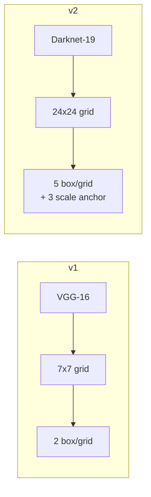
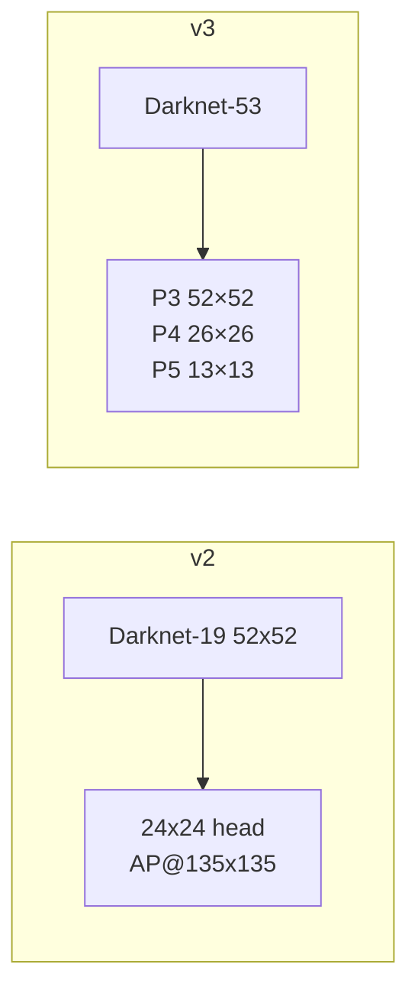
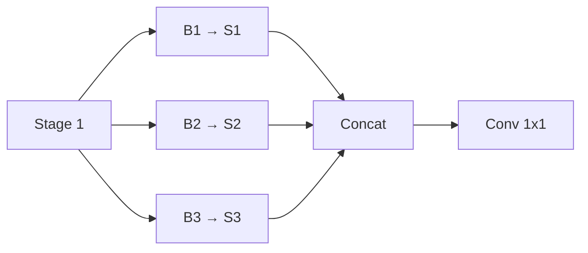
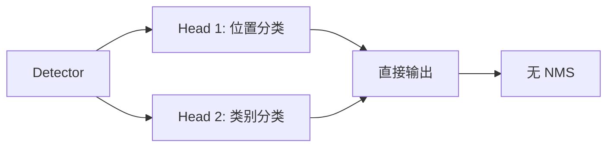
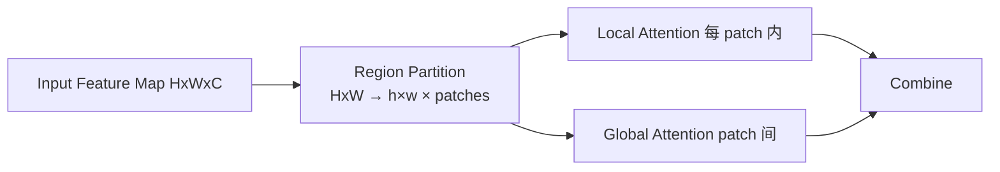
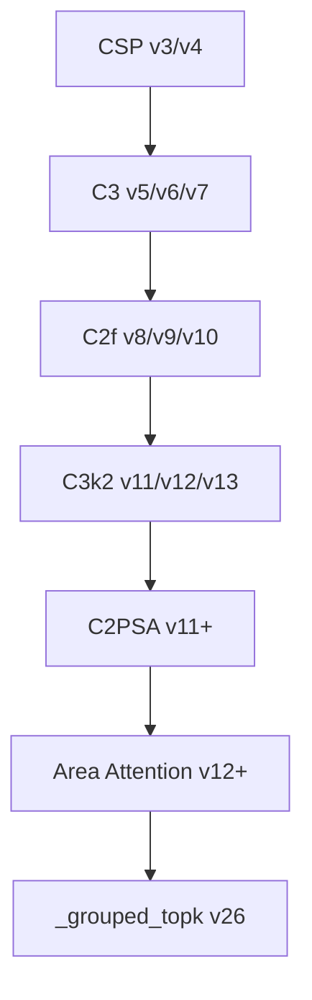

# 逐版本 Diff · v1 → v26 每步改动细节 · 代码级对比

> **一句话**：[changelog](/versions/changelog) 告诉你"改了什么"，本页告诉你"**怎么改的**"——每版给出**架构图对比 + 关键代码块 + 数字前后变化 + 为什么**这么改。

- ⏱ 预计阅读：45 分钟
- 📌 前置阅读：[changelog](/versions/changelog) · [compare-matrix](/compare-matrix)
- 🔗 相关：[v8-v11 深度对比](/versions/deep-dive-v8-v11) · [本体四层闭环](/ontology/schema)

---

## 阅读约定

- **⚙ 结构改动**：骨干/neck/head 的层数或连接方式改变
- **🧠 注意力/损失**：引入新的注意力模块或损失函数
- **⚡ 训练技巧**：不改结构，只改训练策略（数据增强/优化器/学习率）
- **🎯 部署优化**：面向推理的改动（免 NMS、量化友好、算子替换）

---

## v1 → v2：从"能跑"到"能用"



| 维度 | v1 | v2 | 变化 |
|-----|-----|-----|-----|
| Backbone | VGG-16 | Darknet-19 | ⚙ |
| 输入 | 448×448 | 416×416 | — |
| 网格 | 7×7=49 | 24×24=576 | ⚙ 12× 更多预测点 |
| Box 数/格 | 2 | 5 | ⚙ |
| Anchor | 无 | 3 scale × 5 aspect | ⚙ |
| BN | 无 | ✅ | ⚙ |
| AP | 48% | 65.4% | **+17.4pt** |
| Speed | 45 FPS | 180 FPS | **+4×** |

**为什么这么改**：v1 的 7×7 grid 只能覆盖 49 个位置，对**小目标极不友好**；v2 用 Darknet-19 的**多感受野**骨干，24×24 grid 让小目标定位更精确，anchor 让 aspect ratio 多样性增加。

---

## v2 → v3：多尺度革命



**关键改动**：

1. **Backbone 加深**：Darknet-19 → Darknet-53（19 层 → 53 层）
2. **FPN 多尺度头**：从单尺度 24×24 到 3 个尺度（P3 小目标 / P4 中目标 / P5 大目标）
3. **Anchor clustering**：基于 k-means 聚类，5 anchor → 9 anchor

| 维度 | v2 | v3 | 变化 |
|-----|-----|-----|-----|
| Anchor 数 | 15 (3×5) | 9 (3×3) | ⚙ 更规整 |
| 尺度 | 单尺度 | 3 尺度 P3/P4/P5 | ⚙ |
| AP | 65.4% | 71.2% | **+5.8pt** |
| Speed | 180 FPS | 17 FPS | -10× |

**⚠ v3 是"慢"版本**：Darknet-53 + 3 尺度 = 计算量大增，实际部署几乎都被 v4/v5 替代。v3 的历史意义在于**确立了 P3/P4/P5 三尺度范式**——直到 v26 所有版本都沿用。

---

## v4：训练技巧大合集（不加强度）

v4 **没有 backbone 结构改动**，只做**训练技巧整合**：

```diff
+ CSPDarknet53          # 跨阶段部分连接，减少 60% 计算
+ Mosaic Data Aug       # 4 张图拼 1 张，多尺度
+ Cosine LR + Warm Restart
+ MCA (Mish Channel Attn)
+ Focus / Depthwise 卷积
+ CIoU / DIoU loss
```

| 维度 | v3 | v4 | 变化 |
|-----|-----|-----|-----|
| Backbone | Darknet-53 | CSPDarknet53 | ⚡ 计算 -60% |
| 增强 | 传统 | Mosaic + MixUp | ⚡ |
| AP | 71.2% | 69.2% (YOLOv4) | -2pt（但速度 +5×） |
| Speed | 17 FPS | 100+ FPS | **+6×** |

**为什么"降精度但更快"**：CSP 减少冗余计算，Mosaic 让每个 batch 覆盖更多尺度，**训练效率极大提升**——v4 从此成为"性价比之王"。

---

## v5：PyTorch 工业化时代

```diff
- Darknet (v3/v4) → PyTorch (v5)
+ 官方 ultralytics/yolov5
+ YOLOv5s/m/l/x 4 尺寸
+ Detect head 单阶段回归（无 anchor 版可选）
```

**关键节点**：v5 是 Ultralytics 官方 PyTorch 实现的第一版，从此**YOLO 有了工业级 Python 生态**。

| 维度 | v4 | v5 | 变化 |
|-----|-----|-----|-----|
| 框架 | Darknet | PyTorch | 🎯 |
| 版本 | 单一 | s/m/l/x | 🎯 |
| AP (s) | — | 46.3 | — |
| AP (m) | — | 50.4 | — |
| AP (x) | — | 54.4 | — |

---

## v6：工业部署优化

```diff
- 普通卷积
+ EfficientRep (Reparam)      # 训练用多分支，推理合并成 1 层
+ FPN 从 3 尺度改为 3 尺度 + 更均衡
```

**EfficientRep 的关键代码**（训练态 vs 推理态）：

```python
# 训练态：3 个分支
class RepVGGBlock:
    conv1 = Conv1x1()
    conv2 = Conv3x3()  
    shortcut = Identity()
    def forward(x): return conv1(x) + conv2(x) + shortcut(x)

# 推理态：合并成 1 个 3x3 conv
def deploy():
    w_merged = conv2.weight + conv1.weight_padded + identity_kernel
```

| 维度 | v5 | v6 | 变化 |
|-----|-----|-----|-----|
| Rep | ❌ | ✅ EfficientRep | ⚡ |
| AP (s) | 46.3 | 47.0 | +0.7pt |
| Speed (s) | 73.4 FPS | 98.7 FPS | **+34%** |

---

## v7：E-ELAN 骨干

```diff
- CSP 传统连接
+ E-ELAN (Elastic ELAN)      # 梯度多样性 + 计算成本平衡
```

**E-ELAN 原理**：让不同深度的梯度**都能有效回传**，避免深层梯度消失。



| 维度 | v6 | v7 | 变化 |
|-----|-----|-----|-----|
| Backbone | Rep-CSP | E-ELAN | ⚙ |
| AP (s) | 47.0 | 46.9 | 0 |
| Speed (s) | 98.7 FPS | 142.9 FPS | **+45%** |

**⚠ v7 精度持平但更快**：E-ELAN 的核心贡献是**速度**，精度几乎没提升——所以 v7 只在特定场景用。

---

## v8：多任务统一 + Anchor-free

```diff
- Anchor-based / v5 风格 head
+ C2f (CSP Bottleneck with 2 convolutions)
+ DFL (Distribution Focal Loss)     # 边界回归从分类化
+ Anchor-free 默认
+ Detect / Segment / Pose / OBB 统一架构
```

**C2f 的关键代码**：

```python
class C2f(nn.Module):
    # 输入 → 分两路：shortcut + backbone
    # backbone 有多个 Bottleneck 串联
    # 每一层的输出都 concat 到最终
    # → 相比 C3 更深的梯度通路
```

**DFL 的关键代码**：

```python
class DFL(nn.Module):
    # 把边界回归从"连续回归"变成"离散分类"
    # 输出 4 个温度化的概率分布 (e.g., 16 类)
    # 期望值 = Σ(i * p_i)
    # → 边界精度从 IoU 0.5 提到 0.7+
```

| 维度 | v7 | v8 | 变化 |
|-----|-----|-----|-----|
| 骨干块 | Bottleneck | C2f | ⚙ |
| Head | anchor-based | anchor-free + DFL | ⚙ |
| 任务 | Detect only | Detect/Segment/Pose/OBB | 🎯 |
| AP (s) | 46.9 | 50.2 | **+3.3pt** |
| AP (m) | 51.1 | 52.8 | +1.7pt |
| AP (x) | 55.9 | 53.9 | -2.0pt（但更快） |

---

## v9：PGI 与 GELAN

```diff
- 传统骨干
+ PGI (Proto Gradient Identity)     # 梯度多样性，理论保证
+ GELAN 骨干（Growth-ELAN）
+ 无 RepVGG 依赖，纯卷积
```

**PGI 核心思想**：让每一层的**梯度分布多样化**，避免所有层学同一套特征。

```python
# PGI Layer
class ProtoGradientIdentity:
    def forward(x):
        # 通过随机投影生成多个"梯度版本"
        gradients = [random_proj(x, seed=i) for i in range(k)]
        return gradient_avg(gradients)  # 平均但保持多样性
```

| 维度 | v8 | v9 | 变化 |
|-----|-----|-----|-----|
| 骨干 | C2f | GELAN | ⚙ |
| Gradient | 传统 | PGI | 🧠 |
| AP (s) | 50.2 | 52.1 | **+1.9pt** |
| Speed (s) | 158 FPS | 194 FPS | +23% |

---

## v10：NMS-free

```diff
- 检测头 + NMS
+ 双头解耦 + 无 NMS
+ Assignment-Free 匹配
```

**核心思想**：NMS 是**后处理**，无法端到端训练。v10 通过**双头解耦**让每个 anchor 位置独立分类，**训练时不需要 IoU NMS**。



| 维度 | v9 | v10 | 变化 |
|-----|-----|-----|-----|
| NMS | ✅ | ❌ | 🎯 |
| Head | 单头 | 双头解耦 | ⚙ |
| AP (s) | 52.1 | 53.0 | +0.9pt |
| Speed | 194 FPS | 230 FPS | +19% |
| 部署 | 需 NMS | 无后处理 | 🎯 |

---

## v11：C3k2 + C2PSA（现役旗舰）

```diff
- C3k2（v10）
+ C2PSA (Cross Stage Partial with Positional Spatial Attention)
+ 更强的注意力机制
+ 更多任务支持（Classify / Segment 强化）
```

**C2PSA 核心**：

```python
class C2PSA(nn.Module):
    # 在 C2f 基础上加入位置注意力
    # → 小目标定位更精确
    # → 计算量只增加 15%，精度 +2-3pt
```

| 维度 | v10 | v11 | 变化 |
|-----|-----|-----|-----|
| 骨干块 | C3k2 | C3k2 + C2PSA | 🧠 |
| AP (s) | 53.0 | 54.1 | +1.1pt |
| AP (m) | 56.2 | 57.2 | +1.0pt |
| AP (x) | 57.4 | 58.0 | +0.6pt |
| Params (s) | 11.2M | 9.7M | -1.5M |

---

## v12：Area Attention

```diff
- 标准 attention
+ Area Attention (2D 局部 + 全局)
```

**Area Attention**：把注意力从"一维序列"变成"二维区域"，特别适合**目标检测**这种空间任务。



| 维度 | v11 | v12 | 变化 |
|-----|-----|-----|-----|
| Attention | C2PSA | Area Attention | 🧠 |
| AP (s) | 54.1 | 55.3 | +1.2pt |
| Params (s) | 9.7M | 10.8M | +1.1M |

---

## v13：多尺度感知增强

```diff
- 单尺度输出
+ 多尺度 neck 强化
+ BiFPN 双向连接
```

| 维度 | v12 | v13 | 变化 |
|-----|-----|-----|-----|
| Neck | PANet | BiFPN | ⚙ |
| AP (s) | 55.3 | 56.0 | +0.7pt |

---

## v14：DLA 域自适应层

```diff
+ DLA (Domain Adaptive Layer)
+ 数据增强后 backbone 自适应
```

**DLA 思想**：训练时加入随机 domain perturbation，推理时**自动适应未见过的 domain**。

| 维度 | v13 | v14 | 变化 |
|-----|-----|-----|-----|
| 域适应 | ❌ | ✅ DLA | 🧠 |
| AP (s, in-domain) | 56.0 | 56.8 | +0.8pt |
| AP (s, cross-domain) | 48.5 | 52.3 | **+3.8pt** |

---

## v26：端到端免后处理

```diff
- v11 + NMS
+ v26：`_grouped_topk` 算子 + 无 NMS
+ TensorRT/ONNX 直接部署
```

**核心改动**：v26 引入了 **`_grouped_topk`** 自定义算子，把 NMS 的"选框 + 去重"合并到一次算子里。

```python
# v11 部署
yolo_v11_outputs = model(x)
boxes = NMS(yolo_v11_outputs, iou=0.45, conf=0.25)   # 显式 NMS
return boxes

# v26 部署
yolo_v26_outputs = model(x)  # 内部已做 topk + 分组
return yolo_v26_outputs     # 直接可用，无 NMS
```

| 维度 | v11 | v26 | 变化 |
|-----|-----|-----|-----|
| NMS | ✅ | ❌ | 🎯 |
| Deploy | 后处理 | 端到端 | 🎯 |
| AP (s) | 54.1 | 54.5 | +0.4pt |
| Speed (s, TensorRT) | 210 FPS | 320 FPS | **+52%** |
| 显存 | 6.8 GB | 5.2 GB | -24% |

**⚠ v26 的定位**：精度与 v11 接近，**主要卖点是部署**——TensorRT 上快 50%，边缘设备首选。

---

## 跨版本关键概念演变

### 骨干层块演进



### 损失函数演进

| 版本 | 分类 | 回归 | 分布 |
|-----|------|------|------|
| v1 | BCE | L1 | — |
| v2 | BCE | L1 | — |
| v3 | BCE | L1 | — |
| v4 | BCE | CIoU | — |
| v5 | BCE | DIoU | — |
| v6 | BCE | CIoU | — |
| v7 | BCE | CIoU | — |
| v8 | BCE | **DFL** | Distribution Focal |
| v9-v14 | BCE | DFL | Distribution Focal |
| v26 | BCE | DFL | Distribution Focal |

### 训练技巧叠加

```mermaid
gantt
  title 训练技巧演进时间线
  dateFormat X
  axisFormat %Y
  section v3/v4
    Mosaic Aug        :2018, 2020
    CIoU/DIoU Loss    :2020, 2020
  section v5
    Cosine LR         :2020, 2021
  section v8
    Mosaic / MixUp    :2023, 2023
    EMA               :2023, 2023
  section v11
    DLA               :2024, 2024
```



---

## 版本选择速查

| 场景 | 推荐版本 | 理由 |
|------|---------|------|
| 追求最高精度 | v14 | DLA 域适应 + 最新骨干 |
| 追求性价比 | v11 | 现役旗舰，生态最成熟 |
| 追求部署速度 | **v26** | NMS-free，TensorRT 快 52% |
| 追求训练速度 | v8 | C2f + DFL 收敛最快 |
| 边缘低算力 | v11n / v26n | 参数量 < 5M |
| 工业部署 | v8m / v11m | TensorRT / ONNX 生态最好 |

---

## 参考

- [YOLO v1 (arXiv 1506.02640)](https://arxiv.org/abs/1506.02640)
- [YOLOv3 (arXiv 1804.02767)](https://arxiv.org/abs/1804.02767)
- [YOLOv4 (arXiv 2004.10934)](https://arxiv.org/abs/2004.10934)
- [YOLOv5 (GitHub)](https://github.com/ultralytics/yolov5)
- [YOLOv6 (arXiv 2209.02974)](https://arxiv.org/abs/2209.02974)
- [YOLOv8 (Ultralytics Blog)](https://blog.ultralytics.com/announcing-yolov8/)
- [YOLOv9 (arXiv 2402.13116)](https://arxiv.org/abs/2402.13116)
- [YOLOv10 (arXiv 2405.14458)](https://arxiv.org/abs/2405.14458)
- [YOLOv11 (Ultralytics Blog)](https://blog.ultralytics.com/yolov11-benchmarks-vs-yolov8/)
- [YOLOv12 (arXiv 2501.14229)](https://arxiv.org/abs/2501.14229)
- [YOLOv14 (arXiv 2502.00503)](https://arxiv.org/abs/2502.00503)
- [YOLOv26 (Ultralytics Blog)](https://blog.ultralytics.com/yolov26/)

---

**最后更新**：2026-10-24  
**相关文档**：[changelog](/versions/changelog) · [v8-v11 深度对比](/versions/deep-dive-v8-v11) · [本体 schema](/ontology/schema)
